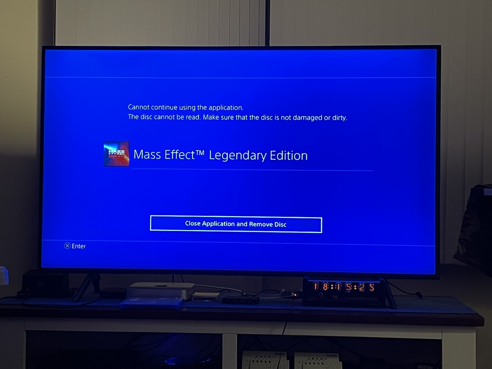
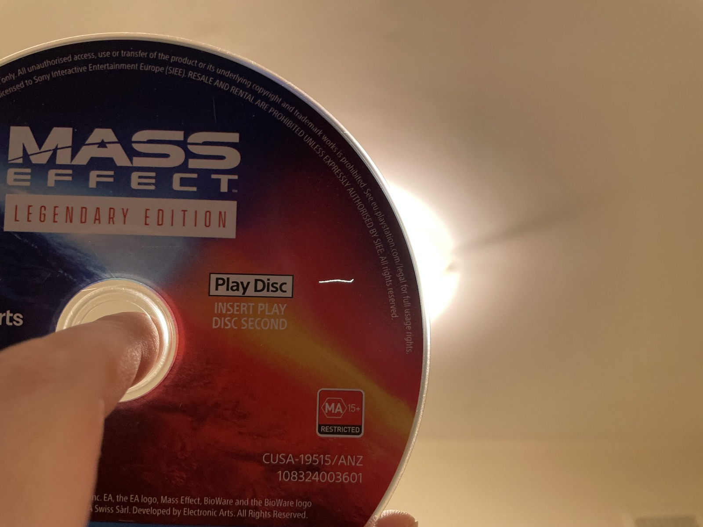
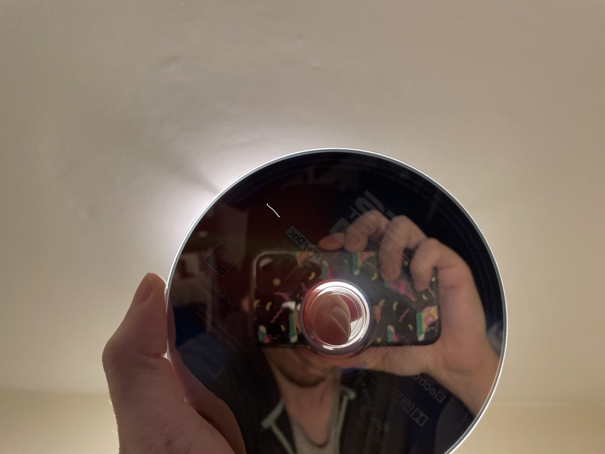
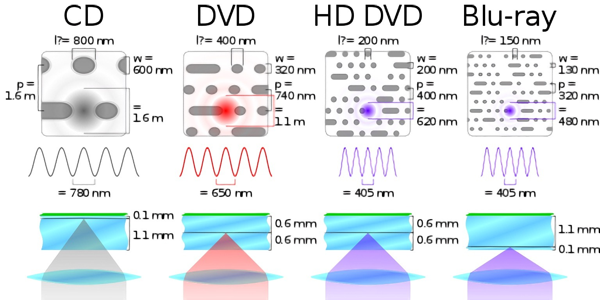



This is as far as I got with Mass Effect. I was recently gifted the Legendary Edition and found the time to fire it up. You might notice I didn't get much further than naming my character honkers. I was trying to put [Honkers the Goose](https://channelchirp.com), but it crashed on the space bar character.

*Mass Effect barely got started before the PS4 complained it couldn't read the disc. Not a promising beginning.*
{: .media-caption }

This was a preowned game and the data disc had no issues installing. I took onboard the wisdom of the black square box and inspected the play disc.

*A little white gash was visible on the Play Disc. That preowned bargain was looking less bargain-like.*
{: .media-caption }

Uhhhhh, hmmm, this gash is a feature, not a bug, right? And those specks or holes? Probably not good. With damage like that, I wouldn't be surprised if the disc was responsible for the crash.

*On the other side, a suspicious mark showed up against the light. I wasn't going to polish my way out of this one.*
{: .media-caption }

I guess it will have to go back to the store. That one will not buff out, especially with visible damage you can see light through. As they say, with increased disc density, comes great responsibility.

*A handy comparison of the disc formats. Blu-ray puts the reading layer much closer to the surface.*
{: .media-caption }

After having a bit of a read I learnt why damage on the read side of a Blu-ray Disc matters so much. The recording layers sit close to the read surface compared with older optical formats, which is why Blu-ray media relies heavily on a hard protective coating. Being able to see light through the damaged area certainly wasn't encouraging!



For now, we play Horizon Zero Dawn, which is proving to be a beautiful, stable game so far. The fact that I can play for eight hours and not have it crash once is a refreshing change from the likes of Cyberpunk 2077. 🫠

### Sources

- [Electronic Arts: Mass Effect Legendary Edition Launch Announcement (2021)](https://news.ea.com/press-releases/press-releases-details/2021/Save-the-Galaxy-in-the-Epic-Saga-of-Commander-Shepard-With-Mass-Effect-Legendary-Edition-Today/)
- [Blu-ray Disc Association: Blu-ray Disc Format General (5th Edition, 2018, Sections 1.2 and 1.6; Archived 28 October 2021)](https://web.archive.org/web/20211028160330/http://www.blu-raydisc.com/Assets/Downloadablefile/White_Paper_General_5th_20180216.pdf)
