

A Macintosh Classic! What a great platform to test [GeoCities](/homepages/geocities). No, just no. Stop right there. No way. Let's dig a little deeper. Perhaps some background would help. First came the Macintosh Plus (Jan 1986 - Oct 1990). The Macintosh Classic (Oct 1990 - Sept 1992) followed on from there. Both were powered by Motorola 68000s at 8 MHz with up to 4 MB of RAM.

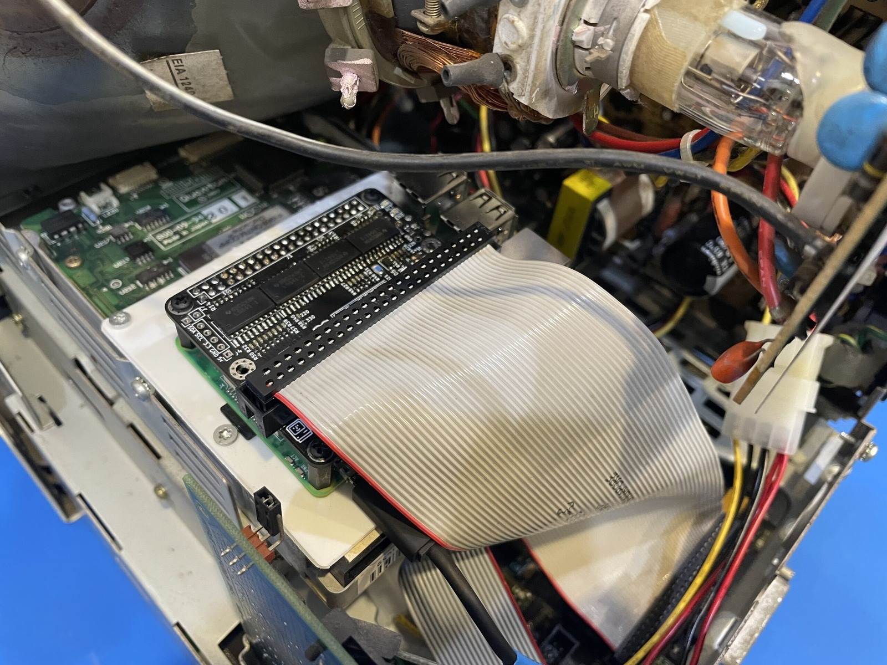

*Inside the Classic was a RaSCSI board and a very determined bundle of cables. Old Mac surgery never gets boring.*
{: .media-caption }

This machine has had the internal hard drive upgraded to a [RaSCSI](https://github.com/PiSCSI/piscsi) (now PiSCSI) using PCB v2.3. There's a little bit of an unaddressed voltage drop happening that **_probably_** won't be an issue, so we'll just ignore the video above with the [lack of red LED](https://raspberrypi.stackexchange.com/questions/51615/raspberry-pi-power-limitations). Optimism, naturally. I should probably look into that voltage drop properly rather than pretending the LED isn't there!

> **If the Red Power LED is not illuminated this means the supply voltage is inadequate. (The newer Pi have a well engineered power circuit, and may continue to function even if the input voltage is below spec; the same may not be true of peripherals).**

This tech is not ready for mid-late 1990s internet. I just didn't realise just how incompatible early 1990s internet was! When setting up my web server I tried to make [GeoCities](/homepages/geocities), [RetroJunkie.net](https://web.archive.org/web/20220406134923/https://retrojunkie.net/) and even my [files archive](/goodies) as simple as possible to avoid issues. It all seemed to boil down to the old browsers missing something. My initial suspicion was HTTP/0.9. Whatever it was, these older browsers weren't getting along with my modern web server.

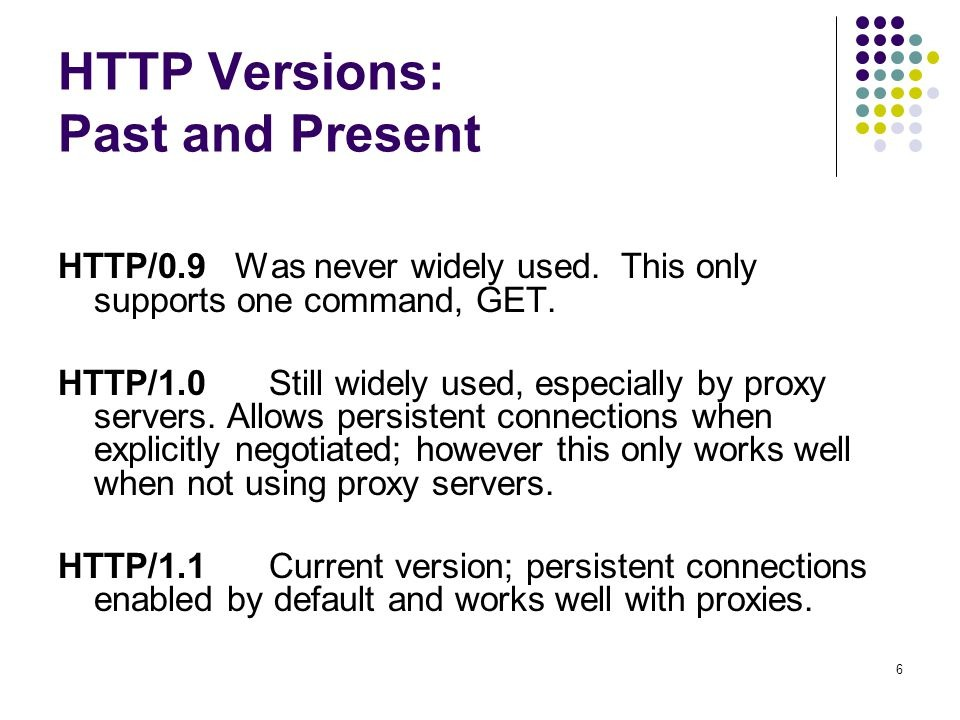

*A simplified slide about early HTTP versions. It made HTTP/0.9 look like the obvious suspect at the time.*
{: .media-caption }

HTTP/1.0 and HTTP/1.1 are way past cool in my book. Look at this crazy mapping of the internet standards history by Cloudflare.

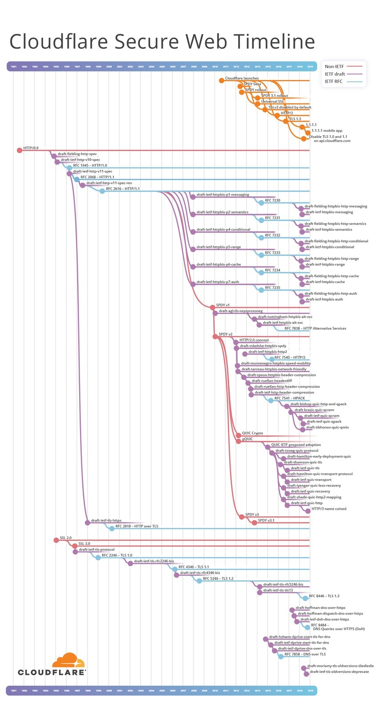

*Cloudflare's secure web timeline: decades of standards squeezed into one gloriously complicated family tree.*
{: .media-caption }

At least that was the theory. HTTP/0.9 really is tiny: essentially a one-line `GET` request, with no protocol version in the request and no request headers. That also means no `Host` header, which makes dealing with modern name-based virtual hosts rather interesting.

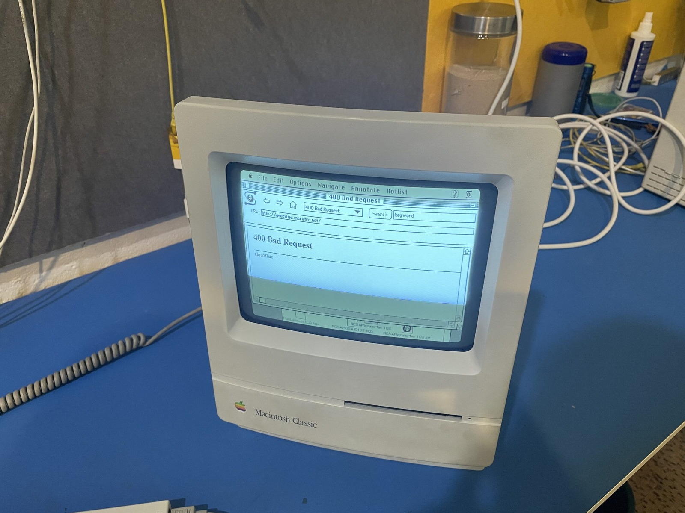

*The Macintosh Classic reached the web server, only to get a 400 Bad Request. Not quite the GeoCities experience I had in mind.*
{: .media-caption }

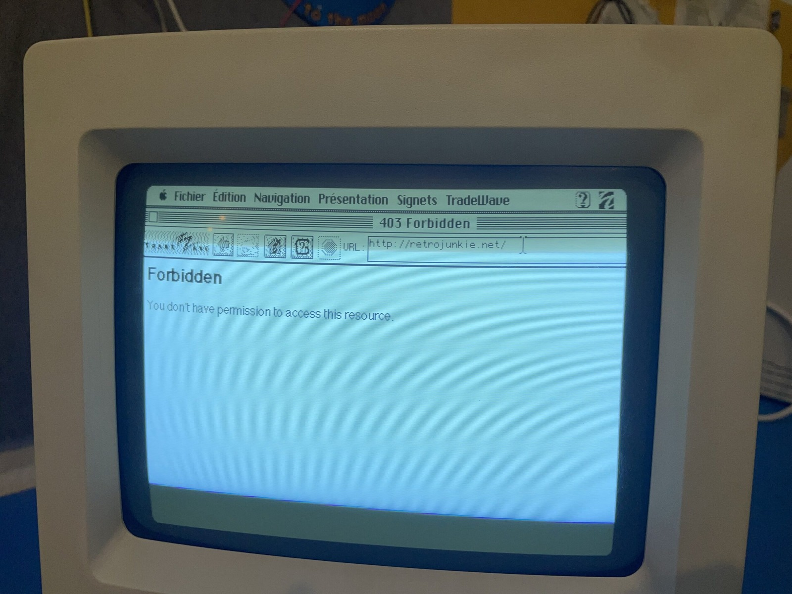

*MacWeb in French this time, and a 403 Forbidden for RetroJunkie.net. Well, that's progress of a sort.*
{: .media-caption }

But nothing. To try and rule out a browser issue I tried a couple of different browsers: TradeWave MacWeb F2.0 (turns out the F is for French...) and NCSA Mosaic 1.0.3. No dice. I am a little limited on what can run in System 7.5.x with only 4MB of RAM. With the roughly 3.9MB requirement I'd noted for iCab 2.9.9, there wasn't much room left for the system. That used to work great on [my old LC 475](/apple-macintosh-lc-475-online-with-pds-ethernet/).

I hit up a relatively simple site (google.com) which I believed was supposed to pass through MacProxy, a part of the RaSCSI software bundle. Looking back now, maybe the MacProxy wasn't working properly as the results were the same on my Windows 98 installation.

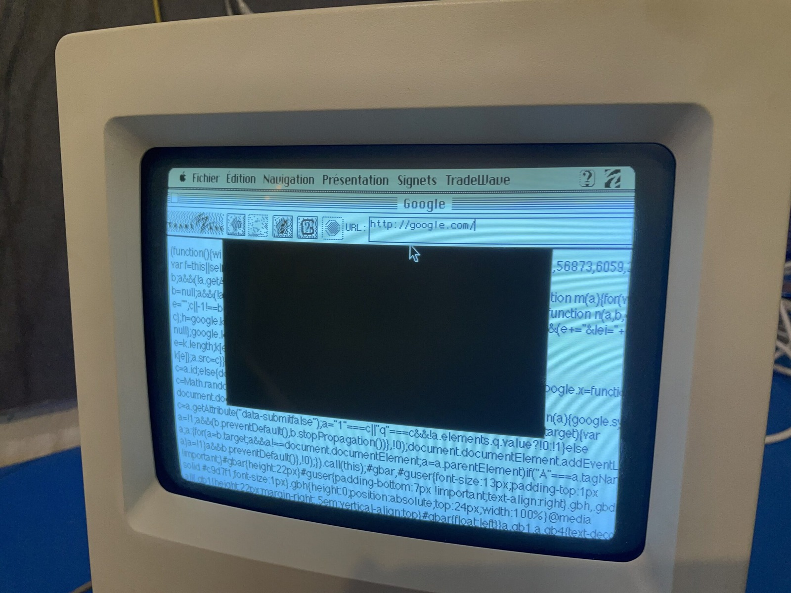

*Google looked rather more like a wall of code than a search engine. MacWeb wasn't impressed.*
{: .media-caption }

MacWeb 2.0 (French) doesn't really like it.

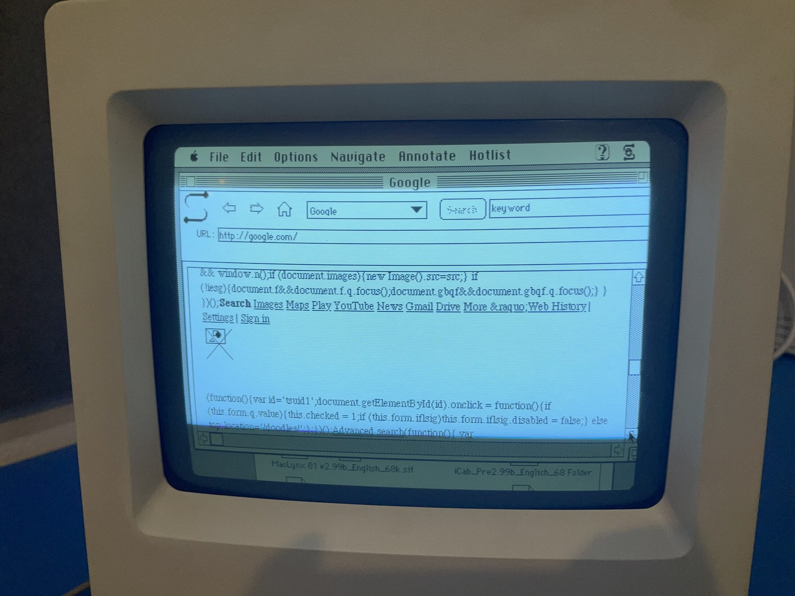

*Mosaic 1.0.3 wasn't much happier. Google appeared as raw scripts and a broken image.*
{: .media-caption }

Neither does Mosaic 1.0.3. At least they are giving similar results but I had to test elsewhere to confirm whether my HTTP/0.9 theory held up. When I got home I jumped onto the information superhighway.

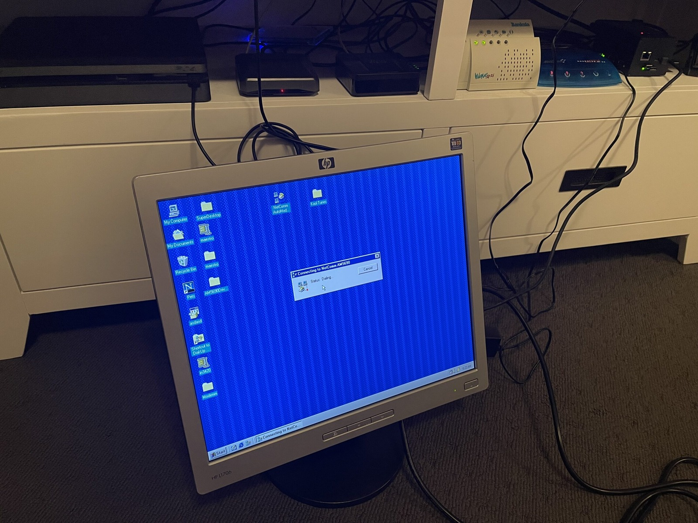

*Back home with Windows 98 and a modem connection. Time for another round of browser archaeology.*
{: .media-caption }

And using Internet Explorer 5.0 grabbed Mosaic 1.0 from [my file server](/goodies).

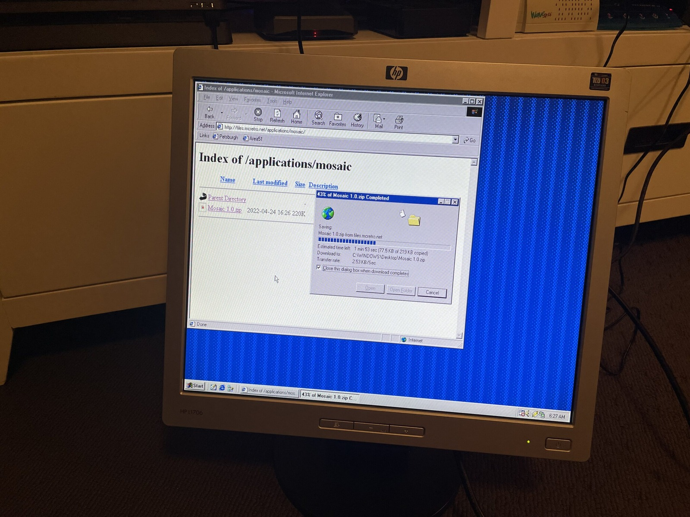

*Internet Explorer fetching Mosaic 1.0 from the file archive. A whole 219 KB, and still a little wait.*
{: .media-caption }

Not the slowest download I've had. A couple of minutes later I was able to load up the same websites at home in Windows 98.

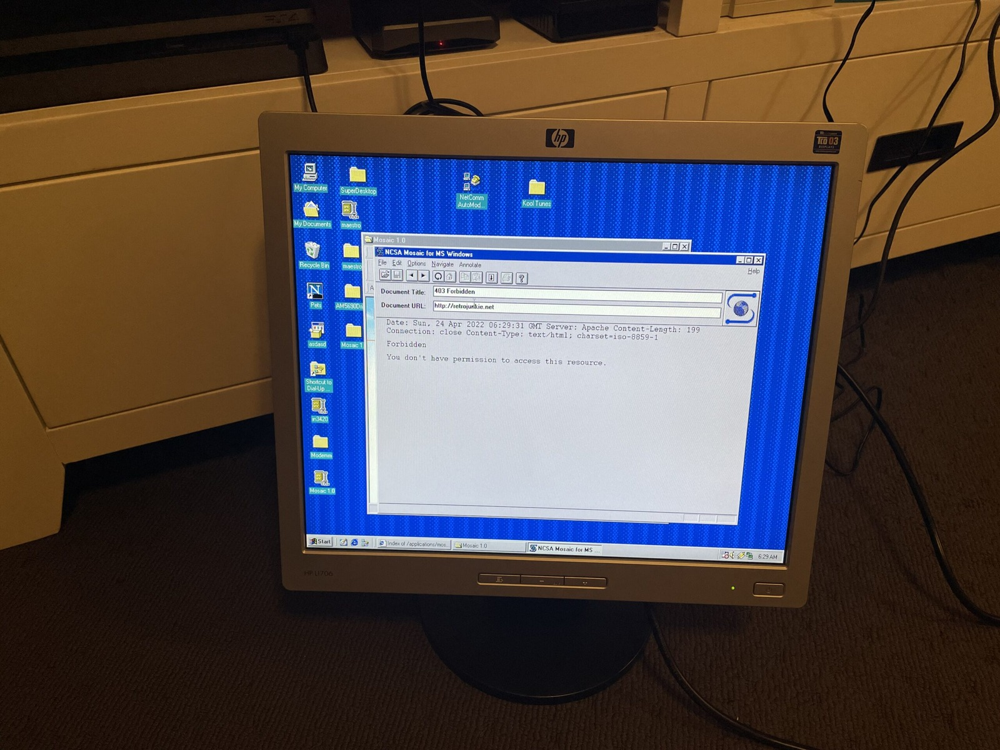

*Mosaic on Windows 98 could reach RetroJunkie.net, but all it got was a 403 Forbidden.*
{: .media-caption }

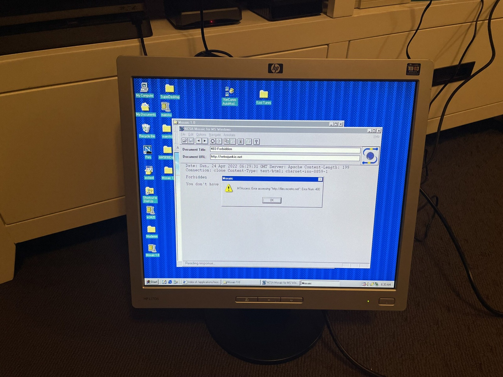

*The files server was a bust too. Mosaic popped up a 400 error while the 403 page sat in the background.*
{: .media-caption }

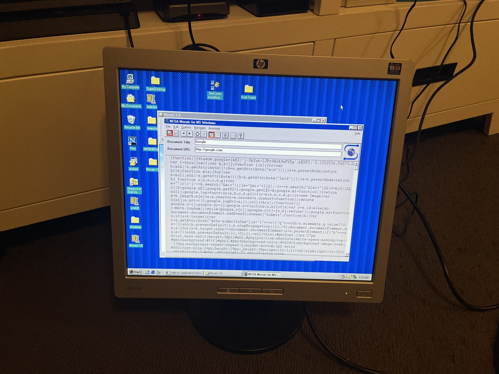

*Google in Windows Mosaic was another wall of code. This was becoming a theme.*
{: .media-caption }

And it seems that [retrojunkie.net](https://web.archive.org/web/20220406134923/https://retrojunkie.net/), [the files server](/goodies) and [google.com](https://www.google.com) were all giving the same errors. We'll try another browser again, shall we?

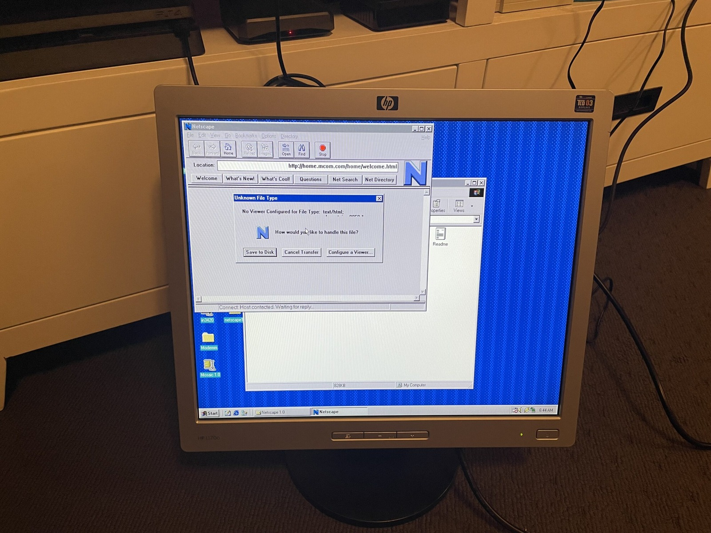

*Netscape 1.0 offered to save the web page as a file instead of displaying it. How very helpful.*
{: .media-caption }

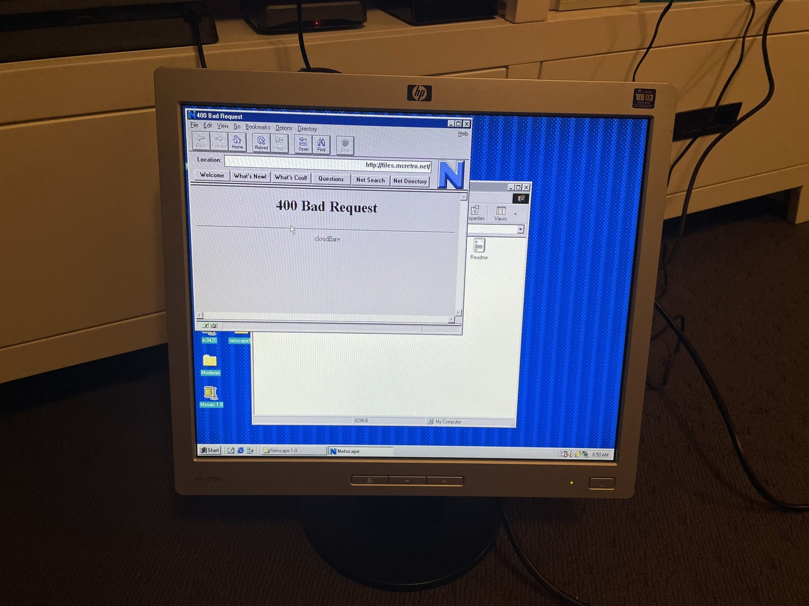

*Netscape could read the files server's reply, but the reply was another 400 Bad Request.*
{: .media-caption }

Netscape 1.0 doesn't want to play nice either. I'm still thinking HTTP/0.9 could be the culprit, but I clearly need to do more testing. A few different browsers giving me the same trouble doesn't make for a particularly encouraging afternoon!

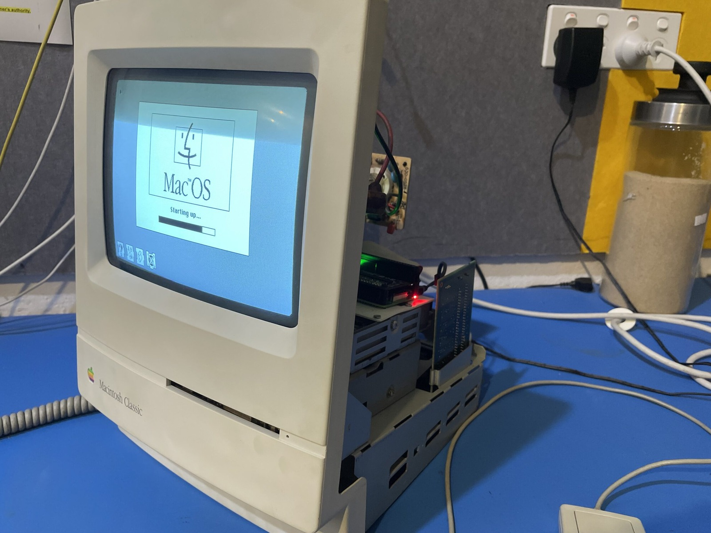

*One more shot of the Classic booting with its insides exposed. The internet experiment needed more tinkering.*
{: .media-caption }

While it would be nice to be able to do things on a 68000 powered Mac, we're just not ready for it yet. Stick with a faster classic Mac like the LC475 for a true internet experience. Leave the early 1990s for bulletin boards! :)

**Update 2023:** I revisited the HTTP/0.9 theory and it turned out to be the wrong diagnosis. The old browsers were capable of more than HTTP/0.9, and I confirmed requests arriving at Apache as HTTP/1.0. The real trouble was how my modern hosting setup, name-based virtual hosts and proxying interacted with clients this old. Once I simplified the hosting path and gave the browsers a site they could resolve cleanly, MacWeb, Mosaic and Netscape were able to talk to the server after all.

### Sources

- [RFC Editor: RFC 1945, HTTP/1.0 (Section 4.1, HTTP/0.9 Simple Requests)](https://www.rfc-editor.org/rfc/rfc1945)
- [RFC 7230 - HTTP/1.1 Message Syntax and Routing](https://www.rfc-editor.org/rfc/rfc7230)
- [Raspberry Pi Documentation - Power supply warnings](https://www.raspberrypi.com/documentation/computers/raspberry-pi.html#power-supply-warnings)
- [Chris Adams - Web browsers for antique Macs, MacWeb notes](https://ia800100.us.archive.org/0/items/macweb-evolt_browsers/macweb.htm)
- [Evolt browser archive - MacWeb](https://browsers.evolt.org/browsers/archive/macweb)
- [Evolt browser archive - MacWeb 1.1.1E](https://browsers.evolt.org/browsers/archive/macweb/1.1.1E/)
- [Evolt browser archive - MacWeb 2.0](https://browsers.evolt.org/browsers/archive/macweb/2.0/)
- [Evolt browser archive - MacWeb 0.98a](https://browsers.evolt.org/browsers/archive/macweb/0.98a/)
- [68K Mac Revival - Downloads (archived 4th August 2019)](https://web.archive.org/web/20190804193457/http://www.angelfire.com/mac/68kmacrevival/68kdownloads.html)
- [Matti Haveri - 68000 Macintosh software notes (archived 6th April 2001)](https://web.archive.org/web/20010406030443/http://www.sjoki.uta.fi/~shmhav/68000.txt)
- [Jag's House - Classic Mac Internet Links (archived 3rd August 2004)](https://web.archive.org/web/20040803073531/http://www.jagshouse.com/classicinternet.html)
- [Gamba - Where to Download 680x0 Browsers](https://vintageapple.org/gamba2/browsers.html)

### Related Posts

- [Apple Macintosh LC 475: Online with PDS Ethernet](/apple-macintosh-lc-475-online-with-pds-ethernet/)
- [Mac Web Browsers from the 90s and HTTP/0.9](/mac-web-browsers-from-the-90s-and-http-0-9/)
