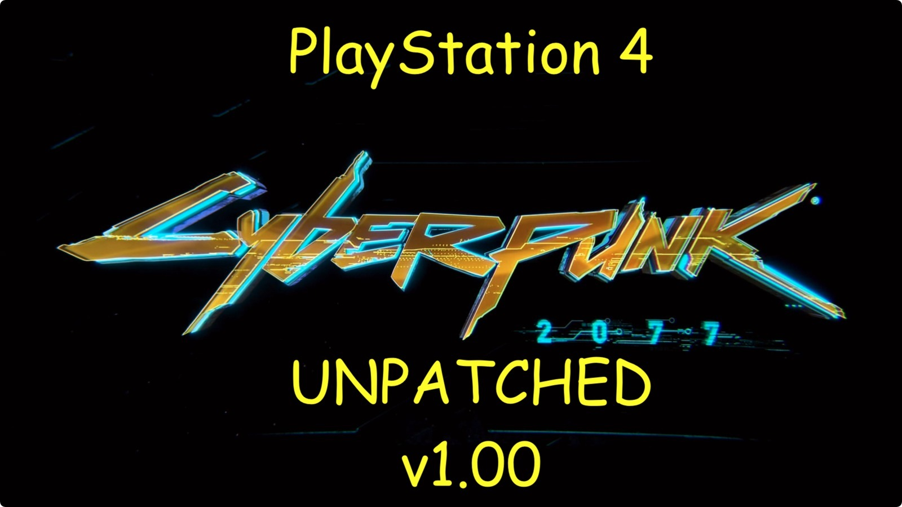
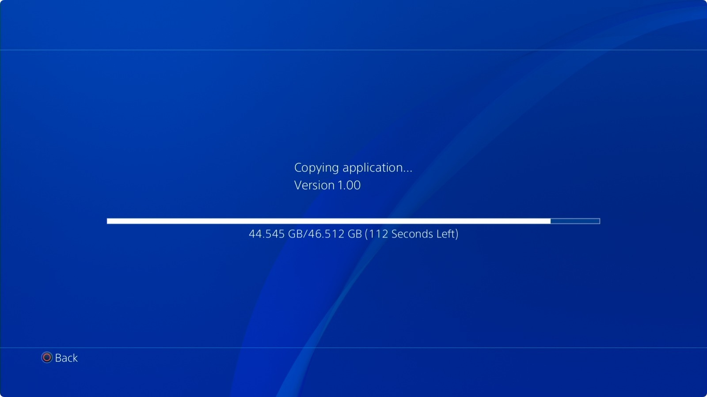
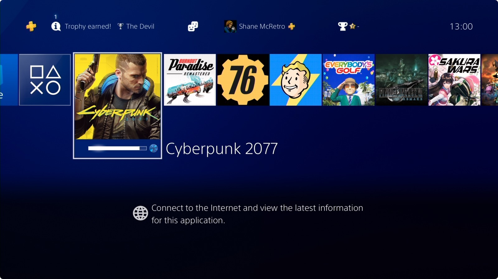
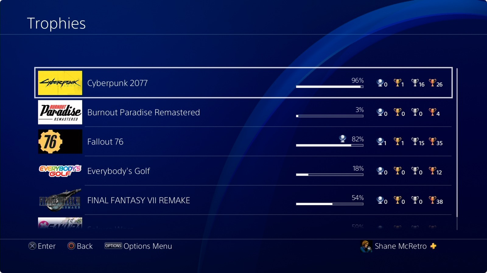
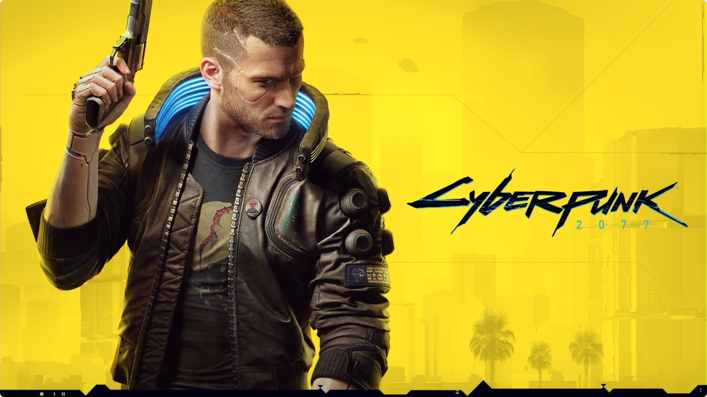
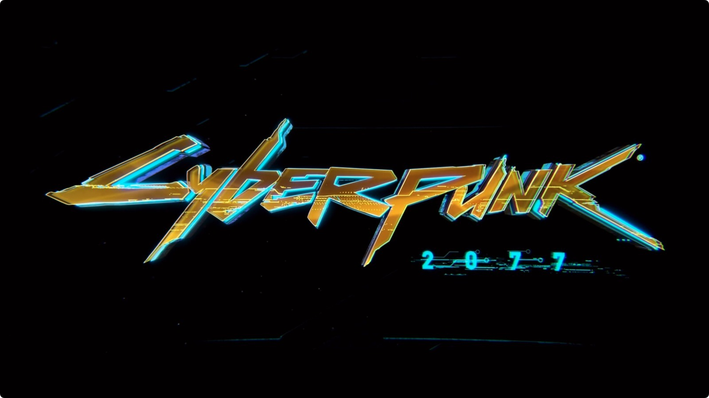
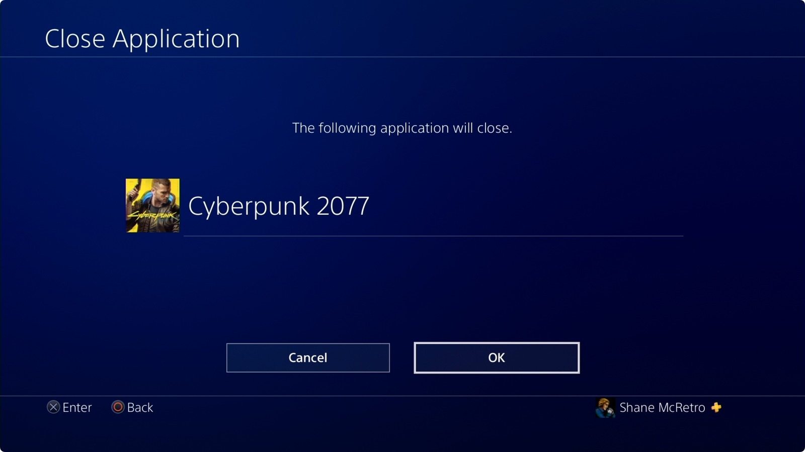
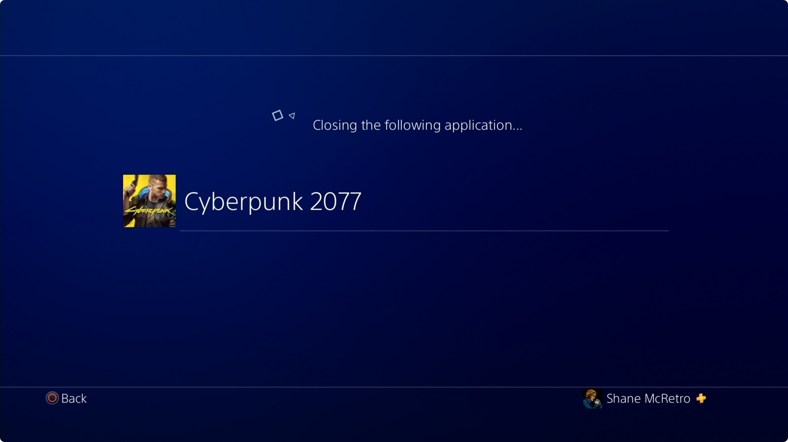



Months have flown by on the calendar and I wanted to glance back on Cyberpunk 2077. Ahhh the memories. I remember reinstalling from disc back to the 1.00 unpatched release with no internet connected.

*Back to Cyberpunk 2077 version 1.00 on the PS4. All those lovely launch-day bugs.*
{: .media-caption }

It has been the only game that had me take my PlayStation completely offline to install the unpatched v1.00, from disc, in order to achieve a platinum trophy.

*Reinstalling the original disc version. Only another 112 seconds until I could revisit the chaos.*
{: .media-caption }

Honestly, I don't miss it.

*The Devil trophy appears while Cyberpunk 2077 is selected. One more for the collection.*
{: .media-caption }

But nor do I regret it. I've got all the trophies now and they can't take that away from me.

*96% in this screenshot, and no platinum on display. You'll have to take my word for the rest!*
{: .media-caption }

Sure, I didn't include a screenshot of the platinum trophy in this post, but you believe me right?

*That familiar yellow Cyberpunk artwork. I still wonder who that bloke is supposed to be.*
{: .media-caption }

Cyberpunk 2077. Amazing! I never did work out who that guy was supposed to be? Is he the guy from NCIS: Los Angeles?

*Cyberpunk 2077. I'm not going to miss this logo any time soon.*
{: .media-caption }

We close this chapter of gaming and say our goodbyes. Cyberpunk 2077, you were a terrible game. I'd much rather play Horizon Zero Dawn. That game never crashed. Not even once. And it looks amazing.

*Goodbye, Cyberpunk. Yes, I am quite sure I want to close you.*
{: .media-caption }

With that, we hold the buttons to end the Cyberpunk 2077 saga - Ctrl, Alt and...

*And with that, the Cyberpunk saga finally closes. Ctrl, Alt and... Del.*
{: .media-caption }

Del.

### Related Posts

- [Cyberpunk 2077 (2020, PS4 Live Stream, Day 1)](/cyberpunk-2077-ps4-live-stream-day-1/)
- [Cyberpunk 2077 (2020, PS4 Live Stream) - The 2022 Update](/cyberpunk-2077-the-2022-update/)
- [Cyberpunk 2077 PS4 1.51 Patch Update](/cyberpunk-2077-ps4-1-51-patch-update/)
- [Cyberpunk 2077 PS4 1.51 Patch Update... Update](/cyberpunk-2077-ps4-1-51-patch-update-update/)
