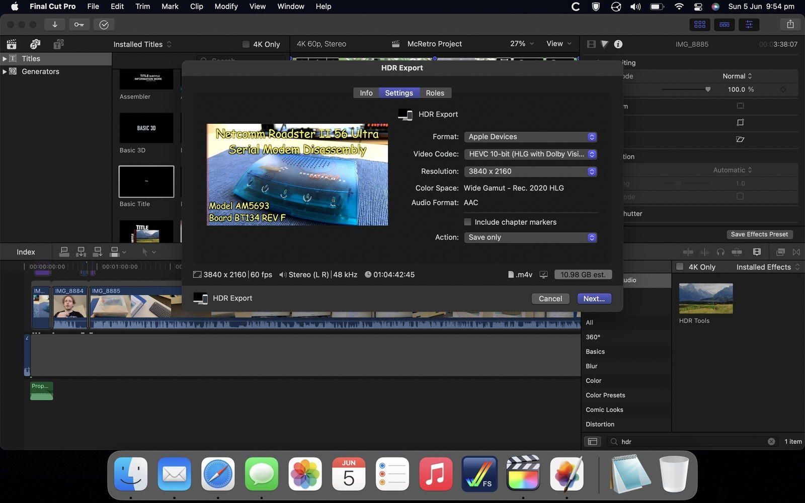

*A 4K HDR export in Final Cut Pro. Bigger files, brighter colours and more excuses to tinker.*
{: .media-caption }

Just a quick little update. I've started using HDR on videos now, fairly consistently. They should really pop when viewed on hardware that has HDR support. I'm noticing the change from non-HDR to HDR far more than I used to.

I'm also trying to keep all footage in 4K at the same time. It's a challenge but it seems to be working so far. Hope you enjoy the videos that are coming up in the next few months! ;)
