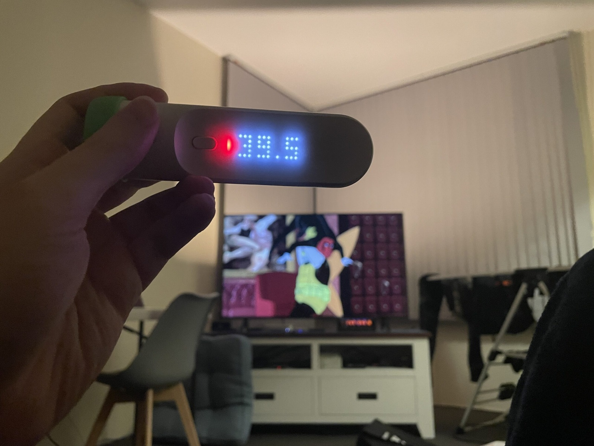
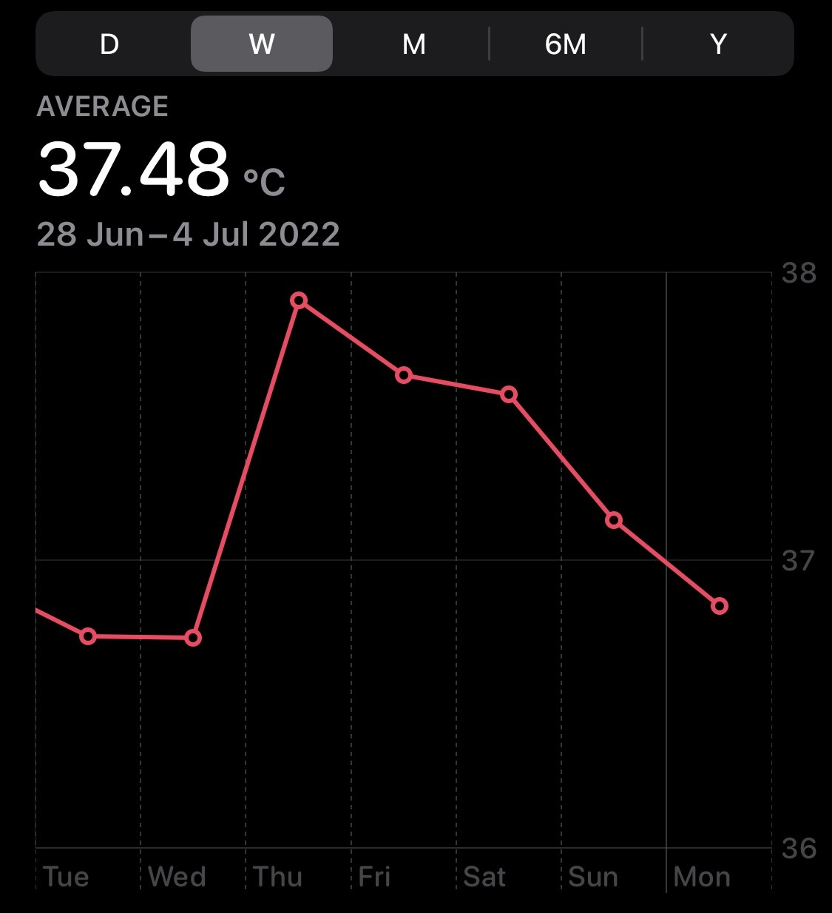
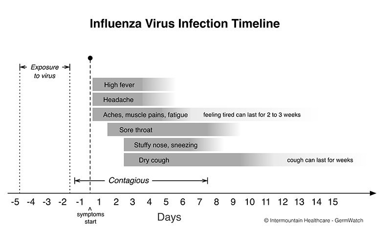

*39.5°C. Well, that rather rules out an ordinary case of the sniffles.*
{: .media-caption }

It was late Wednesday afternoon, I was at work. It was boring. Sniff, sniff. Allergies? Hopefully. Fast forward 24 hours. Fever! I was under attack by a foreign body. Temperature peaked at 39.5°C at which point I ruled out allergy as a reason and stayed home from work.

*At least the temperature graph was finally heading back down.*
{: .media-caption }

It's around five days later now and I'm no longer needing paracetamol to keep my temperature down. COVID-19 rapid antigen tests kept coming back negative. I was thinking it might be the flu, given it's the middle of winter and I feel pretty dreadful. But I haven't had a test to tell me what I've actually caught, and the negative RATs don't settle the question either. Mystery respiratory infection of 2022 it is!

*A general influenza symptom timeline. My own mystery winter bug was still exactly that: a mystery.*
{: .media-caption }

It might be a couple more days until I'm feeling human enough for work, but at least I got to watch all three seasons of FLCL. Annnnnd maybe seven seasons of The Venture Bros. I guess there's always a silver lining!

*Some ridiculous television was a welcome distraction while I was stuck at home.*
{: .media-caption }

In other news I increased my web server storage to 64GB, up from 32GB, with a slight buff to read speeds. Whether that matters on a Raspberry Pi 4 is moot; I need that storage space! Thanks to [this quick and easy guide](https://web.archive.org/web/20220704034854/https://scalan.com/expand-partition-size-on-raspberry-pi-ubuntu-disk/) for the filesystem resize after my lazy clone.

### Sources

- [Healthdirect Australia - Flu](https://www.healthdirect.gov.au/flu)
- [TGA: COVID-19 Rapid Antigen Self-Test Performance and Risk Mitigation (September 2021)](https://www.tga.gov.au/sites/default/files/covid-19-rapid-antigen-self-tests-performance-requirements-and-risk-mitigation-strategies.pdf)
