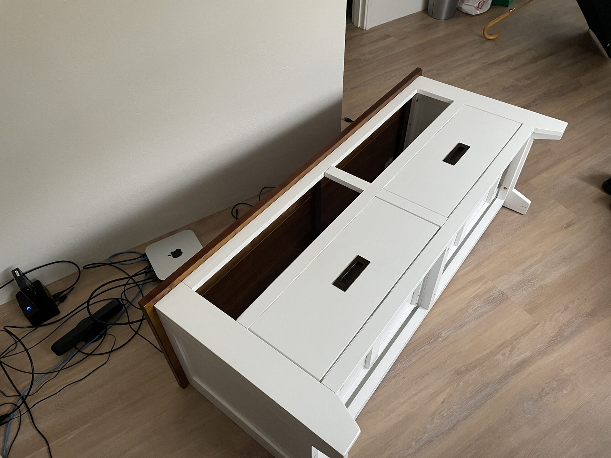
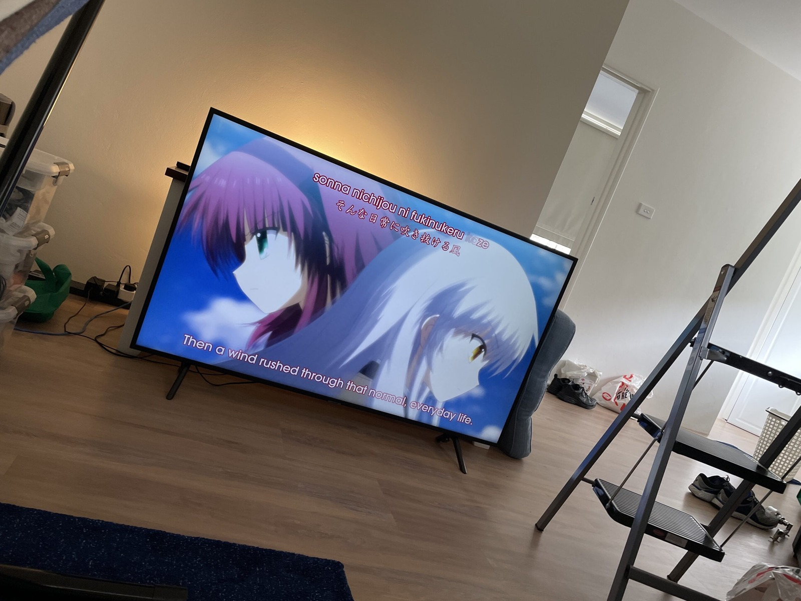
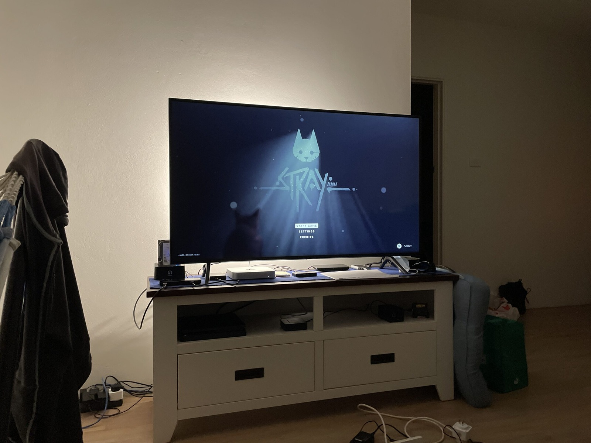
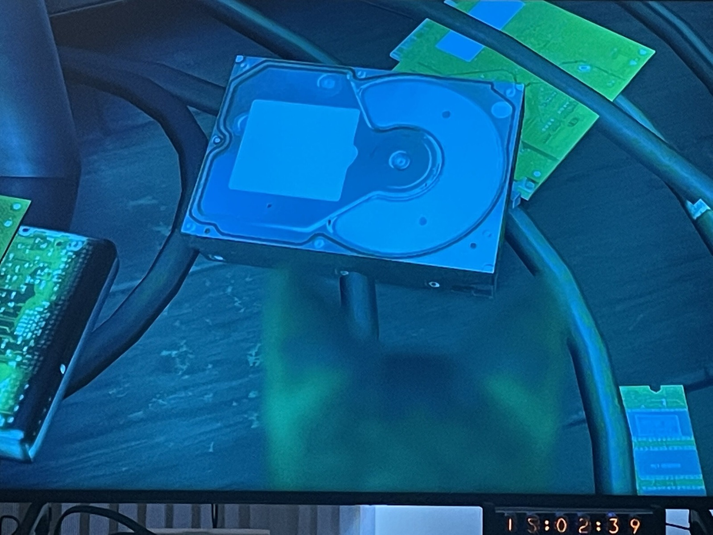
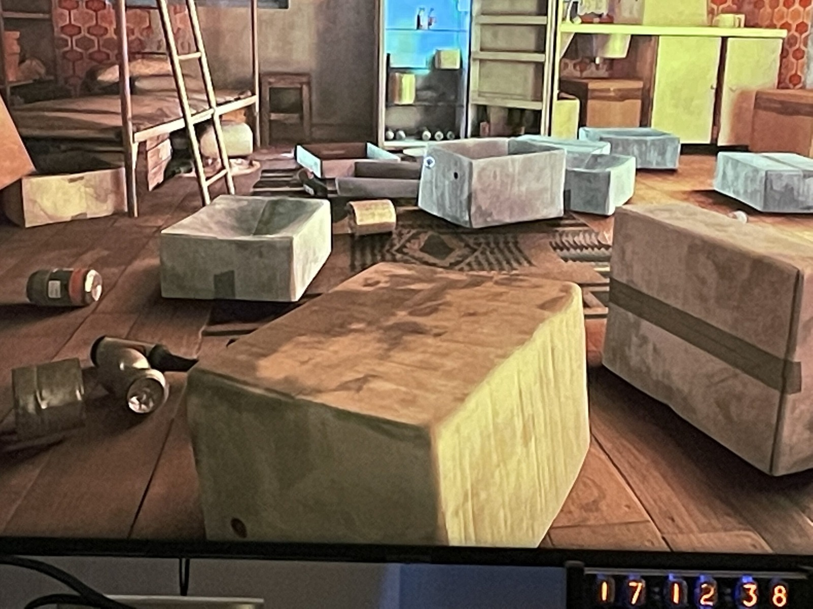
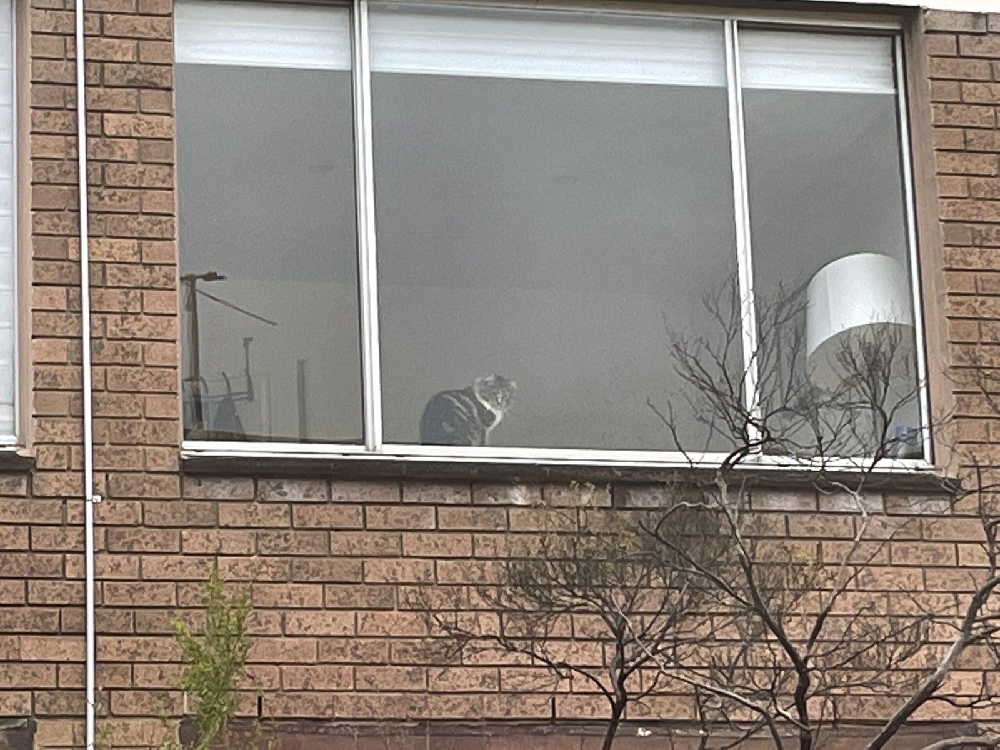
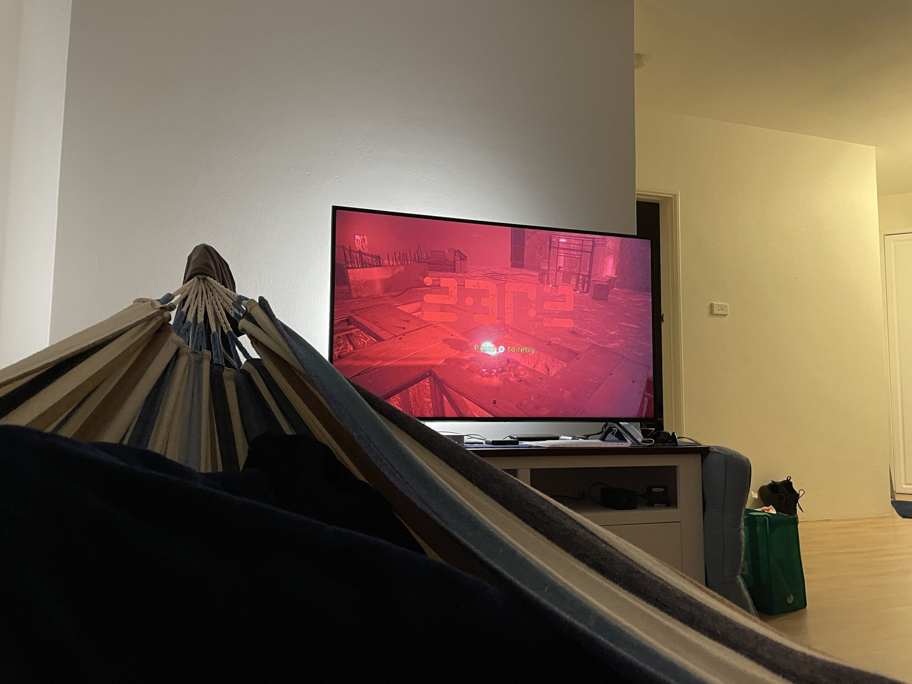
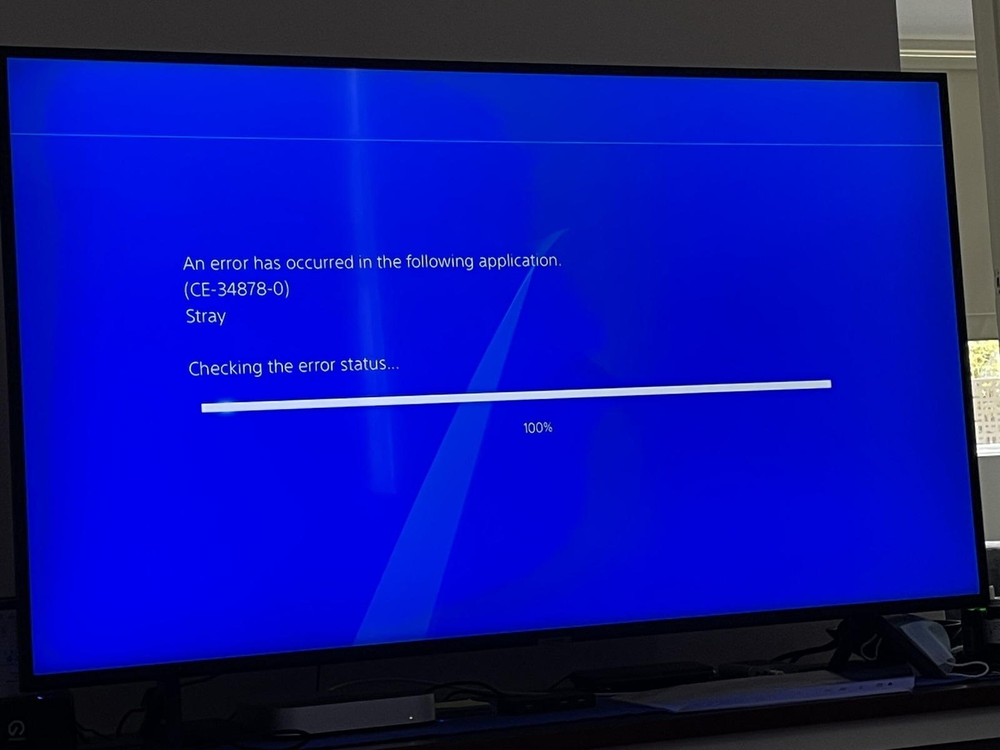
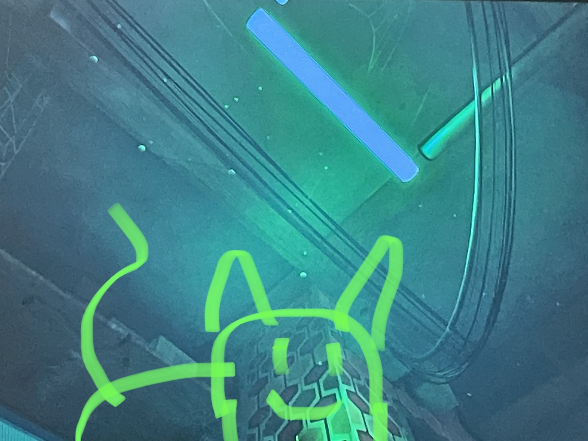



Recently, there have been more tumbleweeds than posts. I've moved house, and that took a lot out of me. The old landlords had decided to sell. I'd be understating it if I said that it was annoying losing your home every so often, but I get it - money is nice. Heck, I like money!  

> "I can't believe you like money too. We should hang out."
> 
> Frito - Idiocracy, 2006

*Moving house had one bonus: a chance to give the entertainment unit some new feet.*
{: .media-caption }

On a positive note, moving has given me the opportunity to slap new feet on my entertainment unit. It really is the small victories that make life worth living.

*A little Angel Beats during the post-move anime binge. Moving can wait a bit longer.*
{: .media-caption }

Then I might have gone on a bit of an [anime binge](https://myanimelist.net/animelist/NixMcRetro). A little bit of FLCL here, Space Dandy there and a sprinkling of Martian Successor Nadesico, Serial Experiments Lain and of course some Panty & Stocking with Garterbelt. Not listed is the pictured Angel Beats.

*Finally, Stray on the television and ready to play.*
{: .media-caption }

Which then led on to me getting around to finishing Stray. Took me long enough, I am not a speedrunner at video games. Nope!

*An IDE-looking hard drive in Stray. Naturally, I stopped to admire it.*
{: .media-caption }

Was it because I got distracted by IDE hard drives, Creative Sound Blasters and other goodies in the game? Look, it might have played a part. Who am I to tell! Ohhhoooo a box!

*Boxes everywhere in Stray. As a cat, investigating them was practically compulsory.*
{: .media-caption }

Being a cat, it's only natural to hide in the box. What was really scary is that after getting up to stretch my legs I looked out of my window and what did I see?

*Meanwhile, a real fluffy cat was watching from the window opposite. Excellent timing.*
{: .media-caption }

Well, well, well! One large fluffy cat. No, not [that cat](https://sonic.fandom.com/wiki/Big_the_Cat). A real cat wouldn't survive a minute on the streets of Stray. Then again...

*The monsters got me again. Stray certainly wasn't making things easy.*
{: .media-caption }

Neither would I. Stray would have been a lot easier without all those damn off-brand [headcrabs](https://en.wikipedia.org/wiki/Headcrab)! By the time I worked out how to get around them I got some serious Cyberpunk 2077 vibes from my poor PlayStation 4. Judder but no crash. A few minutes later and...

*Ah, the familiar PS4 crash screen. Stray had joined the club.*
{: .media-caption }

Ahhh, such familiarity. One day I'll pick up a PS5 slim. I guess Sony will have to release it first though. I can't physically fit a PS5 under my TV because of the weird shape they went with and Xbox isn't much better; at least they kept edges instead of curves.

*Stray still had its little moments of charm. That glowing cat doodle was one of them.*
{: .media-caption }

Would I play Stray again? Probably not. Would I watch someone else play it? Absolutely! Head back to the top for a taste of my Stray (2022) gameplay that I spammed out on my trusty PlayStation 4 slim. I'm surprised it only crashed twice! :)