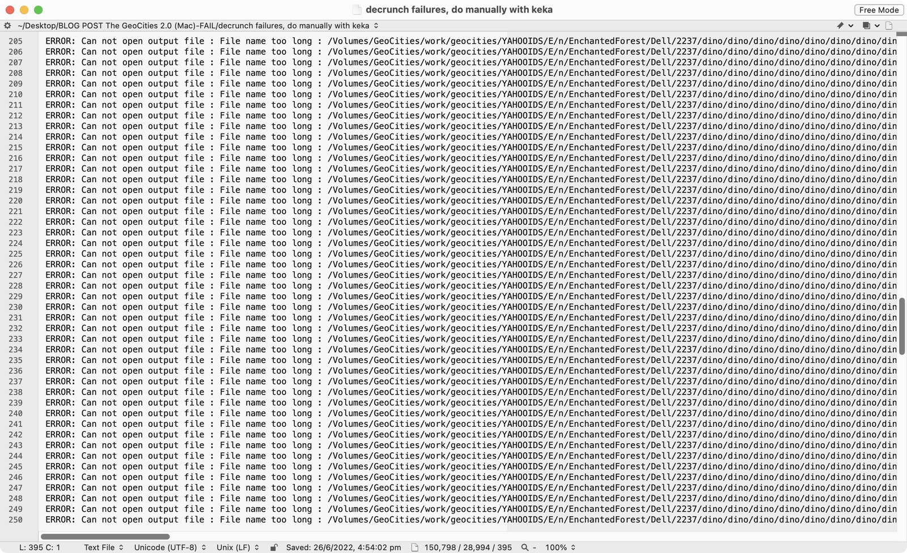
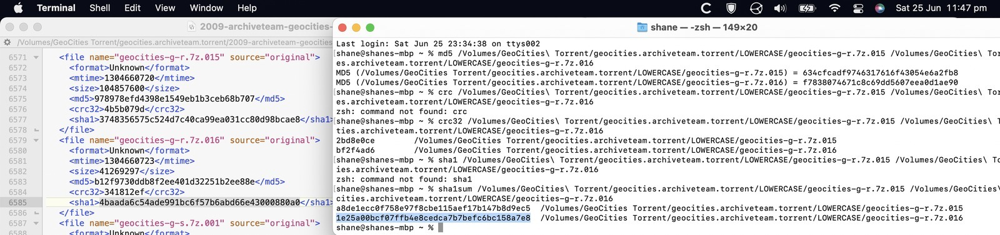
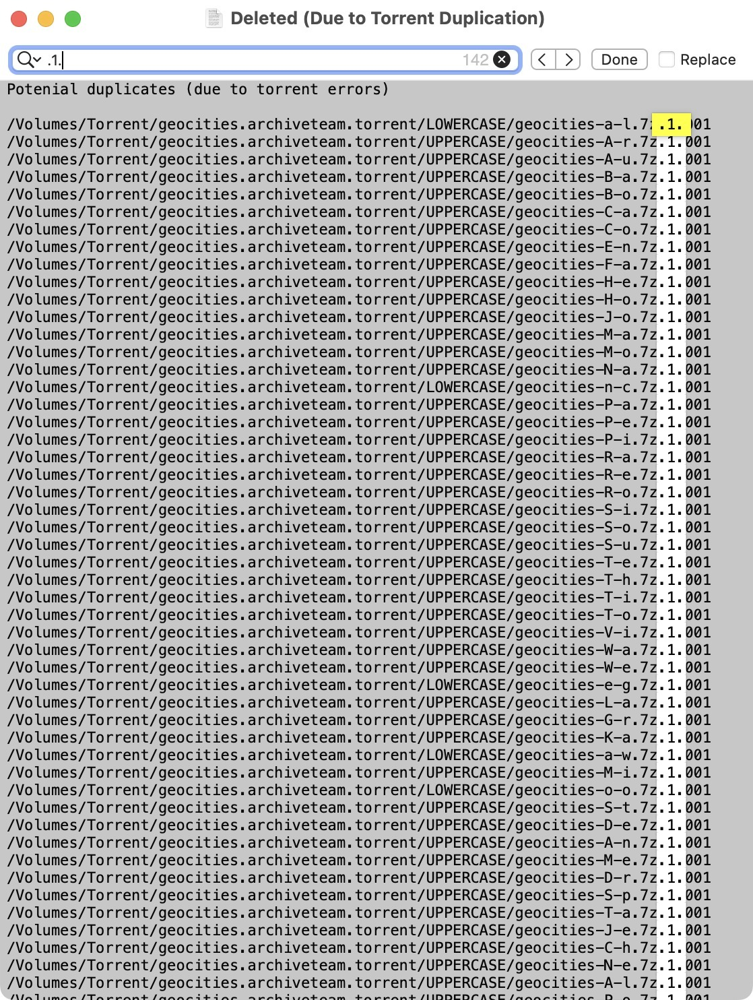
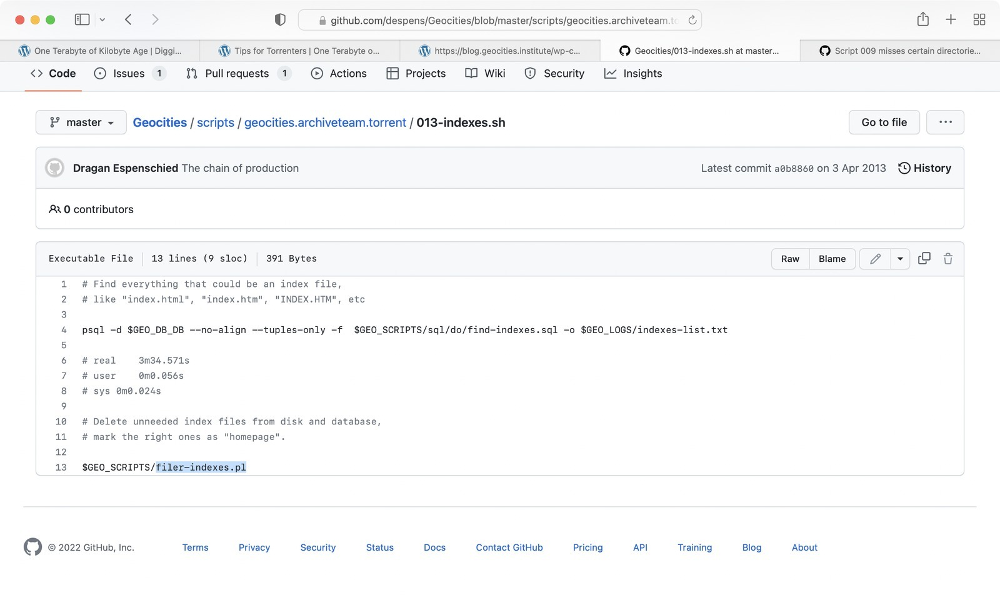

*Back to GeoCities. Because rebuilding the entire thing once clearly wasn't enough.*
{: .media-caption }

A while back, some of you may remember that I entered [RetroChallenge 2021/10](https://www.retrochallenge.org/2021/10/). I had [some success](/the-geocities-rebuild-worklog/) rebuilding the [GeoCities Archive](https://archive.org/details/archiveteam-geocities), also known as The Archive Team Geocities Valhalla, and managed to host it on a Raspberry Pi.

Of course it wasn't perfect and I knew that. So since then I've tried to reboot it again using the [GitHub repository from despens](https://github.com/despens/Geocities) as it would potentially solve some of the problems I had when I started to merge data together. But then this happened...



*Dino, dino, dino... and eventually macOS decided the path was far too long.*
{: .media-caption }

Ideally, I wanted to use macOS instead of Ubuntu, but the archive ran straight into a pathname limit. I originally called it a "1024-character filename limit", but it was the full path causing the trouble. An individual filename component can be up to 255 characters, while the complete macOS pathname traditionally has to stay under 1024. Have a look at all those nested dino directories! Linux handled these particular paths without the same problem, which made the rebuild a lot less painful.



*Comparing archive checksums to figure out why the downloads weren't matching up.*
{: .media-caption }

I was also getting checksum mismatches compared to the original torrent, which needless to say, is very bad. Not sure what caused that, but it was possibly the same thing that resulted in duplicates. Note the ".1." in the file names.



*Those extra '.1.' bits were rather suspicious. Another cleanup job for the list.*
{: .media-caption }

I did find what appears to be a typo in the [despens GitHub](https://github.com/despens/Geocities) too.



*That script filename looked like a typo. My money was on 'filter-indexes.pl'.*
{: .media-caption }

`$GEO_SCRIPTS/filer-indexes.pl` should probably be `$GEO_SCRIPTS/filter-indexes.pl`. Don't worry, I'll fix it in post.

Here are my notes from the steps before 004 in despens' instructions on macOS. It's a mixture of 2022 commands, package versions and reminders rather than a current install guide, so don't run the cleanup commands blindly! The ridiculous pathname at the end was what sent me back to Ubuntu 22.04.

```
Verify and complete your Geocities Download
From here - https://blog.geocities.institute/archives/3209

curl -L https://install.perlbrew.pl | bash
source ~/perl5/perlbrew/etc/bashrc
perlbrew install perl-5.36.0	
perlbrew switch perl-5.36.0	This needs to be done repeatedly in the active terminal window, find bin file
/usr/bin/which -a perl
sudo cpan -i XML::LibXSLT

This makes future installs less questiony
cpan -i App::cpanminus

This is needed for the thing
cpanm XML::TreePP

Also needs this to calculate md5s on Mac
brew install md5sha1sum

perl geo-torrent-checksums.pl 2009-archiveteam-geocities-part1_files.xml > download1.sh
perl geo-torrent-checksums.pl 2009-archiveteam-geocities-part2_files.xml > download2.sh
perl geo-torrent-checksums.pl 2009-archiveteam-geocities-part3_files.xml > download3.sh
perl geo-torrent-checksums.pl 2009-archiveteam-geocities-part4_files.xml > download4.sh
perl geo-torrent-checksums.pl 2009-archiveteam-geocities-part5_files.xml > download5.sh
perl geo-torrent-checksums.pl 2009-archiveteam-geocities-part6_files.xml > download6.sh
perl geo-torrent-checksums.pl 2009-archiveteam-geocities-part7_files.xml > download7.sh
perl geo-torrent-checksums.pl 2009-archiveteam-geocities-part8_files.xml > download8.sh

Note: All must be in the same directory when verifying

Next, backup files to root to avoid accidental erasure.
Then sudo chmod +x download*.sh
./download1.sh
./download2.sh
./download3.sh
./download4.sh
./download5.sh
./download6.sh
./download7.sh
./download8.sh

Once completed sudo rm download*.sh files re-run the md5 checker:
perl geo-torrent-checksums.pl 2009-archiveteam-geocities-part1_files.xml > download1-1.sh
perl geo-torrent-checksums.pl 2009-archiveteam-geocities-part2_files.xml > download2-1.sh
perl geo-torrent-checksums.pl 2009-archiveteam-geocities-part3_files.xml > download3-1.sh
perl geo-torrent-checksums.pl 2009-archiveteam-geocities-part4_files.xml > download4-1.sh
perl geo-torrent-checksums.pl 2009-archiveteam-geocities-part5_files.xml > download5-1.sh
perl geo-torrent-checksums.pl 2009-archiveteam-geocities-part6_files.xml > download6-1.sh
perl geo-torrent-checksums.pl 2009-archiveteam-geocities-part7_files.xml > download7-1.sh
perl geo-torrent-checksums.pl 2009-archiveteam-geocities-part8_files.xml > download8-1.sh

Everything *should* be commented out, indicating no issues. Then it is time to decompress.

https://blog.geocities.institute/archives/3288
https://github.com/despens/Geocities/tree/master/scripts/geocities.archiveteam.torrent

Per readme on https://github.com/despens/Geocities
check variables in terminal with env
nano ~/.zshrc

This appears to be updated!
https://github.com/kyledrake/Geocities

Mac OS limit of ~1024 characters
/Volumes/GeoCities/work/geocities/YAHOOIDS/E/n/EnchantedForest/Dell/2237/dino/dino/dino/dino/dino/dino/dino/dino/dino/dino/dino/dino/dino/dino/dino/dino/dino/dino/dino/dino/dino/dino/dino/dino/dino/dino/dino/dino/dino/dino/dino/dino/dino/dino/dino/dino/dino/dino/dino/dino/dino/dino/dino/dino/dino/dino/dino/dino/dino/dino/dino/dino/dino/dino/dino/dino/dino/dino/dino/dino/dino/dino/dino/dino/dino/dino/dino/dino/dino/dino/dino/dino/dino/dino/dino/dino/dino/dino/dino/dino/dino/dino/dino/dino/dino/dino/dino/dino/dino/dino/dino/dino/dino/dino/dino/dino/dino/dino/dino/dino/dino/dino/dino/dino/dino/dino/dino/dino/dino/dino/dino/dino/dino/dino/dino/dino/dino/dino/dino/dino/dino/dino/dino/dino/dino/dino/dino/dino/dino/dino/dino/dino/dino/dino/dino/dino/dino/dino/dino/dino/dino/dino/dino/dino/dino/dino/dino/dino/dino/dino/dino/dino/dino/dino/dino/dino/dino/dino/dino/dino/dino/dino/dino/dino/dino/dino/dino/dino/dino/dino/dino/dino/dino/dino/dino/dino/dino/dino/dino/dino/dino/dino/dino/dino/dino/dino/dino/dino/dino/dino-d.html
```

{: width="100" }

*A little GeoCities badge for the next round of RetroChallenge adventures.*
{: .media-caption }

For now, I'm back in the game with [RetroChallenge 2022/10](https://www.retrochallenge.org/2022/) doing something similar but different on hardware and software from 2012. I'm thinking a Mac Pro and Ubuntu 12.04.5. This should result in fewer errors and a more accurate replication of despens' results. :)

### Sources

- [Apple - Mac OS X intro(2): file and pathname limits](https://developer.apple.com/library/archive/documentation/System/Conceptual/ManPages_iPhoneOS/man2/intro.2.html)
- [despens - GeoCities rebuild repository and README](https://github.com/despens/Geocities)
- [One Terabyte of Kilobyte Age: Verify and Complete a GeoCities Download via HTTP](https://blog.geocities.institute/archives/3209)
- [One Terabyte of Kilobyte Age - Resolving conflicts](https://blog.geocities.institute/archives/3288)

### Related Posts

- [The GeoCities Rebuild Worklog](/the-geocities-rebuild-worklog/)
- [RetroChallenge 2022/10 - GeoCities Rebuild on Dial-up at 14.4k](/retrochallenge-2022-10-geocities-rebuild-on-dial-up-at-14-4k/)
- [RetroChallenge 2022/10 - GeoCities Rebuild on Dial-up at 28.8k](/retrochallenge-2022-10-geocities-rebuild-on-dial-up-at-28-8k/)
