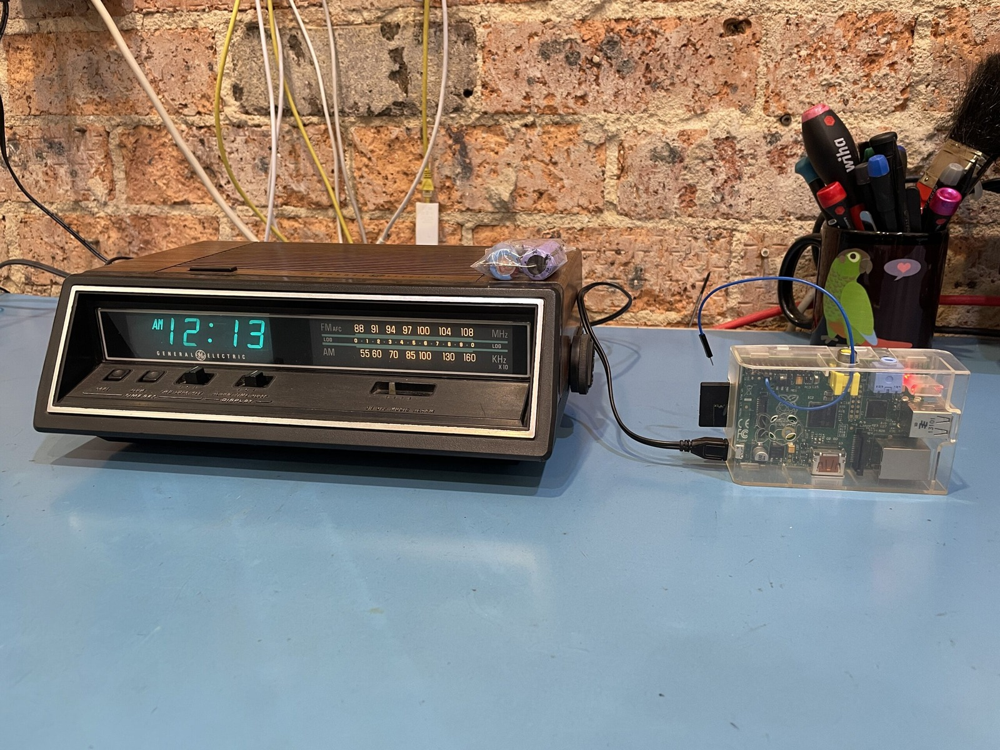



In this video I've used a first-generation Raspberry Pi as a little FM transmitter for the General Electric Model 4665 clock radio I just fixed. I followed [Make:'s Raspberry Pirate Radio guide](https://makezine.com/projects/raspberry-pirate-radio/), put [Bit Shift by Kevin MacLeod](https://incompetech.com/music/royalty-free/index.html?isrc=USUAN1600045&Search=Search) onto the SD card and picked 94.5 MHz for the experiment. I found this old Raspberry Pi Model B lying around, complete with a few missing GPIO pins, and rather surprisingly it still worked! The guide is a little dated, but so is the Raspberry Pi.

Before anyone is tempted to set up Radio McRetro across Sydney, this was just a very short-range bench experiment. A bare Raspberry Pi GPIO pin isn't automatically a compliant broadcast transmitter, and Australia's LIPD class-licence rules set limits on frequency, power and equipment. Worth checking those rules before attempting anything similar.



The old capacitors I replaced are sitting on top of the radio in this photo, and the blue wire is the transmitter antenna.

Unfortunately, an old site conversion mangled the command below, so don't copy and paste it expecting magic. I'm keeping it here for historical reference rather than guessing at the exact command I originally ran.

```
youtube-dl -x --audio-format mp3 ""
```

And no, I'm not saying I might have run the above command to enjoy unlimited John Farnham on loop forever, but you might choose to live your life that way - and that's OK!

I was surprised at how good Bit Shift sounds on a 42-year-old piece of hardware. The John Farnham didn't sound as good, but that might have been the fact that it was John Farnham. Given that it is a mere clock radio rather than a boom box, it gets my tick of approval! :)

### Sources

- [ACMA - Low Interference Potential Devices (LIPD) class licence](https://www.acma.gov.au/licences/low-interference-potential-devices-lipd-class-licence)

### Related Posts

- [General Electric Model 4665 AM/FM Radio - Part 1: Overview](/general-electric-model-4665-am-fm-radio-part-1/)
- [General Electric Model 4665 AM/FM Radio - Part 2: Tuning](/general-electric-model-4665-am-fm-radio-part-2/)
- [General Electric Model 4665 AM/FM Radio - Part 4: AM/FM Switch](/general-electric-model-4665-am-fm-radio-part-4-am-fm-switch/)
- [General Electric Model 4665 AM/FM Radio - Part 5: Photo Slideshow](/general-electric-model-4665-am-fm-radio-part-5/)
