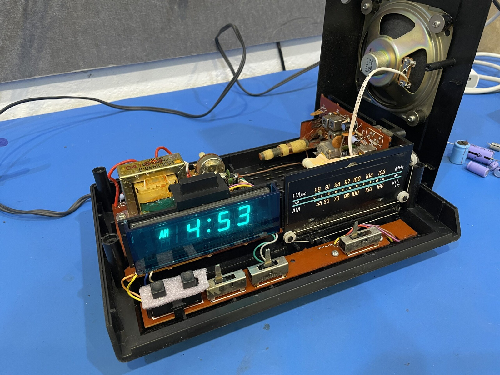
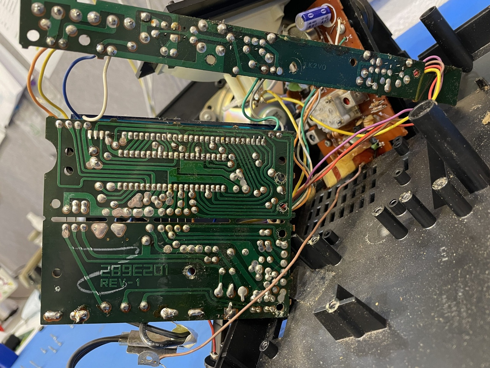
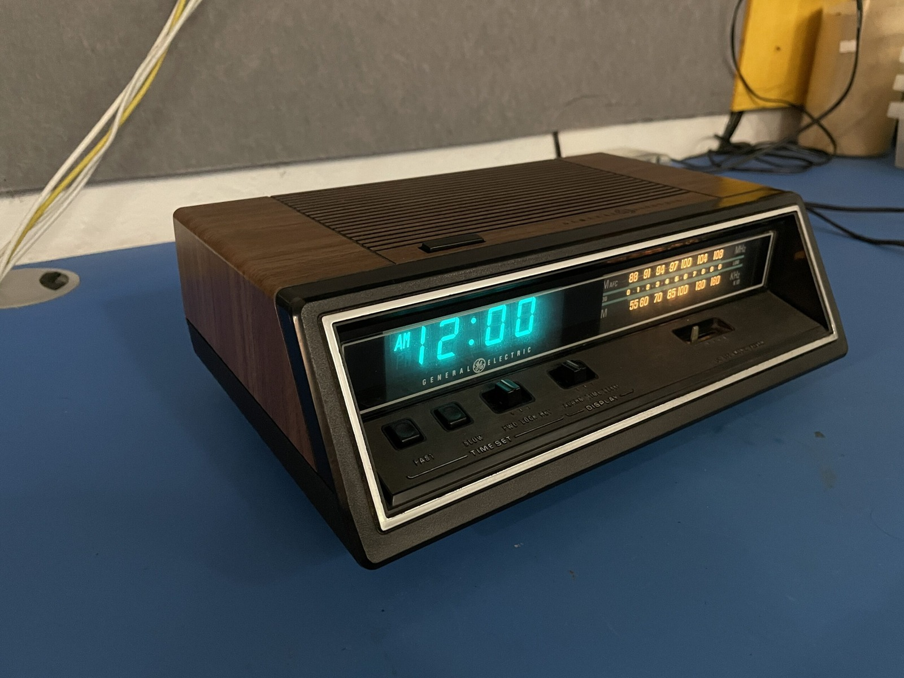



All good things eventually come to an end. If you've watched the previous four videos, this is the fifth and final instalment of my alarm clock radio adventure. Below is the capacitor list I recorded while working on it.

The stickers on my unit had disappeared, so I couldn't work out whether I had the A or B revision. These are the values from my actual board, not a parts list for every Model 4665 ever made. If you're recapping one yourself, check what's fitted, including the capacitor type, polarity, capacitance, voltage and temperature ratings, ESR, ripple-current requirements and physical fit.



For a write-up of the EA 7-4665B model, see [RadioMuseum's entry](https://www.radiomuseum.org/r/general_eo_ea7_4665b.html). It provides some useful background, but it doesn't identify the revision of my unlabelled unit.



Note that all capacitor markings are underneath the capacitors. On this unit the sticker with the model number was missing from the base. If any switches need cleaning, use a cleaner specifically suitable for the switch materials and surrounding plastics.



You can either [download the PDF version](/assets/uploads/General-Electric-Alarm-Clock.pdf) or copy and paste the list below into a plain text file. Where I've written "Upgraded", I fitted a capacitor with a higher voltage rating. That doesn't automatically make it a suitable replacement, of course, since all the other requirements still matter.

  

```
-----------------------------------------------------------------
POWER CIRCUIT
-----------------------------------------------------------------
Marking	Value	Voltage	Width	Height	E14	Notes
Axial	1000uF	35V	16mm	32mm	1600791	Upgraded to 50V
C34	1000uF	16V	15mm	25mm	1219471	Upgraded to 25V
C207	100uF	35V	21mm	10mm	3254079	Same specifications
C205	22uF	35V	8mm	13mm	1848399	Upgraded to 50V
-----------------------------------------------------------------
RADIO BOARD
-----------------------------------------------------------------
Marking	Value	Voltage	Width	Height	E14	Notes
C21	220uF	6.3V	8mm	12mm	2217563	Upgraded to 25V
C27	100uF	10V	8mm	12mm	3254079	Upgraded to 35V
C28	100uF	10V	8mm	12mm	3254079	Upgraded to 35V
C29	470uF	16V	10mm	20mm	3254036	Same specifications
-----------------------------------------------------------------
```

### Related Posts

- [General Electric Model 4665 AM/FM Radio - Part 1: Overview](/general-electric-model-4665-am-fm-radio-part-1/)
- [General Electric Model 4665 AM/FM Radio - Part 2: Tuning](/general-electric-model-4665-am-fm-radio-part-2/)
- [General Electric Model 4665 AM/FM Radio - Part 3: Transmitter](/general-electric-model-4665-am-fm-radio-part-3/)
- [General Electric Model 4665 AM/FM Radio - Part 4: AM/FM Switch](/general-electric-model-4665-am-fm-radio-part-4-am-fm-switch/)
