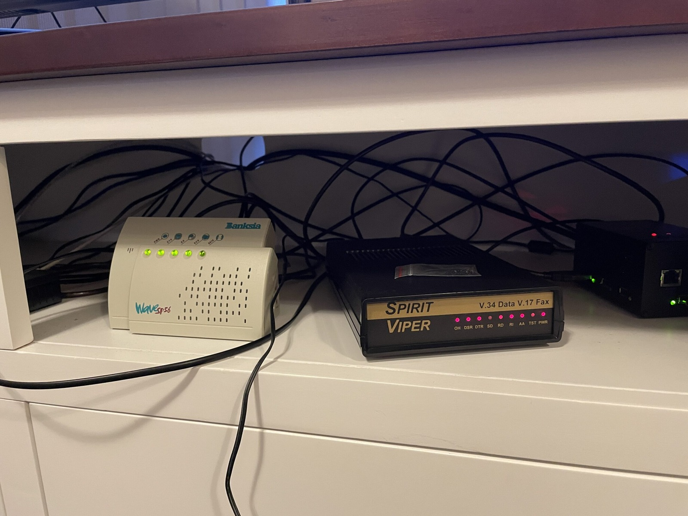
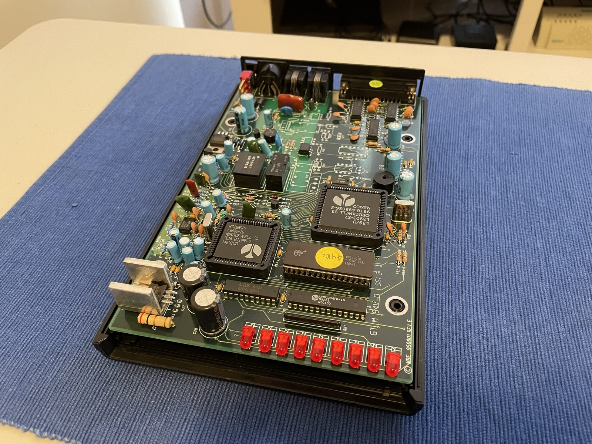



That's right, we doubled the speed to 28.8k, but it's still only 28.8k... maybe that's why the video is four hours long. Haha! Or maybe it's because I was searching for the perfect [Evangelion](https://en.wikipedia.org/wiki/Neon_Genesis_Evangelion) MIDI. I do need to find some new [SoundFonts](https://en.wikipedia.org/wiki/SoundFont)!

*Banksia Wave on one side, Spirit Viper on the other. The equipment behind my gloriously slow GeoCities browsing.*
{: .media-caption }

We were using the Spirit Viper V.34 external modem on the client-side. These were distributed by Mike Boorne Electronics Pty. Ltd. in the mid-1990s. Apparently a pretty solid modem. We clocked four hours and 12 megabytes of data. The Banksia Wave SP 56 was our server-side modem.

*Inside the Spirit Viper. Those capacitors were a little too close to the plastic lid for comfort.*
{: .media-caption }

The Spirit Viper V.34 is a nice looking modem internally too. Those capacitors at the front touch the plastic top. If they vent, they'll be melting through the top. I'm still waiting for a backorder to arrive with potentially suitable replacements, but as we all know, the chip shortage continues.

### Related Posts

- [The GeoCities Rebuild Worklog](/the-geocities-rebuild-worklog/)
- [Rebuilding GeoCities on macOS 12](/rebuilding-geocities-on-macos-12/)
- [RetroChallenge 2022/10 - GeoCities Rebuild on Dial-up at 14.4k](/retrochallenge-2022-10-geocities-rebuild-on-dial-up-at-14-4k/)
