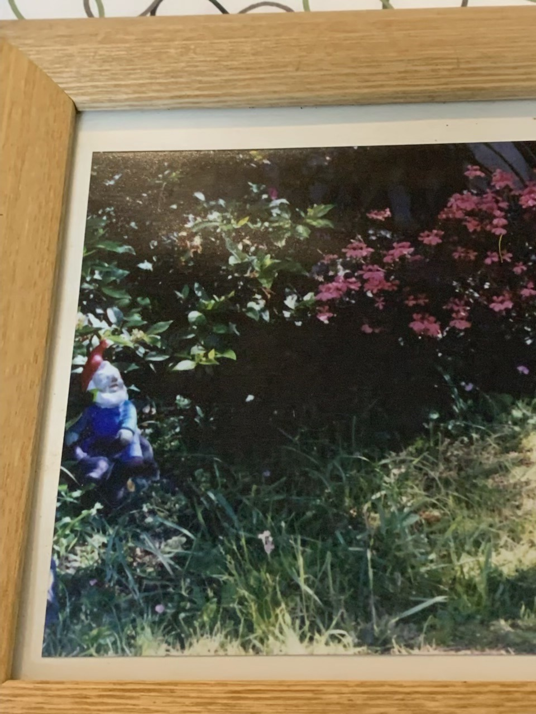
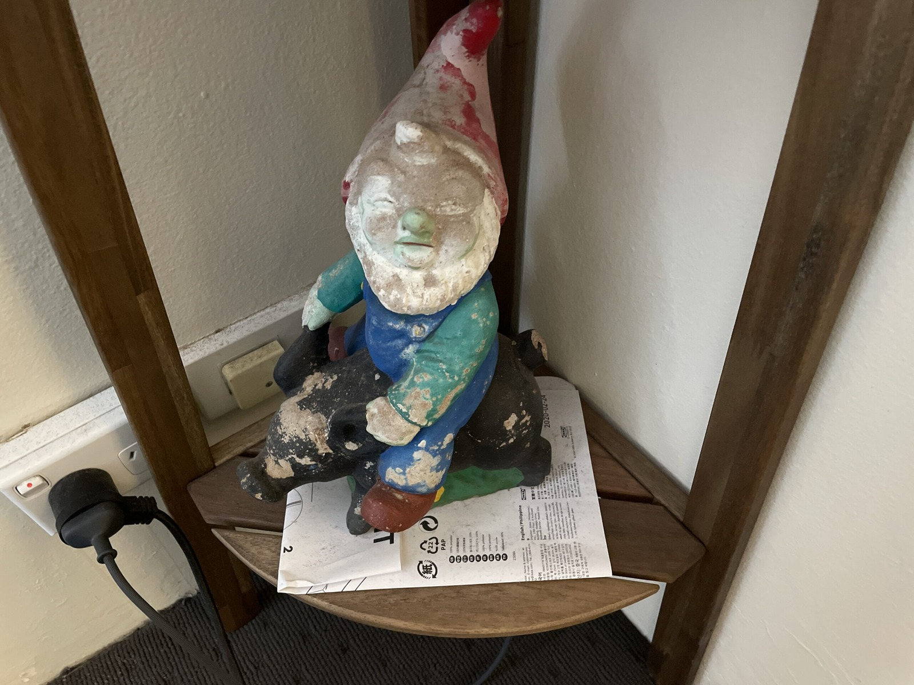
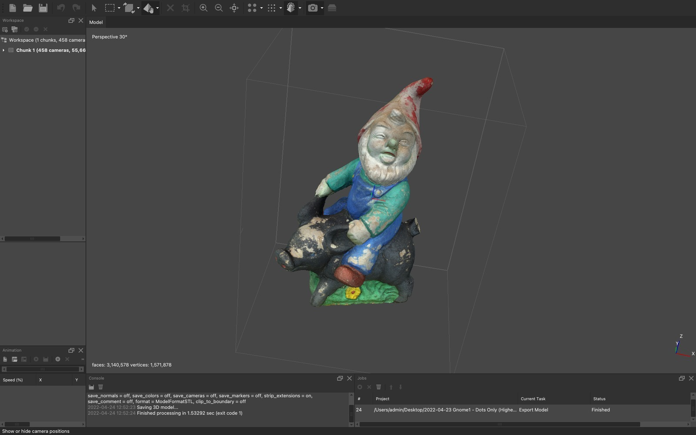



I don't own many things. However, I do own this gnome. This heavy, concrete gnome. I don't have a garden or any outdoor space because those things are expensive where I live. _Sigh._ Luckily, I was able to turn him into a digital 3D model using [photogrammetry](https://guides.lib.unc.edu/c.php?g=716413&p=5098011) and [Agisoft Metashape](https://en.wikipedia.org/wiki/Metashape).

Here's the gnome in the wild circa early 1990s. A very vibrant looking gnome. Is that green space? Maybe things were better growing up. At least now I can make the gnome live on forever like a [Digimon](https://en.wikipedia.org/wiki/Digimon).

Nan and Pa, my grandparents, gave this gnome to either Mum or me years ago. I'm not sure which, but the concrete gnome has certainly survived the years. It's rather nice being able to turn something I've known since childhood into something digital.

Here's our garden gnome in the present day. A little worn, but still looks like a garden variety garden gnome riding a pig.

Getting a PLA print out of the 3D printer wasn't entirely straightforward. We had problems with bed adhesion and a nozzle that might have been clogged, or perhaps just wasn't fitted properly. Eventually we got a working print, and the support material came away more cleanly than I'd expected. Even the missing little piece of the pig's tail had made it into the digital model. Not bad!

He can live inside the computer as a 3D model or, thanks to [augmented reality](https://web.archive.org/web/20221111200747/https://www.apple.com/au/augmented-reality/), appear in my lounge room or even the kitchen sink (scale is no issue!). And of course, you can always 3D print more to carry around and throw at people... or whatever one would do with Pocket Gnomes (Patent pending).

I should thank Tim as well, because I wouldn't have learnt about turning the concrete gnome into a 3D model without him. It's quite extraordinary what can be done with a pile of photographs and some software.

You can find more gnome photos in the [photo gallery](/goodies) under Project Gnome. I'll likely be doing a future post on how all this came about as the photogrammetry software, Metashape, was quite interesting and very fun to work with! 😀
