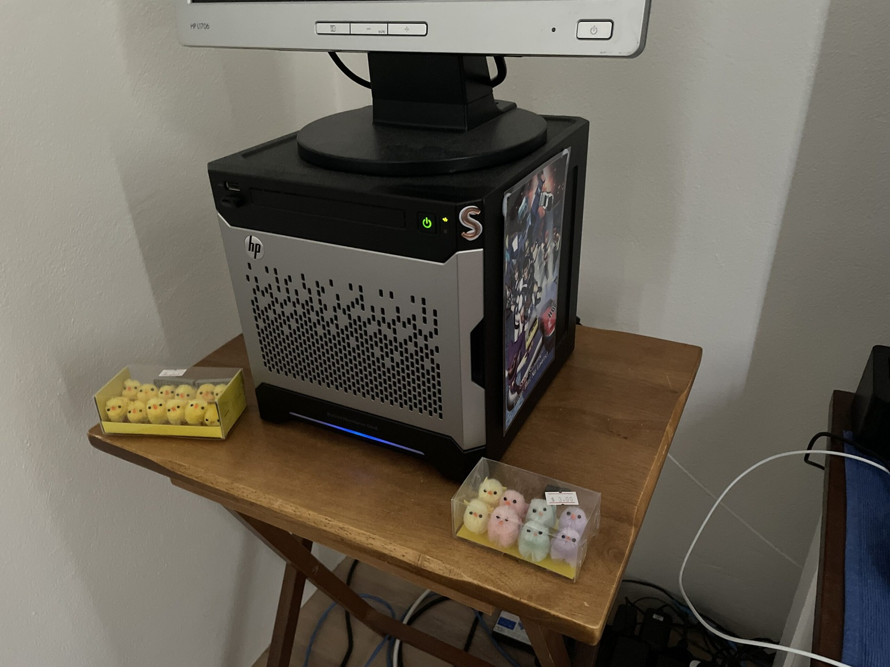
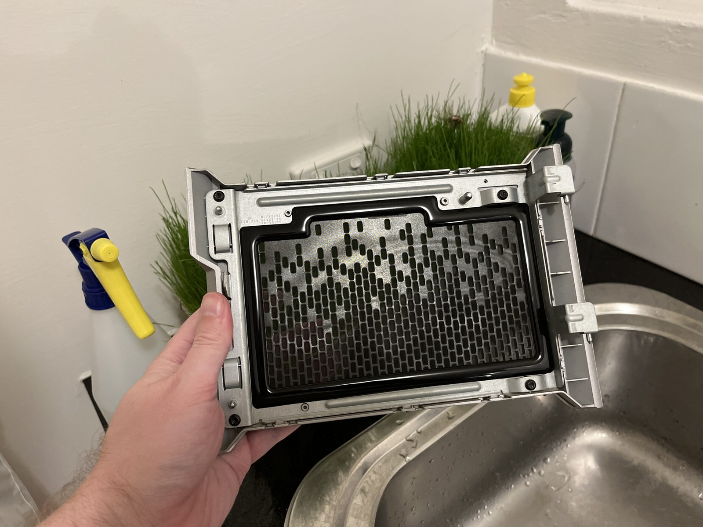
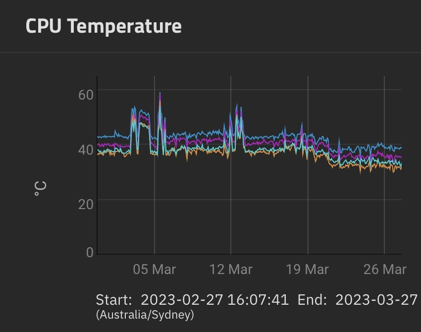

*The little HP server hosting the storage experiments, with some rather colourful company on the table.*
{: .media-caption }

Sometime in October 2022 during RetroChallenge 2022/10 I started to tinker with TrueNAS SCALE. I've been on the search for more storage for a while now. Well, not more storage, but a way to store my data _**reliably**_. I learnt about magical things like ZFS, RAIDZ2, spinning rust, HPE MicroServer Gen8, modern hard drive error rates and more!

*A closer look at the mesh panel. The kitchen ryegrass apparently wanted to be involved too.*
{: .media-caption }

Fast-forward to today and I now have a cool mesh and 64 TB of raw drive capacity, with 32 TB of that going towards redundancy rather than file storage. That's before filesystem overheads. Redundancy isn't a backup, so I might have an offsite backup or two.

And who could forget the ryegrass in my kitchen along with the empty shell of a desiccated cicada (zoom!). That's a story for another day. With the mesh fitted, the CPU temperature graph below shows a drop towards the end of March. Looking cooler!

*The CPU temperature traces settle noticeably lower towards the end of March. Looking cooler!*
{: .media-caption }

The additional storage gives me space to breathe and sort out my data, which is something I haven't been able to do for a long time. There's plenty happening, but I'm back on a five-day week and it's killing me.

I think the problem is I can't see any future where more of the same doesn't continue. Maybe lizard has it all figured out but can't communicate it to us. Oh well, at least TrueNAS kicks ass! 🤷‍♀️

*LIZARD. The captioning department was operating at peak sophistication.*
{: .media-caption }

### Sources

- [TrueNAS Storage Primer on ZFS for Data Storage Professionals](https://www.truenas.com/blog/truenas-storage-primer-zfs-data-storage-professionals/)
