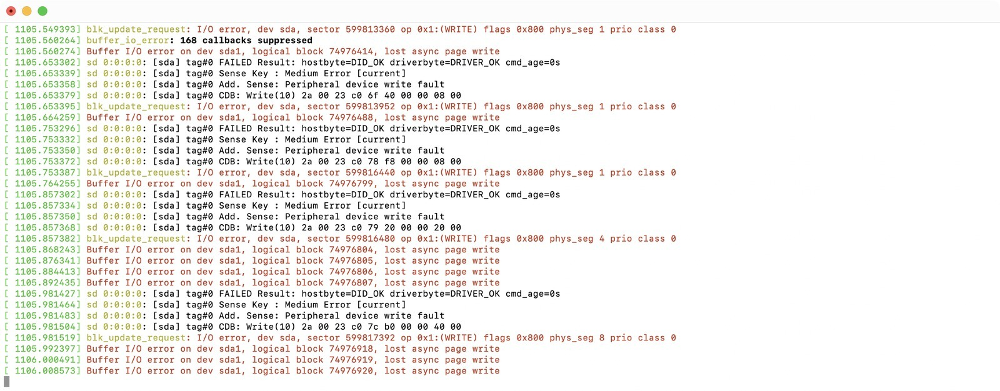
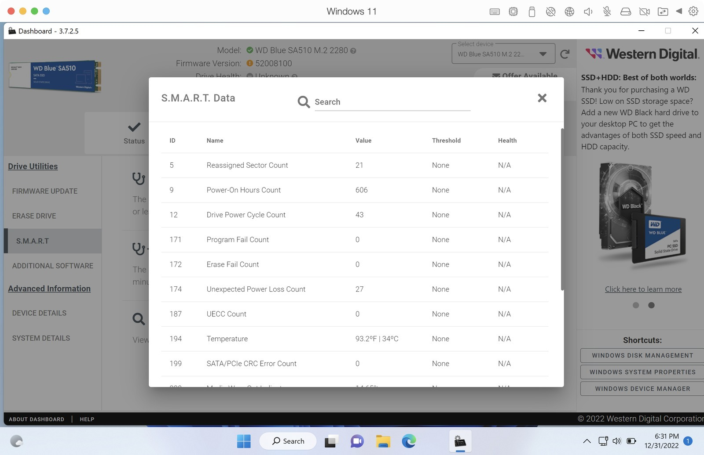
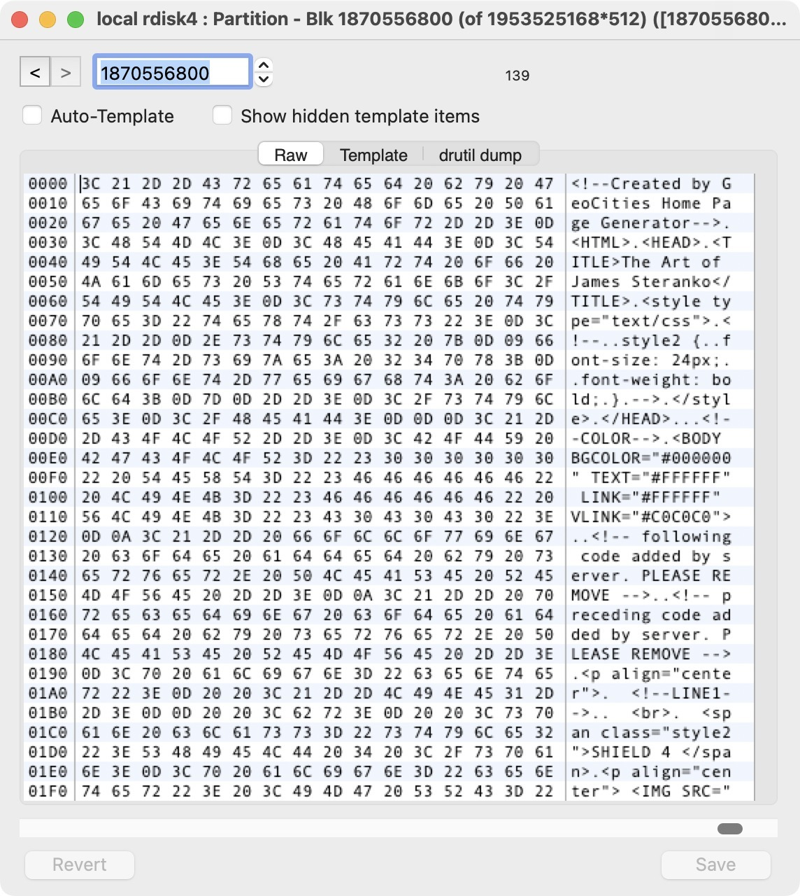
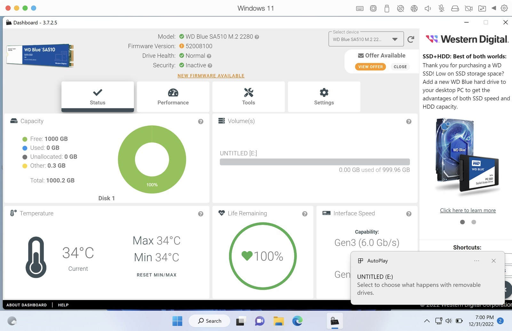
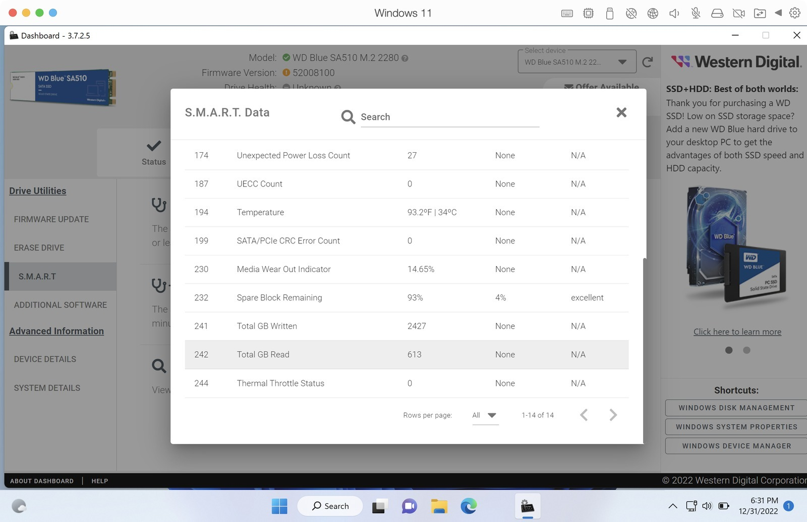
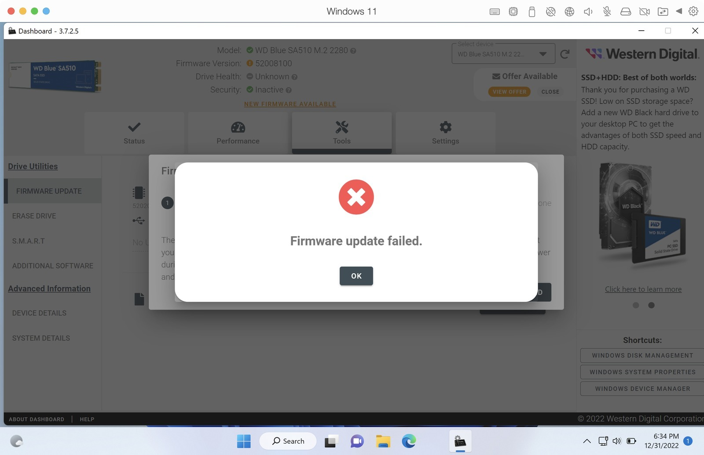
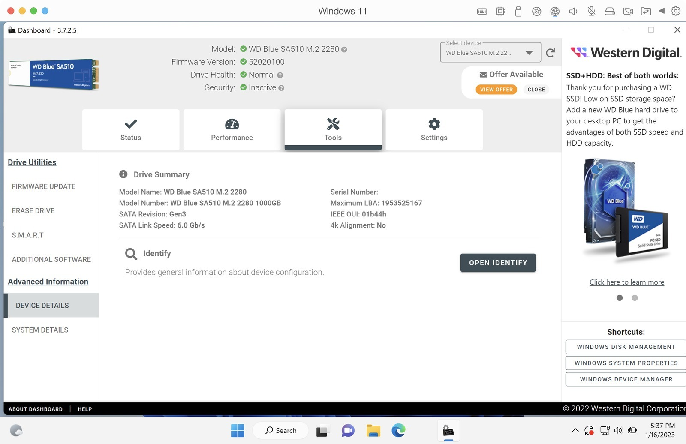

*GeoCities did not go down quietly. The drive was throwing write errors all over the terminal.*
{: .media-caption }

Back in late December, and I'm talking right on 31st December 2022, GeoCities crashed hard. Its SSD had become unusable for normal writes while running firmware 52008100. Firmware, I'm looking at you! It was certainly high on the list of suspects, even if one dead drive can't tell us everything about why it failed.

*Just 606 power-on hours and 43 power cycles on the troublesome SSD. Not much of a retirement age.*
{: .media-caption }

The failed drive powering GeoCities was a WD Blue SA510 1 TB M.2 SATA SSD, model WDS100T3B0B. That little blade-shaped SSD was enough to take the whole site offline.

*At least the old GeoCities pages were still readable at the raw-data level.*
{: .media-caption }

The drive was behaving as read-only. GeoCities data was still there when read with [iBored](https://apps.tempel.org/iBored/). I could read it in Ubuntu and macOS, but couldn't get at the data in my Windows setup, even though WD Dashboard could see the drive.

Being overly cautious, I had another drive ready to go. The bad news is, that other drive was of the same vintage. This was the drive I'd been using for [RetroChallenge 2022/10](https://www.retrochallenge.org/2022/11/finish-line.html). Those reported power-on hours tell you how long the SSD had been running, not how many months had passed since the challenge.

*The backup SSD was still healthy enough to see an available firmware update.*
{: .media-caption }

The above is my secondary drive, the offline backup for GeoCities. Interestingly it updated without any issues. It had 2 hours of uptime and 26 power cycles, somehow. It was also on 52008100 and successfully updated to 52020100, which was the available fix I had at the time.

*More S.M.A.R.T. details from WD Dashboard. The numbers were not exactly reassuring after the first drive died.*
{: .media-caption }

[I was not alone](https://community.wd.com/t/wd-blue-250-gb-sa510-issues/279814). Both drives were running 52008100, one of the firmware versions covered by [Western Digital's critical update notice](https://web.archive.org/web/20230519165540/https://support-en.wd.com/app/answers/detailweb/a_id/50208). The good news was that 52020100 was available, and my backup drive accepted it. WD's [later release history](https://web.archive.org/web/20231015000448/https://support-en.wd.com/app/answers/detailweb/a_id/50208/kw/SA510) dates that detection fix to 27th October 2022, before this failure. It also lists 52046100, dated 25th May 2023, for a read-only issue. That second fix came after this April post, so it helps explain the firmware suspicion in hindsight; it wasn't the update I was trying here.

*The failed SSD refused the firmware update. Cheers for that.*
{: .media-caption }

The failed drive wouldn't update from 52008100 to 52020100 through WD Dashboard. I couldn't recover it that way, so after a quick warranty check and message to the initial seller, it was sent back for repair or replacement.

*The spare SSD made it to firmware 52020100. At least one of them was playing nicely.*
{: .media-caption }

Not too long later I received a replacement and copied GeoCities back across, completely forgot the mount point and nearly set fire to my Raspberry Pi 4. Mission accomplished! 🤷‍♀️

### Sources

- [Western Digital Archive: WD Blue SA510 SATA SSD Critical Firmware Update (19 May 2023)](https://web.archive.org/web/20230519165540/https://support-en.wd.com/app/answers/detailweb/a_id/50208)
- [Western Digital / SanDisk: WD Blue SA510 Critical Firmware Update and Release History](https://support-en.sandisk.com/app/answers/detailweb/a_id/50208/~/wd-blue-sa510-sata-ssd-critical-firmware-update)

### Related Posts

- [The GeoCities Rebuild Worklog](/the-geocities-rebuild-worklog/)
- [Rebuilding GeoCities on macOS 12](/rebuilding-geocities-on-macos-12/)
- [RetroChallenge 2022/10 - GeoCities Rebuild on Dial-up at 14.4k](/retrochallenge-2022-10-geocities-rebuild-on-dial-up-at-14-4k/)
- [RetroChallenge 2022/10 - GeoCities Rebuild on Dial-up at 28.8k](/retrochallenge-2022-10-geocities-rebuild-on-dial-up-at-28-8k/)
