

Here I was thinking I had an 11-minute voiceover but I misread the timeline. I'll never use a script, I'm too lazy. Enjoy my half-completed thoughts above. You'll work it out. The protocol I was wrestling with was HTTP/0.9, not "HTML/0.9". HTML is the document format; HTTP is the protocol carrying it. The following issues we encountered are in no particular order - it adds to the fun! 😉

Most of this tinkering goes back to around April 2022, and here we are in May 2023. I wanted to get the photos and notes up because somebody else might find them useful when trying to get an old computer onto the internet. If nothing else, they might save someone from chasing a few of the same problems!

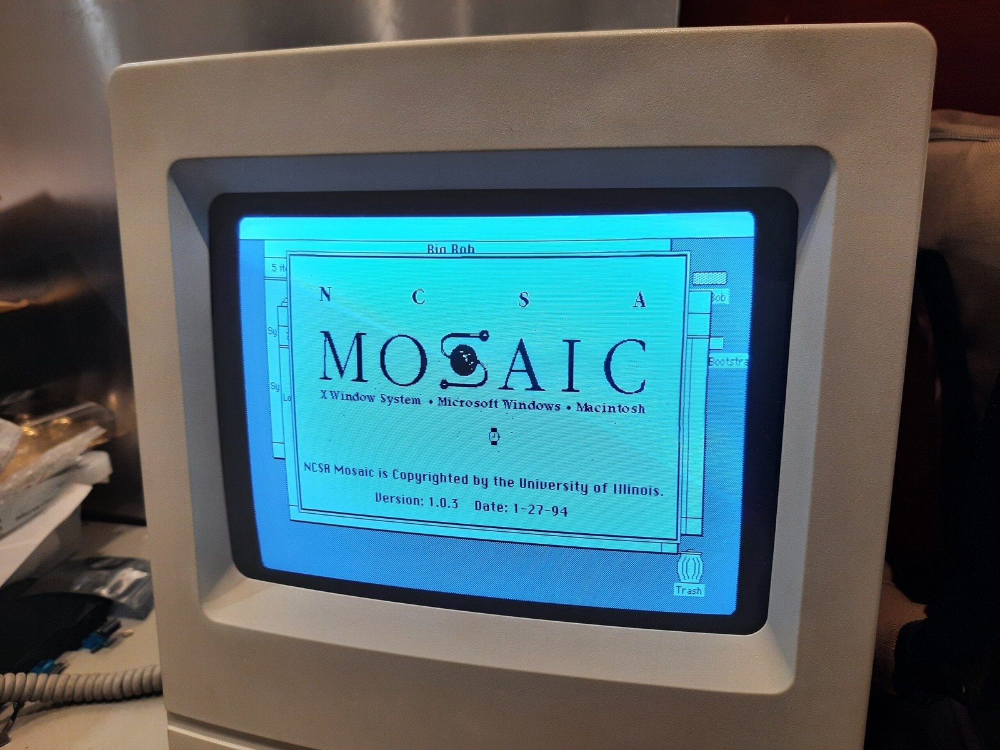

*The Macintosh Classic fires up NCSA Mosaic 1.0.3. Modern web compatibility was never going to be straightforward.*
{: .media-caption }

Let's start with the innocent [NCSA Mosaic](https://en.wikipedia.org/wiki/NCSA_Mosaic). At this stage we were running on a [Macintosh Classic](https://web.archive.org/web/20210304075849/https://support.apple.com/kb/SP198?locale=en_US), complete with its Motorola 68000 and black-and-white screen. Its original hard drive had failed and we'd been trying RaSCSI, so this wasn't exactly the most straightforward internet machine. Give me an LC 475 any day! Still, the Mosaic splash screen works well.

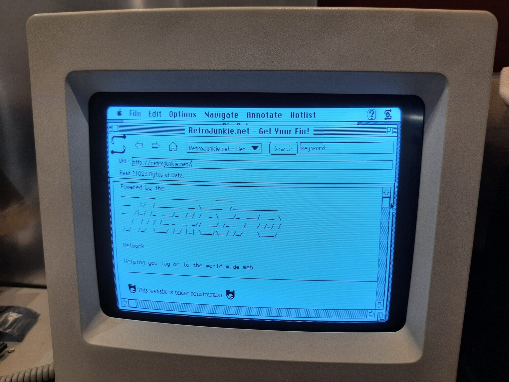

*RetroJunkie.net loads in Mosaic on the Classic. Even the ASCII-art logo made it across.*
{: .media-caption }

We even made it to the [RetroJunkie homepage](https://retrojunkie.net)!

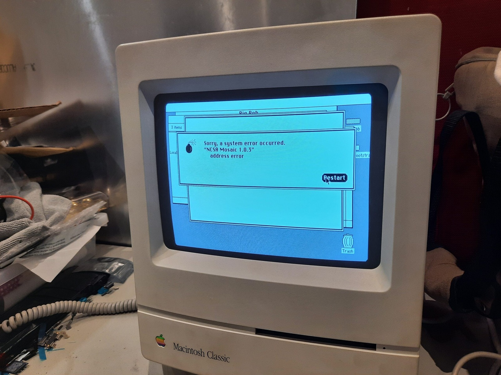

*Mosaic was less enthusiastic about staying alive: an address error brings the entire Mac to a stop.*
{: .media-caption }

Like anything running way beyond what it was designed for, it crashed a good amount. Of course there's no memory protection so Mac OS went down with it forcing a slow restart.

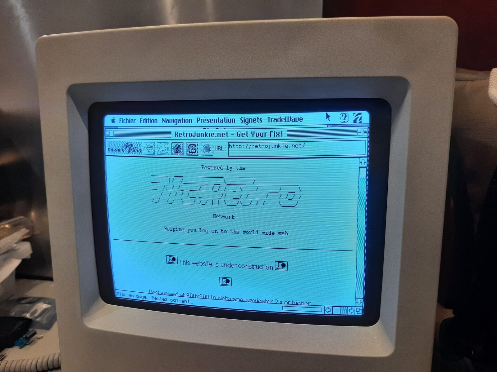

*MacWeb manages the RetroJunkie homepage, although I managed to find the French version.*
{: .media-caption }

We ruled out Mosaic due to the crashes and really dated HTML support. Next up we had [MacWeb by Tradewave](https://en.wikipedia.org/wiki/MacWeb). And can I say, it actually worked OK for our purposes. There is a patched version, 2.0c, that has some tweaks for black and white Macs even. Unfortunately, I picked the French localisation.

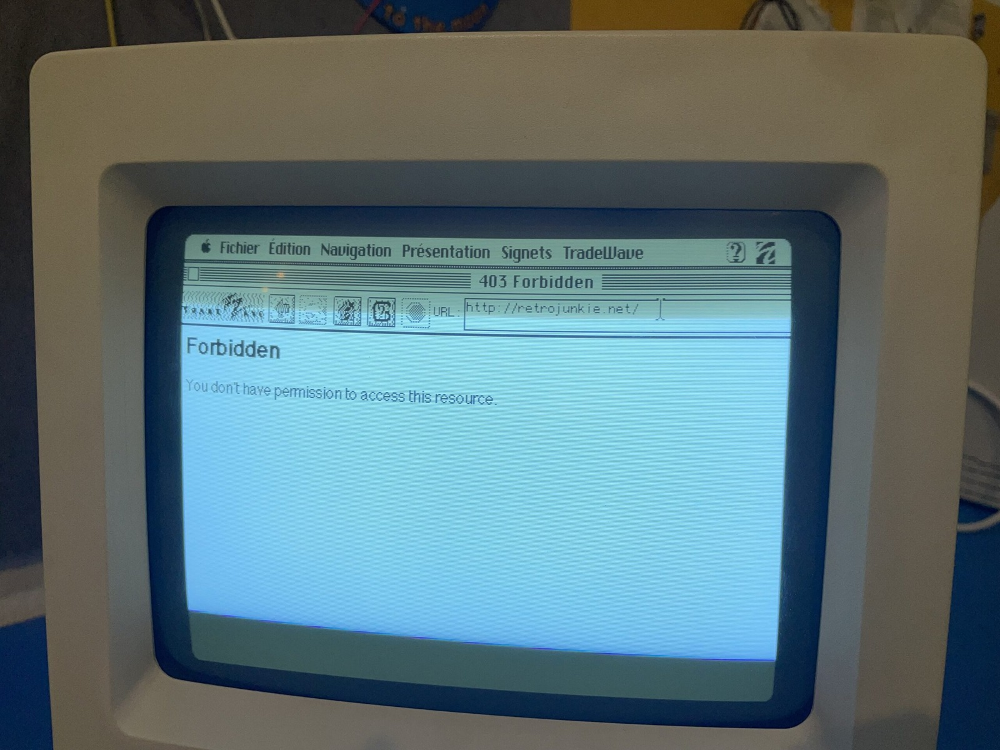

*A rather unwelcoming 403 Forbidden response in MacWeb. The browser itself was not the only obstacle.*
{: .media-caption }

Forbidden address. Ahhh yes. I believe this was caused by Cloudflare doing something... what exactly - I can't remember! But I was able to get it by accessing retrojunkie.net or the IP retrojunkie.net was hosted at. It's the catch-all site in case anyone strays to my server's IP address.

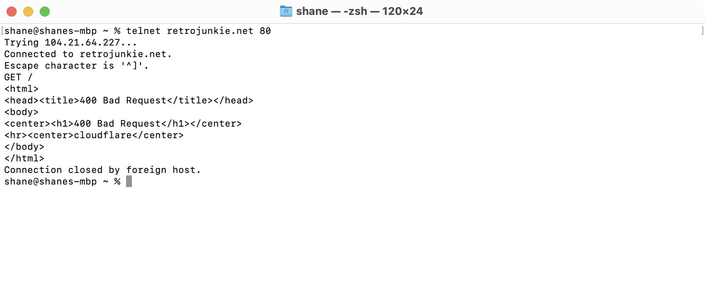

*Even a plain `GET /` by telnet came back with a 400 Bad Request from Cloudflare. Very retro, very helpful.*
{: .media-caption }

So I resorted to telnet, which is very old-internet friendly it turns out. A simple `GET /` sent to retrojunkie.net resulted in... a bad request... with a sprinkling of Cloudflare, which was supposed to be disabled. The screenshot catches that in all its glory.

A proper HTTP/0.9 request is just a one-line `GET` with no HTTP version token or request headers. There's no `Host` header either, so it can't choose between name-based virtual hosts. I messed with the proxy settings a bit more, possibly disabling Cloudflare completely for testing and...

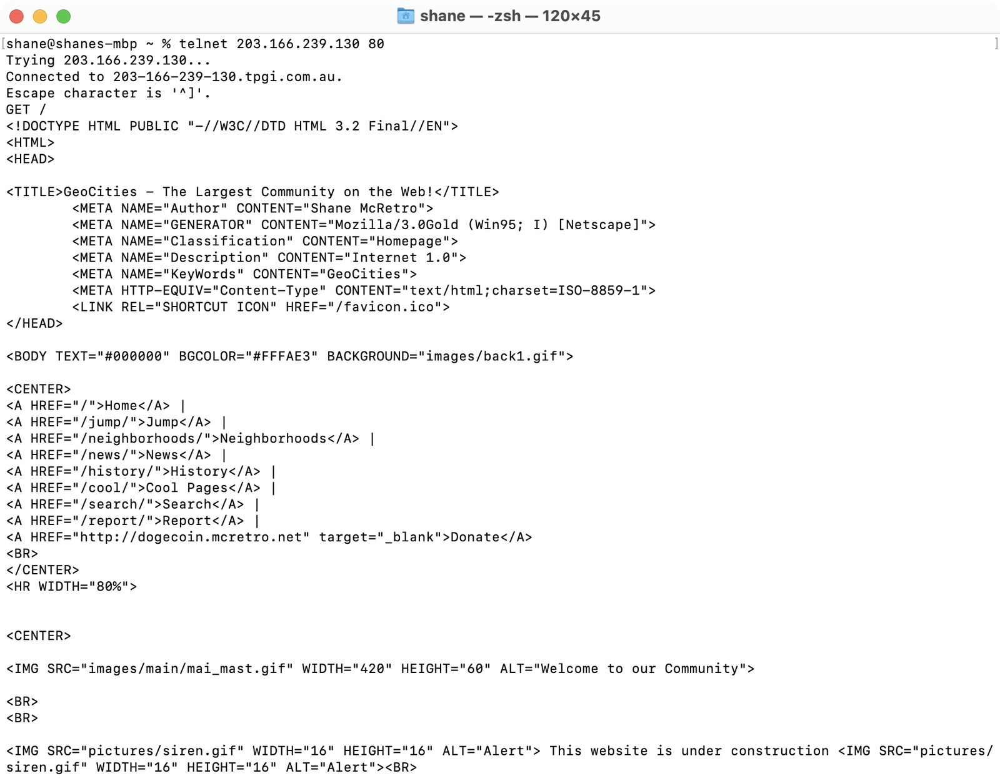

*Talking directly to the server IP gets us somewhere: GeoCities HTML in response to a simple `GET /`.*
{: .media-caption }

Telnet successfully gets the root! This time I connected directly to the server's IP and got the GeoCities HTML back from a simple `GET /`. By this point I'd opted to mess with the GeoCities subdomain. Now what about a web browser?

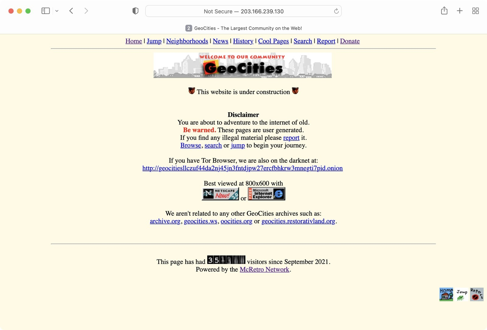

*One IP address, one useful default page. The GeoCities landing page appears without a hostname in Safari.*
{: .media-caption }

One IP address, one default website. That gave these older clients somewhere useful to land even without a `Host` header.

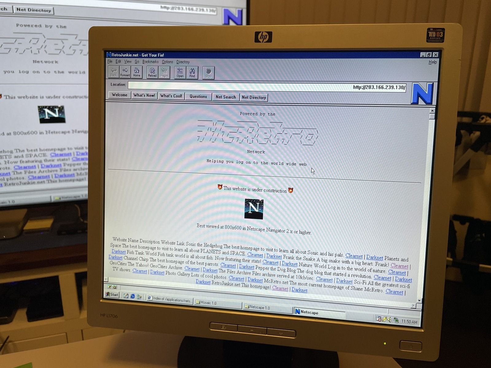

*Netscape 1.0 on Windows reaches the server by IP. MiSTer, modem and all, because apparently this was the easy option.*
{: .media-caption }

I only had Netscape 1.0 on hand in Windows via the MiSTer and a dial-up modem... as one does. But the IP address now resolves. Let's test with the retrojunkie.net domain name...

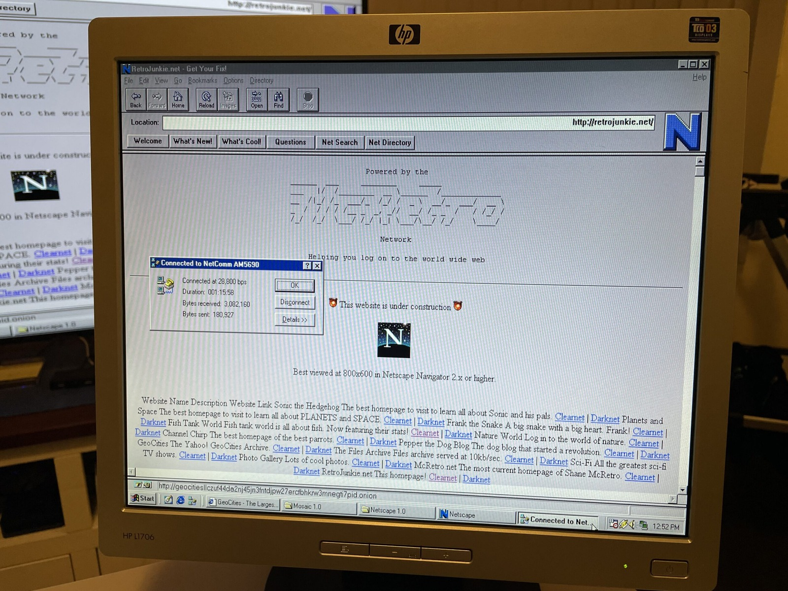

*RetroJunkie.net loads by name too, with the NetComm dial-up status box proudly reporting 28,800 bps.*
{: .media-caption }

And it works a charm.

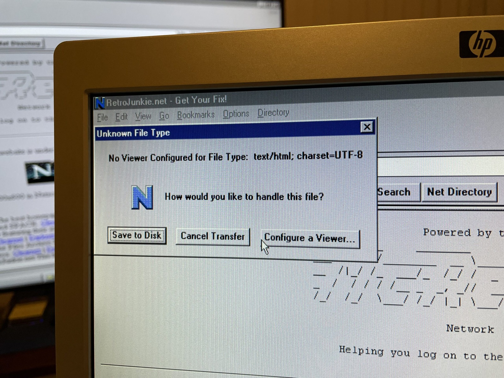

*Netscape was happy enough until it met `charset=UTF-8` and wanted me to configure a viewer.*
{: .media-caption }

Well, close enough to a charm. Especially given charset=UTF-8 wasn't yet the rage and ISO-8859-1 would rule supreme for a while longer.

`sudo tail -f /var/log/apache2/access.log`

Tailing the Apache2 access log shows us:

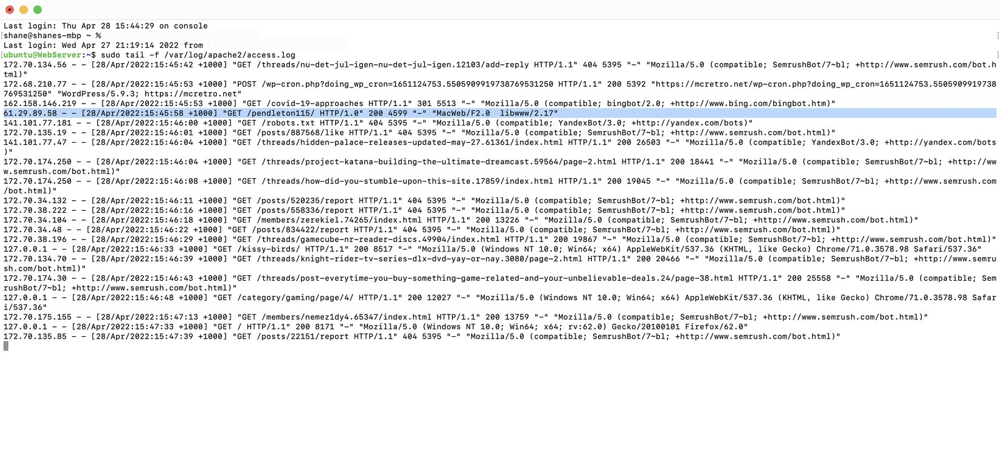

*Apache caught MacWeb/F2.0 in the logs, using libwww/2.17 and making an HTTP/1.0 request.*
{: .media-caption }

MacWeb/F2.0 uses libwww/2.17 - There's that F for French again...

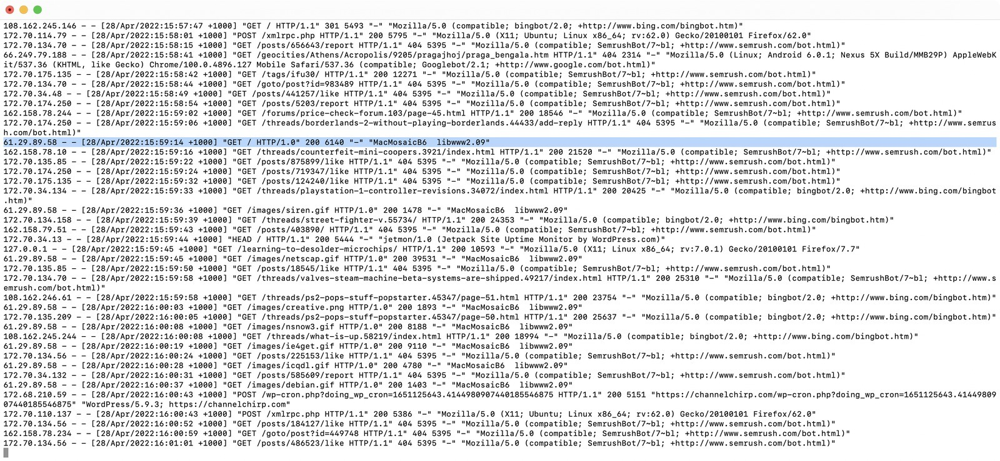

*Mosaic introduces itself as MacMosaicB6 using libwww2.09. Another HTTP/1.0 request, not HTTP/0.9.*
{: .media-caption }

Mosaic identifies itself in the log as MacMosaicB6 libwww2.09. The splash screen calls our copy version 1.0.3, so at least we know what this particular setup was reporting. That doesn't mean every earlier Mac Mosaic version necessarily sent the same user-agent string.

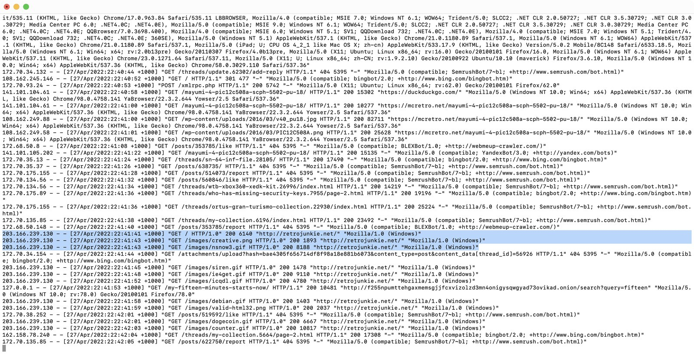

*The Windows Netscape 1.0 test appears in Apache as Mozilla/1.0 (Windows), again over HTTP/1.0.*
{: .media-caption }

And our Windows Netscape 1.0 identifies itself as Mozilla/1.0 (Windows).

What's perhaps most interesting in these examples is the request protocol recorded by Apache. The old clients were reaching the server as HTTP/1.0. A real HTTP/0.9 request would just be a one-line `GET /path` with no HTTP version token and no request headers. Apache wasn't detecting an "HTML version" here at all. I'd been mixing up the page format with the transport protocol.

This also corrects my earlier [Macintosh Classic, RaSCSI and The Internet](/macintosh-classic-rascsi-and-the-internet/) theory that the browsers were failing because they only supported HTTP/0.9. That conclusion did not survive testing, which is exactly why documenting the wrong turns is useful.

### Sources

Here's some of the pages I followed to get this to work, a big thanks to each of the authors! RFC 1945 also spells out the difference between the simple HTTP/0.9 request and a full HTTP/1.0 request.

- [MDN - Evolution of HTTP](https://developer.mozilla.org/en-US/docs/Web/HTTP/Guides/Evolution_of_HTTP)
- [Metalbabble: Connecting a Macintosh SE to the Internet with a Raspberry Pi (2020)](https://metalbabble.wordpress.com/2020/02/08/the-final-frontier-connecting-a-macintosh-se-to-the-internet-with-a-raspberry-pi/)
- [Web browsers for antique Macs](http://www.mirrorservice.org/sites/browsers.evolt.org/browsers/macweb/macweb.htm)
- [Kafsemo - Talking HTTP/0.9, 1.0, 1.1](http://www.kafsemo.org/2015/01/03_talking-HTTP-0.9%2C1.0%2C1.1.html)
- [Toby Mackenzie - Supporting HTTP 0.9](http://www.tobymackenzie.com/blog/2018/02/18/supporting-http-0-9)
- [RFC 7230, Appendix A.2 - Changes from RFC 2616](https://datatracker.ietf.org/doc/html/rfc7230#appendix-A.2)
- [RFC 1945 - Hypertext Transfer Protocol HTTP/1.0, Sections 4 and 5](https://www.rfc-editor.org/rfc/rfc1945.html#section-4)

### Related Posts

- [Macintosh Classic, RaSCSI and The Internet](/macintosh-classic-rascsi-and-the-internet/)
