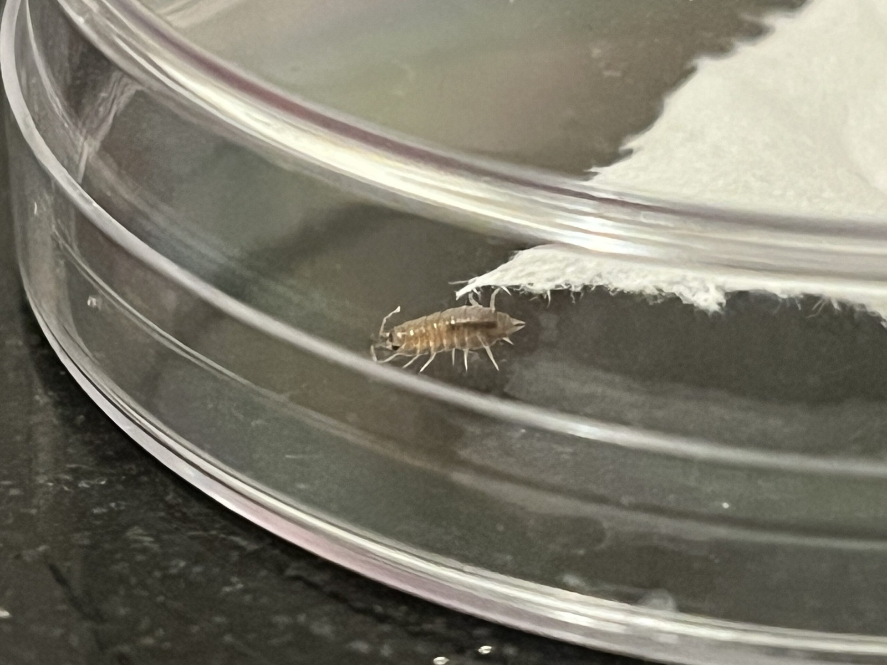
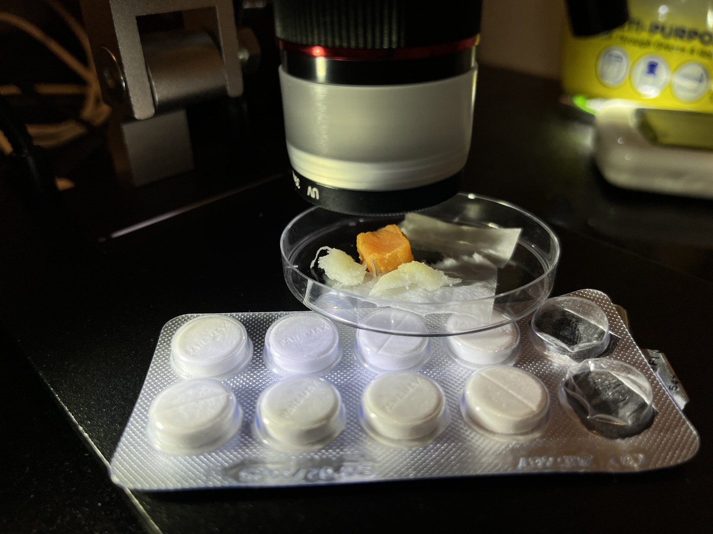
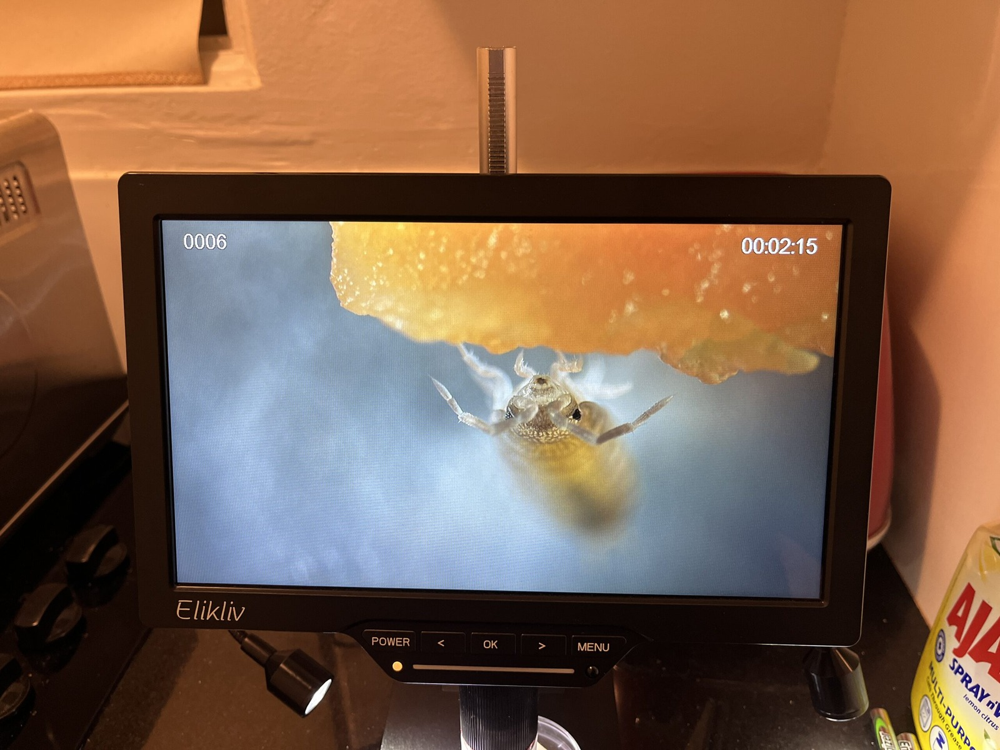



Earlier, I was processing some video footage from my [Super Nature World](https://www.youtube.com/@SuperNatureWorld) YouTube channel and realised I'd recorded a woodlouse feeding **for over an hour**. Slater, potato bug... honestly, they have a million names. That's a lot of footage of one little buggo eating lunch.

*The tiny bath-rescue potato bug resting in a petri dish, already on its way to a better afternoon.*
{: .media-caption }

This was a small potato bug that must have fallen into my bath during the day. This little one was trapped in a small droplet of water. I recovered it and popped it into a petri dish to rest. That's when I learnt they can be called "potato bugs".

*The dining experiment: one sweet potato cube, two bits of ordinary potato and a microscope to catch the action.*
{: .media-caption }

A freshly rinsed sweet potato cube cut from a frozen sweet potato chip with two regular potato bits and we see who the clear favourite is. I hear you little buggo. I'd eat sweet potato all day too! 🍠

*Sweet potato wins. The little buggo gets its own close-up feeding video, naturally.*
{: .media-caption }

Watch the video at the top to enjoy this little bug having the meal of a lifetime to some classical music that, at times, actually fits the scene quite well. Potato bug was kept under observation until later that evening and released into some moist leaf litter. Below is the 10x-speed version!


