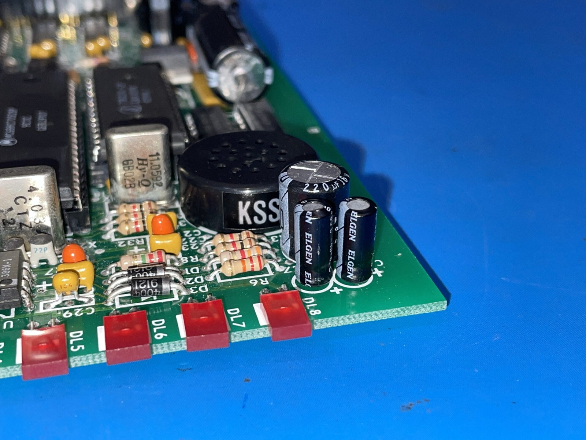
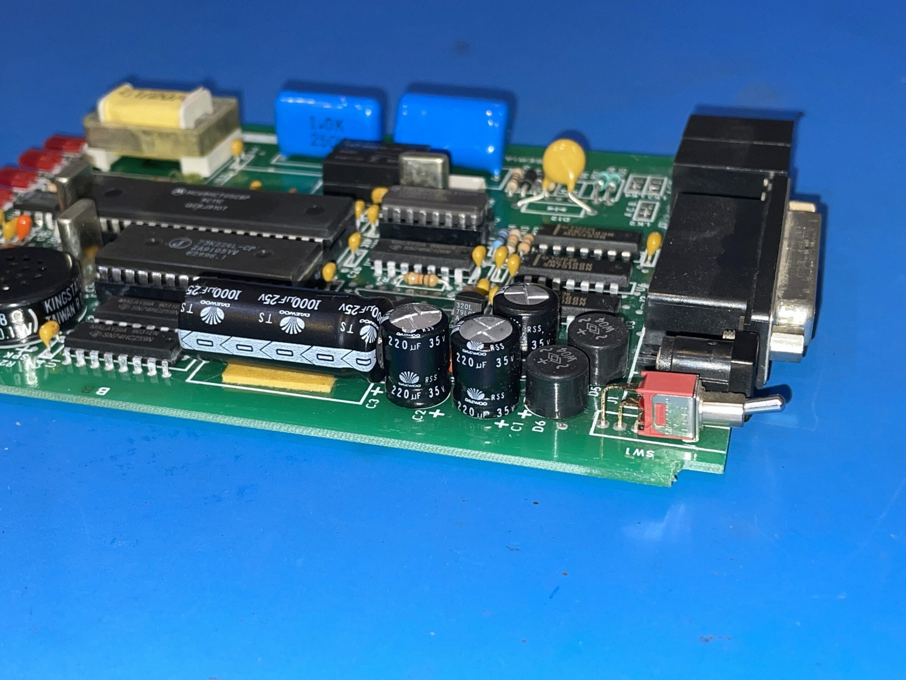
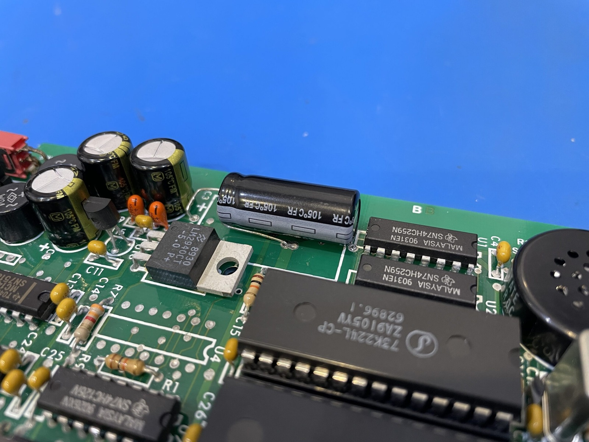
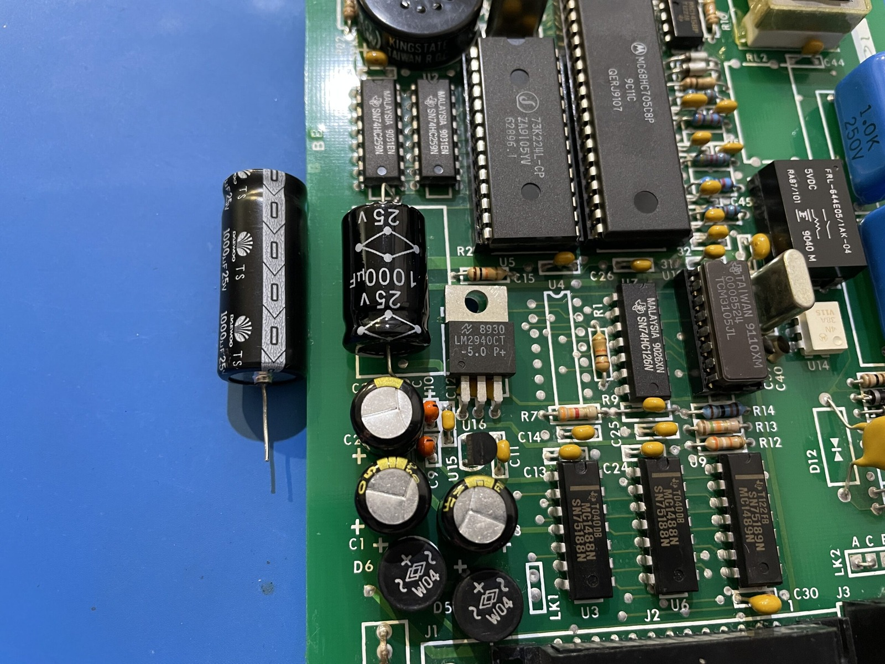
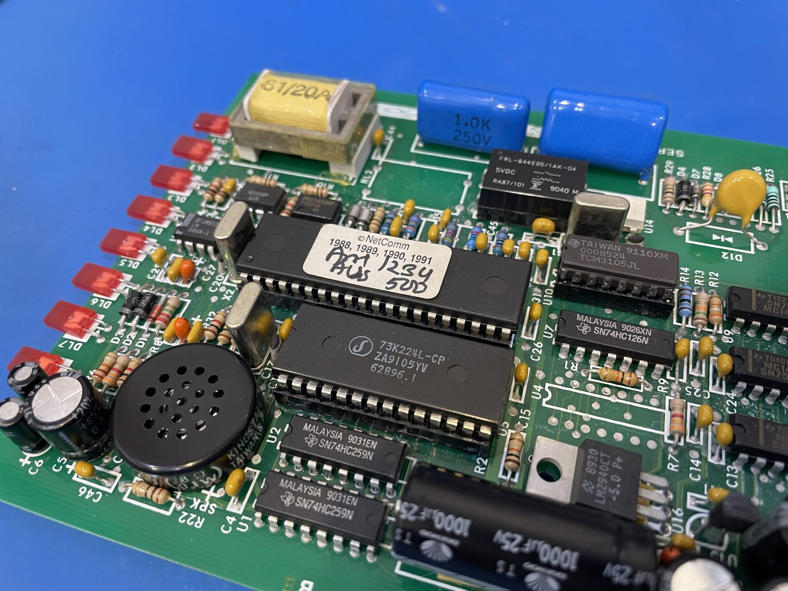
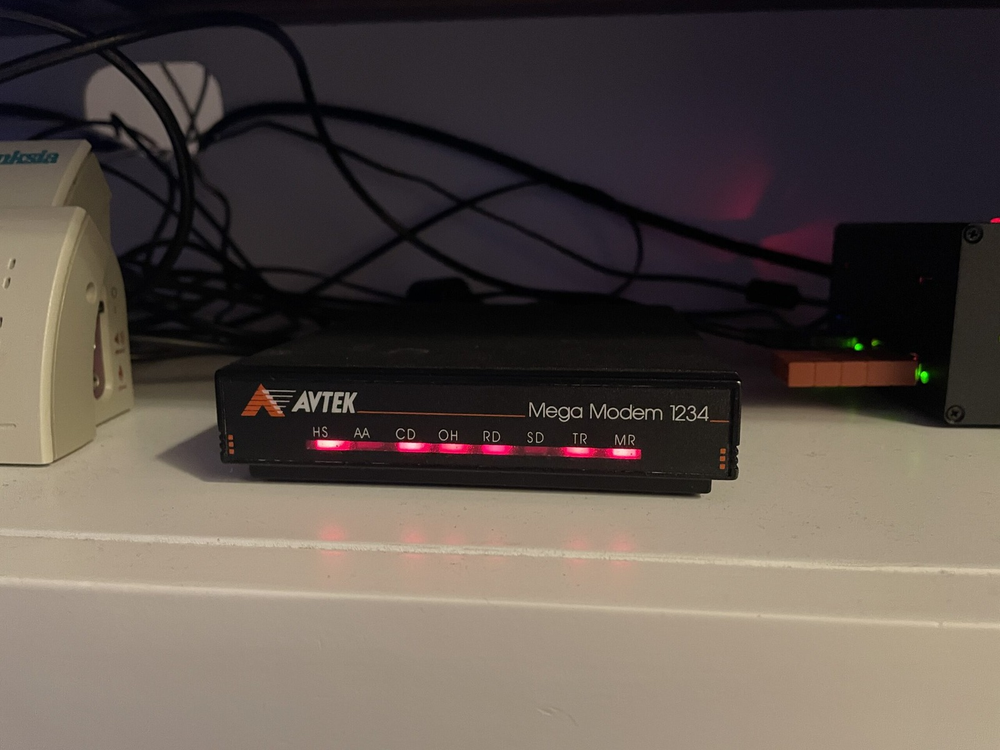
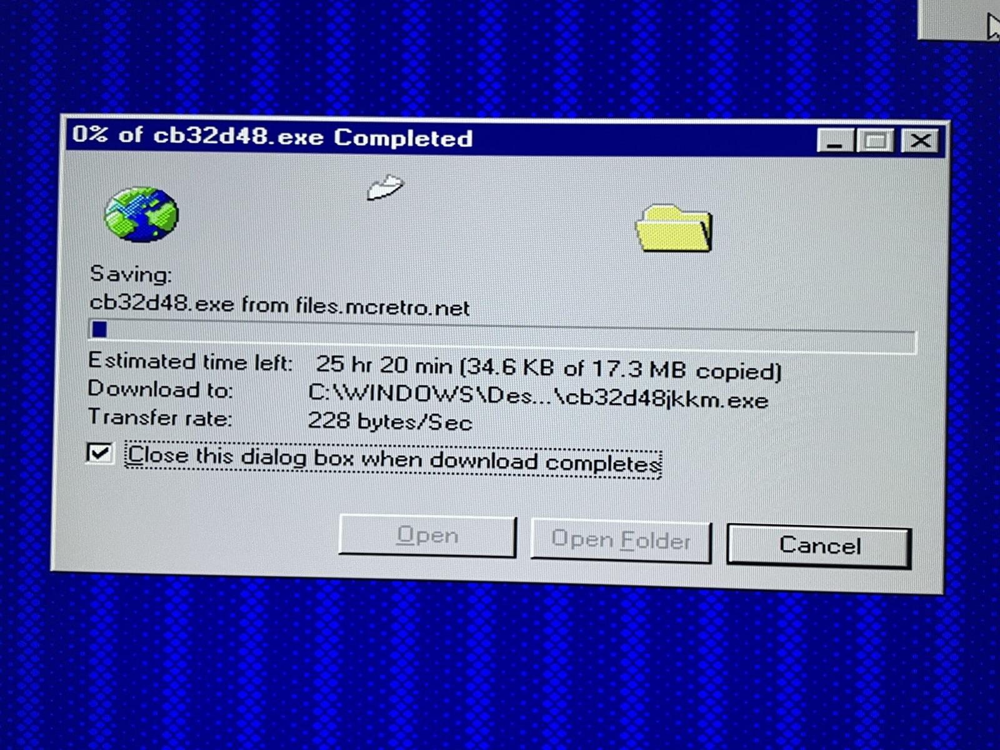
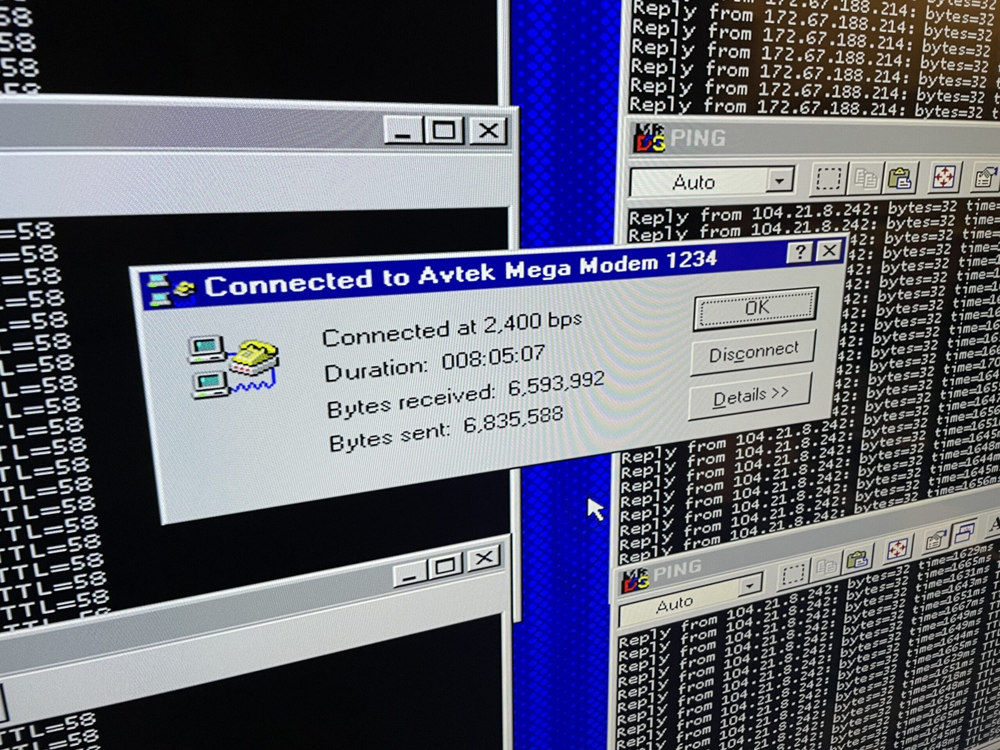
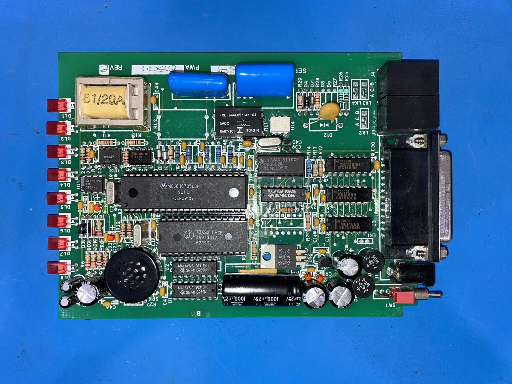



Back in May 2022 I picked up this Avtek Mega Modem 1234 (Serial 801452), capable of a blistering 2400 bps. I figured I'd replace the capacitors and make sure it was A-OK, then give it a proper workout through my dial-up setup. There's something about these old external modems that I really like, especially the big indicator lights and the noise they make when connecting.



*The Elgen capacitors had spent decades inside the Mega Modem. Some looked decidedly unhappy by the time I got to them.*
{: .media-caption }

Inside were Elgen and Daewoo branded capacitors, both brands before my time. All I really know about Daewoo is that their cars used to be sold here in Australia for a period. Some of these capacitors were visibly bulging, which was more than enough encouragement to get the soldering iron out.



*Thirty years was a reasonable innings for those Daewoo capacitors. Time for the soldering iron.*
{: .media-caption }

Geez, that Daewoo one doesn't look too good. Haven't seen a Daewoo car in years either, maybe they used the same capacitors in their cars. Lasting only a mere *does maths* 1992 to 2022, that's thirty years, and they didn't leak at least. Not a bad run I guess!



*The initial replacement capacitors fitted to the old Avtek. Functional, even if the arrangement was a bit improvised.*
{: .media-caption }

I didn't keep particularly good notes on the capacitor replacements. I'd put more photos in the [photo gallery](/goodies). From the photographs, it looks as though I used Panasonic FM and FR series replacements in May 2022.



*The earlier 1000 uF capacitor makes way for an axial replacement, which feels more at home in a modem this old.*
{: .media-caption }

In July 2022 I replaced the FR series 1000 uF capacitor with something a little more traditional. One big old axial MultiComp Pro MCAX25V108M13X22. Much more fitting for a modem of this vintage!



*A glimpse of the handwritten firmware sticker before it decided to disappear forever.*
{: .media-caption }

One important lesson this modem taught me was that its 9 V AC power input really wanted AC. With a DC supply, some of the logic came alive, but the modem wouldn't dial properly. It looks as though part of the analogue or telephone-line circuitry depends on the supply arrangement, so the correct adapter for this unit is 9 V AC. Best not to experiment with random DC adapters simply because they fit the socket.

For the actual connection test, I had the Avtek connected through a USB-to-serial adapter to my Linux system running Ubuntu Jammy Jellyfish. The other end of the call went through my local VoIP arrangement, using a Raspberry Pi, Asterisk and a modem listening for incoming connections.

I started with WvDial and a configuration I'd previously used with another 2400 bps modem. After sorting out the serial device and getting the initialisation right, the Avtek dialled out and established a connection. Its enormous collection of indicator lights made it easy to see when data was being sent and received.

With PPP running, the modem even managed to reach the outside world. DNS needed a little attention, but after correcting the name-server settings I was getting responses. Not particularly fast responses, mind you. Some were taking around half a second, and the slower ones were considerably worse.

I also tried changing the connection settings to see how the modem behaved at lower speeds. It wasn't always impressed, and there were a few unsuccessful attempts before I returned to the settings that had worked. These old Rockwell-based modems are wonderful things, but they still have their limits.

Next came Windows 98 running in VirtualBox, with the host's USB serial device passed through as a virtual COM port. Windows detected the modem, although the generic driver wasn't particularly exciting. After another bit of fiddling with Dial-Up Networking, it finally connected.

Trying to browse a website at 2400 bps was an exercise in patience. After a couple of minutes I'd transferred only a few kilobytes, with the modem happily flashing away while the page slowly assembled itself. These machines were much happier with bulletin boards and text-based services than modern websites.

During the earlier testing, the initialisation string was `AT&FS0=0V1X3`. The `ATI9` response identified the modem as `AutoModem 1234PCi Vers 500m (C) NetComm 1991`. That matches the handwritten BIOS or firmware label, before the little sticker fell off... forever.



*The Mega Modem 1234 lights up the bench. Those enormous red status lights are part of the charm.*
{: .media-caption }

Interestingly, I couldn't find an external model number beyond "Mega Modem 1234" on the front. I'd been calling it AM1234 because that looked consistent with later NetComm naming, but I don't have evidence that it was the official model number. Better to stick with the name actually printed on the machine.



*A 17.3 MB download at 228 bytes a second. Windows estimates another 25 hours. Magnificent.*
{: .media-caption }



Here's a slightly older recording showing the modem performing a blind dial and then making a stable connection once the VoIP setup was configured... correctly, better, less worse. 😅 Slow and steady.



*Eight hours at 2400 bps and about 6.6 MB transferred each way. Slow, steady and surprisingly satisfying.*
{: .media-caption }

With a bit of patience, I managed to clock roughly six megabytes in each direction during extended ping testing. No small feat for 2400 bps. The later video also confirmed that the modem could establish a PPP connection and pass traffic, even if modern browsing wasn't especially practical.



*A full look at the Mega Modem 1234 board, including its wonderfully excessive row of red LEDs.*
{: .media-caption }

Up last we have the logs from querying the modem.

```
---------- 2022-06-11 18:02:54 +1000: Logging Started ----------

ATZ
OK

AT&FS0=0V1X3
OK

ATI0
243
OK

ATI1
243
OK

ATI2
OK
OK

ATI3
243
OK

ATI4
243
OK

ATI5
243
OK

ATI6
243
OK

ATI7
243
OK

ATI8
243
OK

ATI9
AutoModem 1234PCi Vers 500m (C) NetComm 1991
OK

ATI10
243
OK

ATI11
243
OK

ATI12
243
OK

ATDT1234567890
CONNECT 2400
```

This modem has since been donated to the [Australian Computer Museum Society (ACMS)](https://forum.acms.org.au). Hopefully it isn't pilfered, left in a field or waterlogged... time will tell.
