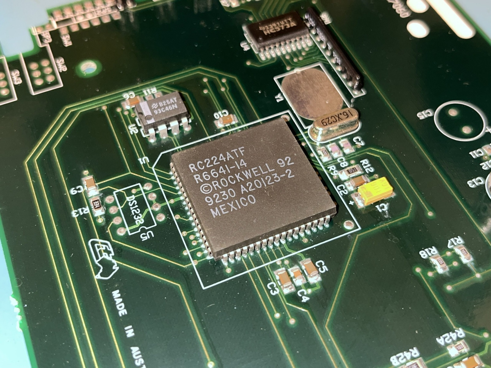
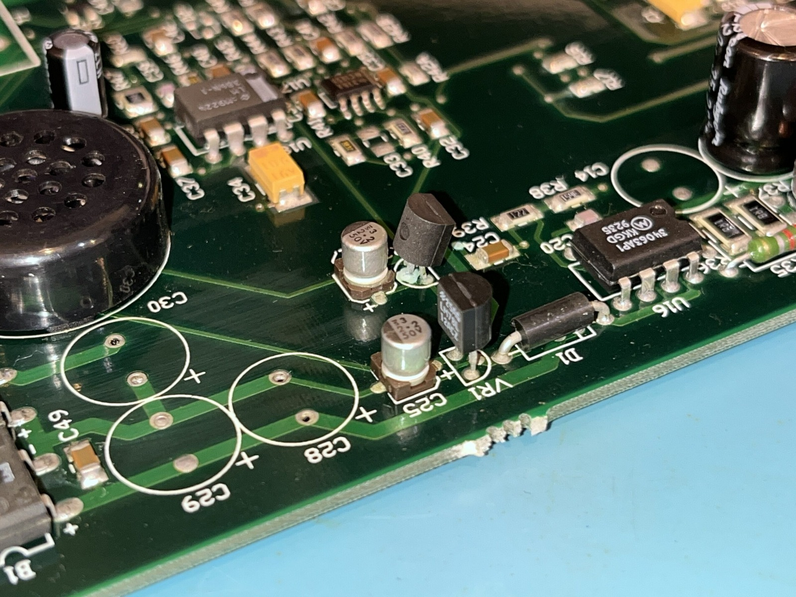
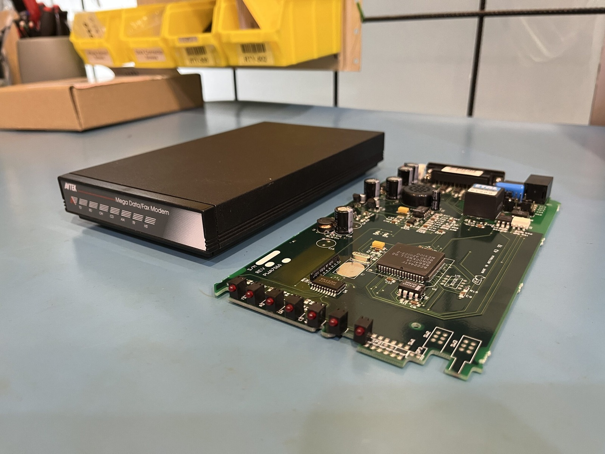
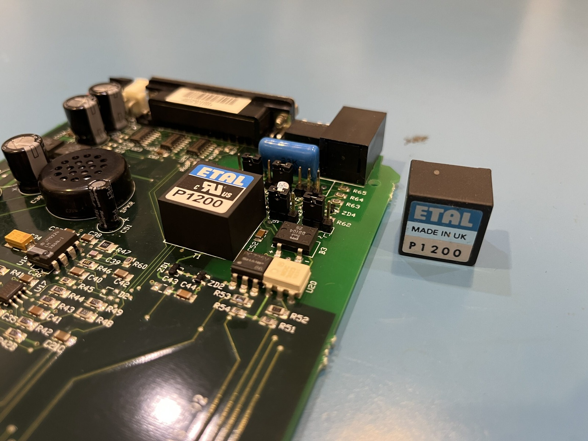
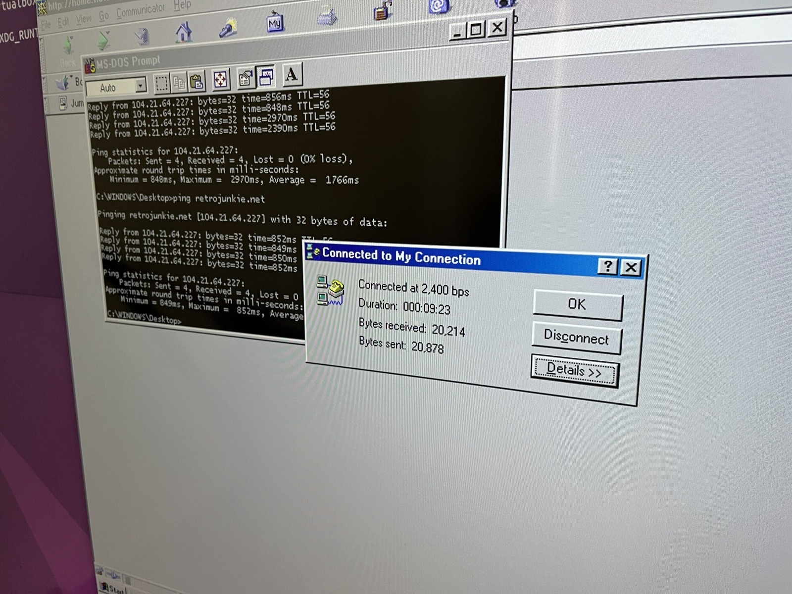
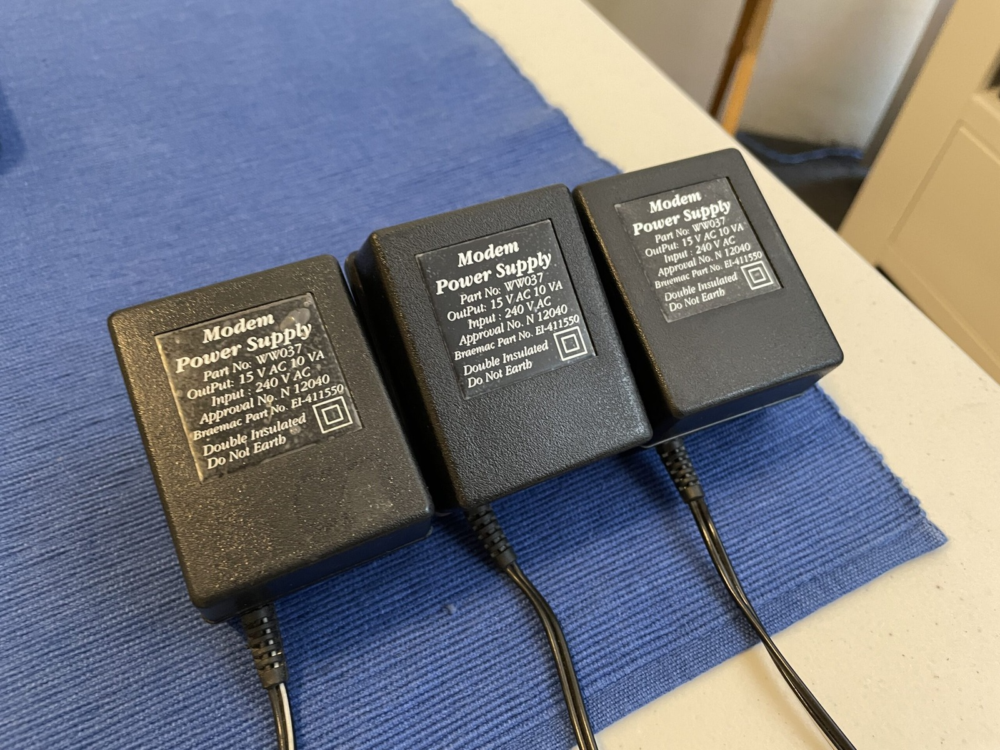
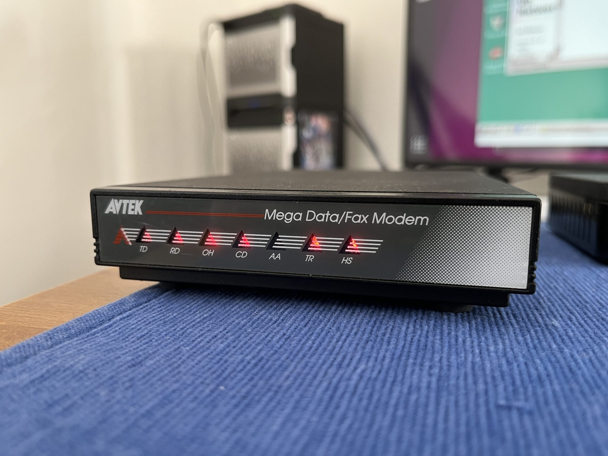



This modem was purchased through eBay in February 2023 and recapped in late May 2023 using whatever capacitors I had on hand. Thankfully, I had a bunch of Rubycons and Panasonics. If you order enough of them you always end up with spares.

The CD900 is a beautiful little modem. It's similar in appearance to Avtek's faster 14.4K and 28.8K machines, although at 2400 bps it doesn't need quite as many fancy lights on the front. Look at those LEDs. They're arranged to make the letter A, for Avtek! I love little design touches like that.



*The CD900's Rockwell RC224ATF, marked week 30 of 1992. An early-1990s survivor.*
{: .media-caption }

The chip is also marked R6641-14. I put more photos in the [photo gallery](/goodies).



*The surface-mount capacitor area after the old parts had been tackled. Tiny components, plenty of swearing.*
{: .media-caption }

Some of the surface-mount capacitors had leaked and started to corrode the board, but it was nothing a small scrub couldn't handle. A few pads lifted without breaking away from the PCB. Nobody likes surface-mount capacitors leaking. No one!



*The CD900 dismantled: a compact black case and the circuit board responsible for all that 2400 bps glory.*
{: .media-caption }

Quite a simple board design, no firmware to dump as far as I could tell. The LEDs were different to other models I've seen but notice the front of the PCB and the lack of switches. Likely this board was used across a few different models, maybe even brands.



*Two ETAL P1200 transformers, one fitted and one loose. Replacing a broken leg turned out to be an adventure.*
{: .media-caption }

While recapping the SMD components, I did my due diligence (for once) and removed the P1200 rather than risk getting it, let's just say **_somewhat melted_**. How did the universe repay me? Why, one of the legs fell off. I tried jamming it back in, but no dial.

So I sourced a replacement ETAL P1200 line-matching and isolation transformer. And here I was thinking it was just a relay! Isolation transformer... I'll try to remember that one!



*Another CONNECT 2400, with Windows ping replies arriving at the leisurely speeds this modem deserves.*
{: .media-caption }

Hmmm, good old 2,400 bps. Not the fastest of modems. That 1992 date code gives us an early-1990s component, rather than an exact birthday for the finished modem. The chip was over 30 years old by the time I got to it! I'm not surprised those surface-mount capacitors leaked.



*Three almost identical WW037 power bricks, all 15 V AC. Which one came with the modem? Still a mystery.*
{: .media-caption }

All three are labelled WW037, 15 V AC, 10 VA. I used a 15 V AC supply with the female prong connector; that is a record of this setup, not a power-supply specification for every Avtek or NetComm modem.



*And there's that illuminated Avtek A design. Little touches like this are why I keep collecting old modems.*
{: .media-caption }

With the modem back together, I hooked it into my dial-up arrangement through a Raspberry Pi running Asterisk and mgetty. The answering modem was a Banksia, connected over VoIP. Both were using Rockwell chipsets, which might have helped them get along.

I had already left the connection running for about 199.5 minutes when I checked the session. The Linux counters showed data going in and out, and the error figure I calculated at that point was around 3.1%. That's much better than some of the other dial-up sessions I'd been seeing.

Then it was time for a quick disconnect and redial. I created a CD900 profile for `wvdial`, using the initialisation strings reported by `wvdialconf`. After the familiar handshake, the carrier came back and the pings resumed. Beautiful!

I also wanted to interrogate the modem itself. My first plan involved `socat`, which naturally wasn't installed. Then I tried Minicom, which I hadn't used in ages and was determined not to relearn in the middle of the recording.

Naturally, I ended up relearning Minicom in the middle of the recording.

Once I had the serial port and speed configured, I could issue the ATI commands and see what the modem had to say about itself. Not an enormous amount, as it turns out, but ATI3 at least gave me something more interesting than another error message.

After that, I tried the modem through Windows 98 in VirtualBox. It connected at 2400 bps and attempted to browse the file server, although the pages were going to take rather longer to arrive than I had patience for. The connection was working; it was simply doing so at a pace more appropriate to the early 1990s than a modern web page.

Last up, we have the results of probing the modem for information. Surprisingly short, as nothing beyond ATI3 registered anything apart from ERROR. Short and sweet! 😄

```
---------- 2023-05-28 15:36:54 +1000: Logging Started ----------

ATI0
242
OK

ATI1
192
OK

ATI2
OK
OK

ATI3
AFES-C2501-H0
OK

ATI4
ERROR

ATDT1234567890
CONNECT 2400

```

The capacitors were replaced in this modem in May 2023. The list below records this particular CD900 and the replacements I used. Before ordering, check the actual board, capacitor type and polarity, capacitance, voltage and temperature ratings, ESR, ripple-current requirements and physical size. The parts listed below are manufacturer part numbers. The formatting isn't too web friendly. Copy the raw text out and paste it into a plain-text editor such as Notepad or TextEdit in plain-text mode and you'll probably be fine. 😄

```
SMD Electrolytic
Location	Value		Voltage  	Dimensions		Notes
C63		2.2uF		50V		4mm (W) x 5mm (H)	EEE-HD1H2R2R - Panasonic HD Series
C64		2.2uF		50V		4mm (W) x 5mm (H)	EEE-HD1H2R2R - Panasonic HD Series
C65		2.2uF		50V		4mm (W) x 5mm (H)	EEE-HD1H2R2R - Panasonic HD Series
C25		2.2uF		50V		4mm (W) x 5mm (H)	EEE-HD1H2R2R - Panasonic HD Series
C27		2.2uF		50V		4mm (W) x 5mm (H)	EEE-HD1H2R2R - Panasonic HD Series

Radial Electrolytic
Location	Value		Voltage  	Dimensions		Notes
C51		100uF		16V		5mm (W) x 11mm (H)	16ZLH100MEFC5X11 - Rubycon ZLH Series
C13		220uF		35V		10mm (W) x 12mm (H)	35ZLK220M10X12.5 - Rubycon ZLK Series
C28		220uF		35V		10mm (W) x 12mm (H)	35ZLK220M10X12.5 - Rubycon ZLK Series
C30		220uF		35V		10mm (W) x 12mm (H)	35ZLK220M10X12.5 - Rubycon ZLK Series
C54		220uF		35V		10mm (W) x 12mm (H)	35ZLK220M10X12.5 - Rubycon ZLK Series
C59		220uF		35V		10mm (W) x 12mm (H)	35ZLK220M10X12.5 - Rubycon ZLK Series

```

This modem has been donated to the [Australian Computer Museum Society (ACMS)](https://forum.acms.org.au/).

### Sources

- [ETAL - P1200 line-matching transformer datasheet](https://www.farnell.com/datasheets/1801043.pdf)
- [Nichicon - Application Guidelines for Aluminum Electrolytic Capacitors](https://www.nichicon.co.jp/english/series_items/catalog_pdf/e-aluminum.pdf)
