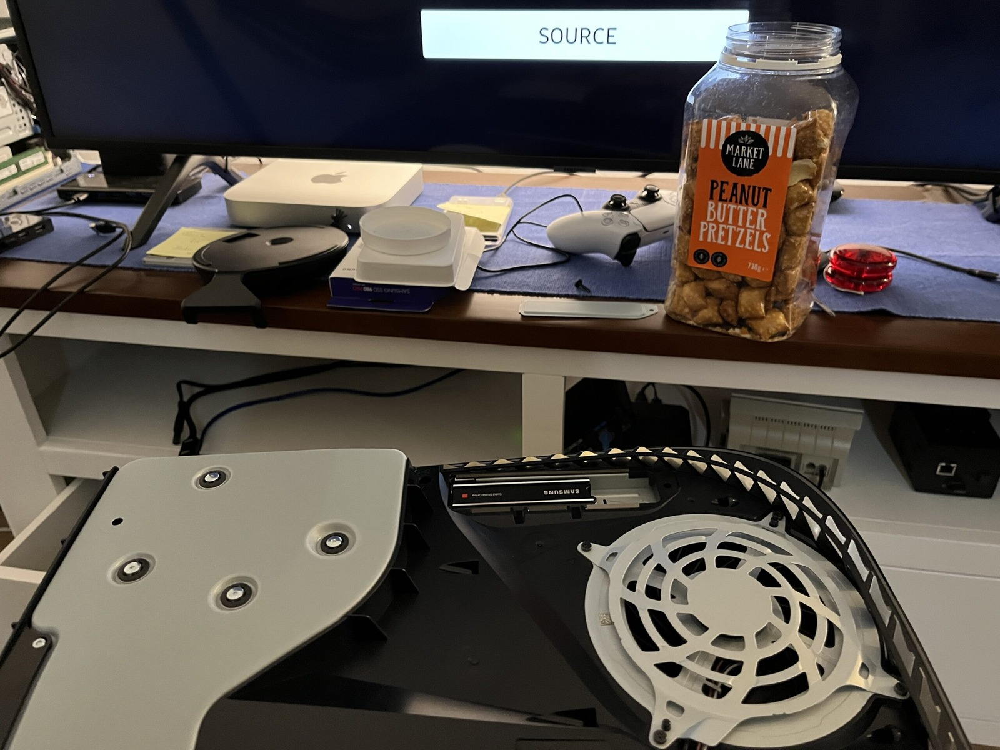
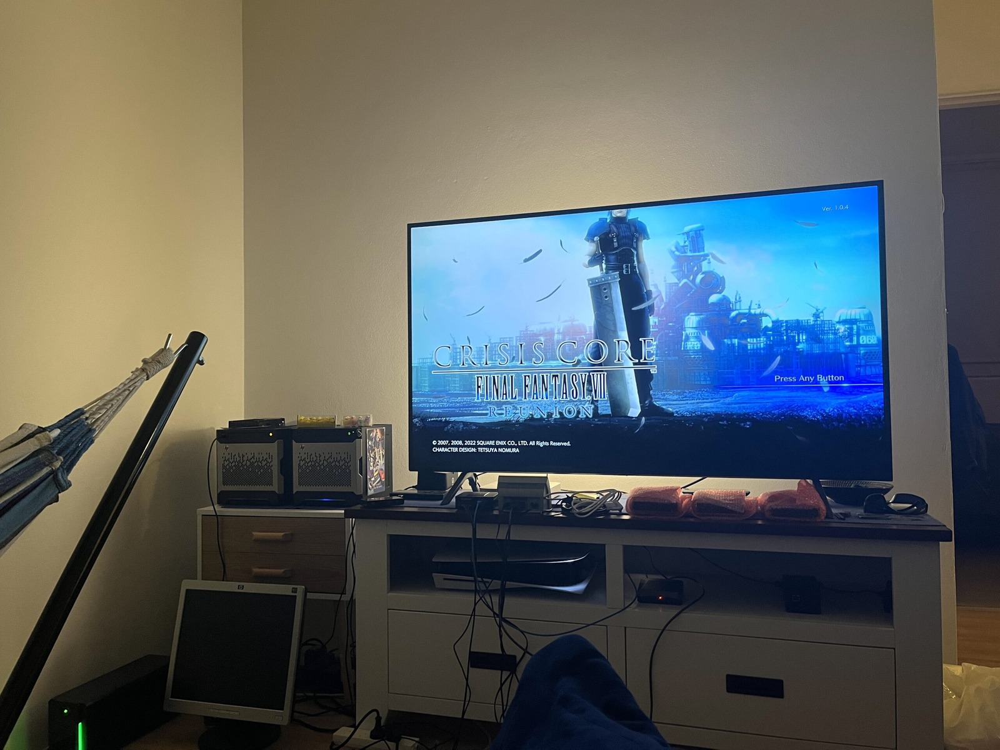
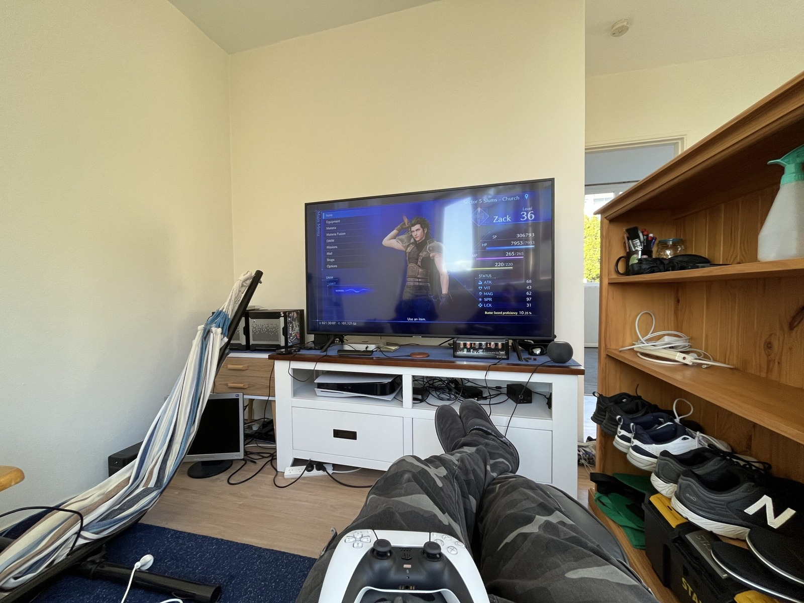
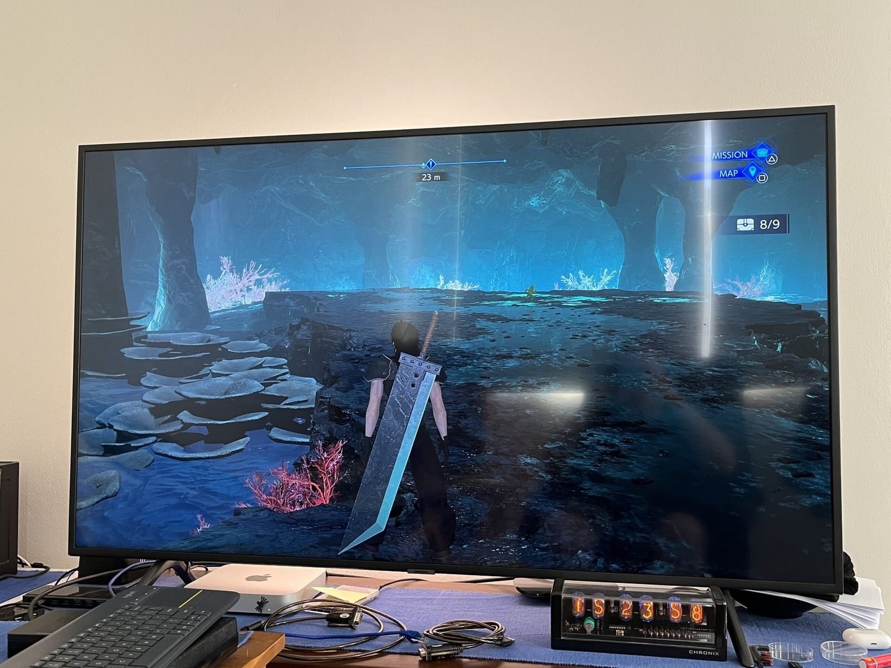
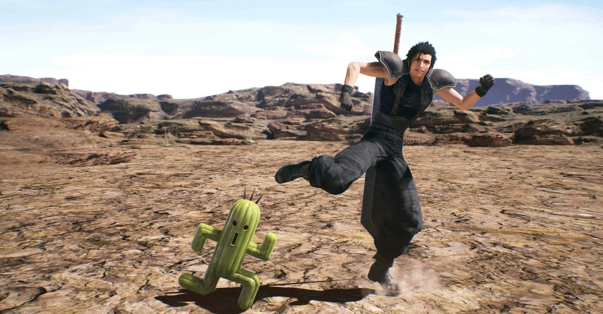
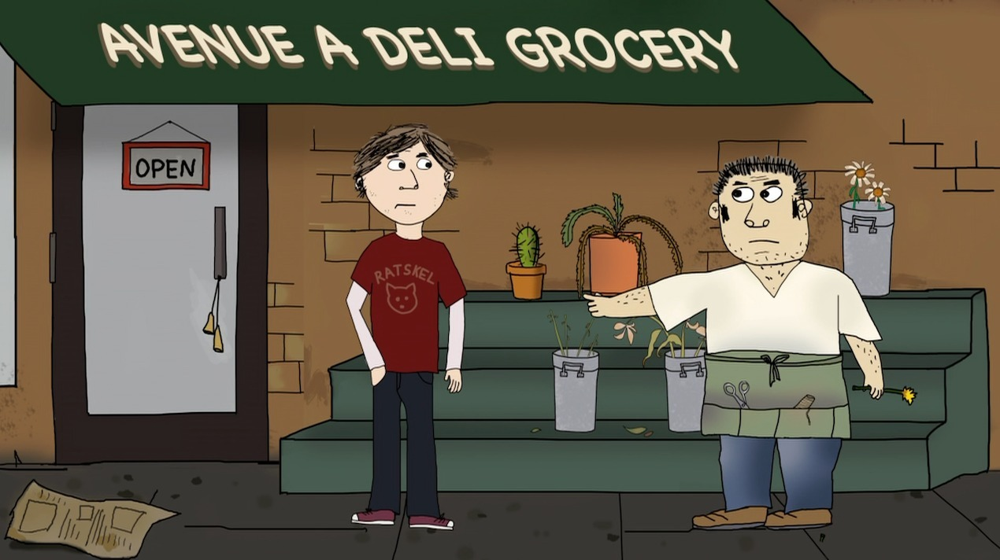
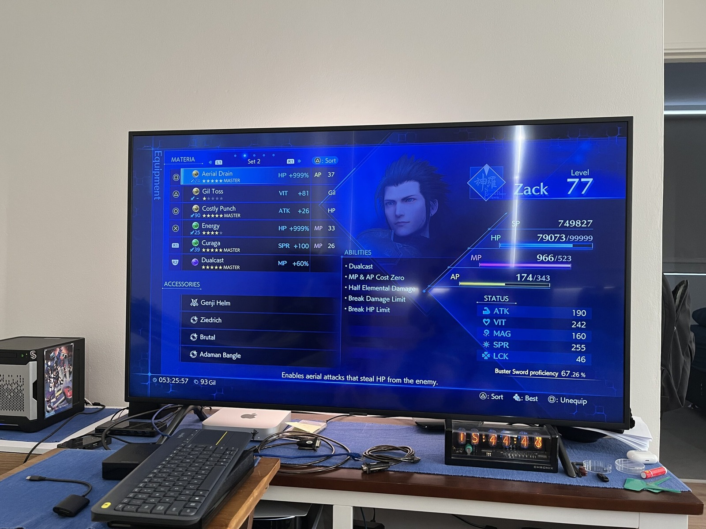
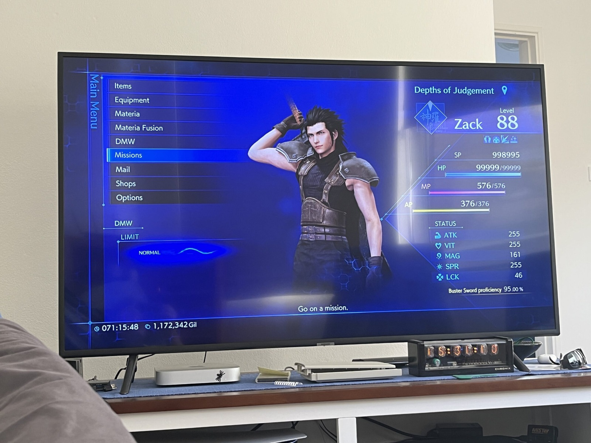



Wow. Just wow. What a great game! My playthrough ran to roughly 73 glorious hours over 27 days. Just under three hours a day. The stream above gives you a taste of the adventure.

*An open PS5, a Samsung SSD and a big jar of peanut butter pretzels. I probably should have moved the crumbs away from the electronics.*
{: .media-caption }

Yet it feels like only yesterday that I was munching away on peanut butter pretzels while installing my speedy-looking Samsung 980 PRO M.2 NVMe SSD into my shiny new PlayStation 5. And yes, I did get some crumbs in there.

*Crisis Core Reunion was up on the telly. The new SSD had about 73 hours of Zack's adventures ahead of it.*
{: .media-caption }

With the help of Lilly, we confirmed the drive had shipped with firmware 5B2QGXA7. That mattered because the widely reported 980 PRO failure problem centred on drives running 3B2QGXA7, which could accumulate errors and in some cases end up read-only. Samsung's 5B2QGXA7 firmware was the preventative update being recommended for affected 980 PRO drives. Mine had a production date of 2023-03-22, so there was nothing to update before the crumbs and Crisis Core began.

*Zack had reached level 36, my feet were up, and the bookcase had joined the gaming setup. A pretty decent afternoon, really.*
{: .media-caption }

And at some point along the way, my window frames and windows were all replaced, causing a little bit of chaos and a wild bookcase to appear.

*Zack wandered into another rather blue cavern. Meanwhile, the Chronix clock beneath the telly kept counting away.*
{: .media-caption }

From the dungeons to the fields, Zack sure did have a good time with knocking enemies unconscious. That is, until the little cactus man and his cactus friends started to kick my ass.

*Little cactus man made an appearance. Zack looked as if he had the situation under control, which was rather optimistic.*
{: .media-caption }

Little cactus man and his posse wreaked havoc on poor little Zack. Squats could not save him here. It forced me to go looking for cactus-destroying gear.

*And there he is, the cactus from The Life & Times of Tim. That little green menace clearly followed me out of Crisis Core.*
{: .media-caption }

The above cactus lives rent free in my head. From an [amazing show](https://en.wikipedia.org/wiki/The_Life_%26_Times_of_Tim) that everyone should watch at least once. **_Cactus_**. Anyway, I set to work and eventually kicked that damn cactus back, with steel cap boots. No spikes for me thanks.

*Level 77, a mountain of Materia, and a growing collection of accessories. I wasn't going to let Minerva win without an argument.*
{: .media-caption }

Eventually I got closer to the end of the story but got a little stuck while trying to complete the missions. **_Minerva_**. That boss was just way too hard for me at that stage, so I levelled up, got some more cool gear and won. Everything from there was a cakewalk.

*Level 88, 99,999 HP, and over 71 hours on the clock. Perhaps I took those side missions a little seriously.*
{: .media-caption }

Not to spoil anything, but the ending is quite emotional. You'll have to play it to see: it was a blocked scene in my live stream. Overall, well worth a play. If you skip the missions, it'll be a much shorter playthrough. Even though I can't shake that Zack sounds like Sonic the Hedgehog most of the time, he grew on me eventually - and he was right about one thing:

> "Boy oh boy, the price of freedom is steep." - Zack Fair

### Sources

- [Puget Systems - Critical Samsung SSD firmware update](https://www.pugetsystems.com/support/guides/critical-samsung-ssd-firmware-update/)
