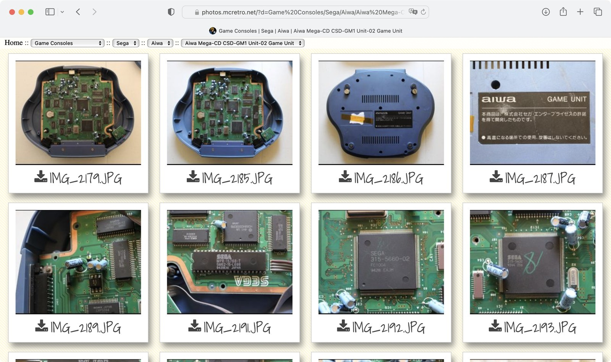
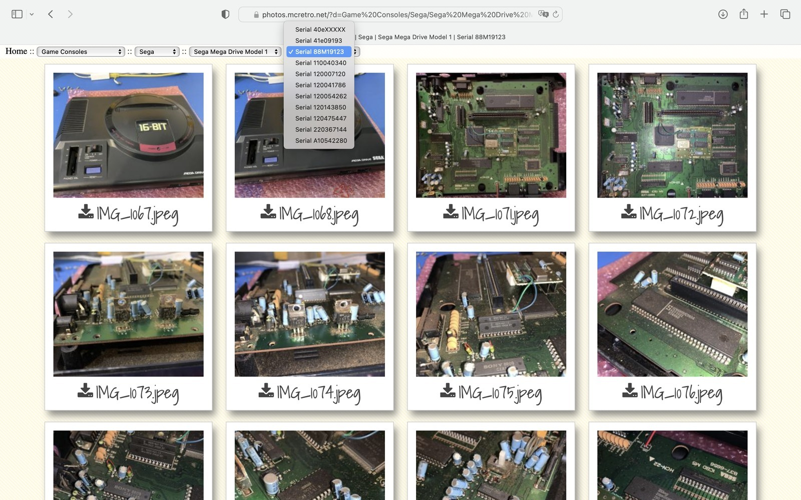
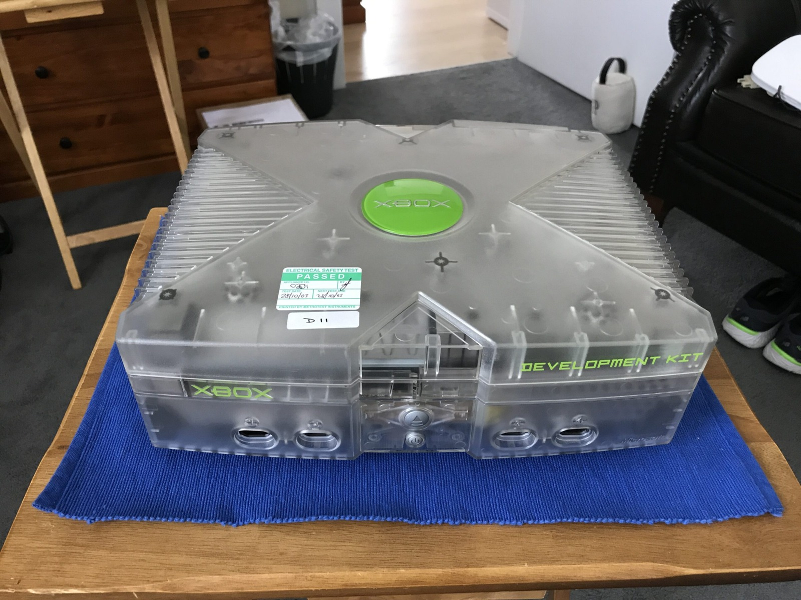

*The Aiwa Mega-CD photos are getting their own little home in the gallery, circuit board close-ups and all. One folder at a time.*
{: .media-caption }

Unemployment is both a blessing and a curse. The blessing? Catch up time to clear my desktop of all the random photos and videos that have been accumulating since... 2016. The curse? Probably the lack of any income.

*One Mega Drive model, a whole list of serial numbers, and all those circuit boards to sort. My idea of a relaxing filing job.*
{: .media-caption }

The photo gallery is at least something I can actually work on. I've been making progress at long last! I'm still working on getting the directory structure more... structured.

*Sonic has some thoughts about sorting licensed hardware. He might have a point, but I'm making the folders anyway.*
{: .media-caption }

Licensed hardware makes things a little messy, but I suppose in the grand scheme of things it doesn't matter. I'll be able to put accessories - think Sega's Mega-CD Karaoke add-on or that [Stargate-shaped ring thing](https://giantbomb.com/sega-activator/3000-8/) - in their own folders without too much hassle.

*A transparent Xbox development kit. Yes, the photo gallery has room for things a little more unusual than another beige modem.*
{: .media-caption }

There will be some pretty neat stuff in there. The data is slowly going up in the [photo gallery](/goodies). Once I'm done uploading what I can, I'll probably move back onto processing modem videos for the next 3-4 years. Ha ha! 😅