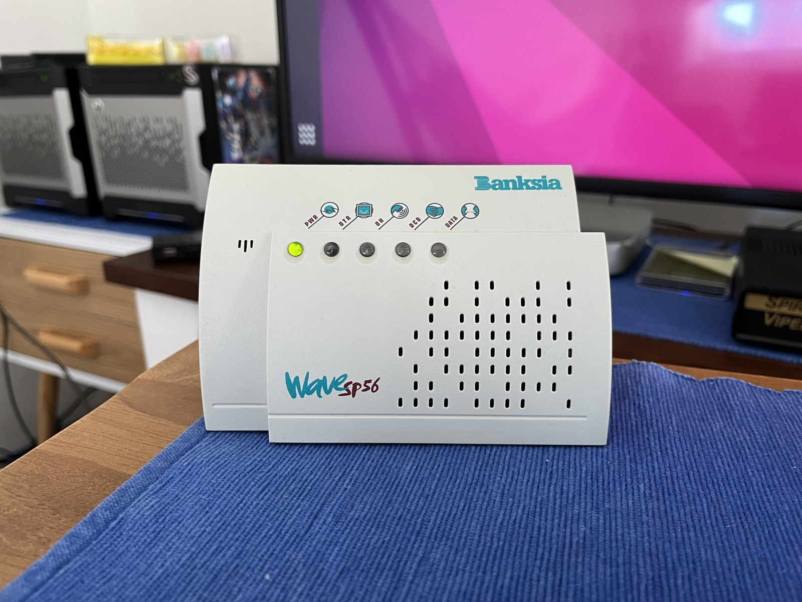
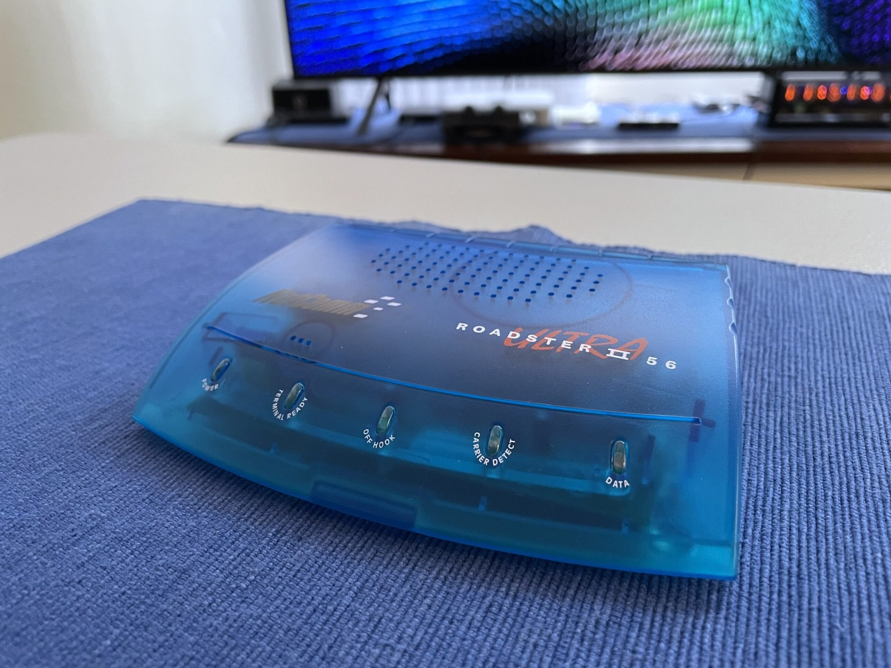
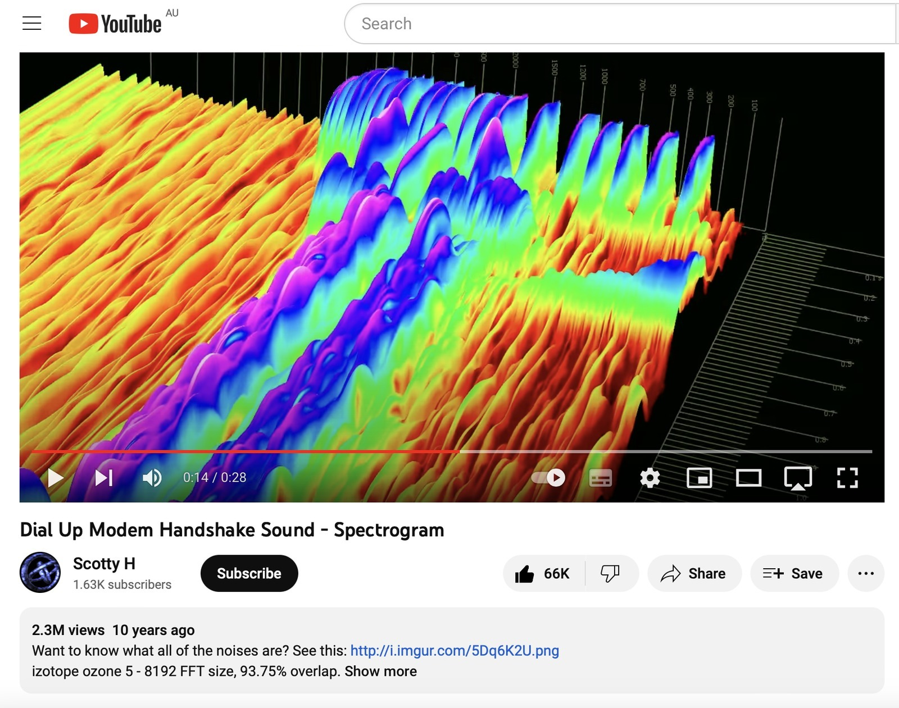
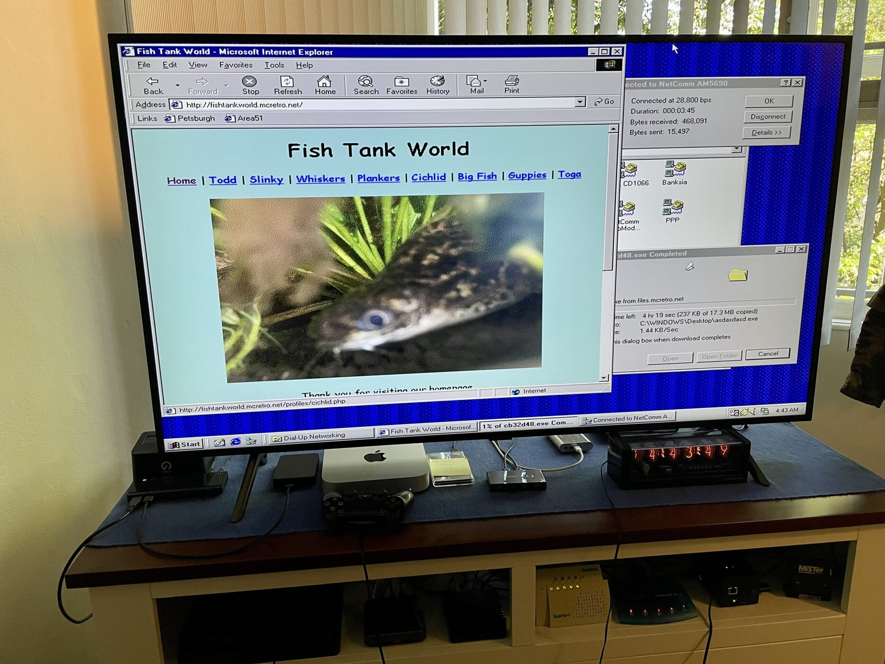
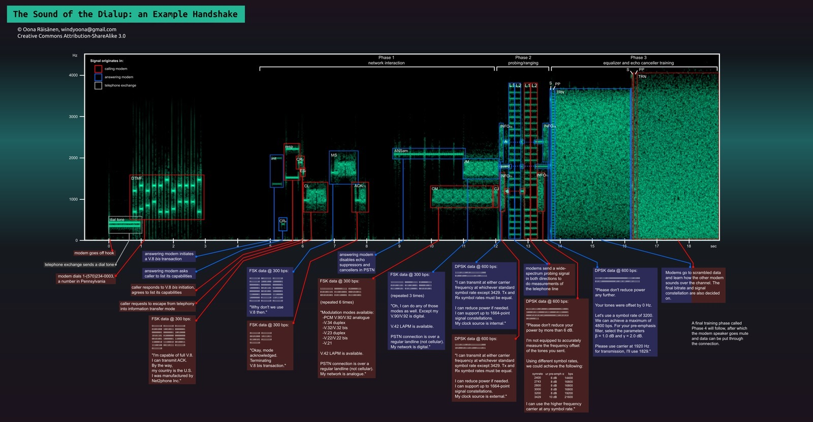
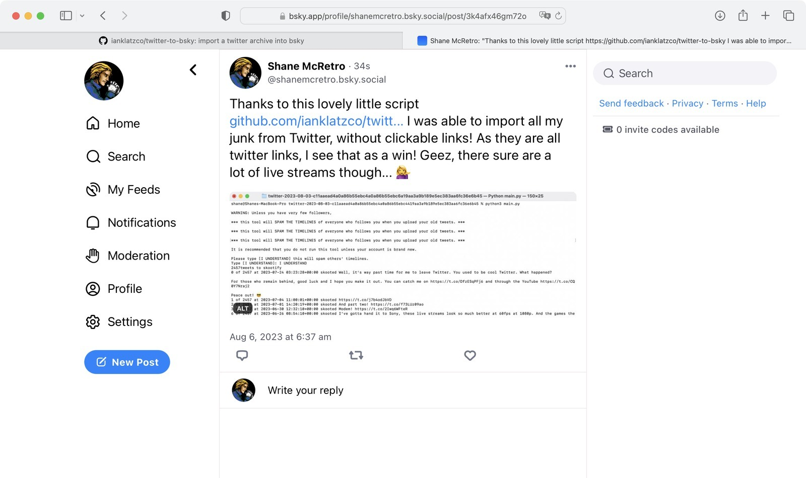



I saw this awesome dial-up modem spectrogram from ten years ago while hunting something or other modem related on archive.org. I was curious if I could replicate it. I don't have any clean sounds - only audio that is recorded with an iPhone.



Reading through the comments on the video above, I was disappointed that the software used didn't seem to be mentioned. So I started digging around and found [ScienceMusic's Spectrogram](https://spectrogram.sciencemusic.org), which is pretty cool. Drop an audiophile in there and you're good to go. Wait, no, not that sort of audio file.

*The Banksia Wave SP 56 looking terribly clean. The modem recordings I like are generally less well behaved.*
{: .media-caption }

Initially I opted for some clean audio from [Gough's modem sounds archive](https://goughlui.com/2016/05/03/project-the-definitive-collection-of-v-90v-92-modem-sounds/). They are \*very\* clean. Almost too clean, I couldn't handle it. I want my modems like I want my garden soil - dirty and containing shards of glass. Wait, is that normal? Nope... Ha ha! 😎

*Back to the blue Roadster Ultra II. I had my own 2021 dial-up recording to put through the spectrogram experiment.*
{: .media-caption }

So I went back and clipped some audio from a modem dial test back in 2021 - for which the video is still pending processing. Seems to be a habit of mine. Build up a mass of video then release it several years later. Good thing modems are timeless! Well, kind of? 🙃

But what software to use? I went back to the initial YouTube channel and... I read the description. Read it with me.

*The software was named in the video description all along. Naturally, I found that out after doing the detective work.*
{: .media-caption }

Mother cluckers !!!🐓!!! Sometimes it pays to read the blooping manual. You'd think I'd learn, but no. It's also mentioned about 50 times in the comments.

> **"izotope ozone 5 - 8192 FFT size, 93.75% overlap."**

Well, I know what iZotope Ozone 5 is. It's five versions older than Ozone 10, which was current when I wrote this in 2023. So how did they get the cool spectrogram to happen? Ozone 5 Advanced had a Meter Bridge with a spectrogram. For my attempt, I used Insight 2, iZotope's separate metering plugin, rather than a plugin inside Ozone 10. Mystery solved... eventually.

*Windows 98, Fish Tank World, and a 28,800 bps connection. At least the old dial-up testing gave me plenty of sounds to play with.*
{: .media-caption }

While I used Final Cut Pro X, it turns out you can use iZotope Ozone with Logic Pro X and other apps which is pretty neat. And that's it. Screen capture the video, sync it to the source, encode again... [add some more JPEG](https://web.archive.org/web/20130516130936/http://needsmorejpeg.com/) to your HEVC video and it's ready to be processed for an eighth time by YouTube.

*Oona Räisänen's breakdown of the dial-up handshake. A surprising amount of negotiation hides inside those lovely modem noises.*
{: .media-caption }

Here's what is happening in the handshake as documented by [Oona Räisänen](https://www.windytan.com/2012/11/the-sound-of-dialup-pictured.html). However, as [Gough Lui points out](https://goughlui.com/2016/05/03/project-the-definitive-collection-of-v-90v-92-modem-sounds/),

> **"This image, however, depicts a V.34-type connection, as it has no high speed sound."**

Which is great, that's what this one is too. V.34 is by far my favourite internet dialling sequence. Don't give me any of that V.32bis trash, I want sweet, sweet V.34 or maybe V.FC for some chaos. If you're connecting at 56k, that's too much man. Overall though, it was interesting to replicate the spectrogram ten years on with one of my own little sound snippets.

*One more social network to neglect! At least getting the old tweets into Bluesky was less painful than I expected.*
{: .media-caption }

In other news, I've set up and configured [Bluesky](https://bsky.app/). So I've gone from having one Twitter to neglect to having two Twitter replacements, [Mastodon](https://mastodon.social/@NixMcRetro) and [Bluesky](https://bsky.app/profile/nixmcretro.bsky.social), to neglect. The responsibilities are stacking up, fast! 😅

### Sources

- [iZotope - Ozone 5 Help: Meter Bridge](https://help.izotope.com/docs/izotope-ozone5-help.pdf)
- [iZotope - Insight 2 Help: Spectrogram](https://s3.amazonaws.com/izotopedownloads/docs/insight200/en/spectrogram/index.html)
