*The health investigation begins with an expert in 'helth'. Very reassuring.*
{: .media-caption }

Ahhh yes, health. Long-time readers of this blog will know that I've lost weight a few times in the past - all in the name of health. I'll have an update on that in a future blog post. Today though, I'll be going through some data I've collected on my sleeping patterns.

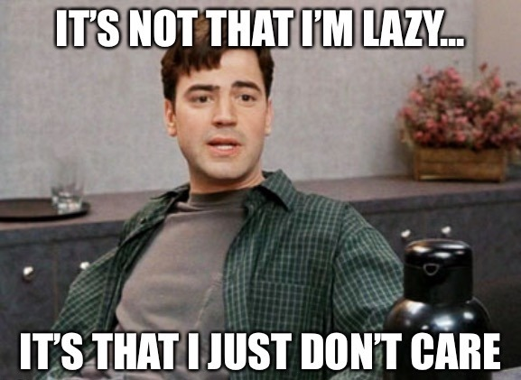

*Redundancy gave me some time to reassess my priorities. The meme had a head start.*
{: .media-caption }

Lack of employment is arguably one of the best life changes one can enjoy, if one can afford it. I've been saving for time off for a couple of decades now, so I am ready. What do you know, a redundancy was served at the end of June. I now have time to improve my health. While my sleep hygiene has traditionally been alright, lately it has not been nearly as good as it once was.

One of the most annoying things I've been encountering intermittently over the past eight years is night sweats. Looking at the [potential causes](https://www.healthdirect.gov.au/night-sweats), some seemed less likely to me, while anxiety, stress and medications caught my attention. I also wondered whether a sleep disorder could be involved. That was a list of possibilities to investigate, not causes I could rule in or out myself.

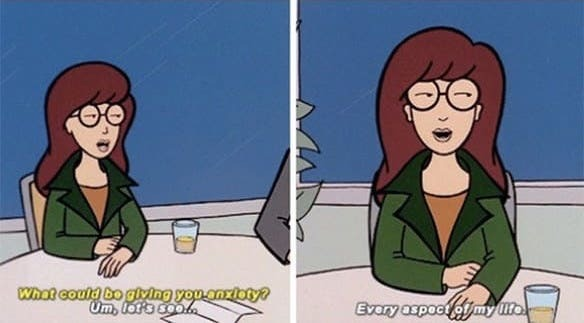

*The anxiety question gets a wonderfully concise answer. Thanks, Daria.*
{: .media-caption }

Anxiety and stress are always there. As far back as 2015, I'd blamed medications such as pregabalin, diazepam or whichever antidepressant I was on. Most SSRI and SNRI antidepressants I've tried have caused sleep bruxism for me, which has led me to stop treatment in the past. Changing or stopping these medicines is something to work through with the prescriber. But what if we were wrong and there was another underlying cause? Could sleep apnoea be the root of some of my issues?

Sleep apnoea was one possibility I wanted investigated, especially because disrupted breathing and repeated arousals can disturb sleep. But night sweats, poor sleep and noises on a microphone are not enough to diagnose it or establish it as the root cause. I believed it was worth further investigation, so I slapped my MacBook Pro on a fold-out table next to my bed and recorded a few nights of sleep.

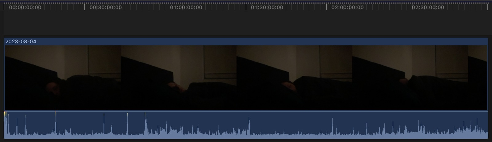

*Three hours with the MacBook Pro's built-in microphone. Plenty of spikes to investigate, but a waveform is not a diagnosis.*
{: .media-caption }

Three hour sample. Recorded with the built-in microphone on my MacBook Pro.

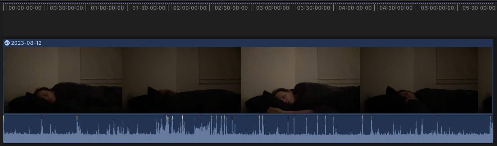

*Six hours with the Blue Yeti Nano microphone. More audio to sift through, but the peaks cannot tell me what caused them.*
{: .media-caption }

Six hour sample. Recorded with a Blue Yeti Nano microphone.

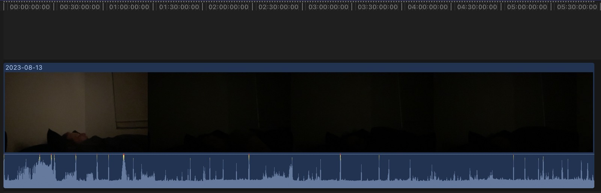

*Another six hours from the Blue Yeti Nano. This recording has its own assortment of spikes and quiet patches.*
{: .media-caption }

Another six hour sample. Recorded with a Blue Yeti Nano microphone.

Alright, so we have some data. I'm using Final Cut Pro X to analyse the audio since it's what I have on hand. I boosted the audio amplitude above baseline so the peaks were easier to see. They sounded like a mixture of snoring, movement, breaths and brief awakenings. An audio waveform by itself cannot tell me whether an event is an apnoea or what caused it, but it was enough to convince me that my sleep was worth investigating properly.

I'd already reported the problem to my GP and started the process of arranging a sleep study. The practical problem was the wait. The bulk-billed services I contacted quoted close to a year, with shorter waits if I paid the gap. A year of rubbish sleep while waiting to find out why? Our system is sick.

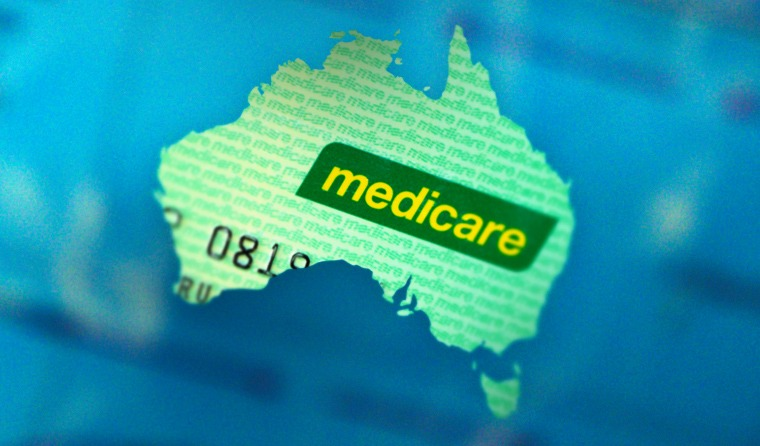

*Quoted waits approaching a year for bulk-billed sleep studies. Our system really can do better.*
{: .media-caption }

What the hell is wrong with our system? Those who **_need_** to use bulk-billed services should be prioritised. How is this not the case? I am disgusted that this is even an issue in a modern society.

While waiting, I was tempted to try CPAP. Being able to get hold of a machine does not make a trial a diagnosis, and my biomedical-science background does not replace a sleep physician or a sleep study. Let's zoom in and look at these peaks a little closer on a smaller time scale.

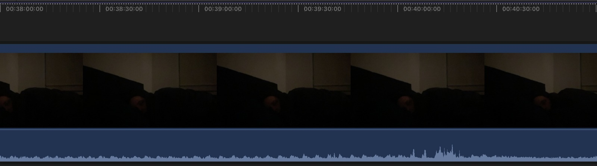

*Zooming in on the MacBook Pro recording. The waveform gets busier near the end, but it cannot explain why.*
{: .media-caption }

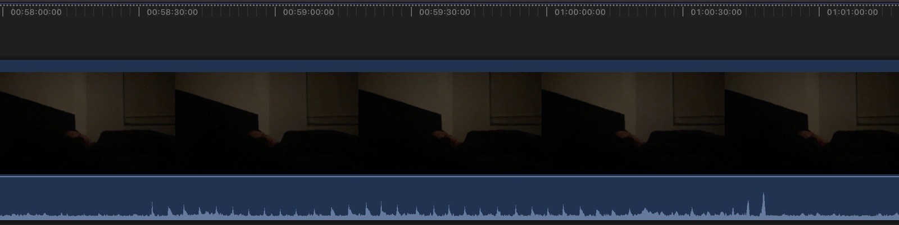

*Quite a rhythmic-looking patch around the one-hour mark. A dreadful one-bit drum track in the making.*
{: .media-caption }

The above two were captured on 3rd August and you can see that I have the potential to be a great [1-bit groovebox](https://github.com/buranelectrix/lunchbeat-PCB) but that's not what should be happening. Remember, the two are the lower quality samples owing to the MacBook Pro built-in microphone being _ordinary_. Let's look at some higher quality data from the 12th and 13th August.

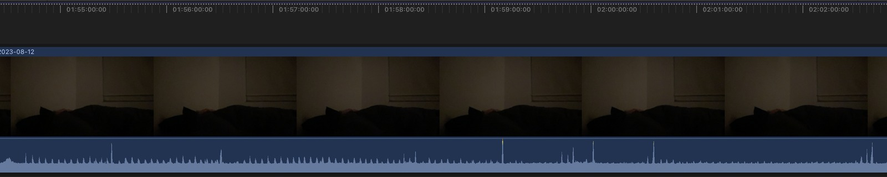

*A closer look at the 12th August recording. Lots of little peaks, but no conclusions from the waveform alone.*
{: .media-caption }

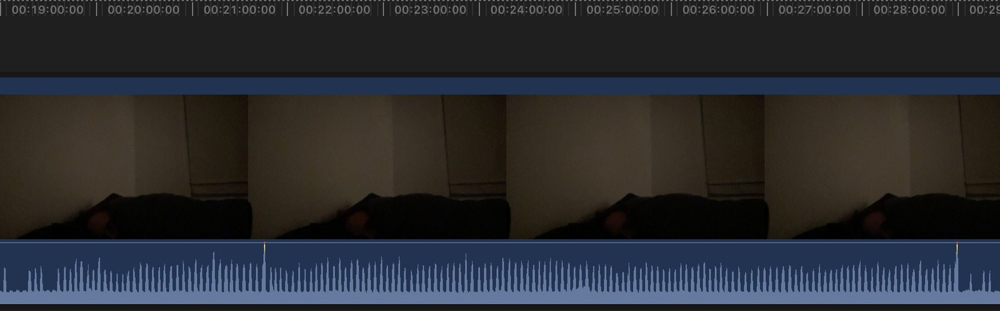

*Nine minutes from the 13th August recording. That's a lot of peaks, but the sleep study would have to answer the important questions.*
{: .media-caption }

Yep, there's nothing good happening there! The time scales are seven and nine minutes respectively. After looking around I can see that these machines aren't cheap. An electric pump and an algorithm for $1000+. Computer says no, bank account says no. Especially as I am running on a trial and error basis here. Maybe there's another way.

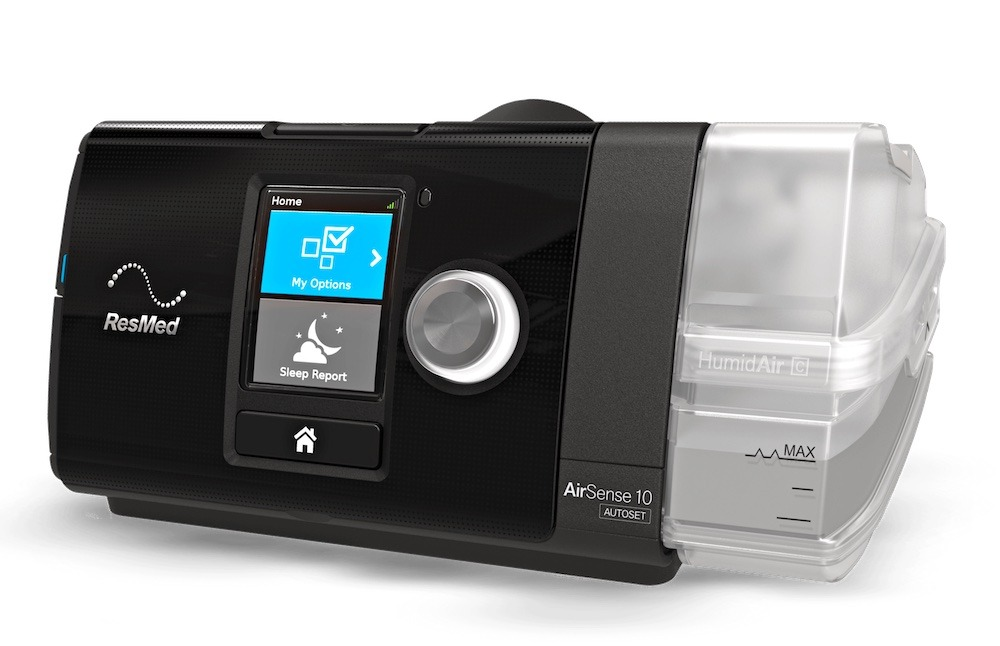

*The ResMed AirSense 10 AutoSet I arranged to trial. Much more promising than spending another year researching machines.*
{: .media-caption }

Well, what do you know, I could trial a ResMed AirSense 10 AutoSet for the cost of only a few big meals each week. I arranged a short trial while I waited to see how I got on with it. Biggest issues were probably going to be mask type, mask fitting and exhaling against the machine. The trial wasn't a substitute for a formal diagnosis.



I could honestly research these for years, the end result being analysis paralysis with no device ever materialising. For now, I wait for the trial ResMed AirSense 10 AutoSet CPAP hardware to arrive and hope I picked a suitable mask. Here's to a good night's sleep at some point in the future? Time will tell! 😴

### Sources

- [Healthdirect Australia - Night sweats](https://www.healthdirect.gov.au/night-sweats)
- [Healthdirect Australia - Antidepressants](https://www.healthdirect.gov.au/antidepressants)
- [Healthdirect Australia - Obstructive sleep apnoea](https://www.healthdirect.gov.au/obstructive-sleep-apnoea)

### Related Posts

- [Sleep Hygiene and Sleep Health - The Data](/sleep-hygiene-and-sleep-health-the-data/)
