

I really don't like small fans. Dreamcast, looking at you. Then again, I've added small fans to things in the past. Right [Netgear DG834Gv5](/netgear-dg834gv5-adsl2-modem-router-cooling-mod/)? Above we have the smash hit follow up to the [Cisco SPA8000-G4 post-recap video](/cisco-spa8000-g4-8-port-ip-telephony-gateway-recap-overview/) from... **_\*checks notes\*_** eight months ago. Whoops! 😅

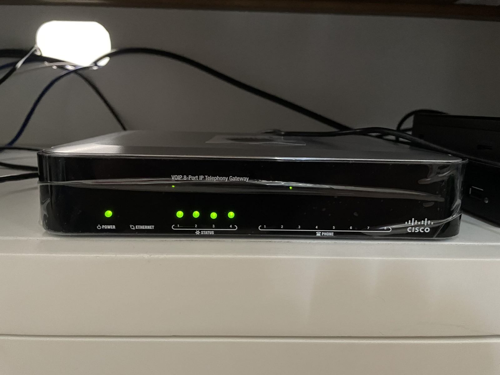

*The SPA8000 was an impressive bit of kit, even if I only needed it to test a few dial-up modems.*
{: .media-caption }

This SPA8000 was originally slated to replace my Linksys PAP2T. However, I ended up moving to the similar Cisco SPA112. The SPA8000 was overkill for my needs - testing some dial-up modems. It wasn't ever going to hang around for long. Since this will probably be the last post on this device, I probably should tie up some loose ends.

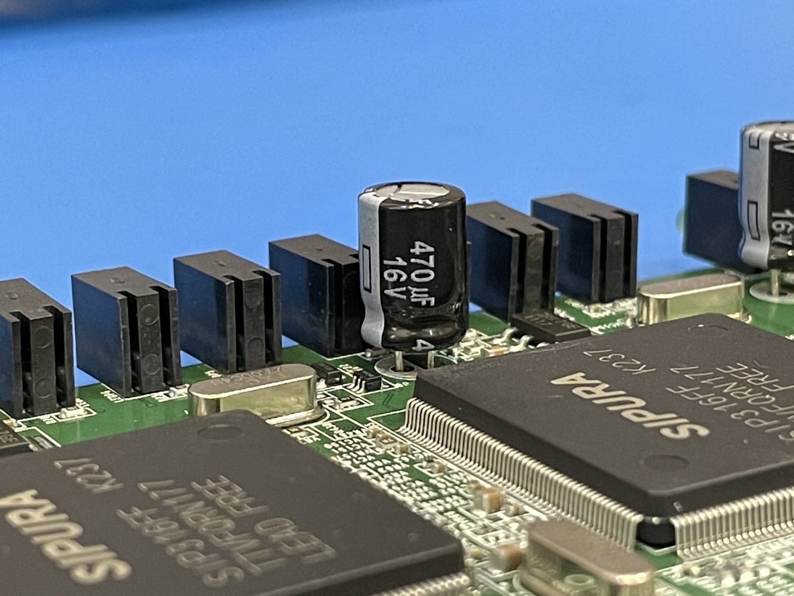

*A 470 µF replacement capacitor standing a little proud of the board. Sometimes the new parts need extra breathing room.*
{: .media-caption }

First up is the capacitor replacement. These capacitors must have been rated with Nichicon-levels of life. The Panasonic FR replacements did not line up neatly with every original footprint, which made me suspicious, but case size alone does not prove the original markings were wrong. Different capacitor series can package the same capacitance and voltage rating in different case sizes. I was able to get around the fit problem by elevating the larger replacements slightly off the PCB.

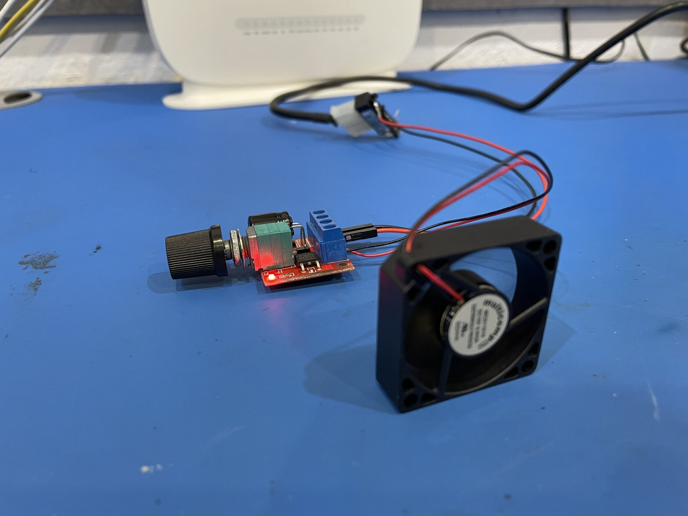

*The little fan controller on the bench, wired to a replacement fan. At least this modification was small enough to fit.*
{: .media-caption }

Here's the fan controller I used. Relatively simple and cheap. I swapped the 50 V Sanyo capacitor for a 25 V Panasonic to fit flush with the PCB. That's what I fitted, but reducing the voltage rating requires checking the maximum circuit voltage and transients at that component. Physical fit alone is not enough.

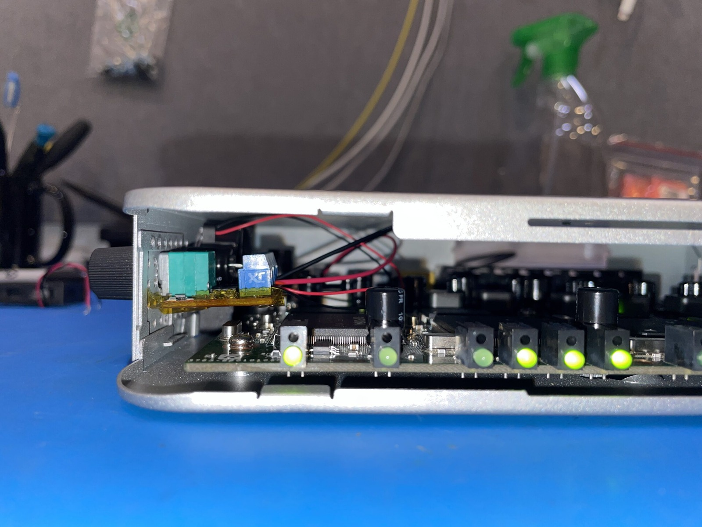

*The controller dial finally fitted through the chassis. The lead-free solder and I were not exactly on speaking terms.*
{: .media-caption }

I didn't want to destroy the original fan connector in the process, so I kept it intact. Getting the new header in place was a bit of a fight, thanks in part to the lead-free solder refusing to leave the holes alone.

Some of the case needed to be dremelled to fit the potentiometer through. I put Kapton tape on the underside of the controller PCB to prevent shorts.

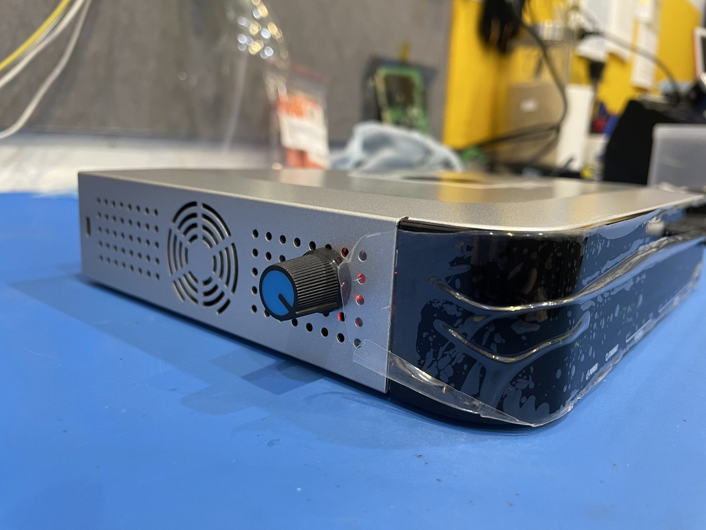

*The dial found its new home beside the fan grille. It actually looks reasonably tidy, for once.*
{: .media-caption }

Doesn't look too bad with the dial attached.

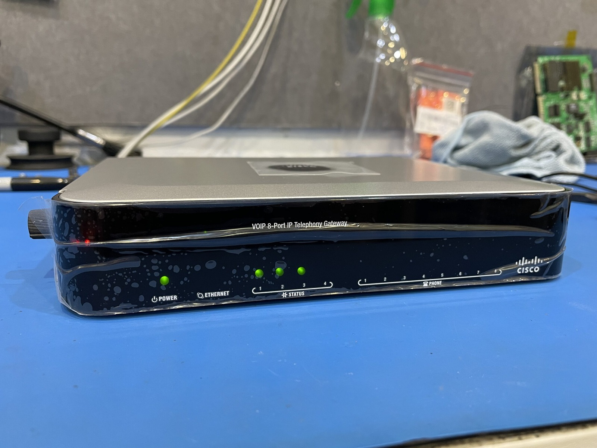

*From the front, the new fan dial almost disappears. I wish the noise had done the same.*
{: .media-caption }

And you can hardly even notice it from the front.

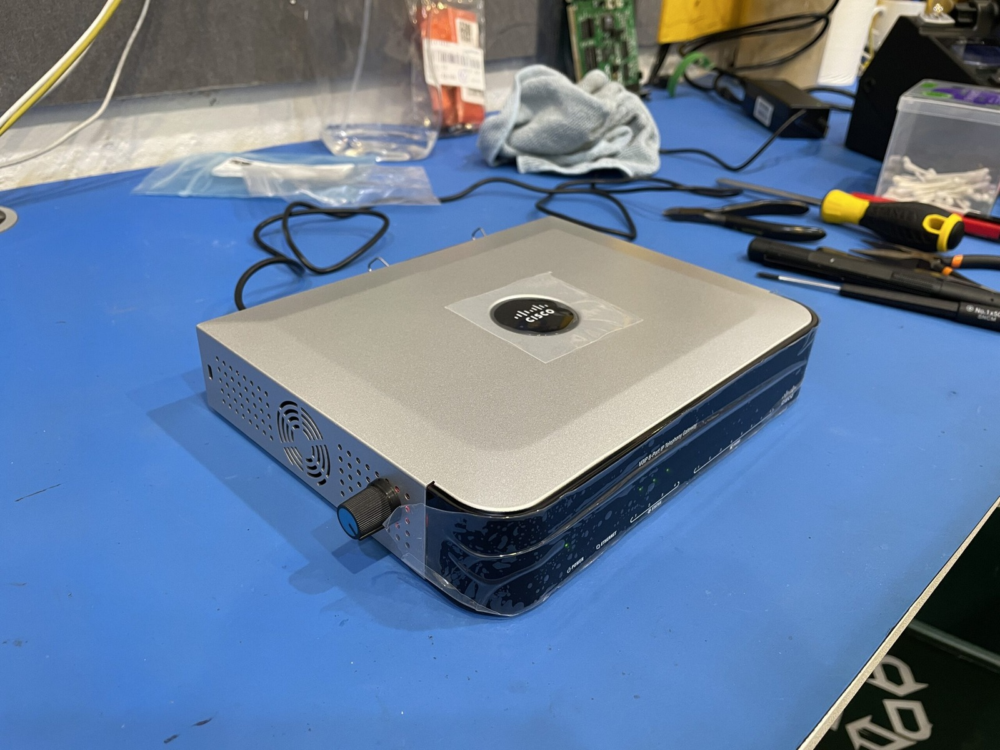

*A final look at the modified gateway. The knob looks neat, but the fan was still too noisy for my liking.*
{: .media-caption }

The original fan was rated at 12 V, 0.13 A, while the replacement was rated at 12 V, 0.043 A. I could slow the replacement fan down, but slowing it too far isn't much use if it stops moving enough air. The fan's alignment with the grille probably wasn't helping the noise either.

I mean, it looks neat. That's not like me at all. I'd want the fan on at all times, even at the lowest setting, for peace of mind. Reducing fan speed also reduces cooling, so this sort of modification should be validated with temperatures under the actual load and ambient conditions. Even after the modification, I still found the fan noisy at its lowest speed. Probably that grille blocking airflow and increasing turbulence. Definitely a deciding factor in moving to the Cisco SPA112 instead - no fan!

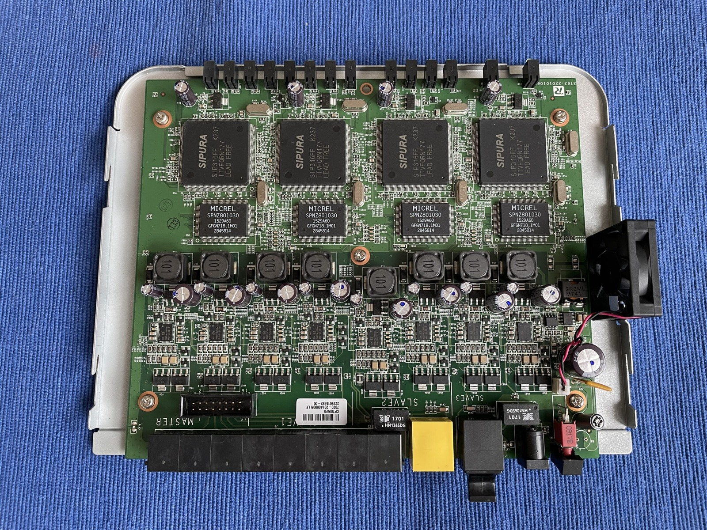

*One last look inside the SPA8000. Four big Sipura chips, plenty of components, and that tiny fan I wanted to quieten down.*
{: .media-caption }

The parts listed below are manufacturer part numbers and record what I installed in this particular SPA8000-G4. Check your board, capacitor type and polarity, capacitance, voltage and temperature ratings, ESR, ripple current and physical fit before choosing replacements. The formatting isn't too web friendly. Copy the raw text out and paste it into a plain-text editor such as Notepad or TextEdit in plain-text mode and you'll probably be fine. 😄

```
Location	Value	Voltage		Dimensions				Lead Spacing	Notes
EC1/EC2		1500uF	16V			12.5mm (h) x 12.5mm (w)	5mm				EEUFR1C152	Panasonic FR Series

VC353		27uF	100V		12.5mm (h) x 8mm (w)	3.0-3.5mm		EEUFS2A270	Panasonic FS Series
VC333		27uF	100V		12.5mm (h) x 8mm (w)	3.0-3.5mm		As above
VC246		27uF	100V		12.5mm (h) x 8mm (w)	3.0-3.5mm		As above
VC266		27uF	100V		12.5mm (h) x 8mm (w)	3.0-3.5mm		As above
VC139		27uF	100V		12.5mm (h) x 8mm (w)	3.0-3.5mm		As above
VC119		27uF	100V		12.5mm (h) x 8mm (w)	3.0-3.5mm		As above
VC32		27uF	100V		12.5mm (h) x 8mm (w)	3.0-3.5mm		As above
VC12		27uF	100V		12.5mm (h) x 8mm (w)	3.0-3.5mm		As above

VEC8		100uF	10V			12.5mm (h) x 5mm (w)	2.0mm			EEUFR1C101	Panasonic FR Series, upgraded to 16V
VEC7		100uF	10V			12.5mm (h) x 5mm (w)	2.0mm			As above
VEC6		100uF	10V			12.5mm (h) x 5mm (w)	2.0mm			As above
VEC5		100uF	10V			12.5mm (h) x 5mm (w)	2.0mm			As above
VEC4		100uF	10V			12.5mm (h) x 5mm (w)	2.0mm			As above
VEC3		100uF	10V			12.5mm (h) x 5mm (w)	2.0mm			As above
VEC2		100uF	10V			12.5mm (h) x 5mm (w)	2.0mm			As above
VEC1		100uF	10V			12.5mm (h) x 5mm (w)	2.0mm			As above

EC10		470uF	10V			12.5mm (h) x 6mm (w)	2.0-2.5mm		EEUFR1C471	Panasonic FR Series, upgraded to 16V
EC8			470uF	10V			12.5mm (h) x 6mm (w)	2.0-2.5mm		As above	Lead spacing is 3.5mm, 8mm wide not 6mm... may not fit...
EC5			470uF	10V			12.5mm (h) x 6mm (w)	2.0-2.5mm		As above	Solution - Raised them up above the board a few millimeters.
EC4			470uF	10V			12.5mm (h) x 6mm (w)	2.0-2.5mm		As above	Original package was smaller; case size alone does not establish that it was operated beyond rating.

Fan			12V 	0.043A		35mm (w) x 35mm (h) 10mm (d) 			MC011510	For Replacement of Superred CHC3512CB DC 12V 0.13A 35x35x10mm 2-Wire Server Fan

```

One issue I encountered on first power-on, which is probably worth mentioning, was boot looping. Here are the initial software version, device serial number and reset command I used.

```
Serial: 		CFH01T701904
Software:		5.1.10
Modem reset:	ATDT****,,,,73738#,,,,1

```

I was able to perform a factory reset using dial-up modems. I was likely using an Avtek MegaPlus V.32bis. You may need to adjust the pauses (commas) as it gives the Sipura menu time to respond.

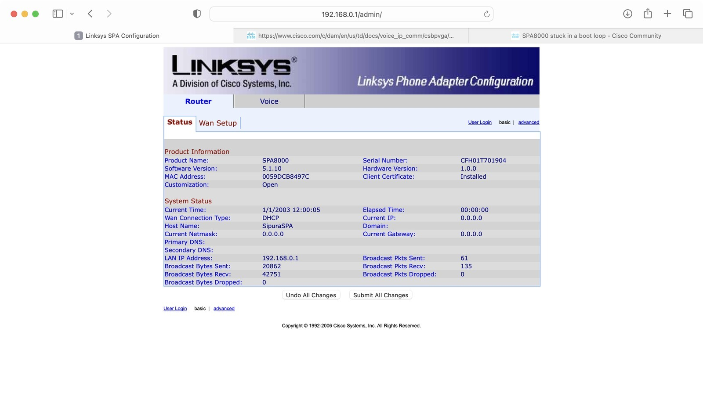

*Before the firmware update, the SPA8000 was reporting version 5.1.10. The address bar was about to cause some mischief.*
{: .media-caption }

The firmware was out of date, which wasn't all that surprising. Keep your eyes on the IP address in the location bar. That caused a few headaches.

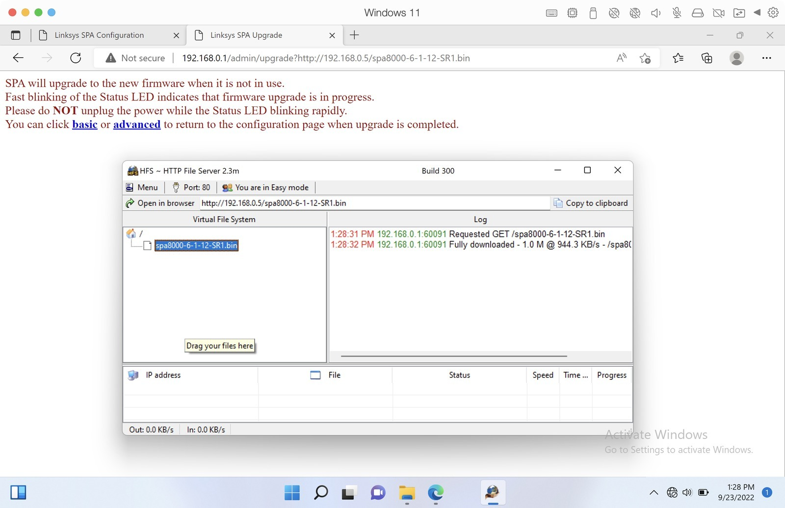

*Firmware update time. A little HTTP file server delivered the upgrade image while the SPA8000 displayed its warnings.*
{: .media-caption }

Cisco's [firmware-upgrade guide for SPA8000 version 6.1.12SR1](https://web.archive.org/web/20230228080434/https://www.cisco.com/c/en/us/support/docs/smb/collaboration-endpoints/cisco-ip-phone-8800-series/1739-SPA8000-upgrade-firmware-to-6112.html) helped me through the update.


*Version 6.1.12SR1 was showing after the upgrade. The addresses were another puzzle to untangle.*
{: .media-caption }

The [quick start guide](https://web.archive.org/web/20250417145553/https://www.cisco.com/c/dam/en/us/td/docs/voice_ip_comm/csbpvga/spa8000/quick_start/guide/spa8000_quick.pdf) also came in handy.

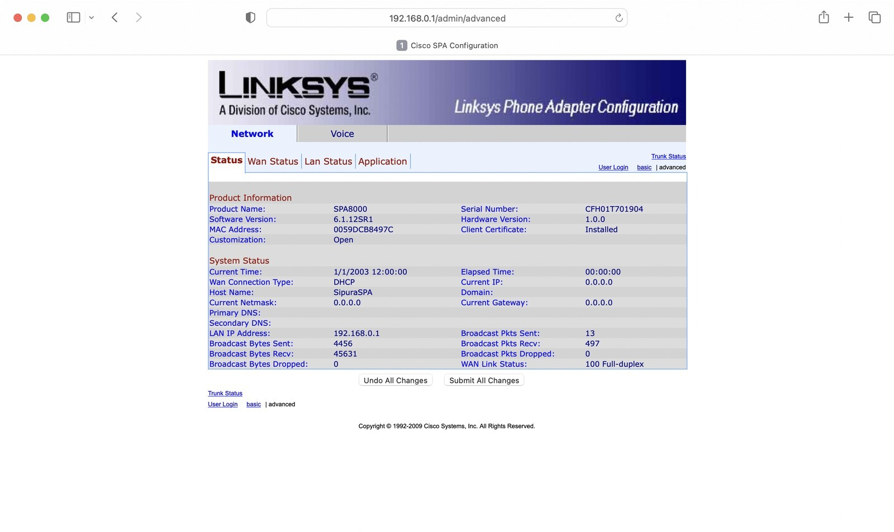

*The updated firmware was there, but the WAN address was back to 0.0.0.0. No wonder this was a frustrating box.*
{: .media-caption }

Thankfully, I wasn't alone: I found a [Cisco Community thread about the SPA8000 boot loop](https://community.cisco.com/t5/voice-systems-and-accessories-small-business/spa8000-stuck-in-a-boot-loop/td-p/1675301?utm_source=chatgpt.com). At least I wasn't the only one fighting with this thing!

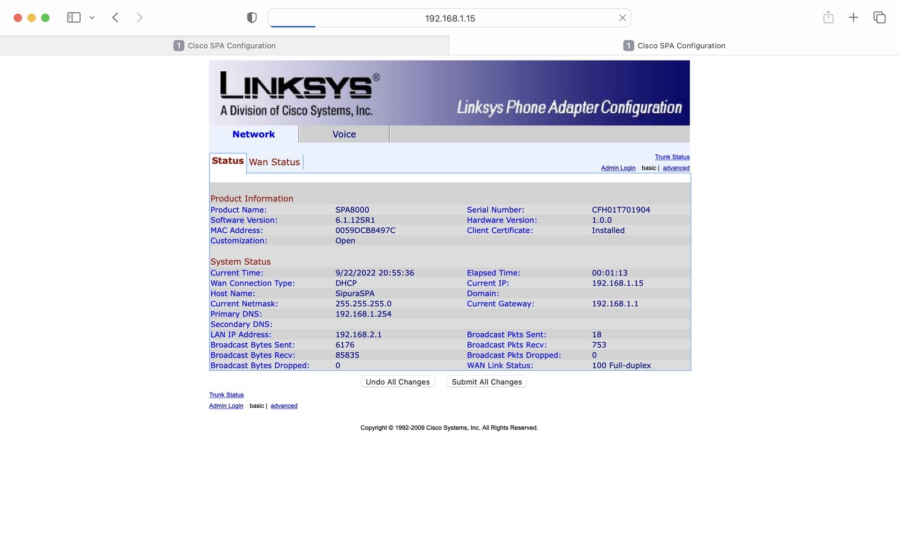

*At last, the SPA8000 was reporting a proper network address and a sensible-looking date. Small victories.*
{: .media-caption }

On this unit, the boot loop stopped when I disconnected Ethernet, which let me reach the AUX interface at 192.168.0.1 and continue recovery. I wouldn't turn that into a universal SPA8000 rule, but it was the condition that worked here. Another thing that was kicking me was the lack of a time server, so the date and time wouldn't update. Adding time.nist.gov as the primary time server in the advanced settings solved that.

I put more photos of this device in the [photo gallery](/goodies), if you are interested in that sort of thing. No judgement from this side of the table! 😄 I also put the firmware I used and some PDFs on configuring the SPA8000 onto the [file server](/goodies).

### Sources

- [Nichicon - Application Guidelines for Aluminum Electrolytic Capacitors](https://www.nichicon.co.jp/english/series_items/catalog_pdf/e-aluminum.pdf)

### Related Posts

- [Cisco SPA8000-G4 8-Port IP Telephony Gateway Recap Overview](/cisco-spa8000-g4-8-port-ip-telephony-gateway-recap-overview/)
