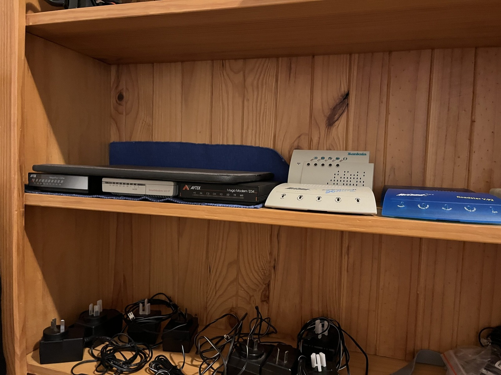
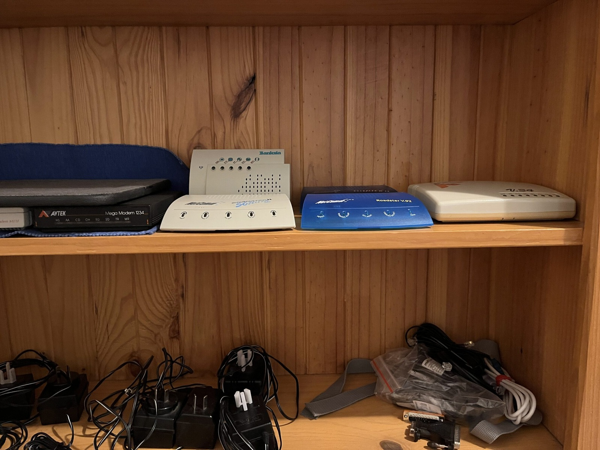
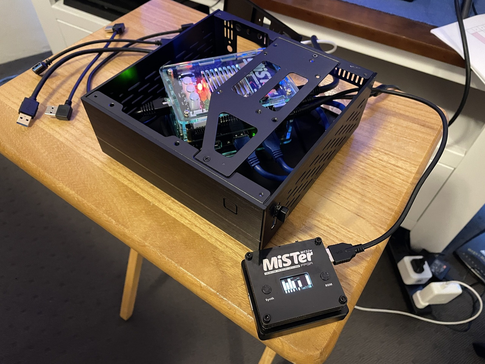



First thing I should probably note: this footage is from relatively early in my VoIP testing, back in 2021. I didn't use anything fancy apart from the VoIP box, some phone cables and good luck. Coupled with [Doge Microsystems' really great dial-up pool guide](https://dogemicrosystems.ca/wiki/Dial-up_pool), of course.

For the test, I had a NetComm and a Banksia modem connected through a Raspberry Pi running Asterisk, with Windows 98 running on the MiSTer ao486 core. It's a pretty ridiculous amount of equipment just to get a dial-up connection, which is probably why I enjoy it.

It does get to a point where you stop and ask yourself, "How many modems are too many modems?" I think I've worked out the answer. They had a very limited use case for me: testing them while testing [the GeoCities Archive](/homepages/geocities). With that work mostly behind me, the modems don't really serve a purpose.

That said, I still have plenty of modem video footage to process. Most of the modems have made their way to the [Australian Computer Museum Society (ACMS)](https://forum.acms.org.au/) after having their capacitors replaced.

I left the setup running for around eight hours. The reported connections included 31,200 bps before dropping to 28,800 bps, and downloads were coming through at roughly 3 kB/s. Not fast by today's standards, but that's hardly the point of messing about with dial-up modems!

In the end, the computer side of this setup can be recreated in an FPGA project like the MiSTer, while the modems remain real hardware. If that isn't powerful enough for you, there's always software-based emulation. It takes up a fraction of the space, which is great for someone like me. 😄

### Sources

- [MiSTer-devel - ao486 core](https://github.com/MiSTer-devel/ao486_MiSTer)
