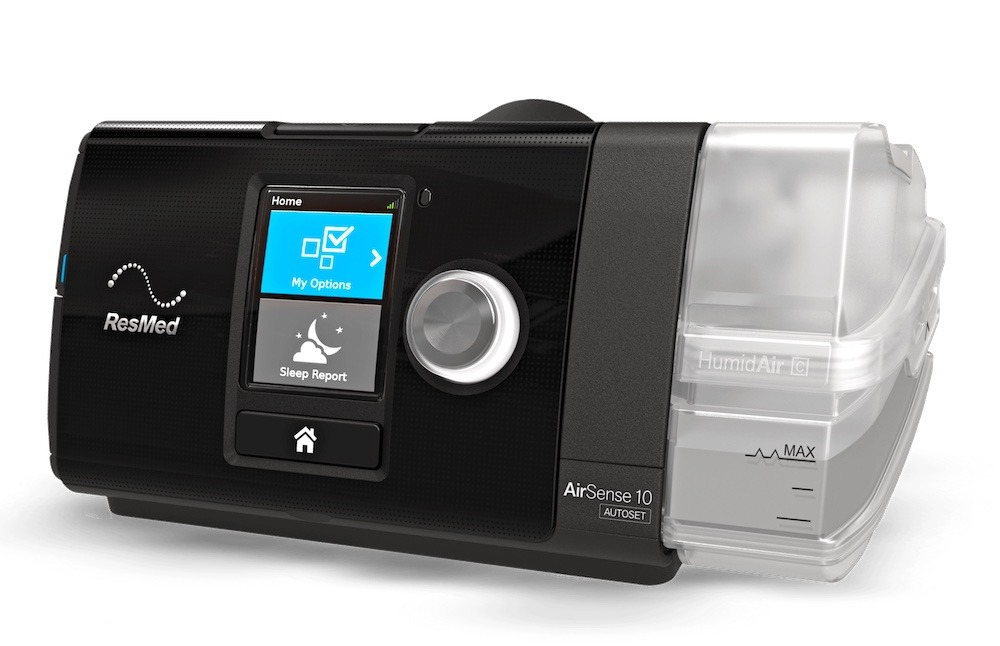

My ResMed AirSense 10 AutoSet trial arrived a couple of weeks ago. After setting it up and picking some starting options, the data flowed for roughly two weeks. Nasal pillows weren't for me: my mouth kept opening, creating the strangest air-pressure sensations. My notes call the ResMed N20 a full-face mask, but the AirFit N20 is a nasal mask. I either wrote the mask type or the model down wrong. 😷

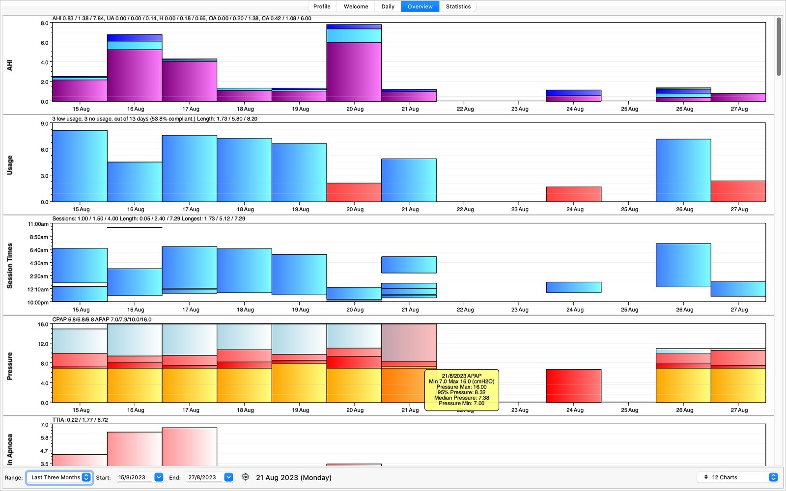

Using [the Open Source CPAP Analysis Reporter](https://www.sleepfiles.com/OSCAR/) (OSCAR v1.4.0), we can dig into the data. The missing days were nights when insomnia kept me awake. Not fun. I've also put the screenshot exports into an [OSCAR ZIP file](/assets/uploads/OSCAR.zip). Anyway, let's look at some of the days and event types in more detail.

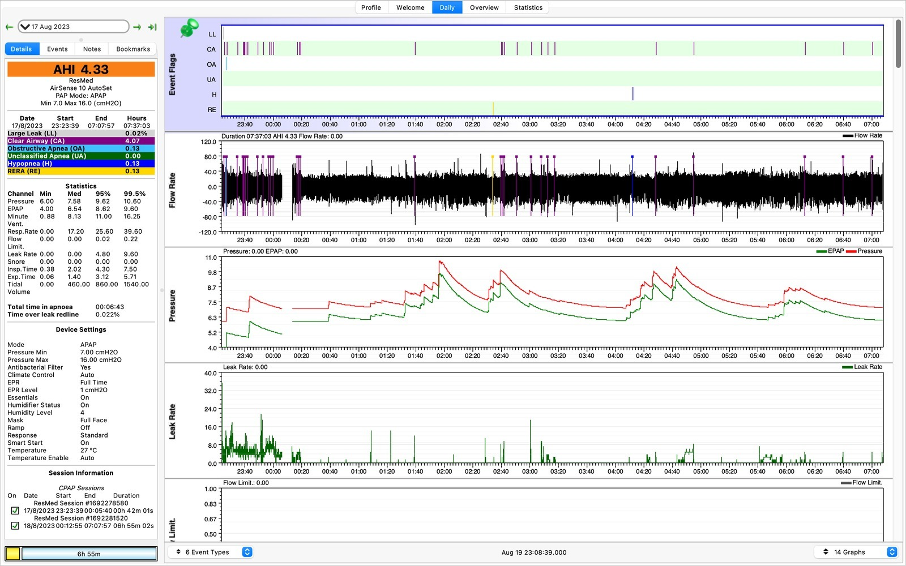

We'll start off with longer periods of recorded data. Above is the 17th August. Many nights were only a few hours of data because the mask itself would cause me to wake up. The machine kept flagging clear-airway events. I was calling these central apnoeas at the time, although they were machine flags rather than something confirmed by a sleep study. If we disregard the earlier data in the night while I was still trying to get to sleep, we can see some of those flags.

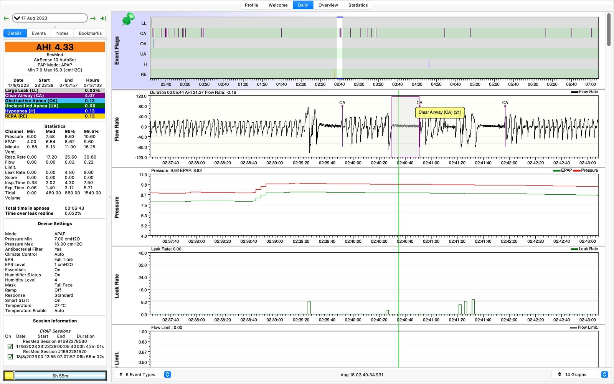

The machine flagged a clear-airway event lasting about 21 seconds. Interesting. The number alone couldn't tell me what caused it, or whether I'd actually been asleep the whole time.

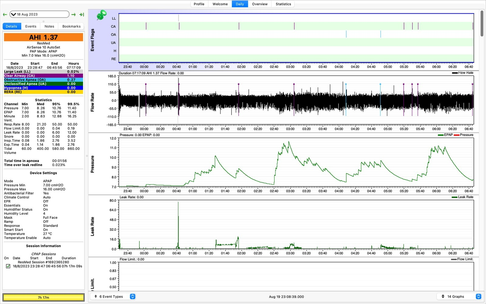

Here's the 18th August, and the machine has flagged some obstructive apnoeas (OAs).

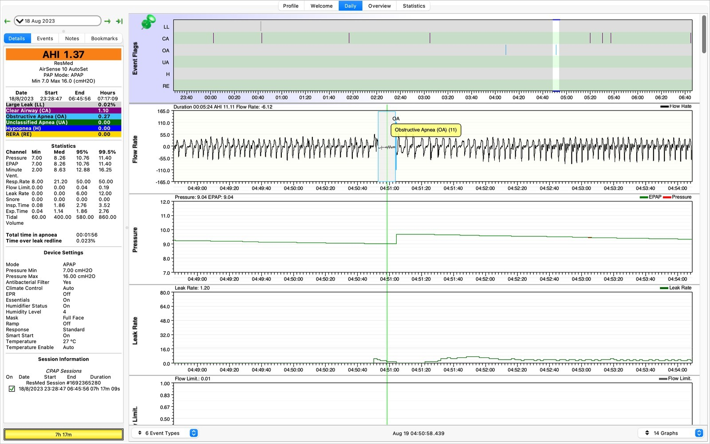

How does the machine distinguish between clear-airway and obstructive events though? The AirSense 10 uses small pressure oscillations during an apnoea to estimate whether the airway is open or closed. That's the machine's estimate, of course, not the same as a proper sleep study. What's also interesting is that central events can appear after treatment of obstructive sleep apnoea begins, known as treatment-emergent central sleep apnoea.

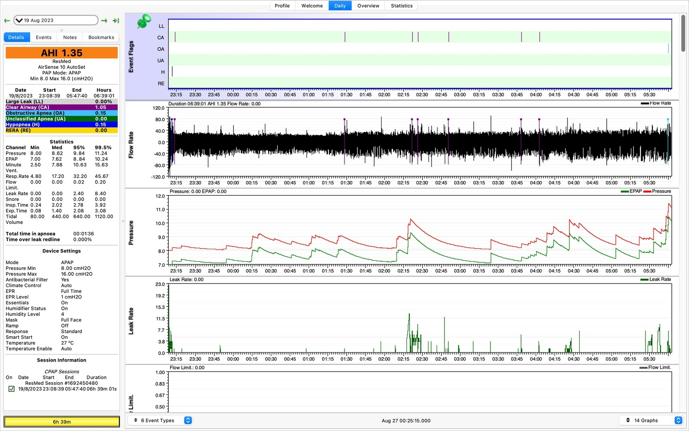

Here's some data from the 19th August. The machine-reported apnoea-hypopnoea index (AHI) was below five on most days and never exceeded eight. It counts flagged events per hour of mask-on therapy, not necessarily per hour asleep. I found the numbers reassuring, even if I still didn't have a diagnosis.

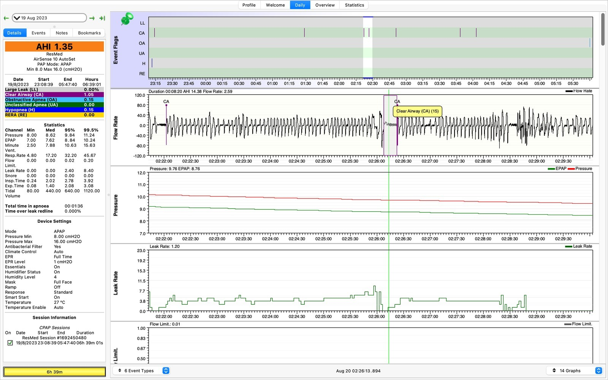

A few more clear-airway flags. I originally assumed a 20+ second event must automatically be more concerning than a 10-second one, but it turns out it's not that simple from the CPAP graphs alone.

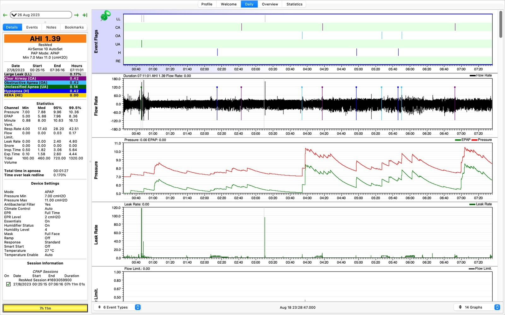

Jumping forward a week to the 26th August we have more data. This one has it all! Large leaks (LL), clear-airway flags (CA), obstructive apnoea flags (OA), and hypopnoeas (H). In my recordings, many of the large leaks appeared while I was readjusting the mask.

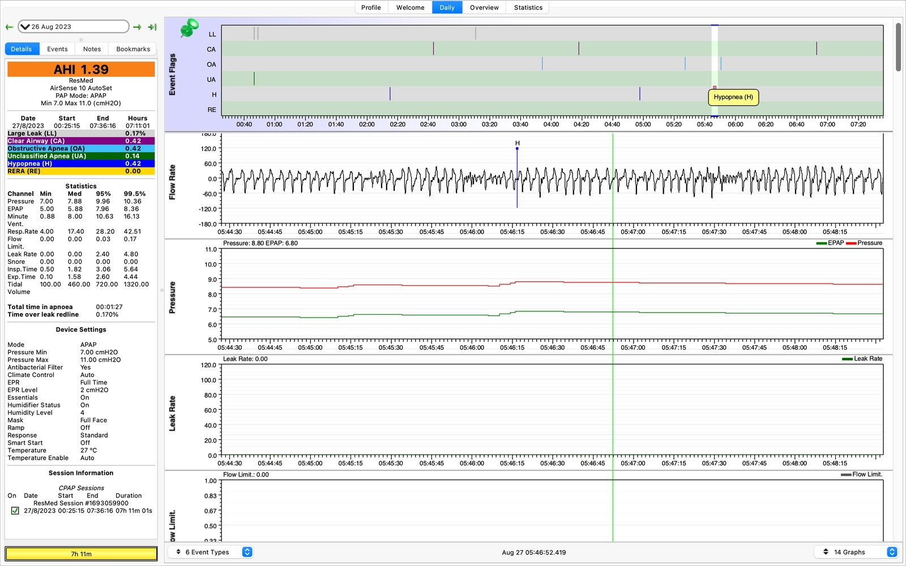

There's a hypopnoea. In plain English, that is a partial reduction in breathing rather than a complete apnoea. That's the label the machine has assigned based on the flow and pressure data.

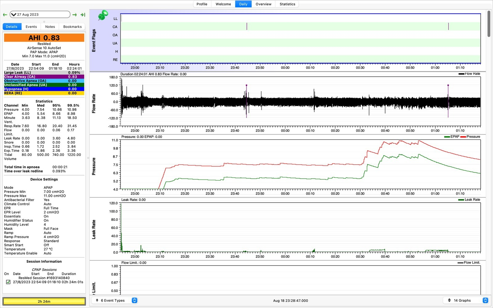

And on the last day of recorded data, the pressure ramped up to 11 cm H2O and I threw the mask off after a few hours.

What have I learnt from this? While my snoring might be an issue to any roommates, I still did not know whether it was clinically important. I varied the settings on the machine night to night, but found that EPR, which reduces pressure during exhalation, made it much easier to sleep.

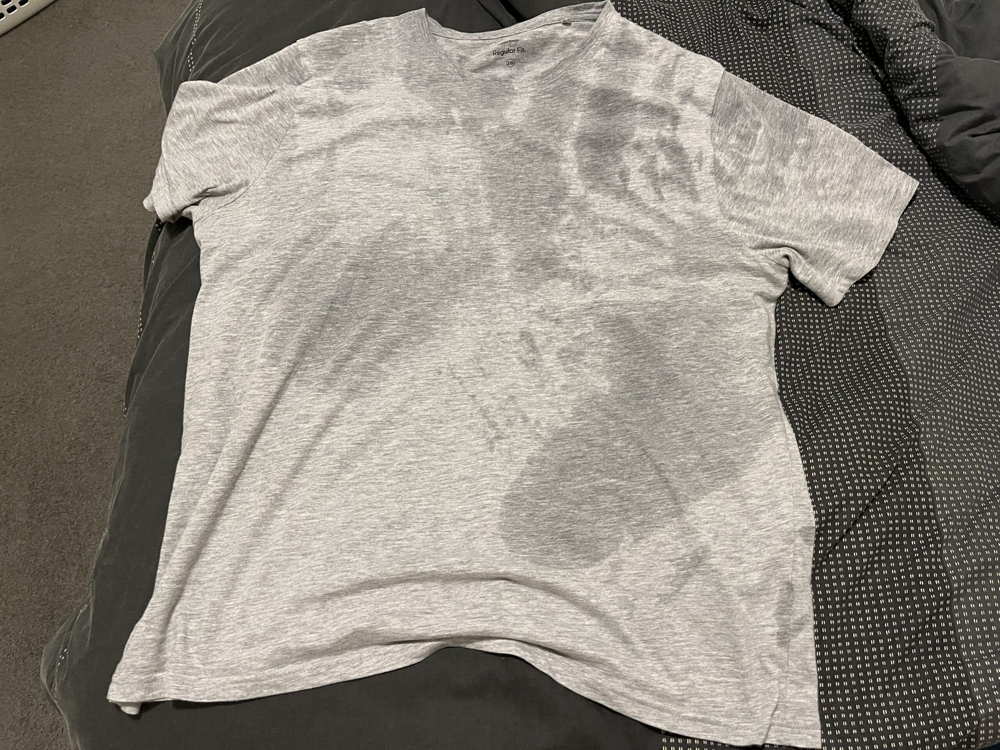

However, I did not feel more rested. What's worse is there were at least three days where I woke up sweat drenched. This was one of the things I was trying to solve: night sweats. The CPAP trial certainly hadn't made them disappear, and I was still none the wiser about what was causing them.

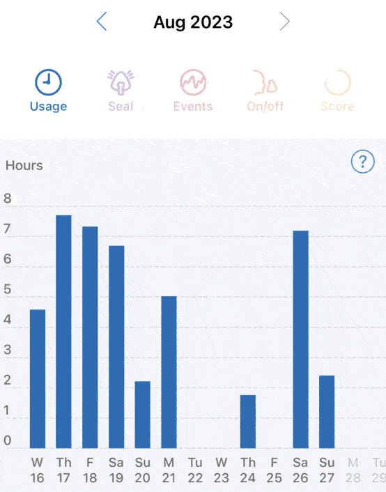

Did APAP or CPAP solve the night sweats during this trial? For me, no. That was the practical question I wanted answered. I still had a proper sleep study ahead of me because two weeks of machine data couldn't diagnose or rule out sleep apnoea. With the sweats showing up on only about 3 of 14 nights, I was also worried a single night might not capture that symptom. Still, a sleep study could find breathing problems even if the night sweats didn't show up.

I guess all I can do is keep investigating why I have issues getting to sleep and staying asleep. I've tried eliminating caffeine, reducing room temperature and changing sleeping positions, and nothing seems to work. The phantom itches as I'm trying to sleep certainly don't help either.

I was starting to wonder whether stress and anxiety were part of the picture, but I did not have an answer yet. 😮‍💨

### Sources

- [ResMed - AirFit N20 nasal mask](https://www.resmed.com/en-us/products/cpap/masks/airfit-n20/)
- [ResMed: AirSense 10 Clinical Guide (AutoSet, AutoSet for Her, Elite and CPAP)](https://www.resmed.com.au/hubfs/airsense-10-autoset-afh-elite-cpap-clinical-guide-apac-eng.pdf)
- [Healthdirect Australia - Obstructive sleep apnoea](https://www.healthdirect.gov.au/obstructive-sleep-apnoea)
- [Treatment-emergent central sleep apnea: a unique sleep-disordered breathing](https://pmc.ncbi.nlm.nih.gov/articles/PMC7725531/)

### Related Posts

- [Sleep Hygiene and Sleep Health](/sleep-hygiene-and-sleep-health/)
