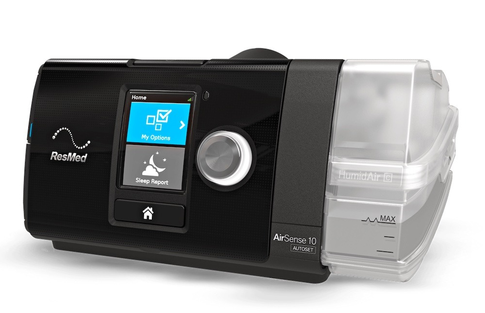

*The AirSense 10 AutoSet trial machine, now accompanied by two weeks of data to poke through.*
{: .media-caption }

My ResMed AirSense 10 AutoSet trial arrived a couple of weeks ago. After setting it up and picking some starting options, the data flowed for roughly two weeks. Nasal pillows weren't for me: my mouth kept opening, creating the strangest air-pressure sensations. My notes call the ResMed N20 a full-face mask, but the AirFit N20 is a nasal mask. I either wrote the mask type or the model down wrong. 😷

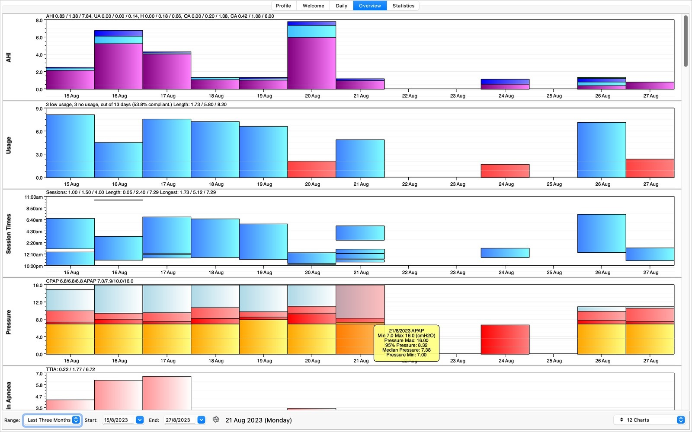

*Two weeks of OSCAR charts, complete with a few blank nights when sleep and I weren't on speaking terms.*
{: .media-caption }

Using [the Open Source CPAP Analysis Reporter](https://www.sleepfiles.com/OSCAR/) (OSCAR v1.4.0), we can dig into the data. The missing days were nights when insomnia kept me awake. Not fun. I've also put the screenshot exports into an [OSCAR ZIP file](/assets/uploads/OSCAR.zip). Anyway, let's look at some of the days and event types in more detail.

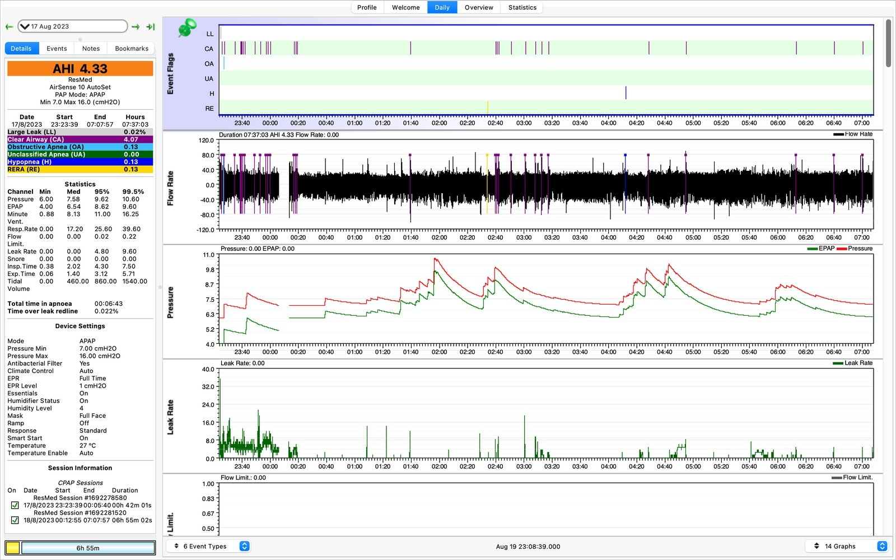

*The 17th August session gave me nearly eight hours of machine data and a collection of clear-airway flags to examine.*
{: .media-caption }

We'll start off with longer periods of recorded data. Above is the 17th August. Many nights were only a few hours of data because the mask itself would cause me to wake up. The machine kept flagging clear-airway events. I was calling these central apnoeas at the time, although they were machine flags rather than something confirmed by a sleep study. If we disregard the earlier data in the night while I was still trying to get to sleep, we can see some of those flags.

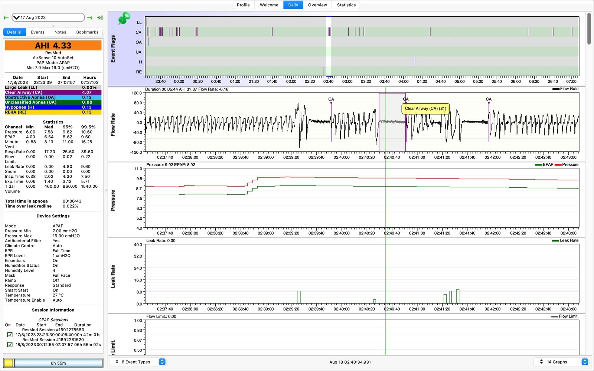

*One of the machine's 21-second clear-airway flags. An interesting trace, not a sleep-study result.*
{: .media-caption }

The machine flagged a clear-airway event lasting about 21 seconds. Interesting. The number alone couldn't tell me what caused it, or whether I'd actually been asleep the whole time.

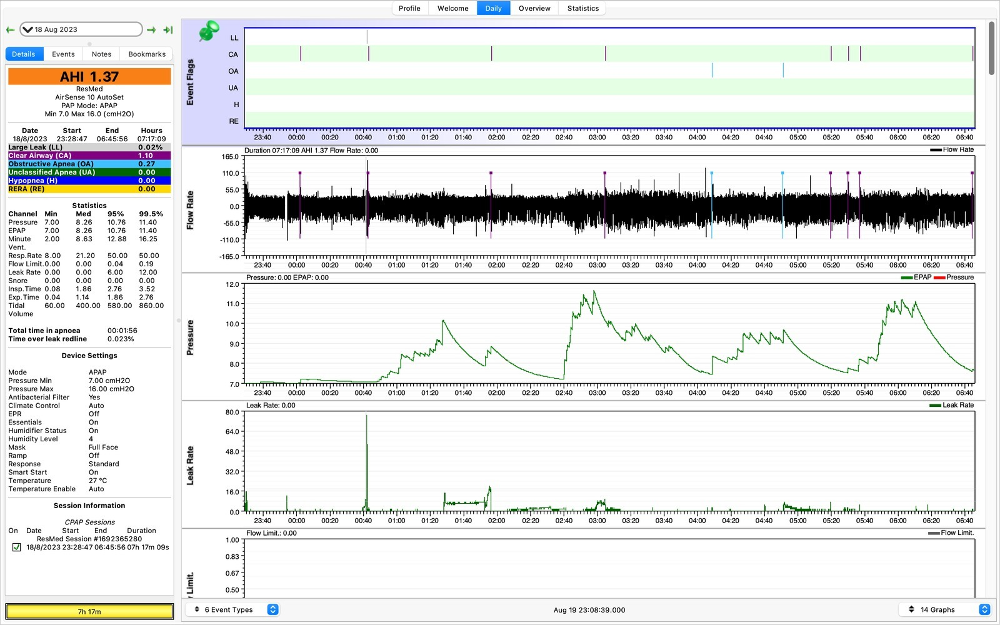

*The 18th August session had a lower machine-reported AHI, with a few obstructive flags mixed in.*
{: .media-caption }

Here's the 18th August, and the machine has flagged some obstructive apnoeas (OAs).

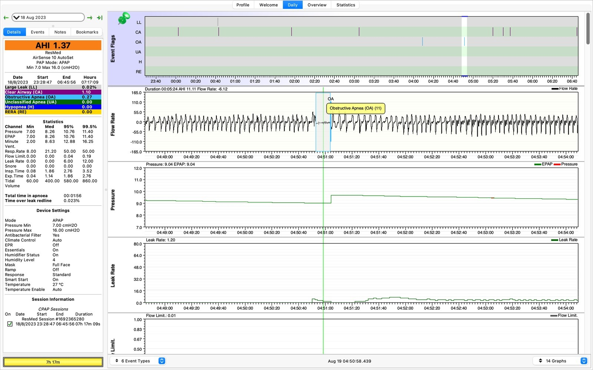

*An 11-second obstructive-apnoea flag from the machine. That's the software's label, not a diagnosis.*
{: .media-caption }

How does the machine distinguish between clear-airway and obstructive events though? The AirSense 10 uses small pressure oscillations during an apnoea to estimate whether the airway is open or closed. That's the machine's estimate, of course, not the same as a proper sleep study. What's also interesting is that central events can appear after treatment of obstructive sleep apnoea begins, known as treatment-emergent central sleep apnoea.

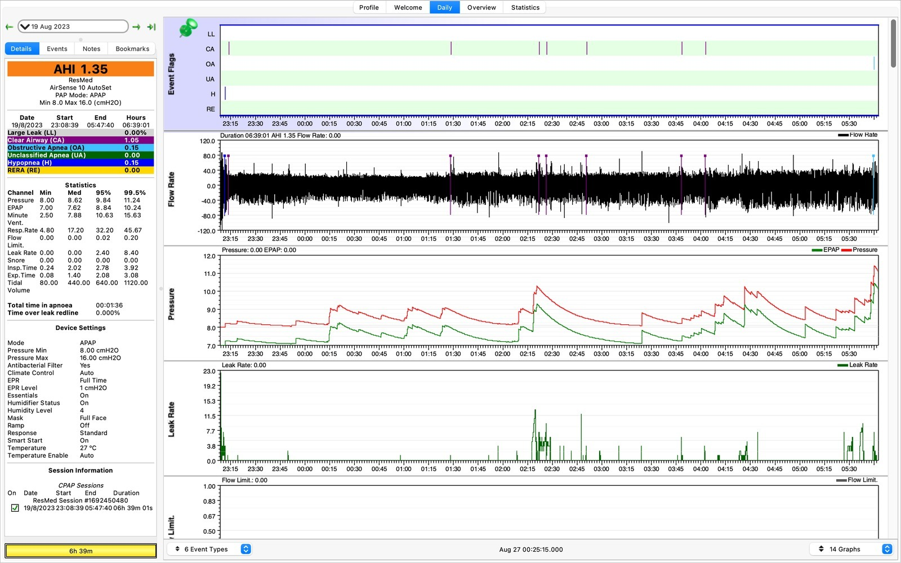

*Another night of recorded data, another batch of machine flags. At least the graphs were giving me something to investigate.*
{: .media-caption }

Here's some data from the 19th August. The machine-reported apnoea-hypopnoea index (AHI) was below five on most days and never exceeded eight. It counts flagged events per hour of mask-on therapy, not necessarily per hour asleep. I found the numbers reassuring, even if I still didn't have a diagnosis.

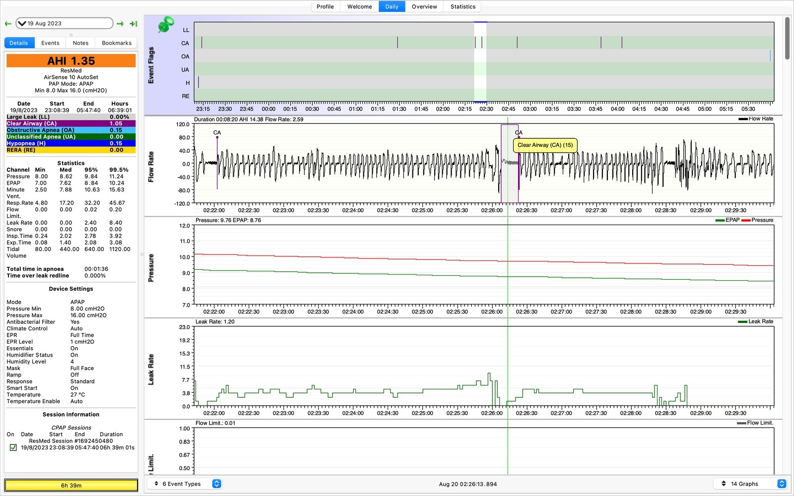

*A closer look at another clear-airway flag. Duration on its own still doesn't tell the whole story.*
{: .media-caption }

A few more clear-airway flags. I originally assumed a 20+ second event must automatically be more concerning than a 10-second one, but it turns out it's not that simple from the CPAP graphs alone.

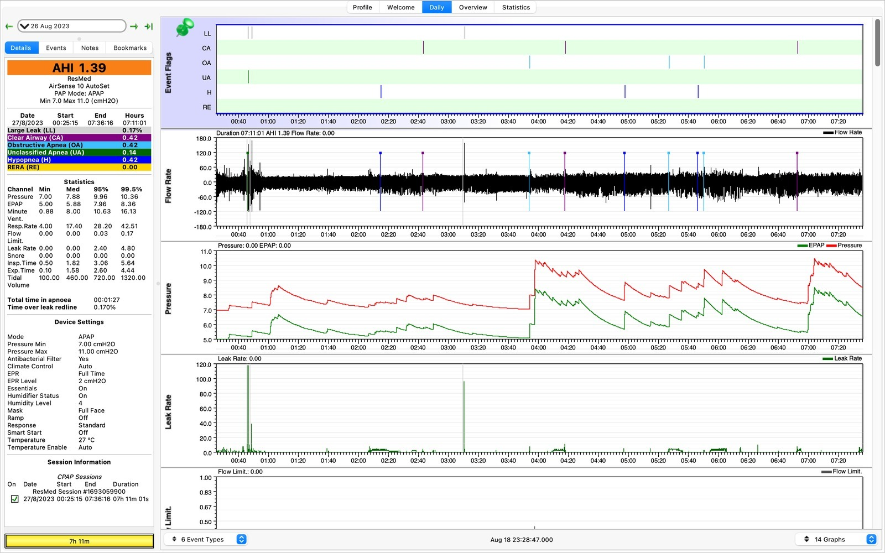

*The 26th August record had a bit of everything: flags, pressure changes and some impressive-looking leak spikes.*
{: .media-caption }

Jumping forward a week to the 26th August we have more data. This one has it all! Large leaks (LL), clear-airway flags (CA), obstructive apnoea flags (OA), and hypopnoeas (H). In my recordings, many of the large leaks appeared while I was readjusting the mask.

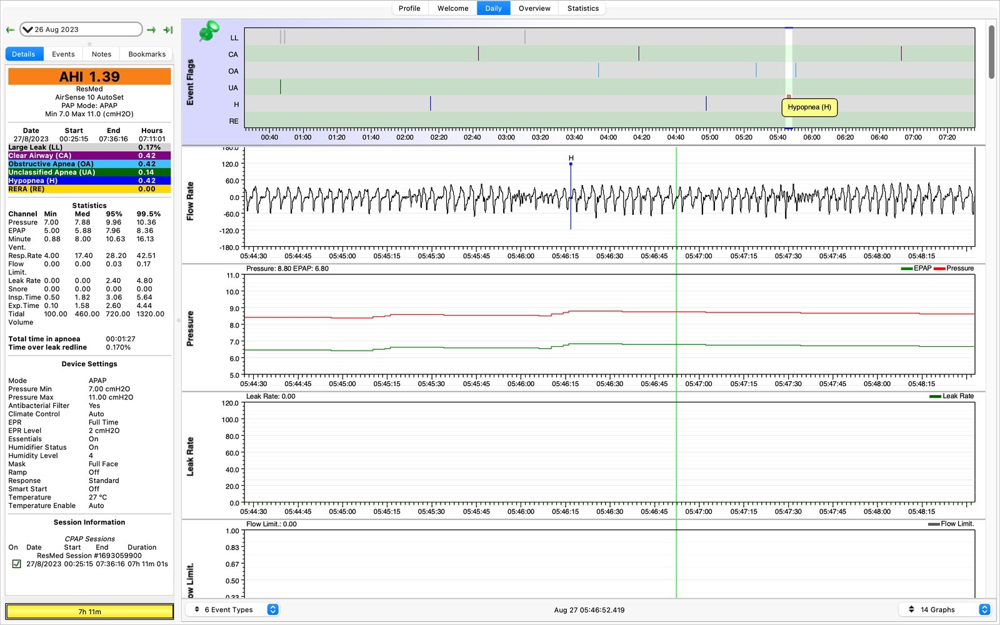

*There it is, a hypopnoea flag in the OSCAR display. Another label assigned by the machine.*
{: .media-caption }

There's a hypopnoea. In plain English, that is a partial reduction in breathing rather than a complete apnoea. That's the label the machine has assigned based on the flow and pressure data.

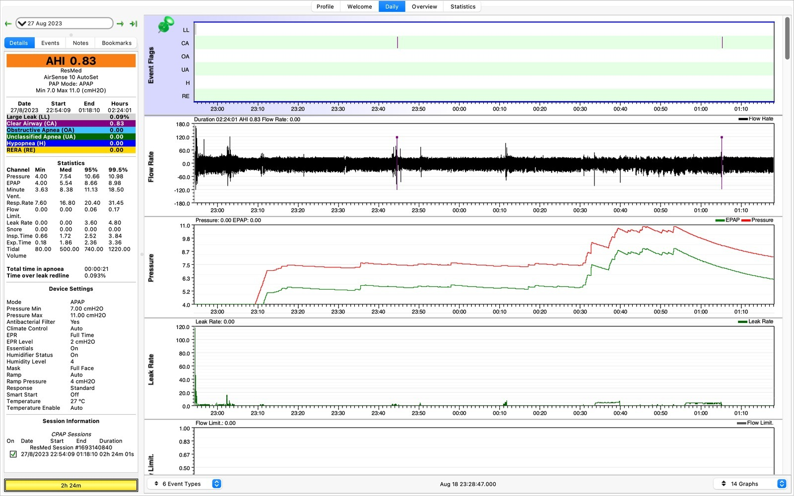

*By the last recorded session the pressure had climbed above 10, and I wasn't in the mood to keep wearing that mask.*
{: .media-caption }

And on the last day of recorded data, the pressure ramped up to 11 cm H2O and I threw the mask off after a few hours.

What have I learnt from this? While my snoring might be an issue to any roommates, I still did not know whether it was clinically important. I varied the settings on the machine night to night, but found that EPR, which reduces pressure during exhalation, made it much easier to sleep.

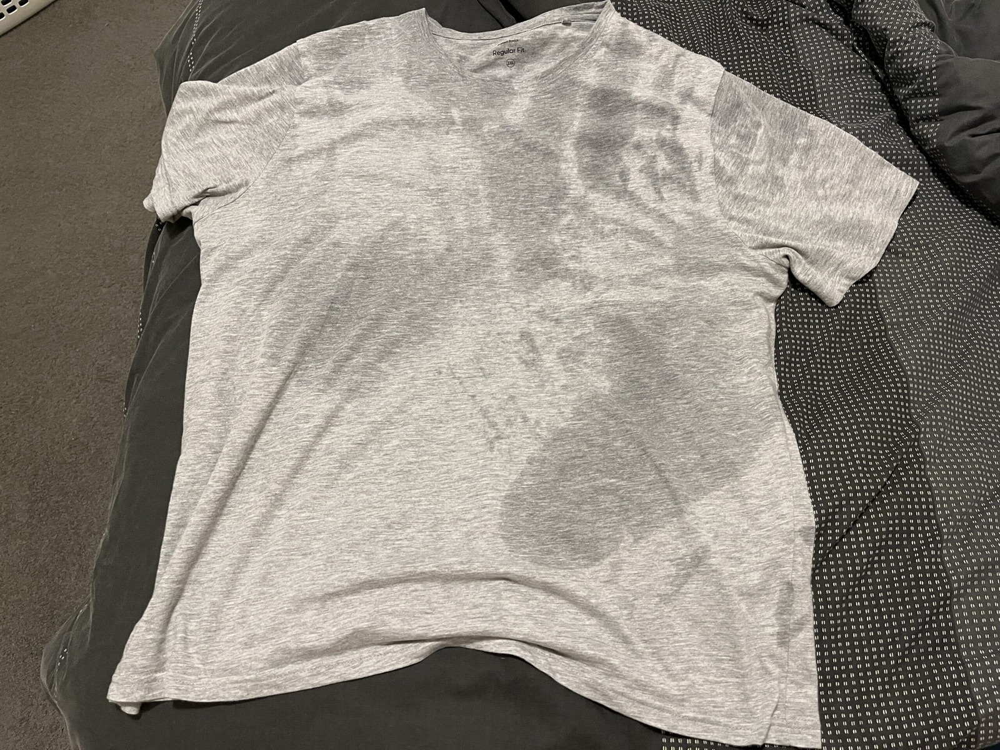

*The night sweats were still with me after the CPAP trial. The T-shirt gives you a pretty good idea of the problem.*
{: .media-caption }

However, I did not feel more rested. What's worse is there were at least three days where I woke up sweat drenched. This was one of the things I was trying to solve: night sweats. The CPAP trial certainly hadn't made them disappear, and I was still none the wiser about what was causing them.

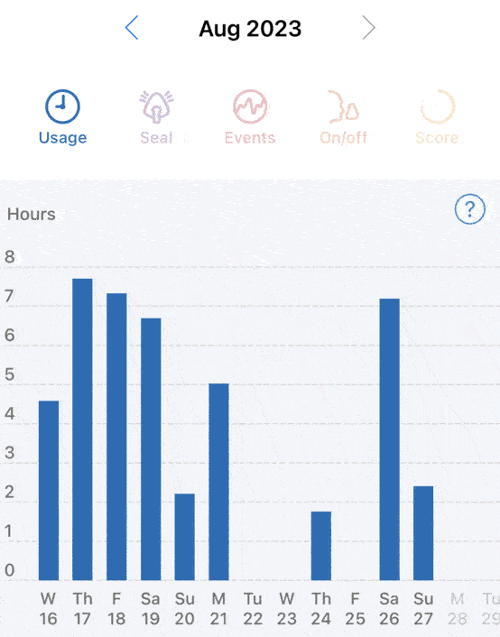

*An August usage chart from the CPAP trial. Some good stretches of machine time, plenty of gaps, and still no magic cure for the night sweats.*
{: .media-caption }

Did APAP or CPAP solve the night sweats during this trial? For me, no. That was the practical question I wanted answered. I still had a proper sleep study ahead of me because two weeks of machine data couldn't diagnose or rule out sleep apnoea. With the sweats showing up on only about 3 of 14 nights, I was also worried a single night might not capture that symptom. Still, a sleep study could find breathing problems even if the night sweats didn't show up.

*Another view of the very stop-start August CPAP usage. Turns out putting numbers on poor sleep doesn't make it any more cooperative.*
{: .media-caption }

I guess all I can do is keep investigating why I have issues getting to sleep and staying asleep. I've tried eliminating caffeine, reducing room temperature and changing sleeping positions, and nothing seems to work. The phantom itches as I'm trying to sleep certainly don't help either.

I was starting to wonder whether stress and anxiety were part of the picture, but I did not have an answer yet. 😮‍💨

### Sources

- [ResMed - AirFit N20 nasal mask](https://www.resmed.com/en-us/products/cpap/masks/airfit-n20/)
- [ResMed: AirSense 10 Clinical Guide (AutoSet, AutoSet for Her, Elite and CPAP)](https://www.resmed.com.au/hubfs/airsense-10-autoset-afh-elite-cpap-clinical-guide-apac-eng.pdf)
- [Healthdirect Australia - Obstructive sleep apnoea](https://www.healthdirect.gov.au/obstructive-sleep-apnoea)
- [Treatment-emergent central sleep apnea: a unique sleep-disordered breathing](https://pmc.ncbi.nlm.nih.gov/articles/PMC7725531/)

### Related Posts

- [Sleep Hygiene and Sleep Health](/sleep-hygiene-and-sleep-health/)
