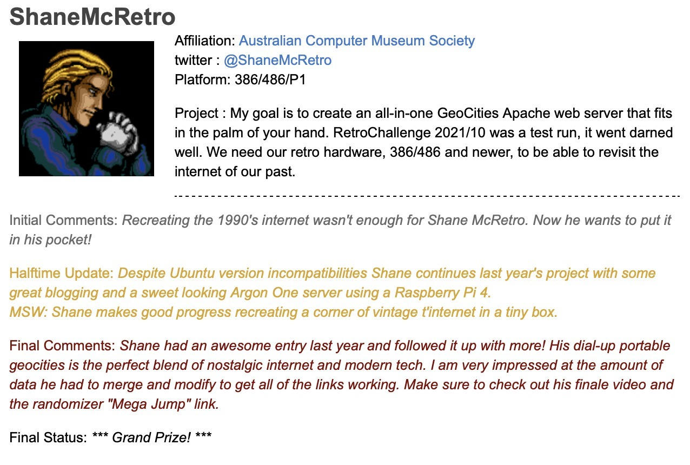
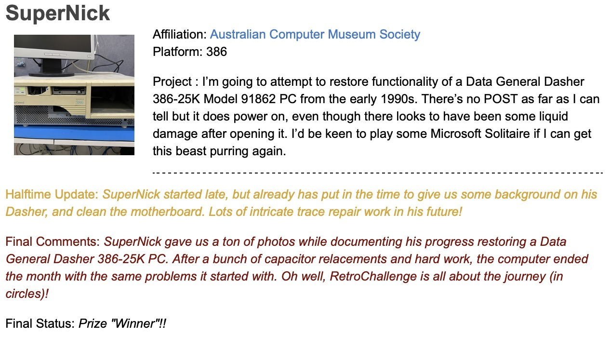
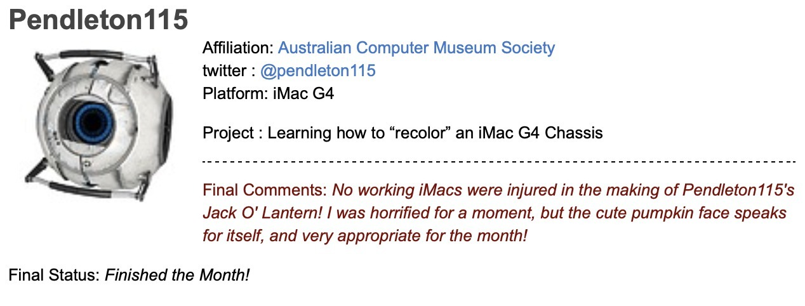
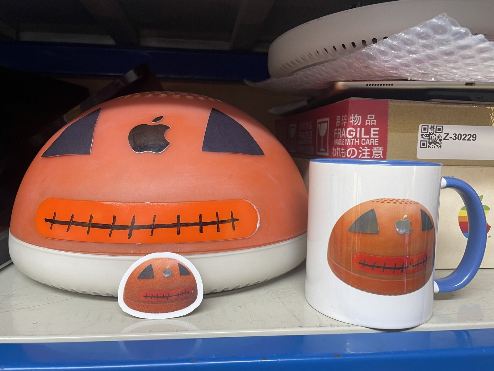
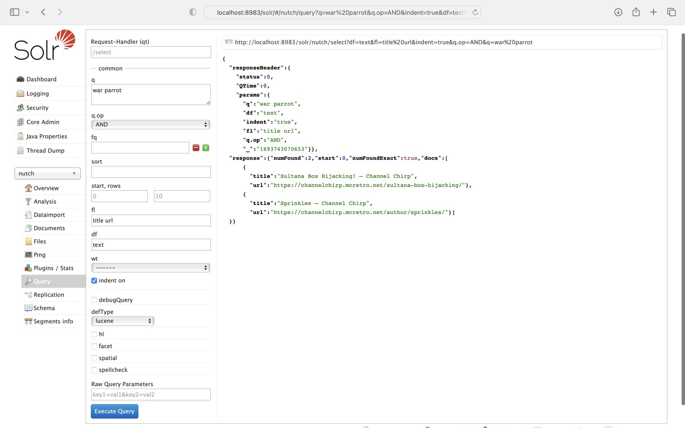
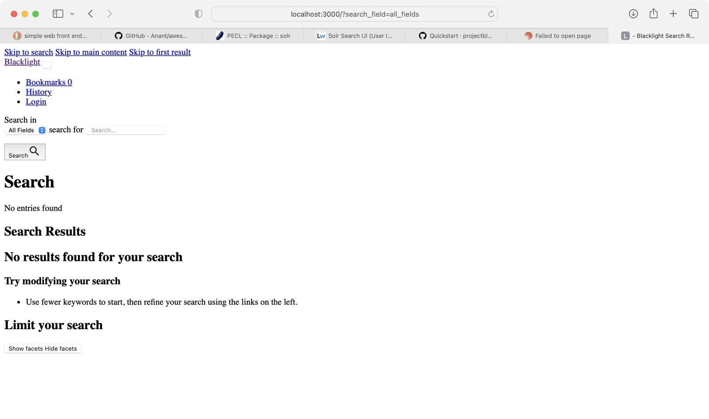

*The RetroChallenge results were in, and somehow my tiny GeoCities server project had picked up the Grand Prize. Nice!*
{: .media-caption }

Where to start with the last few days? Why not here! The [RetroChallenge 2022/10 results](https://www.retrochallenge.org/2023/09/rc202210-results.html) are in. Looks like I nabbed the **Grand Prize**. Not too bad.

*SuperNick got a prize too, with a Data General Dasher restoration. A troublesome old PC is a perfectly respectable project.*
{: .media-caption }

SuperNick (Nick) also got a place, congratulations! He won the [Australian Computer Museum Society (ACMS)](https://forum.acms.org.au/) grand prize last year.

*Pumpkin Mac survived the judging, even if the judges weren't quite as generous with the prizes as I would have been.*
{: .media-caption }

That poor pumpkin Mac just can't catch a break.

*A pumpkin Mac, a matching mug, and a sticker. Honestly, how was anyone meant to compete with that level of merchandise?*
{: .media-caption }

I honestly believe it deserved a place. I suppose as the grand prize winner, I can relinquish my title and hand it to the true winner - [Tim](https://pendleton115.net/). Why? Pumpkin Mac has more merch of course!

*The Solr search was answering a test query for 'war parrot'. Getting that connected to a useful GeoCities search was the next adventure.*
{: .media-caption }

On the topic of RetroChallenge 2022/10, where we tried to bend the GeoCities archive to our needs, I've coincidentally been trying to cook up the following: [Solr](https://solr.apache.org) + [Nutch](https://nutch.apache.org) + [Blacklight](https://projectblacklight.org) in a [Docker](https://www.docker.com) setup.

So far, from what I understand: Solr is the search platform and index, Nutch is the web crawler feeding content into it, and Project Blacklight is the search frontend talking to Solr. This should allow _**full-text searching**_ of the GeoCities Archive. And Docker? Well I've wanted to make GeoCities **_even more portable_** for a long while and now I've started making inroads.

*Blacklight was loading, but the styling had fallen out and the search still wasn't cooperating. At least it was something!*
{: .media-caption }

Wait, was PHP even installed? Maybe that's it! Nope. Blacklight is a Ruby on Rails application, so PHP was a complete red herring. This is why it is good to think out loud. 😆

Regardless, dockerising it has been tricky, but fun. I am definitely making progress though. Do I have a Dockerfile? Why yes, I do have a Dockerfile. I've dreamed of making one since 2019, and can now confirm it is magical. Quite hacky, of course, but that's generally [the way I roll](/). 😎

### Sources

- [Apache Solr Reference Guide](https://solr.apache.org/guide/solr/latest/index.html)
- [Apache Nutch](https://nutch.apache.org/)
- [Project Blacklight](https://projectblacklight.org/)

### Related Posts

- [The GeoCities Archive Rebuild Blog](/the-geocities-archive-rebuild-blog/)
- [The GeoCities Archive Rebuild Goes Live](/the-geocities-archive-rebuild-goes-live/)
- [Multimeter, MiSTer and GeoCities](/multimeter-mister-and-geocities/)
- [The GeoCities Rebuild Worklog](/the-geocities-rebuild-worklog/)
- [Rebuilding GeoCities on macOS 12](/rebuilding-geocities-on-macos-12/)
- [RetroChallenge 2022/10 - GeoCities Rebuild on Dial-up at 14.4k](/retrochallenge-2022-10-geocities-rebuild-on-dial-up-at-14-4k/)
- [RetroChallenge 2022/10 - GeoCities Rebuild on Dial-up at 28.8k](/retrochallenge-2022-10-geocities-rebuild-on-dial-up-at-28-8k/)
- [GeoCities Downtime - WD Blue SA510 1TB WDS100T3B0B Failure](/geocities-downtime-wd-blue-sa510-1tb-wds100t3b0b-failure/)
- [Integrity and Extracting the GeoCities Archive - Rebuild V5](/integrity-and-extracting-the-geocities-archive-rebuild-v5/)
- [GeoCities Archive Retired, Dockerisation Abandoned](/geocities-archive-retired-dockerisation-abandoned/)
