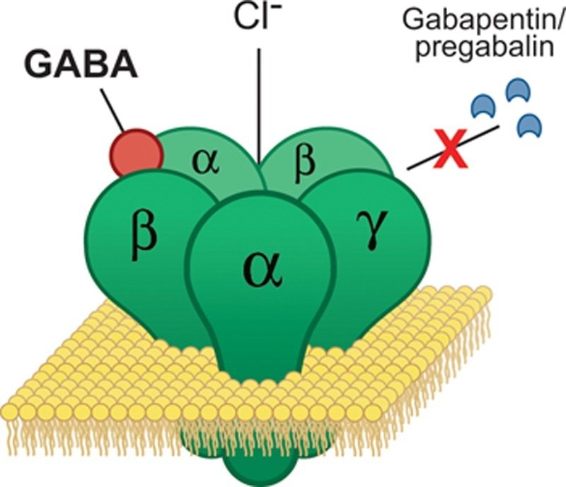
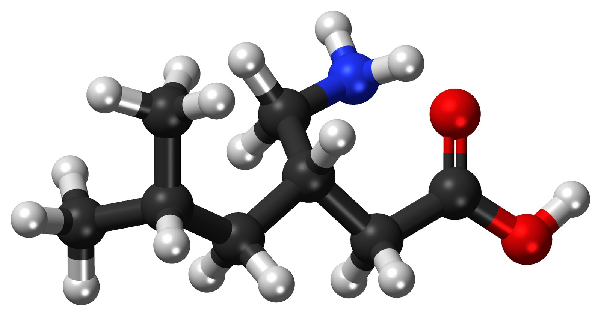
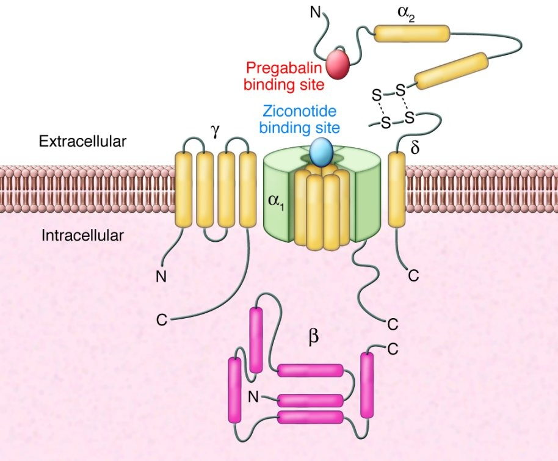
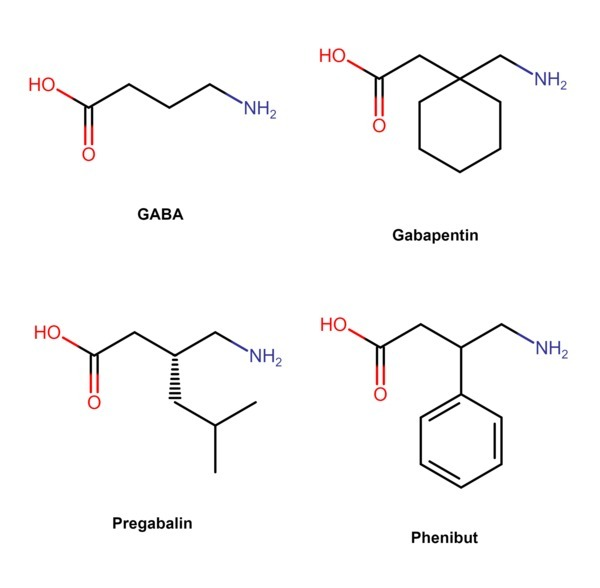
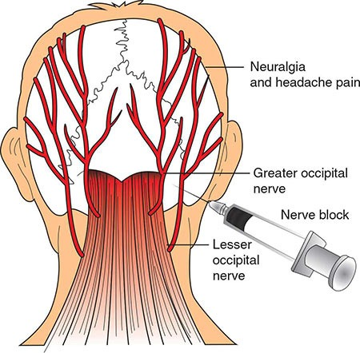

*A pharmacology diagram for the ongoing headache investigation. The colourful picture is simpler than the actual biology.*
{: .media-caption }

We're on _**day 11**_ of having a headache on the right-hand side of my head. It does not respond to ibuprofen, naproxen, paracetamol, or diclofenac. Just my luck. The only thing that seems to be having any effect is the pregabalin my psychiatrist prescribed.

*A ball-and-stick view of pregabalin. The model makes chemistry look like the world's most complicated desk toy.*
{: .media-caption }

I've been on and off pregabalin since January 2021. I had previously had a run-in with it in 2016 but discontinued it. This time around I'm sticking with it because the alternatives, including SSRIs, SNRIs and TCAs, give me painful bruxism.

*The same chemistry in skeletal form. Less colourful, but still a lot more understandable than an endless headache.*
{: .media-caption }

Over in the UK, [pregabalin is indicated for anxiety disorders](https://www.nhs.uk/medicines/pregabalin/). It's also indicated for neuropathic pain, which was interesting because my headache was feeling more and more like nerve pain each day. Mind you, feeling like nerve pain and actually knowing what's causing it are two different things.

*Another crack at illustrating how these medicines interact with ion channels. My headache was less interested in the diagrams.*
{: .media-caption }

Curiously, my headache doesn't seem to mind bright lights. In fact, I was walking to the shops today without sunglasses on, which is not something I usually do. The good news is that I have an MRI booked to follow up on last week's CT scan. They reported:

 

> Ventricles are non-dilated. There is incidental finding of CVI (cavum velum interpositum-anatomic variation), that measures up to 18 mm transverse the medial and 15 mm craniocaudal with convex margins **indicating some degree of mass effect**. Consider further imaging with MRI. There is no brain oedema, or midline shift.

Which doesn't seem that bad. There's just \*something\* that \*might\* be making my brain wonky. I don't think that this will answer the issue of my headache, but it would be nice to have an even higher resolution scan of my brain. It'll set me back $290, but I think that's worth it for cool brain scans.

*A little family portrait of GABA and three related compounds. Chemistry never looked quite so tidy in my notes.*
{: .media-caption }

The fact that I have been able to write all this out means I can continue getting documentation ready for my next psychologist visit on Wednesday. I've had nearly two weeks to get it in order and of course, this headache has been with me for... well two weeks.

*The occipital nerve-block illustration. An injection near the back of my head was starting to sound rather appealing.*
{: .media-caption }

I suppose I owe it to the pregabalin, which had been escalated to 600 mg per day that morning. That's the top of the usual range in the Australian information for immediate-release capsules, normally taken in two divided doses.

I usually took mine in the evening to avoid drowsiness, but that day I tried one dose in the morning and planned another in the evening. That's something to work through with the prescriber, of course. It does make things a little **_fuzzy_**, but it seems to let words flow better.

That said, if this continues on much longer I think getting stabbed by a needle in the back of my head is not sounding quite so bad. Can't work out the pain? Maybe a nerve block is something to discuss with the neurologist. My sanity can only take this for so long.

### Sources

- [NHS - Pregabalin](https://www.nhs.uk/medicines/pregabalin/)
- [Australian Commission on Safety and Quality in Health Care: Lyrica Consumer Medicine Information](https://www.safetyandquality.gov.au/medicine-finder/lyrica)

### Related Posts

- [Nix's Brains! CT Scan - September 2023](/nixs-brains-ct-scan-september-2023/)
- [Nix's Brains! MRI Scan - September 2023](/nixs-brains-mri-scan-september-2023/)
- [Nix's Brains! MRI Scan - October 2023](/nixs-brains-mri-scan-october-2023/)
