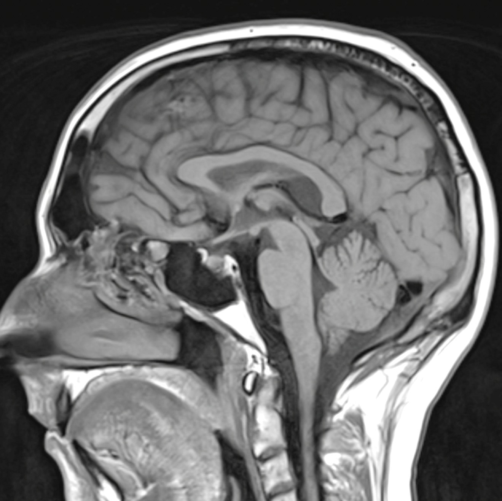
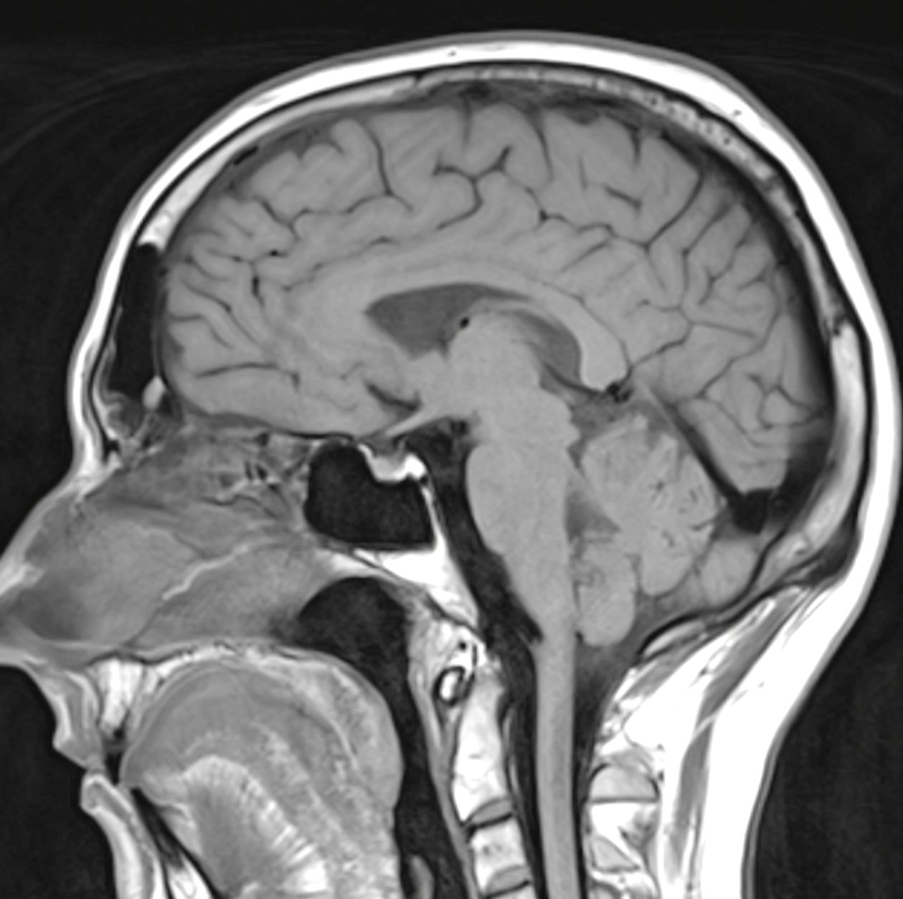



We're on day 25 of the [never](/nixs-brains-ct-scan-september-2023/)\-[ending](/the-headache-that-keeps-marching-on/) headache. The good news, however, is that I've been to a neurologist who prescribed some [indometacin](https://en.wikipedia.org/wiki/Indometacin) (US: indomethacin). It's a nonsteroidal anti-inflammatory drug (NSAID), like naproxen or ibuprofen, but it also has an interesting role in diagnosing and treating certain headache disorders.

I've been given a suspected diagnosis of [hemicrania continua](https://ichd-3.org/3-trigeminal-autonomic-cephalalgias/3-4-hemicrania-continua/). "The cause of hemicrania continua is unknown." Well that's probably not good. One interesting thing is that an absolute response to therapeutic doses of indometacin is part of the diagnostic criteria. The criteria also say the headache needs to have been present for more than three months. At day 25, I wasn't exactly able to tick that box, so this was still a working diagnosis.

I was taking 50 mg indometacin in the morning and 50 mg at night. I figured if I could get away with two 50 mg doses instead of three, I'd be better off. That was me making the call, though, and medication changes really do need to go through the prescriber. I was worried about my stomach too, as indometacin can cause ulcers and gastrointestinal bleeding, particularly with higher doses or longer use.

Have I checked I still have the [headache](https://www.sciencedirect.com/topics/medicine-and-dentistry/hemicrania-continua)? Yes! I missed a dose on at least one occasion and it's definitely still there. Neck, back of eye socket and scalp start to tickle(?) and then turn to pain.

Another two months until I hear from the specialist. They were kind enough to give me another MRI (with contrast this time) and apparently if I wait until late October I can have it done for free with my Health Care Card that Centrelink won't send out.

Yes, I am still unemployed and burning through my savings. I mean they were for a future home, but maybe that's just a pipe dream. Regardless of my upcoming homelessness, here's the results of my MRI and I have to warn you they are _quite mild_.

**Technique:** Sagittal T1, axial T2/FLAIR, DWI ADC gradient sequences of the brain supplemented with coronal T2.

**Findings:** No midline shift is seen. No subdural fluid collection. No Chiari I malformation. Corpus callosum is present. No recent infarct. Small to moderate sized cavum interpositum- normal variant. Patent flow void of the Circle of Willis. Mild-moderate patchy mucosal thickening of the ethmoid air cells noted bilaterally. No recent intracranial hemorrhage.

**Comment:** No acute intracranial pathology detected.

I'm just glad there **_is_** a way to treat the symptoms. Indometacin is not exactly gentle on the gastrointestinal tract, so hopefully it keeps working without giving my stomach something new to complain about. Probably should check and update my lucky bingo card for 2023. Hmmmmm. Oh there it is! "Primary headache disorder" - ✅ 😅

### Sources

- [International Classification of Headache Disorders 3 - Hemicrania continua](https://ichd-3.org/3-trigeminal-autonomic-cephalalgias/3-4-hemicrania-continua/)
- [Australian Commission on Safety and Quality in Health Care: Indocid Suppositories Consumer Medicine Information](https://www.safetyandquality.gov.au/medicine-finder/indocid-suppositories)

### Related Posts

- [Nix's Brains! CT Scan - September 2023](/nixs-brains-ct-scan-september-2023/)
- [The Headache That Keeps Marching On](/the-headache-that-keeps-marching-on/)
- [Nix's Brains! MRI Scan - October 2023](/nixs-brains-mri-scan-october-2023/)
