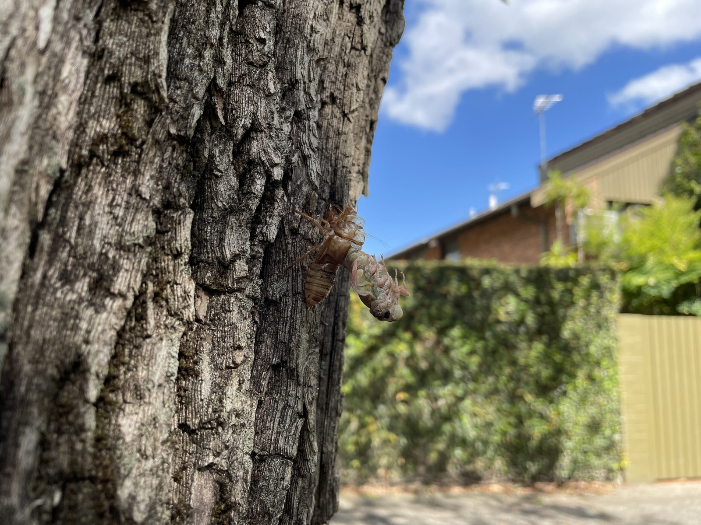
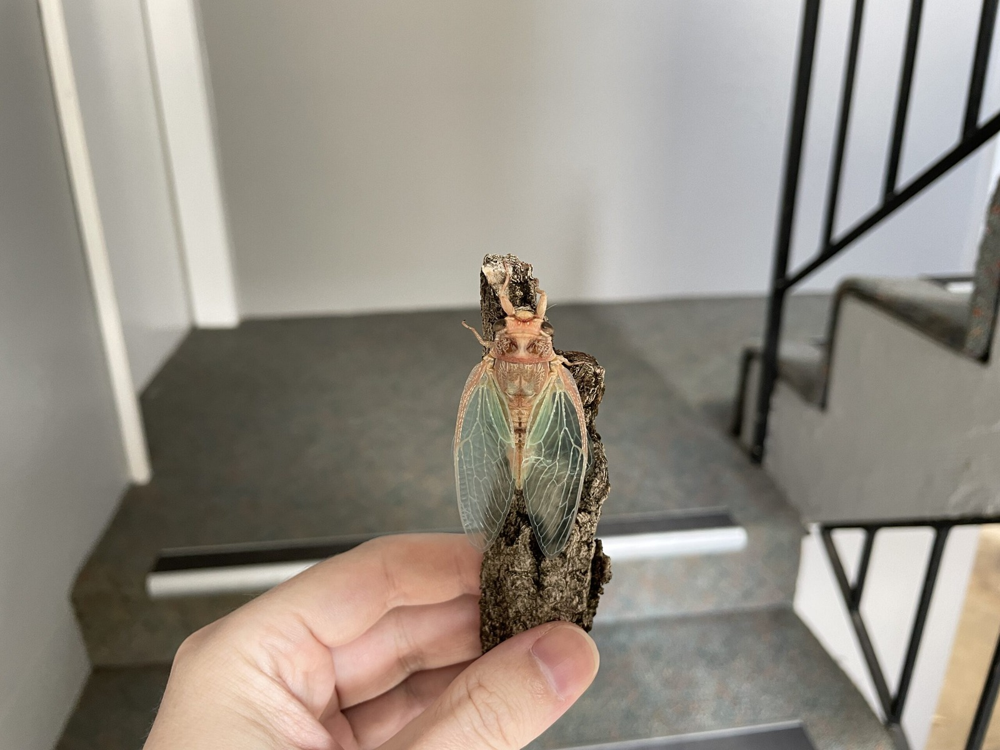
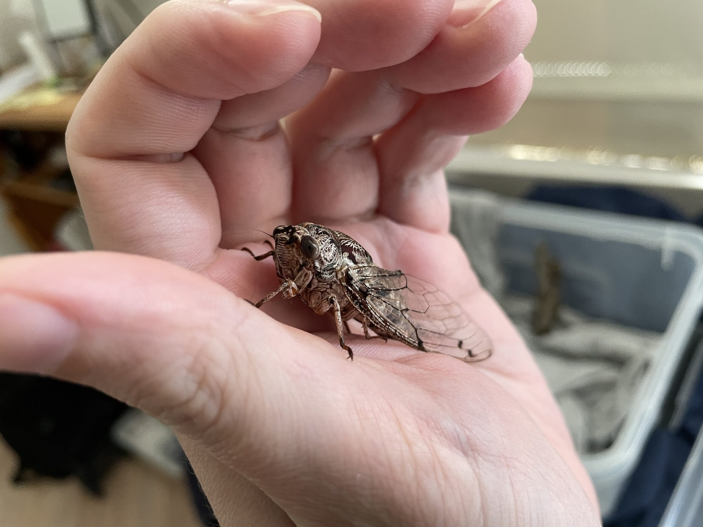
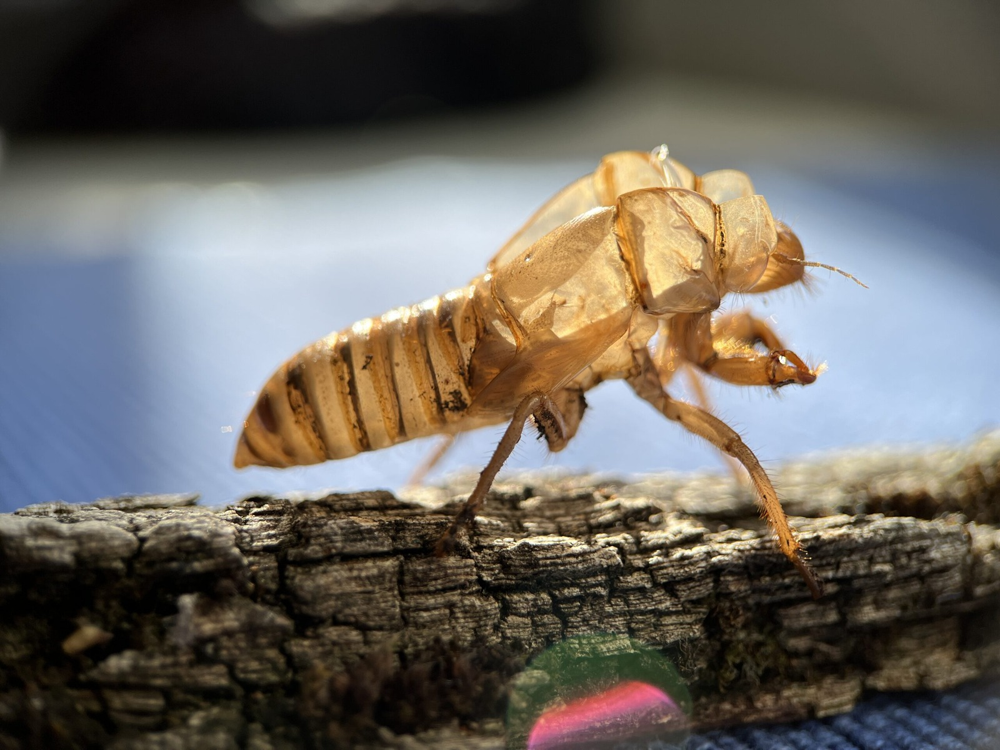



This all started a bit grimly, with a flattened cicada being attacked by ants and a dead beetle who probably couldn't get to soil. But there's always a story to be told, and her story lies in the video above! 🙃



Above is some video of the shell left behind, shot in normal mode. I get to ramble on about bugs which is always a joy. This was the empty shell of a female Floury Baker (*Aleeta curvicosta*) I found back in January 2023. She emerged at about 10 am, of all times, and nearly got picked off by a butcherbird. So I stole her and brought her home!

There was nothing actually wrong with her, thankfully, so I let her go that evening. I later went back to the tree to pinch her empty shell as a keepsake, along with the bit of bark. By July I was already talking about crushing it up and putting it back on the ground so whatever nutrients were left could return to the cycle of nature. Even empty cicada shells are remarkably grippy!



Next is the same shell shot with my relatively cheap clip-on macro lens. It's incredible to see the detail up close. The hairs, the white filaments, all incredible. Those white strands are actually the shed linings of the [tracheal tubes](https://www.extension.entm.purdue.edu/cicadas/), which form part of the cicada's respiratory system. I called them "lung tubes" in the video, and I suppose you can see why!

With the macro lens I could look right down into the abdomen and see those little white strands running along either side. There are also the segmented antennae and those enormous digging claws on the front legs. I still can't work out how their front legs change from those big digging claws into more ordinary-looking adult legs. It's fascinating stuff. For me, anyway!

I was also comparing this shell with the others I'd collected over the summer. The Floury Baker shells seem relatively slender and clean, whereas some of the larger cicadas, such as Black Princes and Green Grocers, can leave much muddier shells. The handy thing about this particular specimen was that I'd actually watched her emerge, so I knew exactly which cicada the shell belonged to. That made comparing the other shells a little easier!

Here are some of the best photos from the day.

This is where she was found.

This is me stealing her on a piece of bark (also stolen).

This is her in her mostly hardened state.

Finally, we have the shell itself. Who would have thought [incomplete metamorphosis](https://australian.museum/learn/animals/insects/metamorphosis-a-remarkable-change/) (hemimetabolism) would be so cool!

Because this was a female, I was also interested in the underside of the shell, particularly where the ovipositor sits. Then there's the way [haemolymph](https://pmc.ncbi.nlm.nih.gov/articles/PMC10113369/) helps build the pressure involved in emergence and expanding the new wings. There's quite a lot going on inside something that eventually gets left hanging on a tree!

I joked in the video that this one was technically Flicky the First of the 2022-2023 summer. When I was a kid there was Croaky, with the cicadas that followed becoming Croaky 2, Croaky 3, etc. I only seem to give cicadas names when they end up coming home with me!

It's always a little bittersweet writing this up knowing she is gone. I guess the only comfort I have is the possibility that she passed on her genetics to future cicadas. Catch you at the [rainbow bridge](https://en.wikipedia.org/wiki/Rainbow_Bridge_(pets)), little one!

### Related Posts

- [Exuviae Variation Among Australian Cicadas](/exuviae-variation-among-australian-cicadas/)