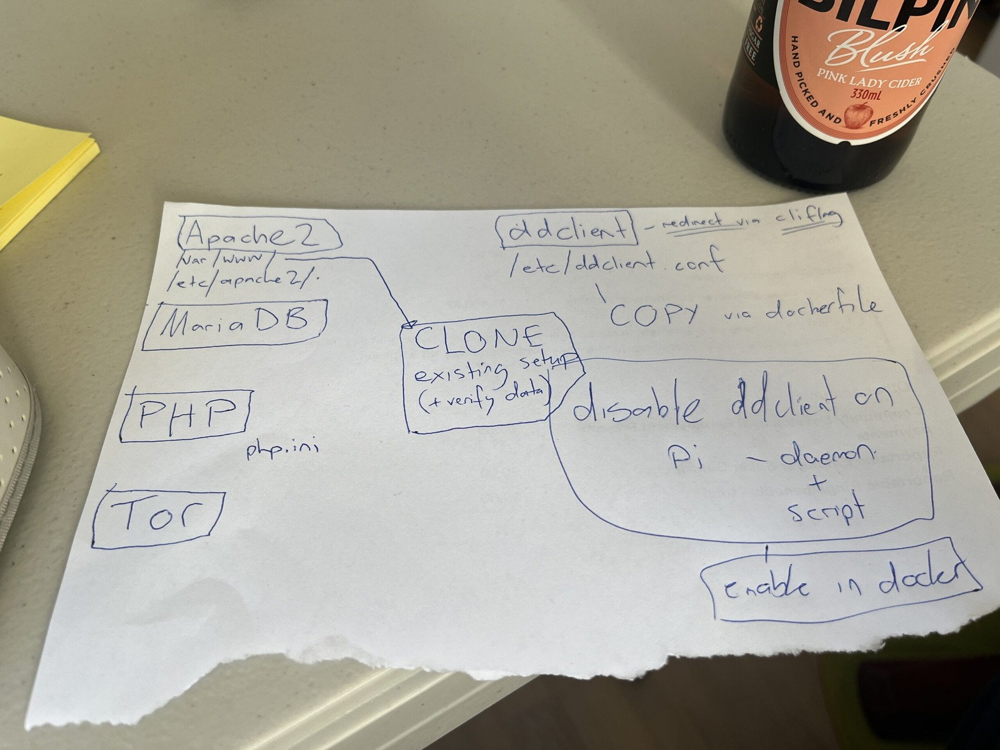
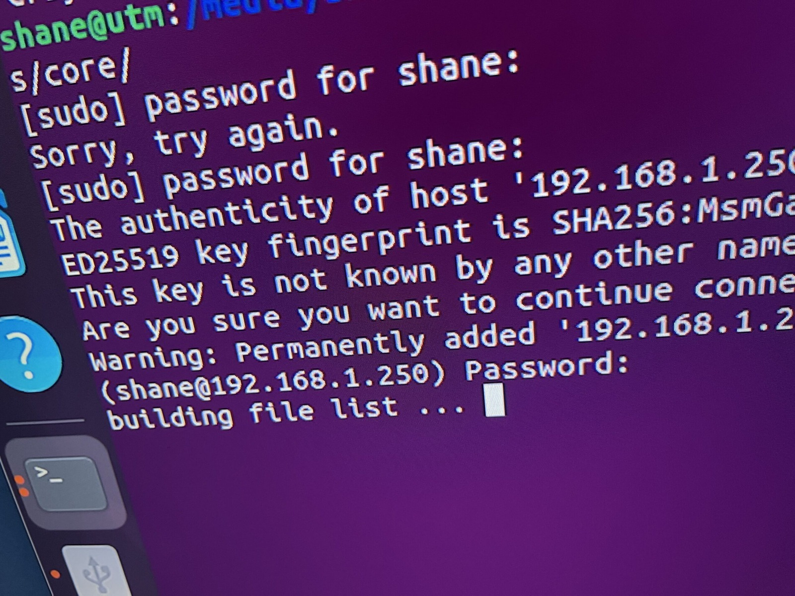
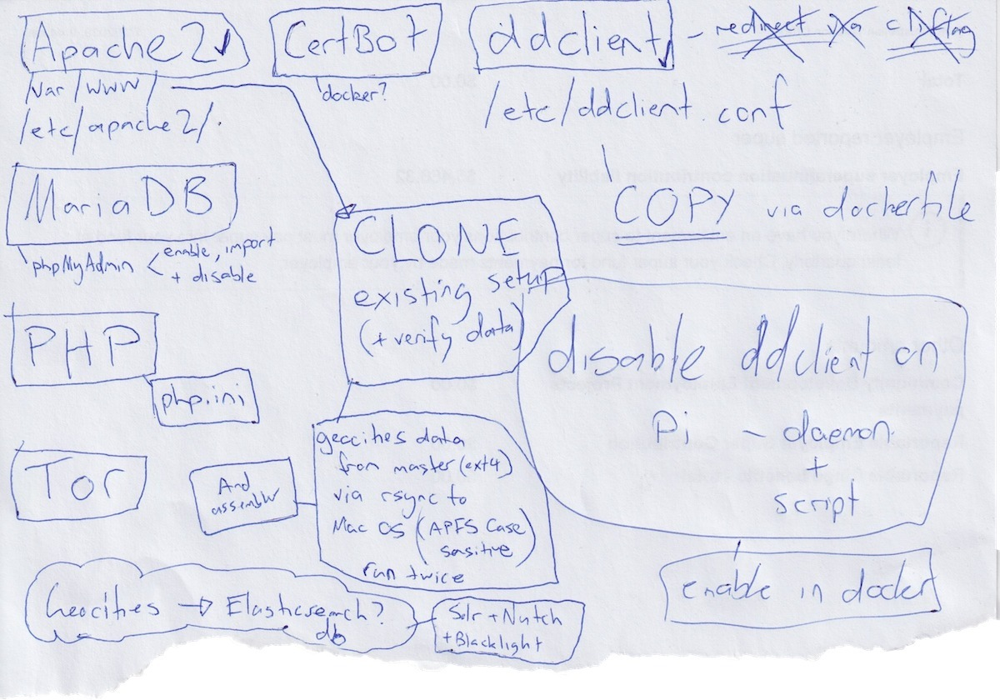
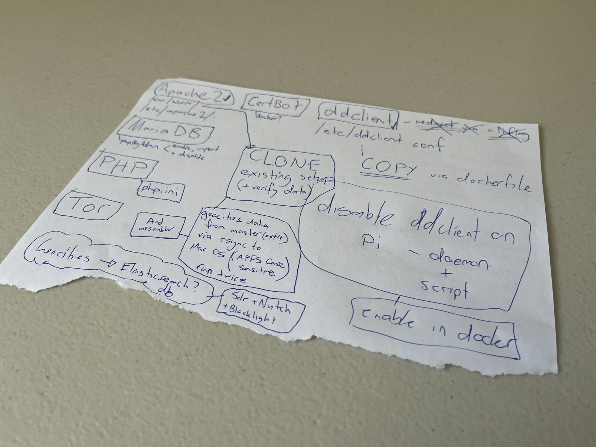

*The first Docker plan was a piece of paper, a pen, and a remarkably optimistic collection of boxes.*
{: .media-caption }

There's something about waking up at 3am every morning that just gives you that extra bit of time to blog. Today we're touching on what happened to my [GeoCities Archive](/homepages/geocities). A while back I had an idea to dockerise my Apache-based web server.

*The planning notes were acquiring hardware. The migration itself was still very much on paper.*
{: .media-caption }

There wasn't much point in having a dedicated piece of hardware when I could just use Docker Desktop on one of my other computers. I began to put pen to paper in early September. The plan was to merge in a better version of the GeoCities Archive and use a case-sensitive APFS volume on macOS.

*The terminal was busy building a file list. It looked promising at this point, at least.*
{: .media-caption }

I rsynced my data with a little help from [Jon](https://damntechnology.blogspot.com/) and it was all looking good. Until I realised how much smut and gore was in the archive. In the material I kept stumbling across, a lot of it appeared to date from after Yahoo!'s acquisition of GeoCities in May 1999. That is an observation from what I was finding in this copy of the archive, not a claim about GeoCities as a whole.

This posed a very big problem for me. While [Cloudflare's CSAM implementation](https://blog.cloudflare.com/the-csam-scanning-tool/) helped with one very specific category, it could not solve the broader moderation problem. The tool compared cached images against hashes of known CSAM. It was not a general pornography, gore or GeoCities ToS scanner, so everything else still needed some other way of being found.

Sure, I could manually search for pornography and gore by filename, but I reckoned I was only finding about 5-10% of it that way. That was my rough impression, not a measured detection rate. Plus I had to look at these sites to assess whether they were worth keeping.

*The expanded version of the plan had even more boxes, including Certbot and a possible search setup. Ambition wasn't the problem.*
{: .media-caption }

In most cases, they were not worth keeping and I made the decision to pull the plug. Only a few days ago, I reverted back to the Raspberry Pi setup without the GeoCities Archive. I also trimmed away [Sci-Fi](/) and [Assembler Games](/). If I remove GeoCities, I can also remove the blade hard drive from the web server.

*A final look at the Docker plan before shelving the GeoCities rebuild. Sometimes the best fix is knowing when to stop.*
{: .media-caption }

The good news? Material I found that appeared to violate the original GeoCities ToS was reported to [archive.org](https://archive.org) for review and possible removal. I just hope they do actually purge all the questionable content I had to sift through. It was nice knowing you GeoCities, but perhaps you are best left in the past - in our memories. 🥲

### Sources

- [Yahoo! - GeoCities acquisition closing filing](https://www.sec.gov/Archives/edgar/data/1011006/000091205799005431/0000912057-99-005431-d2.html)
- [Cloudflare - The CSAM Scanning Tool](https://blog.cloudflare.com/the-csam-scanning-tool/)

### Related Posts

- [The GeoCities Archive Rebuild Blog](/the-geocities-archive-rebuild-blog/)
- [The GeoCities Archive Rebuild Goes Live](/the-geocities-archive-rebuild-goes-live/)
- [Multimeter, MiSTer and GeoCities](/multimeter-mister-and-geocities/)
- [The GeoCities Rebuild Worklog](/the-geocities-rebuild-worklog/)
- [Rebuilding GeoCities on macOS 12](/rebuilding-geocities-on-macos-12/)
- [RetroChallenge 2022/10 - GeoCities Rebuild on Dial-up at 14.4k](/retrochallenge-2022-10-geocities-rebuild-on-dial-up-at-14-4k/)
- [RetroChallenge 2022/10 - GeoCities Rebuild on Dial-up at 28.8k](/retrochallenge-2022-10-geocities-rebuild-on-dial-up-at-28-8k/)
- [GeoCities Downtime - WD Blue SA510 1TB WDS100T3B0B Failure](/geocities-downtime-wd-blue-sa510-1tb-wds100t3b0b-failure/)
- [Integrity and Extracting the GeoCities Archive - Rebuild V5](/integrity-and-extracting-the-geocities-archive-rebuild-v5/)
- [Docker, GeoCities Search, and RetroChallenge 2022/10 Results](/docker-geocities-search-and-retrochallenge-2022-10-results/)
