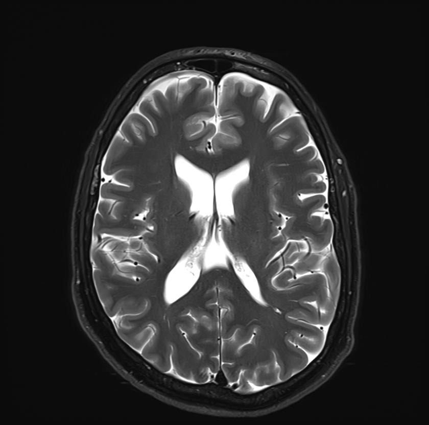
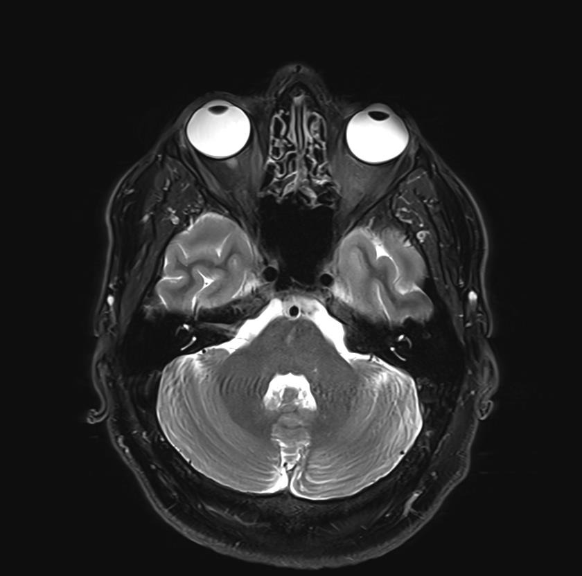
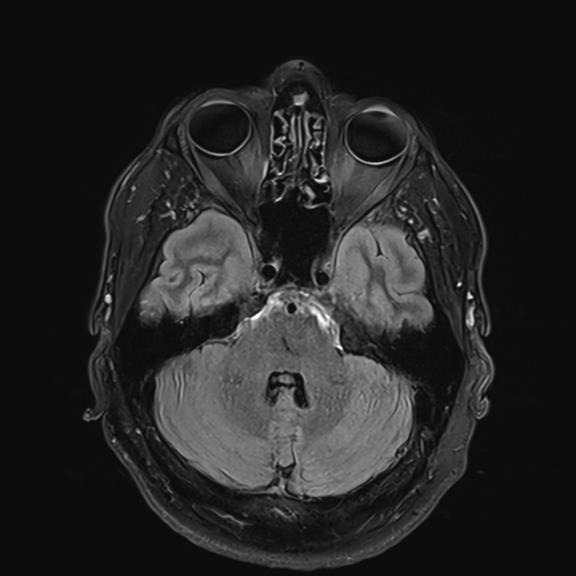
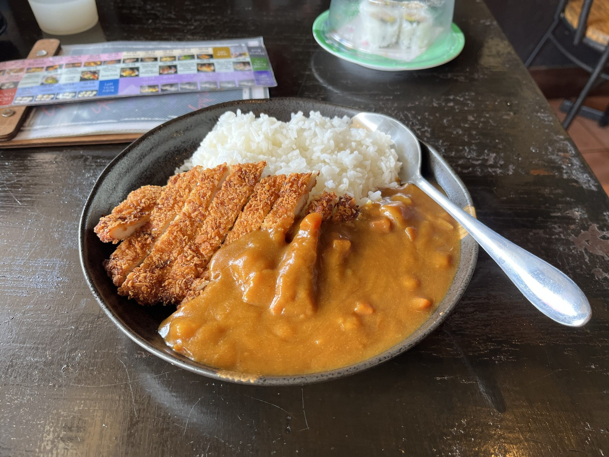



The latest update in a series of updates it seems! Recently I had the fun of being injected with a gadolinium-based MRI contrast agent. The gadolinium is bound in a chelate; once injected it changes the magnetic properties of nearby water and can make blood vessels and some tissues or lesions stand out more clearly on MRI. Christmas tree effect, but with physics!

*More MRI data to inspect while the headache continued. The ventricles certainly stand out in this slice.*
{: .media-caption }

Unfortunately, we are approaching two months since this headache started and it is still there. I was taking indometacin 50 mg once daily, sometimes increasing it to 75 mg in one dose. Until then, one dose each day had been holding the headache fairly well.

*Yes, the eyeballs are back. The October scan provided another rather striking view of the lower brain.*
{: .media-caption }

I have noticed one of my neck muscles pulling itself, a spasm. Could this be the cause of the headache? It doesn't happen when I'm awake enough to tell. It could be happening while I slumber.

*Another slice, another view of the brain's complicated squiggly machinery. Still not an answer by itself.*
{: .media-caption }

On that note, pregabalin was very effective at making me sleepy, but I was noticing what felt like withdrawal symptoms, including extreme irritability, when the dosing interval stretched out. I'd been opening the powder-filled capsules and trying to split the contents to reduce the dose. Not exactly a reliable way to measure it.

My psychiatrist had started me at 300 mg at night, without a gradual build-up. Bon Jovi knows. That's some bad medicine indeed.

*Whatever the MRI might say, Katsu Jazz Friday was still on the calendar. At least some traditions survive a headache.*
{: .media-caption }

A headache that won't go away, unemployment, and an overall lack of purpose. I guess it isn't so bad. I still have Katsu Jazz Fridays. I'm expecting to hear back about this headache in the next two weeks. I couldn't see anything big and out of place on the MRI above, hopefully the wizards who do the report spot something. Hey, at least I'm running out of money. Wait a minute, that is not a positive. 🤷‍♀️

### Sources

- [RadiologyInfo.org - Contrast Materials](https://www.radiologyinfo.org/en/info/safety-contrast)
- [Australian Commission on Safety and Quality in Health Care: Indocid Suppositories Consumer Medicine Information](https://www.safetyandquality.gov.au/medicine-finder/indocid-suppositories)
- [Australian Commission on Safety and Quality in Health Care: Lyrica Consumer Medicine Information](https://www.safetyandquality.gov.au/medicine-finder/lyrica)

### Related Posts

- [Nix's Brains! CT Scan - September 2023](/nixs-brains-ct-scan-september-2023/)
- [The Headache That Keeps Marching On](/the-headache-that-keeps-marching-on/)
- [Nix's Brains! MRI Scan - September 2023](/nixs-brains-mri-scan-september-2023/)
