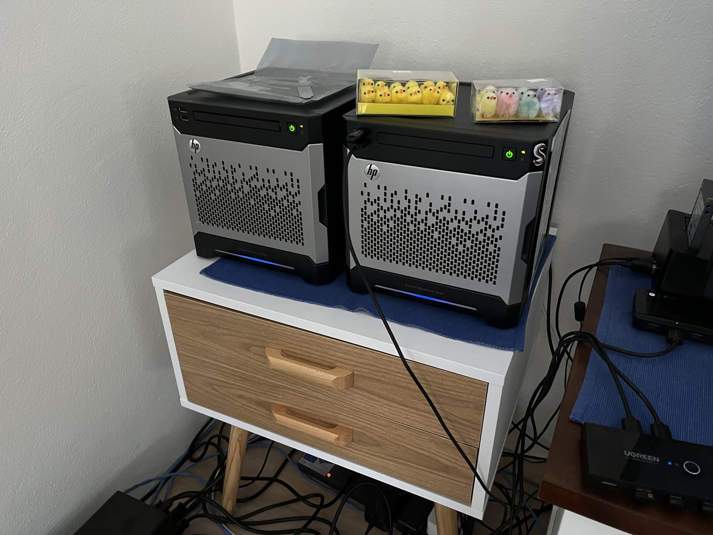
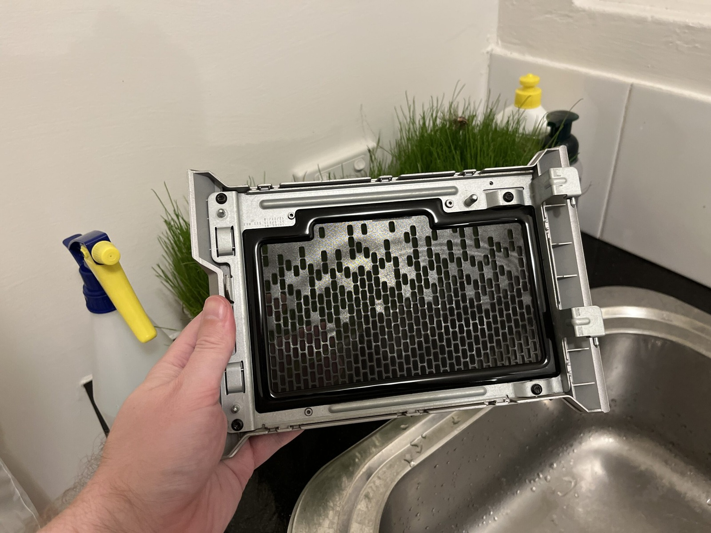
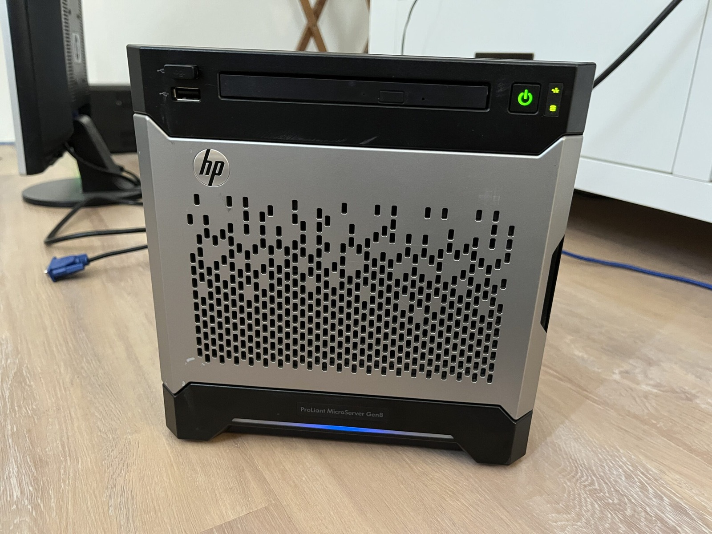



I have been listening to my three or four drives go clunk, clunk, clunk for the best part of a year. Initially I thought it must have been something in TrueNAS as these drives, WD Red Pro 16 TB - Model WD161KFGX, were silent while running badblock scans on them. Someone said it could be a cache flushing, but I'd moved my system dataset to the mirrored SSDs with no change. So what was it?

The MicroServer was sitting in my lounge room, so whenever the TV or music was off I could hear it. Clunk, clunk, clunk, roughly every five seconds. Occasionally it would go quiet just long enough for me to wonder whether it had stopped. Nope! Back again.

Well, I found a very plausible answer. Western Digital users describe "Preventive Wear Leveling", or PWL: periodic head movement that can produce a regular click while some drives are spun up and idle. It sounds a lot like what I was hearing. I haven't found a WD specification confirming PWL for my WD161KFGX drives, but it's a likely explanation!

On one hand I'm glad that I know what the likely noise is now. Spinning rust. I might try spinning the drives down when I'm not using the NAS. It really is just storage at this point. Spindown trades noise and power use for extra start, stop and head-loading activity, so I don't want to churn cycles for no reason. I have multiple backups though, and a drive failure would at least let me test whether I actually know how to restore them! 😅

I'd originally run RAIDZ2 before switching to RAIDZ1, partly because that meant one less drive sitting there clunking away. With one drive of redundancy in the machine and another two backups, one on-site and one off-site, that suited what I was using it for. None of it was mission-critical, although I'd still rather not lose the data.

 

> But, spinning up every hour, which is more likely- That is ~9,000 cycles per year, and you would take 33 years to exceed that threshold.

The rough arithmetic checks out: one event every hour is 8,760 a year, or about 9,000. Hmmmm treating load/unload cycles and actual motor start/stop cycles as might not be entirely accurate though. Plus they could just have no power at any point due to failed anything else!

Honestly though, I still have another four years of warranty. That doesn't promise a drive won't fail, but with backups in place I'm curious to see how the sleep settings behave without churning unnecessary start, stop and load cycles. The question is, how to make it work best?

There sure is a lot of voodoo when it comes to technology!

 

> Set the standby (spindown) timeout for the drive. The timeout specifies how long to wait in idle (with no disk activity) before turning off the motor to save power. The value of 0 disables spindown, the values from 1 to 240 specify multiples of 5 seconds and values from 241 to 251 specify multiples of 30 minutes.

That raw ATA description made the setting easier to understand. TrueNAS itself exposes the usual standby choices as minute intervals, and one practical catch is that its documentation notes temperature monitoring is disabled while a disk is in standby.

The MicroServer itself is a Gen8, hardly new by this point, but I do like these little machines. Five drives fitted, including the mirrored boot drives. I actually bought two Gen8 MicroServers because I liked them so much, although the other one had since been given away with a set of drives.

Cobia hasn't really shown any issues which has been nice. I was expecting going from Bluefin to Cobia to have something go wrong, but nothing. Blessed! 😇

### Sources

- [TrueNAS Community - New WD Red Pros clicking every 5 seconds, described as Preventive Wear Leveling](https://www.truenas.com/community/threads/new-wd-red-pros-clicking-every-5-seconds-preventive-wear-leveling-firmware-feature.105866/)
- [TrueNAS Documentation - Disks](https://www.truenas.com/docs/scale/storage/disks/disksscreen/)
- [hdparm 9.65 manual - Standby timeout (-S)](https://sources.debian.org/src/hdparm/9.65%2Bds-1/hdparm.8/)
