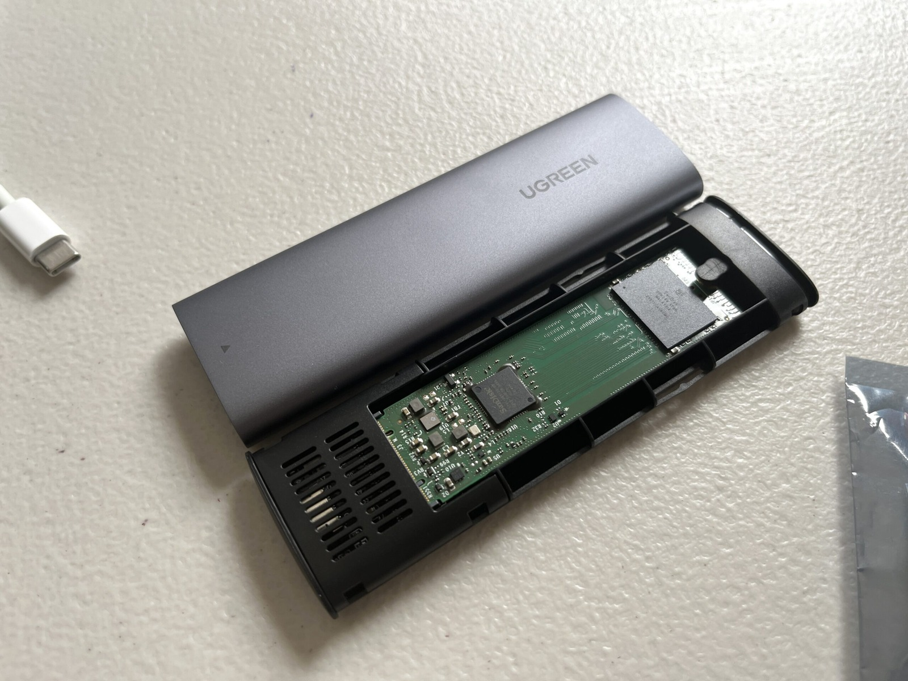
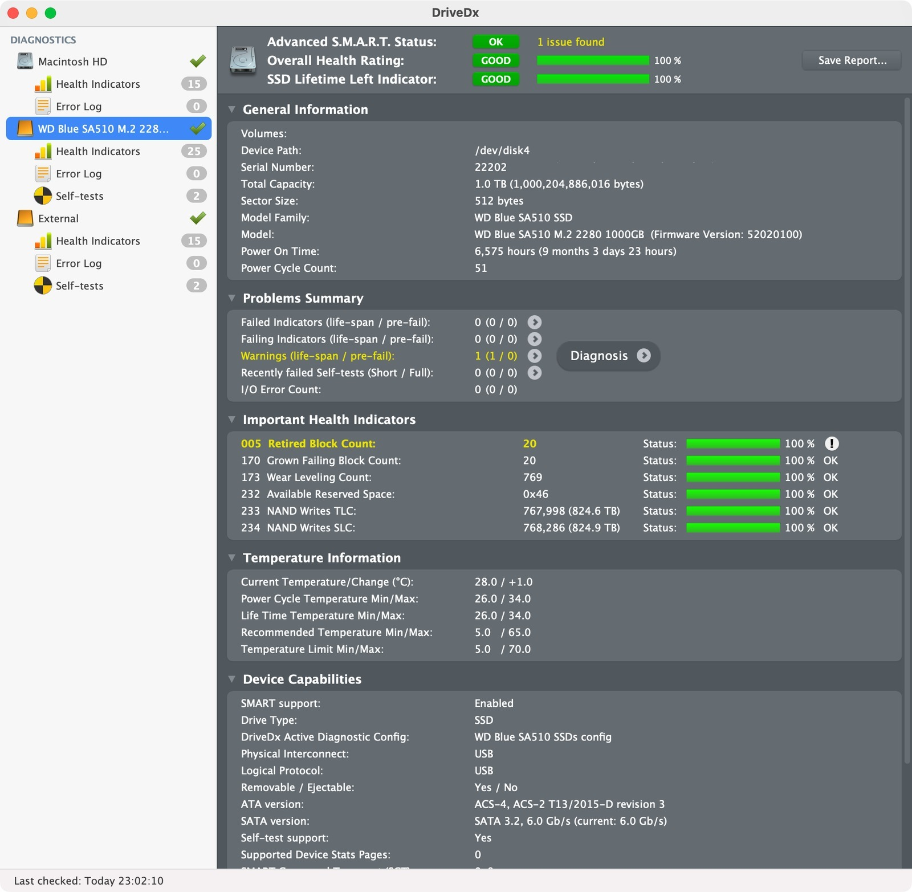
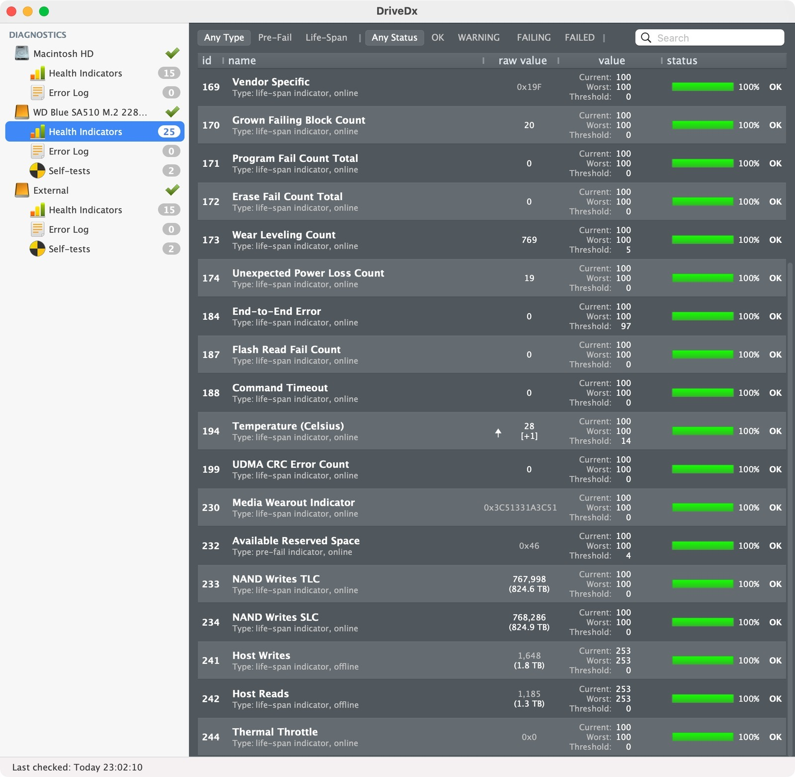
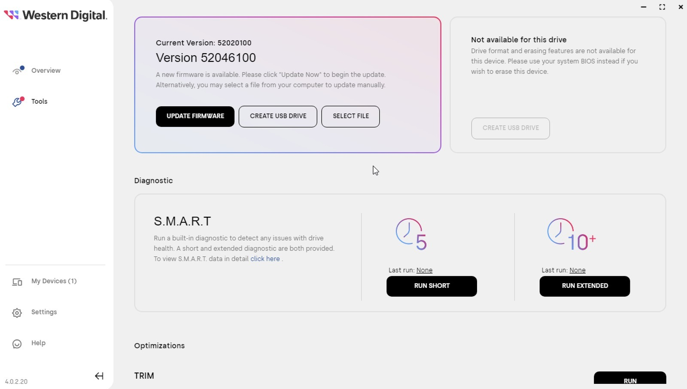
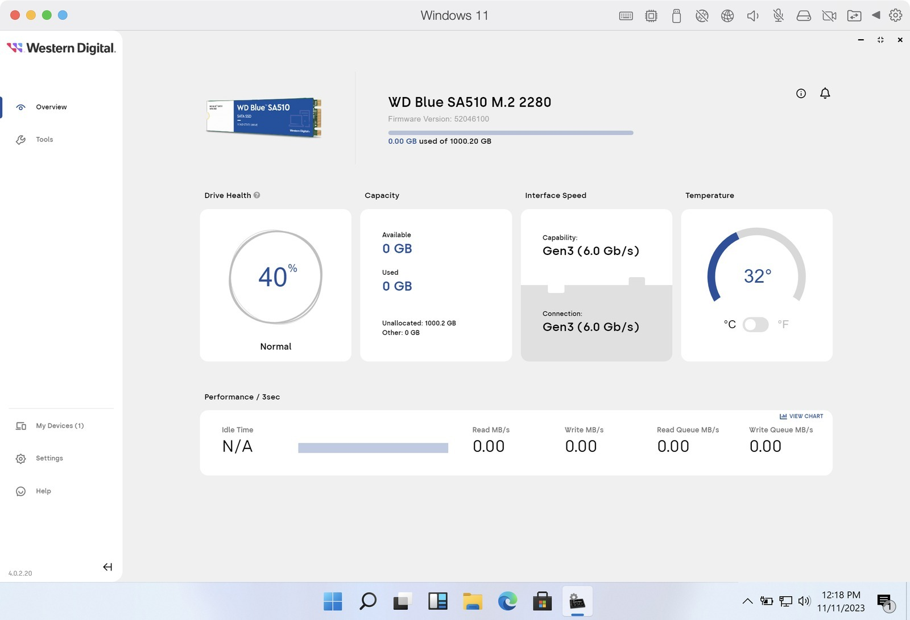
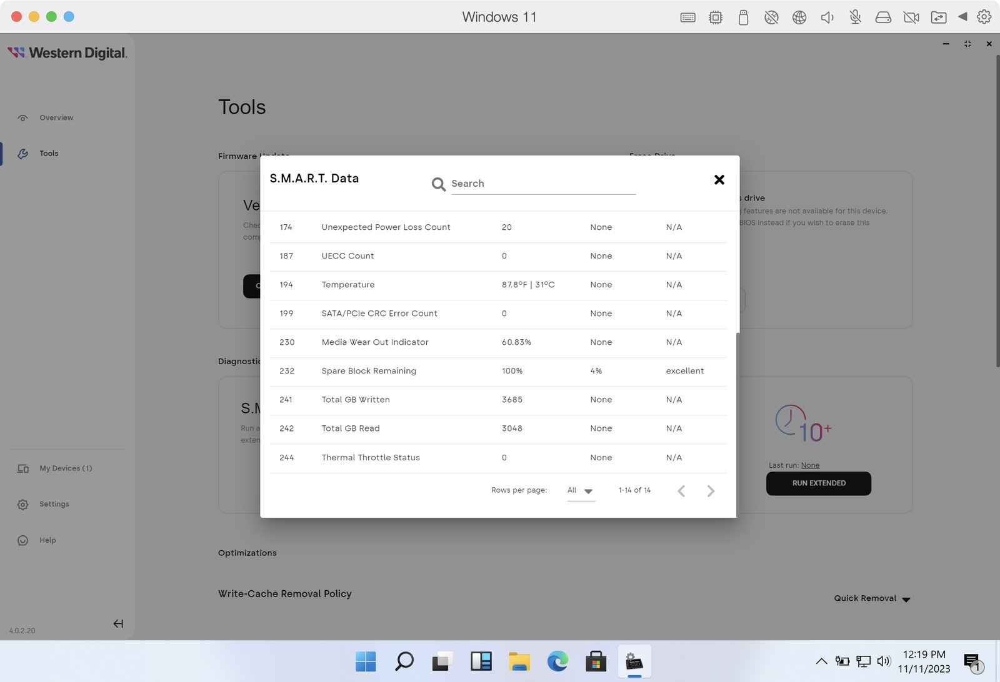
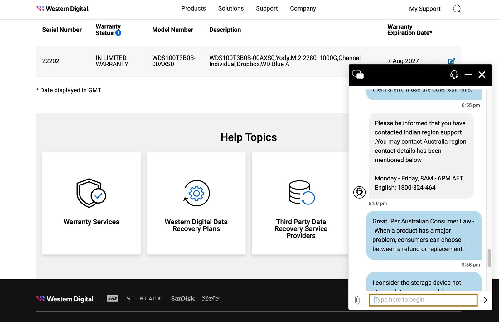

Oh my sweet WD Blue SA510 M.2 SATA 2280 blade drives. [You are such trash](/geocities-downtime-wd-blue-sa510-1tb-wds100t3b0b-failure/). I had two of these for GeoCities, one master and one backup. However, since [I took GeoCities offline](/geocities-archive-retired-dockerisation-abandoned/) I thought I'd erase and sell the drives. But look at what I found when looking at the drive stats with [DriveDx](https://binaryfruit.com/drivedx).

Yeahhh, DriveDx was displaying 824.6 TB under NAND Writes TLC and 824.9 TB under NAND Writes SLC. Two separate counters, not something I was going to add together and call total writes. I also wasn't sure how accurately DriveDx was decoding those particular WD values. NAND writes aren't the same as host writes either, thanks to things like caching and garbage collection. Still, those numbers looked absolutely wild compared with the 1.8 TB of host writes reported below. And retired blocks? Not exactly filling me with confidence. Digging a little deeper we find...

A massive 1.8 TB of host writes, basically the GeoCities dataset copied twice. The drive is rated for 400 TBW, but that isn't some magical number where WD expects it to drop dead. It's an endurance and warranty specification, and 1.8 TB isn't even remotely close. Guess I better hook it into the old WD Dashboard and see what it says.

Oh, a [new critical firmware update](https://web.archive.org/web/20231015000448/https://support-en.wd.com/app/answers/detailweb/a_id/50208) has appeared.

> **October 27, 2022 - Firmware v52020100 Addresses an issue in which a drive may not be recognized by the computer.**

So firmware 52020100 should solve a pretty big issue, not being able to see the drive at all - this is what was installed on both my SA510s. Then there's this new update:

> **May 25, 2023 - Firmware v52046100 Addresses an issue in which a drive may enter a read-only state.**

Hmmm right. Read-only is at least a safer failure mode than silently eating writes. With just 1.8 TB of host writes, I certainly wasn't blaming this on wearing out the drive through normal use. Firmware was looking like a pretty good suspect, especially after what happened with my first SA510. Whether it also explained the strange SMART values was another question. Good thing there's a five-year warranty and I have consumer rights against dud hardware.

Through the motions we go. Updated firmware OK, but WD Dashboard reported only 40% health. DriveDx had shown 100% earlier. Wonderful, even the software can't agree on how healthy this thing is! Updating firmware doesn't replace the flash memory, and without knowing how either tool was calculating its figures I wasn't going to pretend the screenshots explained everything.

At least this second drive had accumulated 6,586 power-on hours before I noticed trouble, compared with only 606 hours on the first failed drive. That's more than ten times the runtime, but two dodgy SSDs are hardly an endurance study. It still only had 59 power cycles because its main job was hosting GeoCities - lots of reading.

Tech support was less than useful, directing me to India when I was trying to discuss Australian consumer rights. But you've gotta feel bad for the [people buying lots of these](https://www.reddit.com/r/pcmasterrace/comments/wk6myd/wd_blue_sa510_vs_3d_nand_sata_3/) based on the success of the earlier WD Blue 3D NAND drives. For now I'll just use the other working drive as a throw about spare and wait for it to fail in a new quirky way. If anyone can do it WD flash division can! 💁‍♀️

### Sources

- [Western Digital - WD Blue SA510 SATA SSD critical firmware update](https://web.archive.org/web/20231015000448/https://support-en.wd.com/app/answers/detailweb/a_id/50208)
- [Western Digital - WD Blue SA510 SATA SSD product brief, October 2023](https://documents.sandisk.com/content/dam/asset-library/en_us/assets/public/western-digital/product/internal-drives/wd-blue-ssd/product-brief-wd-blue-sa510-sata-ssd.pdf)
- [Western Digital - S.M.A.R.T. Self-Monitoring Analysis and Reporting Technology](https://support-en.wd.com/app/answers/detailweb/a_id/12163)

### Related Posts

- [GeoCities Downtime - WD Blue SA510 1TB WDS100T3B0B Failure](/geocities-downtime-wd-blue-sa510-1tb-wds100t3b0b-failure/)
- [GeoCities Archive Retired, Dockerisation Abandoned](/geocities-archive-retired-dockerisation-abandoned/)
