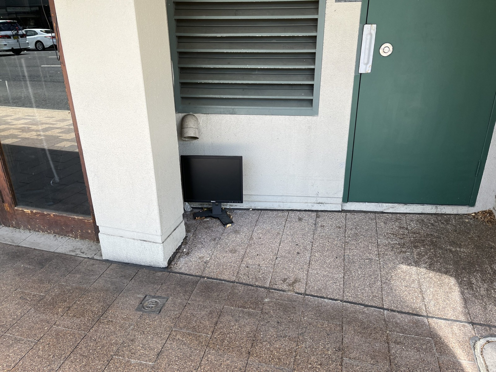

*7th October. A lonely Dell monitor had appeared beside the road, and naturally I noticed it immediately. Poor thing.*
{: .media-caption }

**7th October 2023.** Picture the date, picture the time. Walking along a major arterial road. Out of the corner of my eye, a monitor. E-waste? Maybe. Dumped? Definitely.

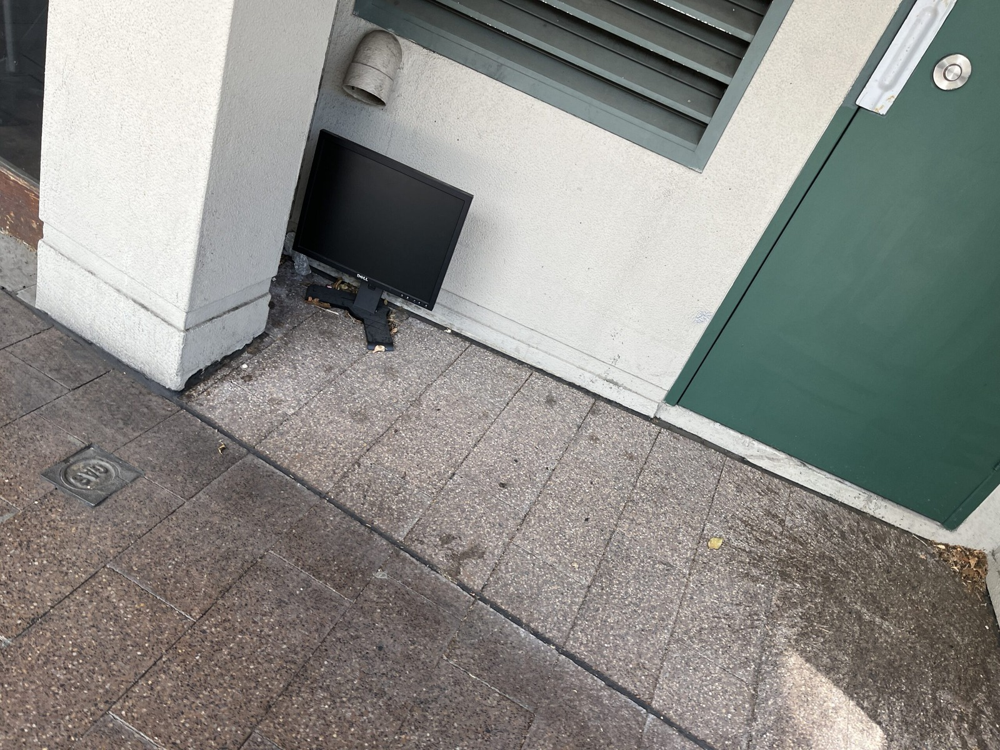

*10th October. Still there, still leaning against the wall, and still doing a marvellous job of making me feel guilty.*
{: .media-caption }

**10th October 2023.** It's still there. There's a nagging inside me that won't go away.

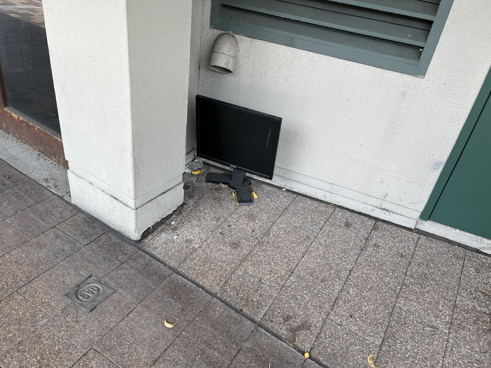

*16th October. Nobody had claimed the Dell, and now something had left a mark on the screen. The rescue plan was taking shape.*
{: .media-caption }

**16th October 2023.** My god, no one is coming to claim this poor baby. It's got a poop on it now. A plan must be put into action. The heist begins.

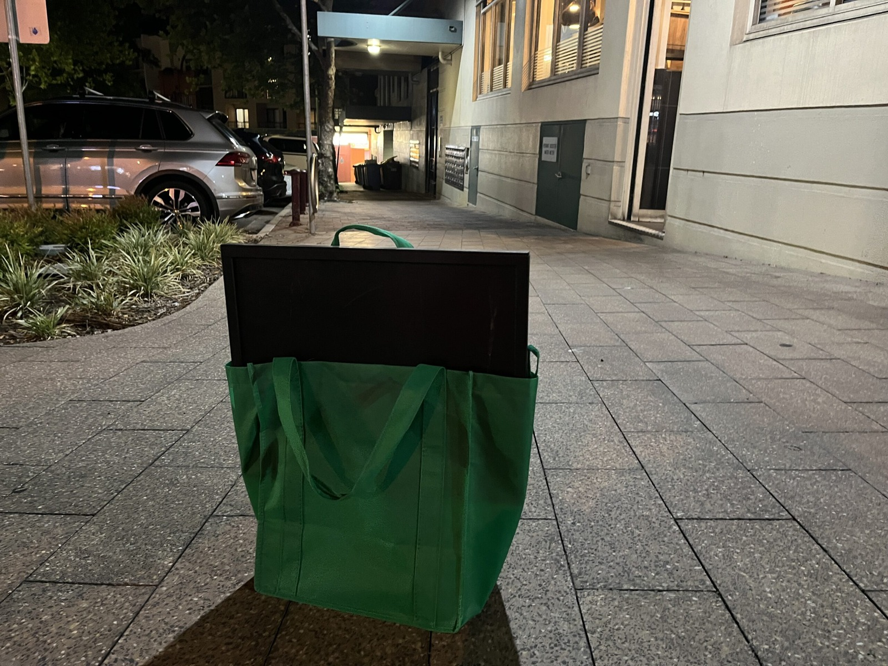

*6th November. Under cover of darkness, the Dell was finally liberated in a green shopping bag. Operation Heist complete!*
{: .media-caption }

**6th November 2023.** [Jon](https://damntechnology.blogspot.com/) and I secure the monitor.

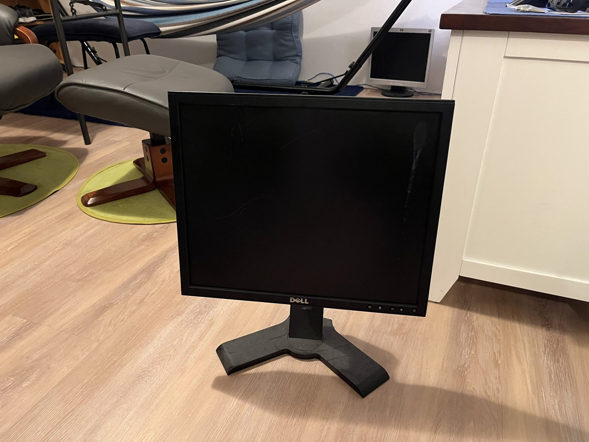

*Back inside, the rescued Dell got its first inspection. The screen looked a bit scuffed, but there was hope yet.*
{: .media-caption }

Later that same evening, a physical and functional check is undertaken.

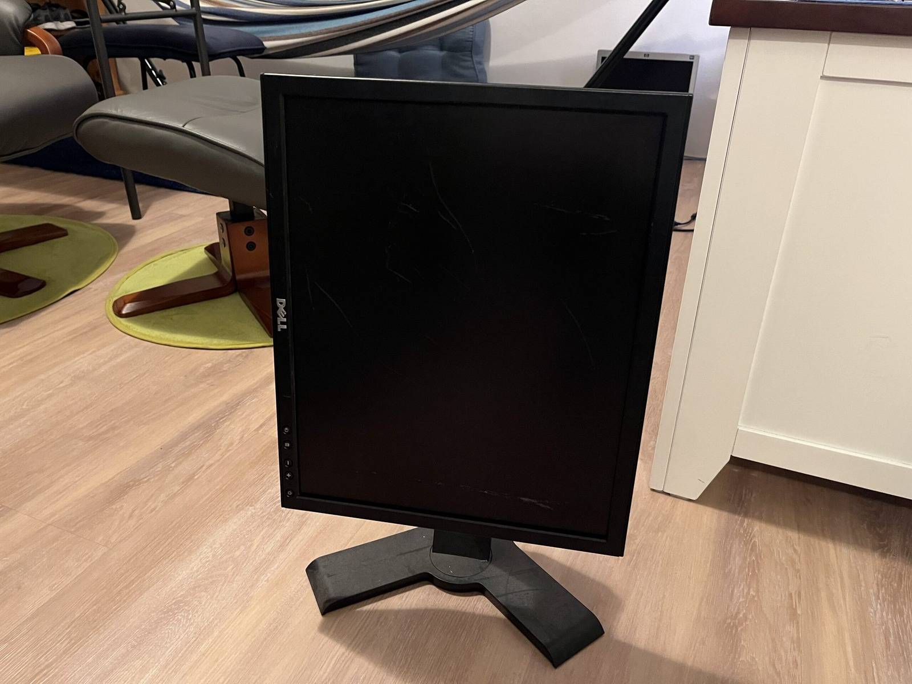

*And then the discovery of the century: the stand could rotate into portrait mode. Truly, we live in remarkable times.*
{: .media-caption }

I never expected to see such an incredible function in my lifetime. For now I must rest, exhausted from the sheer excitement of the heist.

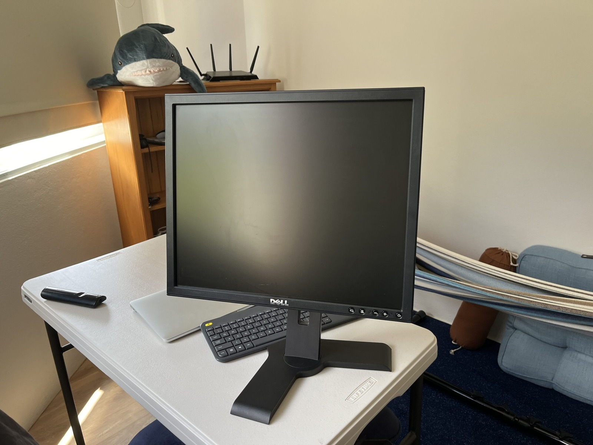

*8th November. The Dell cleaned up rather nicely and was ready for a proper test, with the plush shark supervising.*
{: .media-caption }

**8th November 2023.** All of the marks were just surface scratches. Time to test the electronics.

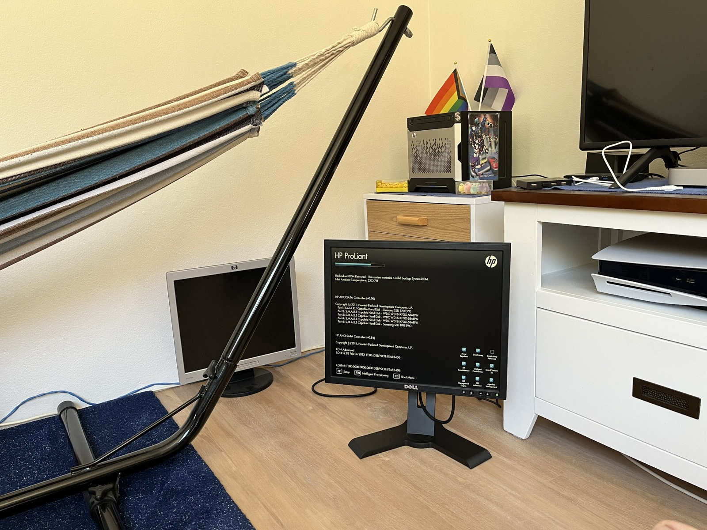

*The rescued Dell finally had a picture, showing an HP ProLiant boot screen beside the old 17-inch monitor. Success!*
{: .media-caption }

Unbelievable, she works well. Dwarfing the 17" HP monitor in the background with an extra two inches of raw monitor real estate. Burn-in tests are left to run overnight.

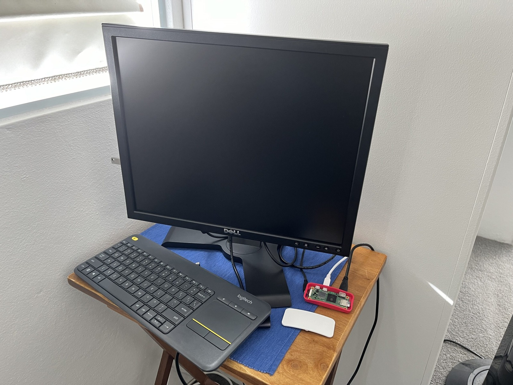

*The Dell moved into the bedroom with a Raspberry Pi Zero 2 W and tiny keyboard. A whole new career was being planned.*
{: .media-caption }

**9th November 2023.** Overnight testing was successful.

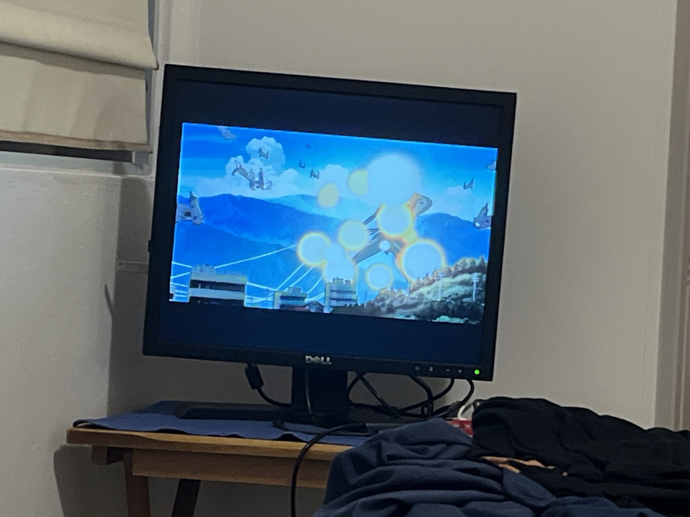

*The Dell could show a lovely bright picture, even if the Raspberry Pi setup wasn't playing nicely. The screen wasn't the problem.*
{: .media-caption }

**10th November 2023.** The Raspberry Pi Zero 2 W proved too slow and RAM-limited for my LibreELEC setup. Workarounds were attempted but ultimately failed. The lack of speakers was a showstopper.

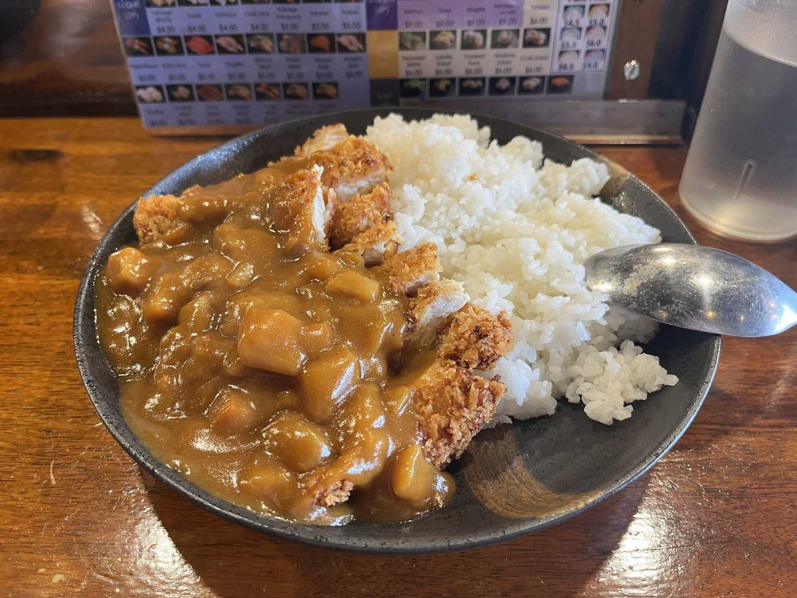

*The rescued Dell found another home, so we toasted its dramatic career over Katsu Jazz Friday. A fitting end to the heist.*
{: .media-caption }

The monitor was delivered the same day to [a bearded man](https://en.wikipedia.org/wiki/A_Bearded_Man), who has since been able to utilise this incredible tech - even if I am unable. We made a toast and consumed a typical Katsu Jazz Friday meal. Between silences we remembered what once was and what will be. A powerful tale of the struggle, success, downfall and eventual rise of one rescued Dell P190Sb LCD monitor. 🖥️ 🥰
