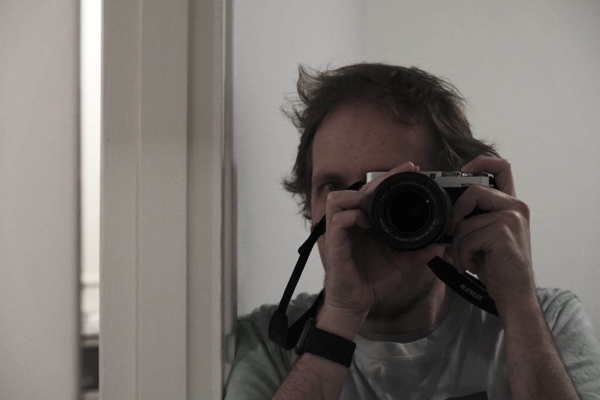
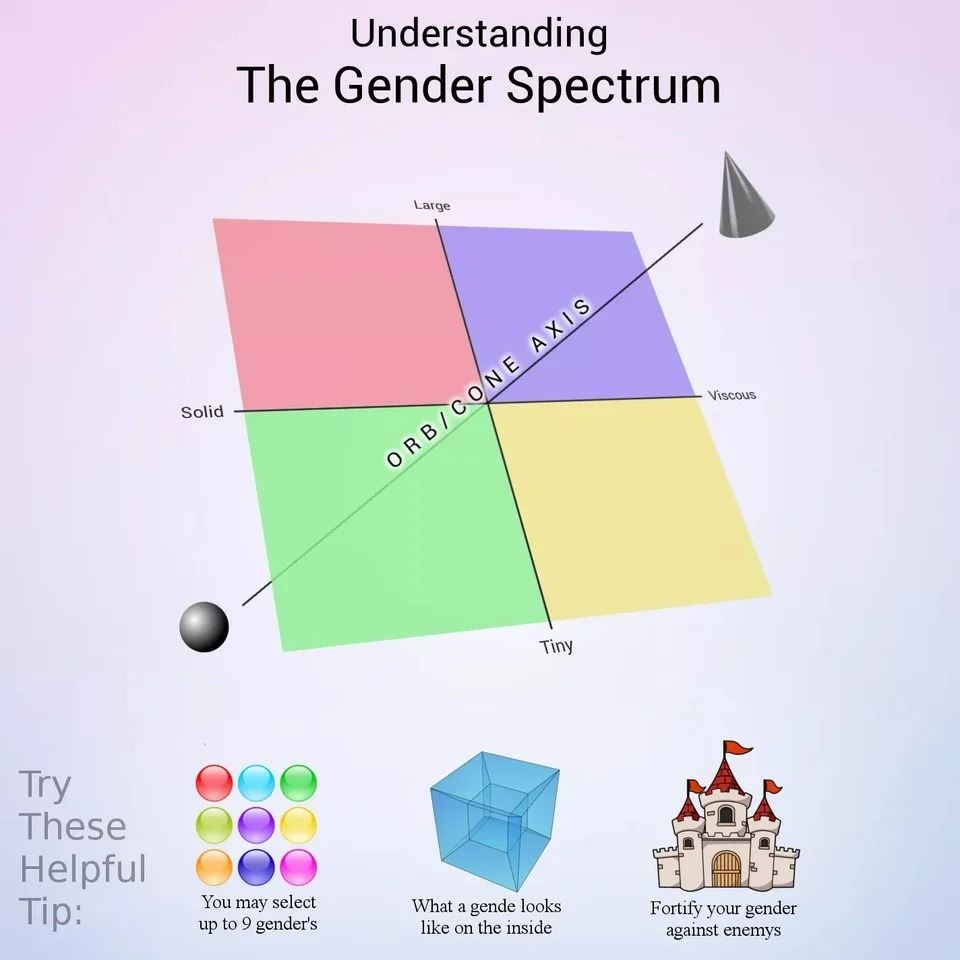
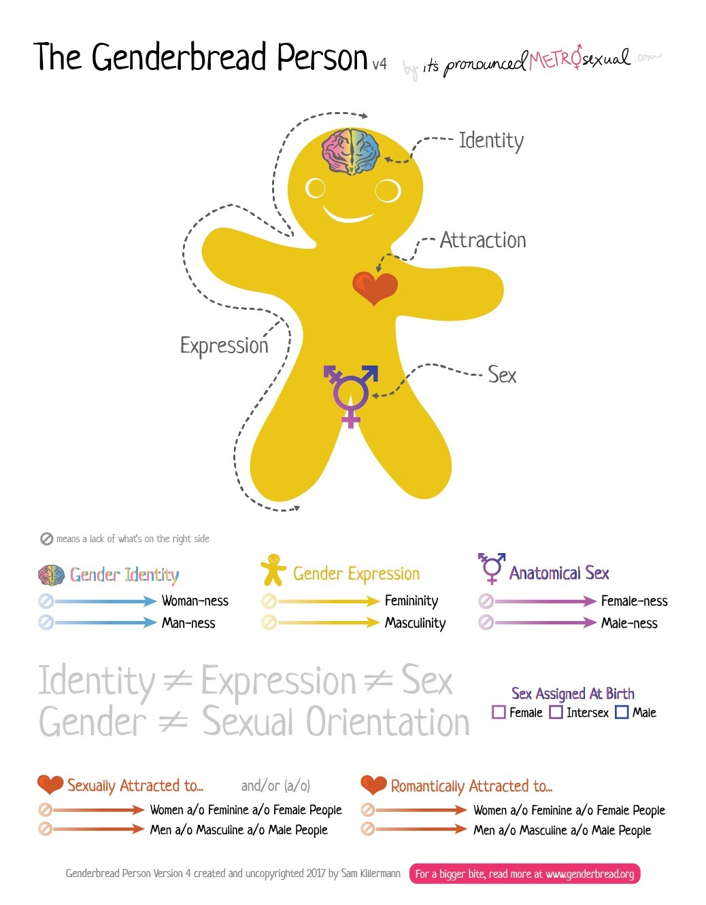
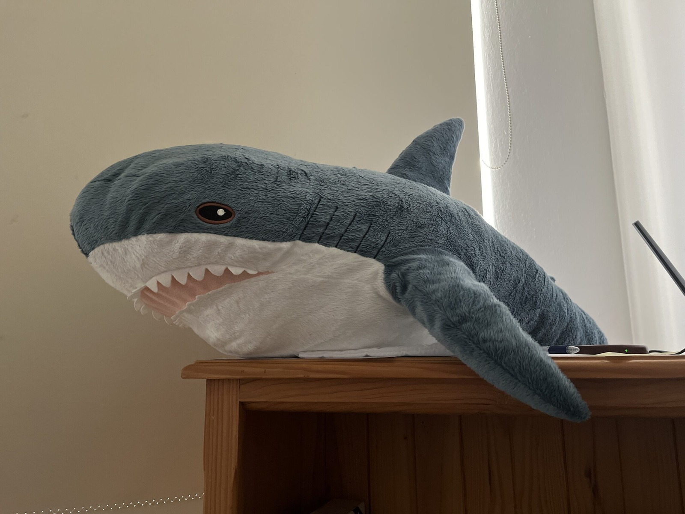
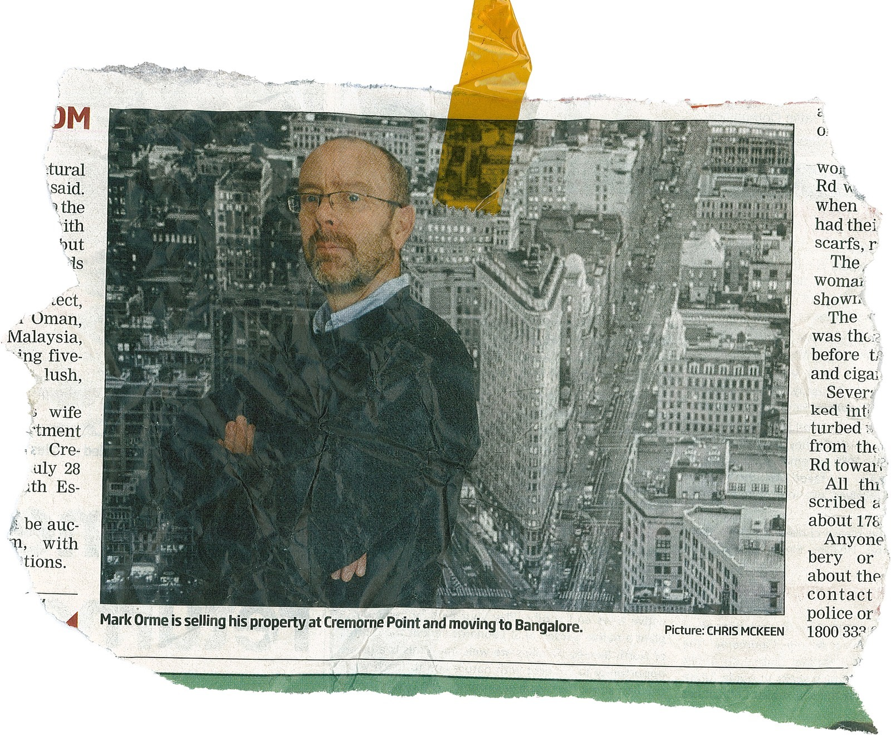

*A mirror selfie to kick things off. Naturally, I managed to hide most of my face behind a camera.*
{: .media-caption }

Exactly one month ago, on the 18th October 2023, I came to the realisation that I am transgender. Two weeks later I had an appointment with an endocrinologist. And one week after that a prescription for [estradiol valerate](https://en.wikipedia.org/wiki/Estradiol_valerate) 6 mg a day. Thank you [informed consent](https://en.wikipedia.org/wiki/Informed_consent).

*Apparently gender comes with an orb/cone axis, a castle, and up to nine selectable options. They definitely didn't teach me this at school.*
{: .media-caption }

[Gender identity is an interesting beast](https://www.itspronouncedmetrosexual.com/genderbread-person/). It's only a part of the puzzle that explains who I am as a person. If I hadn't been questioning my sexuality I would have probably just kept going through the motions until I killed myself. Dark, right?

*The Genderbread Person was a much more useful way to think about identity, expression, sex, and attraction as separate things. I wish I'd seen this years ago.*
{: .media-caption }

They did not teach this in school when I was younger, and until recently I hadn't even considered the possibilities available to me.

*The giant plush shark had already claimed the high ground. Clearly an important member of the household.*
{: .media-caption }

For now at least, I can say that my gender identity is closer to that of a woman. My gender expression is somewhere in the middle as I transition. My sex assigned at birth is male and I'm attracted to femininity both romantically and sexually albeit in a grey-asexual fashion.

*And here's Mark Orme heading to Bangalore. A rather different journey from mine, but the idea of a new chapter seemed appropriate.*
{: .media-caption }

And while labels have their limits, see "orb/cone axis" above, they have helped me make sense of who I am. They have given me the confidence I needed to come to terms with who I am. Like Mark Orme, it would seem that my journey has only just begun. 🥳
