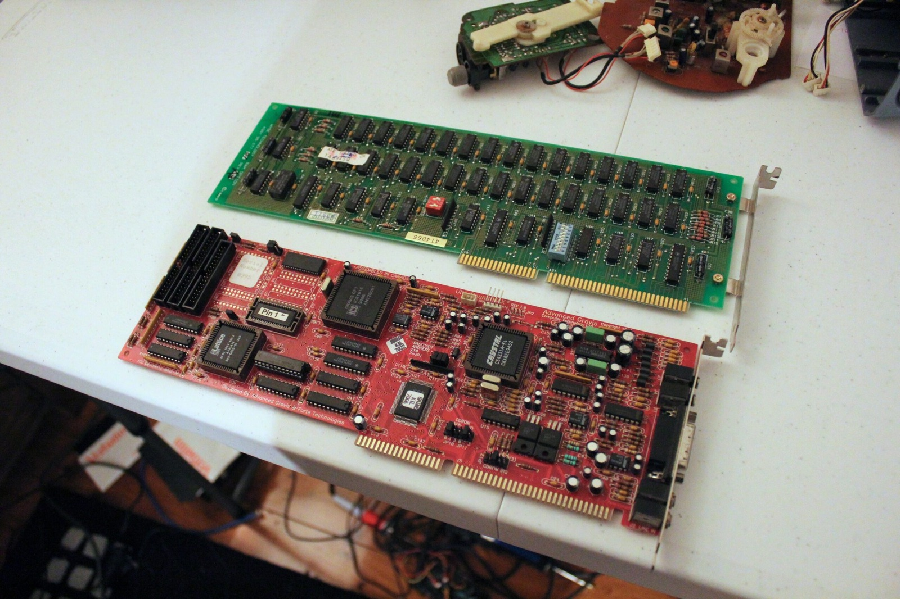



A quick look at HTTP requests on really old browsers. HTTP/0.9, originally just HTTP, was a very simple protocol: essentially a one-line `GET` request with no version token and no request headers. Mozilla has [a great write-up on it](https://developer.mozilla.org/en-US/docs/Web/HTTP/Guides/Evolution_of_HTTP).

The reason for all this messing about? I had a Macintosh Classic with 4 MB of RAM practically begging to get onto the internet. I wanted to see how much of my own website I could serve to it without modern browsers and servers getting in the way. A 28 kbps dial-up connection wasn't going to make it particularly speedy either, but when has that ever stopped me?

I was trying different ways of reaching my Apache server, including going directly to its IP address while Cloudflare's proxy was disabled. Internet Explorer 5 was in the mix, along with older Netscape browsers. I even tried sending a manual GET request, with rather mixed results. The server kept coming back with a bad request, and I was doing a fair bit of guessing about what I had typed incorrectly.

Eventually I did get a page to load through the direct IP address. I was not expecting that to work! The old browser didn't render everything, with tables being one obvious casualty, but there was definitely something there to work with.

One correction to my earlier theory though: the old browsers themselves were not necessarily speaking HTTP/0.9. My [Apache logs showed MacWeb, Mosaic and Netscape reaching the server as HTTP/1.0](/mac-web-browsers-from-the-90s-and-http-0-9/). Still, it was interesting trying to get a modern CDN - Cloudflare in my case - to play nicely with browsers that are now almost older than time itself.

 



Aren't cicadas neat? I've got videos queued up for both my [Nix McRetro](https://www.youtube.com/@NixMcRetro) and [Super Nature World](https://www.youtube.com/@SuperNatureWorld) channels over the coming weeks or even months. However, due to cashflow issues owing to long-term unemployment, I'll soon be forced to move to a location with no internet.

The rush is on to get as much video processed as possible and uploaded to YouTube. It also means this self-hosted website will temporarily disappear. The new internet connection poses a bunch of potential issues too, thanks to CG-NAT. Perhaps Cloudflare Tunnel, which I was still habitually calling Argo Tunnel, might be the answer? I'll see if I can work out a temporary solution to at least put a maintenance/planned downtime notice up. Absolute worst case, there is always [archive.org](https://web.archive.org/web/20231123091212/https://mcretro.net/). 🙃

### Sources

- [MDN - Evolution of HTTP](https://developer.mozilla.org/en-US/docs/Web/HTTP/Guides/Evolution_of_HTTP)
- [RFC Editor: RFC 1945, HTTP/1.0 (Section 4.1, HTTP/0.9 Simple Requests)](https://www.rfc-editor.org/rfc/rfc1945.html)

### Related Posts

- [Downtime - Planned Maintenance](/downtime-planned-maintenance/)
- [Maintenance Complete - User Is Online!](/maintenance-complete-user-is-online/)
