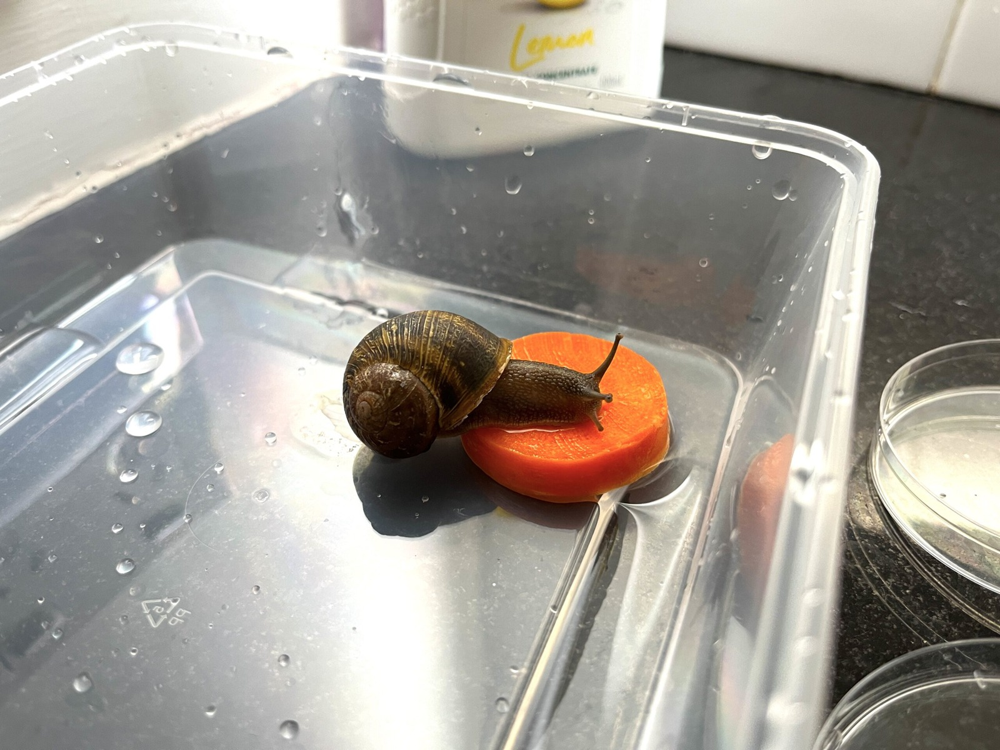

*The website might have been heading for some downtime, but this little snail had a carrot to investigate. Priorities!*
{: .media-caption }

Here comes the downtime. As my NBN connection regresses to 4G home internet, expect this site to be down for at least a few weeks while I get my head around carrier-grade network address translation, or CG-NAT for short. Unlike the NAT in my own router, this one lives in the carrier's network and I don't control the public IPv4 mapping.

*And a little honeybee visitor. Whatever happens to the website, I'll still have time for the local creatures. 🐝*
{: .media-caption }

I initially thought it should be as simple as pressing a few different buttons from the ones I normally press when installing ddclient on my server. Not quite. `ddclient` can keep a DNS record pointed at a changing public address, but it cannot punch an inbound connection through a carrier's NAT that I don't control. I couldn't really test alternatives until the new network was up and running. I guess stay tuned and, if [Cloudflare's Always Online](https://www.cloudflare.com/en-au/always-online/) has an archived copy available, enjoy this page in the meantime. Until we next meet, be excellent to each other and to other creatures too! 🙃

🪲 🐌 🪳 🐟 🦎 🦗
{: .creature-signoff }

### Sources

- [RFC 6888 - Common Requirements for Carrier-Grade NATs](https://www.rfc-editor.org/info/rfc6888/)
- [Cloudflare - Always Online](https://developers.cloudflare.com/cache/how-to/always-online/)

### Related Posts

- [HTTP/0.9 Request and Other One-Liners](/http-0-9-request-and-other-one-liners/)
- [Maintenance Complete - User Is Online!](/maintenance-complete-user-is-online/)
