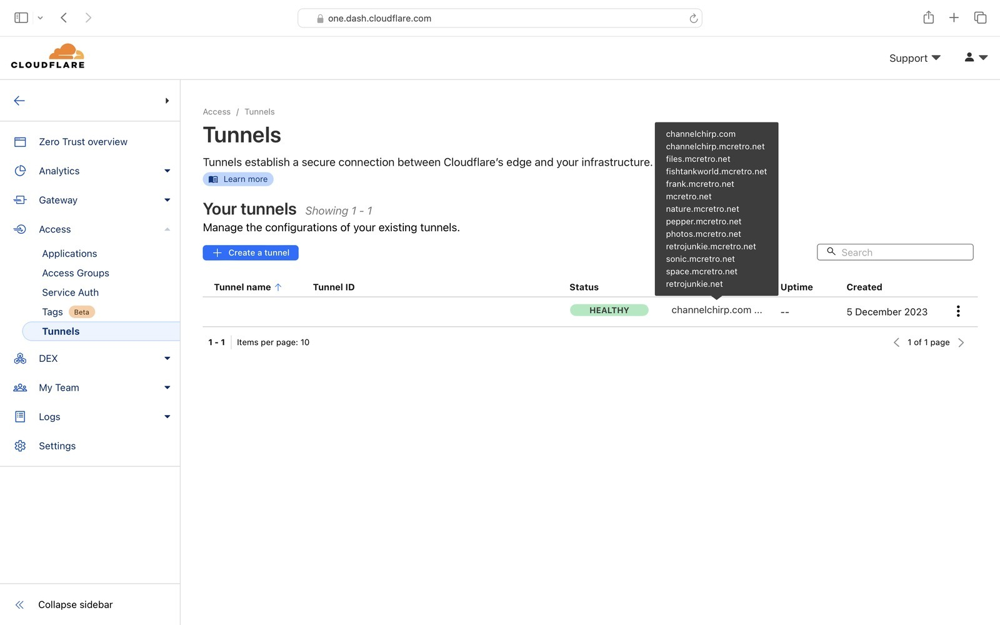
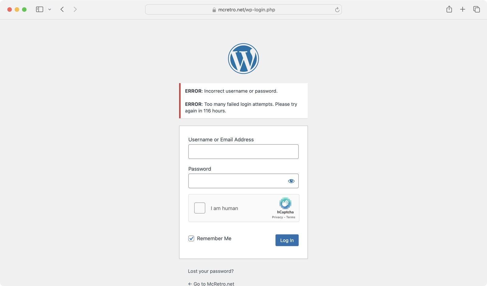
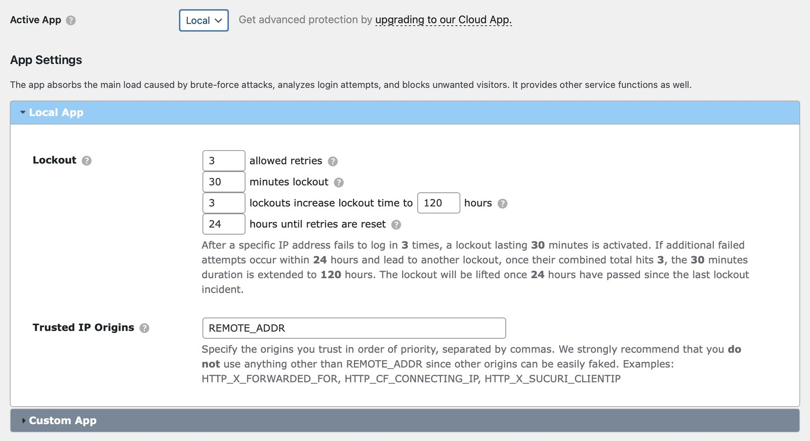
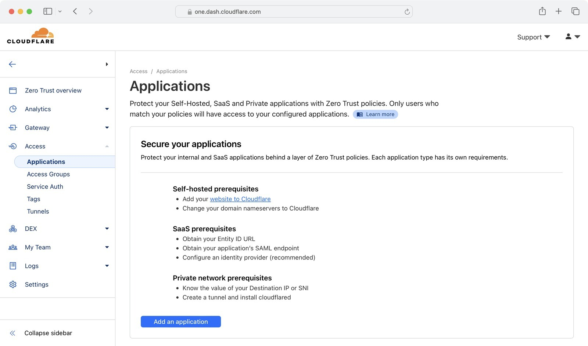
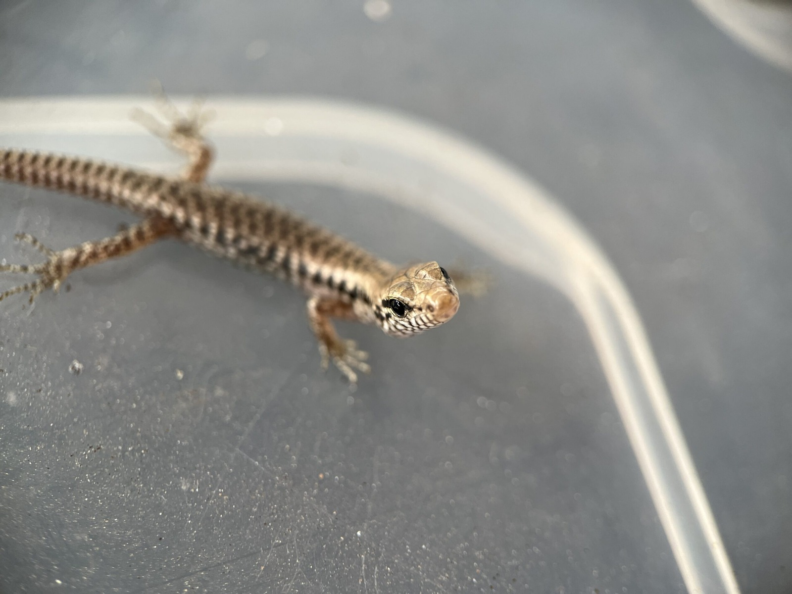

*Cloudflare Tunnel was finally doing its job! A healthy connection, and the website was back within reach despite CG-NAT.*
{: .media-caption }

CG-NAT defeated! Cloudflare Tunnel, which I was still habitually calling Argo Tunnel, works and has done so for about a week. `cloudflared` makes outbound connections from my network to Cloudflare, so I can publish the web server without needing an inbound public IPv4 connection. However, due to the way the tech behind it all works...

*Success with the tunnel, not so much with logging in. WordPress decided I could come back in 116 hours. Lovely.*
{: .media-caption }

...I **_might_** have inadvertently locked myself out, with help from botnets spamming my WordPress login page of course! No problem, it gave me a week to mull over options and find a better solution.

*The lockout settings explained quite a lot. With the tunnel in the mix, treating every request as the same local address was not ideal.*
{: .media-caption }

After finding some time to look at the settings, I could see a likely explanation for the lockout. Cloudflare Tunnel brings the request into my network through `cloudflared`, so software looking only at the local connection can see the tunnel or local proxy rather than the visitor. Cloudflare passes the original visitor address in headers such as `CF-Connecting-IP`, but the security tooling needs to interpret that trusted proxy path correctly. Otherwise, botnet login attempts and my own login activity can look as though they're coming from the same address. That fitted the lockout I was seeing.

*Cloudflare Access to the rescue. Another login gate in front of WordPress sounded much better than sharing a timeout with every bot on the internet.*
{: .media-caption }

Enter Cloudflare Access (again)! With the Access policy restricted to approved email identities, a one-time PIN puts another authentication gate in front of the WordPress login. It doesn't replace WordPress updates or strong credentials, but it means a lot less unauthenticated junk reaches `wp-login.php`. Reduced server load and less exposed attack surface? Yes please! This user is most definitely [back online](/assets/uploads/user-is-online.mp3)!

*Now that the website was back, I could concentrate on the really important work: finding little lizards in the backyard.*
{: .media-caption }

Now that this mess is sorted out I can get back to finding cool lizards **_in my backyard_**. Ahhh, it does beg the question, should I even be self-hosting on 4G home internet? No, probably not. Latency is through the roof and CG-NAT is annoying. Oh well! 💁‍♀️

Big thanks to [Tim Smith](https://tsmith.co/2023/protecting-wordpress-admin-login-with-cloudflare/) and [Jeremy](https://noted.lol/zero-trust-access-applications/) - without their guidance I'd probably still be reading the Cloudflare documentation! 😅

### Sources

- [Cloudflare - Cloudflare Tunnel](https://developers.cloudflare.com/tunnel/)
- [Cloudflare - HTTP request headers](https://developers.cloudflare.com/fundamentals/reference/http-headers/)
- [Cloudflare - One-time PIN authentication](https://developers.cloudflare.com/cloudflare-one/integrations/identity-providers/one-time-pin/)

### Related Posts

- [HTTP/0.9 Request and Other One-Liners](/http-0-9-request-and-other-one-liners/)
- [Downtime - Planned Maintenance](/downtime-planned-maintenance/)
