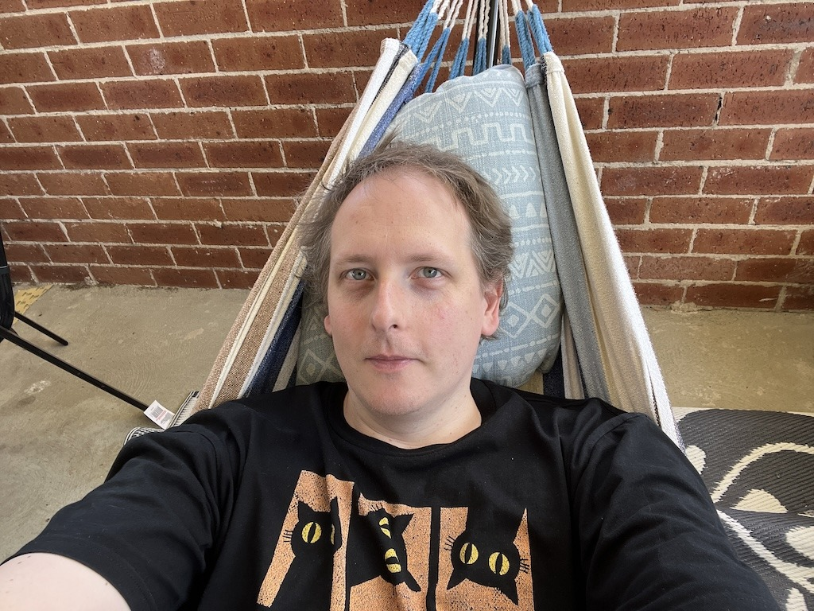

*My hammock, outdoors at last! After years in apartments, having an actual bit of open air still felt wonderfully strange.*
{: .media-caption }

Technically I'm still the same, but my hammock is weirdly outdoors. For the first time in years I have an outdoor area. I'm no longer [trapped in a box](https://en.wikipedia.org/wiki/Trapped_in_a_Box). I hate apartments. At the same time, urban sprawl isn't good from an environmental standpoint either. Maybe the answer lies in population reduction? [I'm doing my part!](https://knowyourmeme.com/memes/im-doing-my-part)

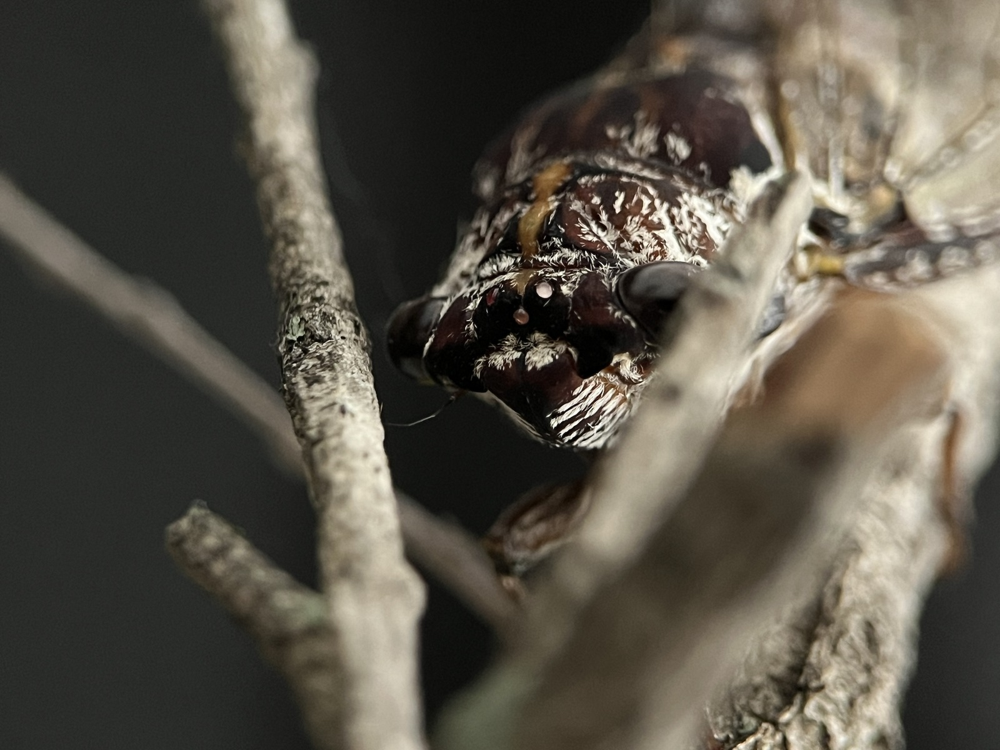

*I rescued this floury baker from a noisy miner, but its wing had been badly damaged. It was a sad afternoon for the little fellow.*
{: .media-caption }

We've got cicadas out here in the wastelands. The floury baker cicadas are still about, the one above was intercepted from a [noisy miner (Manorina melanocephala)](https://en.wikipedia.org/wiki/Noisy_miner) but had catastrophic wing damage at the joint. He was laid to rest that same afternoon. Just because something can suffer, doesn't mean it should. Rest easy little one.

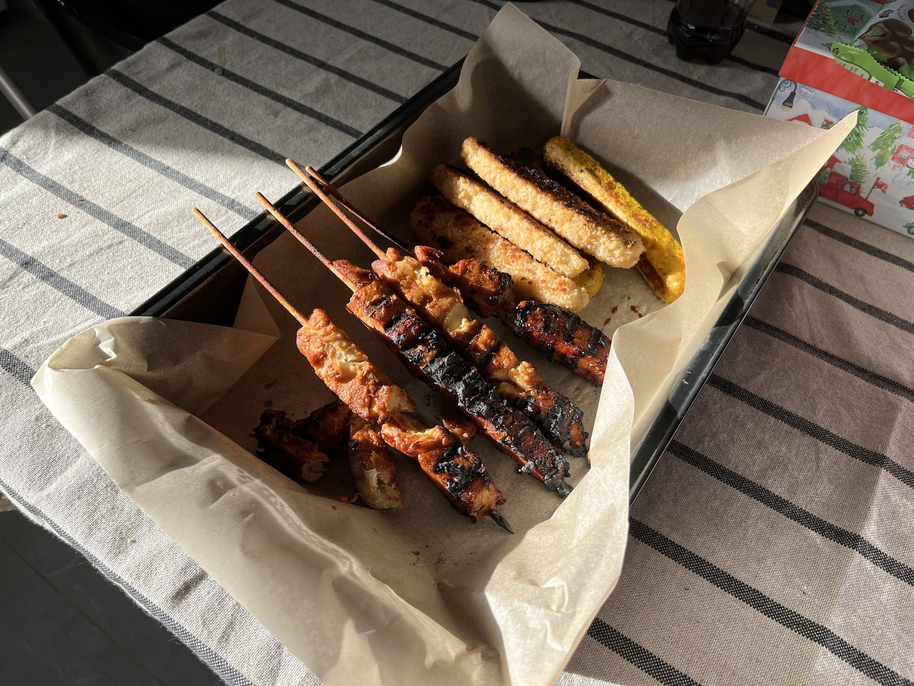

*Our first barbecue at the new place, and nothing caught fire that wasn't meant to. I'll call that a success.*
{: .media-caption }

We've also held our first barbecue without incident. My diet remains mostly vegan, thanks to reduced pressure on rent. The only big exception is salmon which will probably be replaced eventually again.

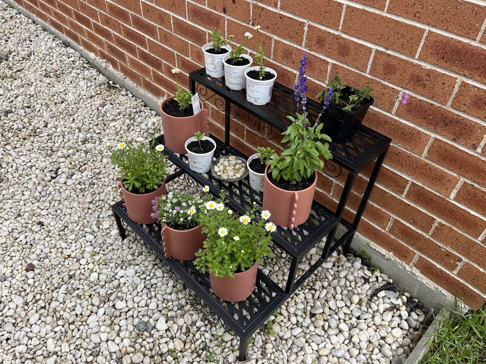

*Actual outdoor space meant I could finally give the plants some proper sunlight. Naturally, I started filling it immediately.*
{: .media-caption }

The garden though, and being able to have plants outdoors in the sunlight. What a game changer. I've made an active decision to let dandelions take over the buffalo grass. They mow down quite well.

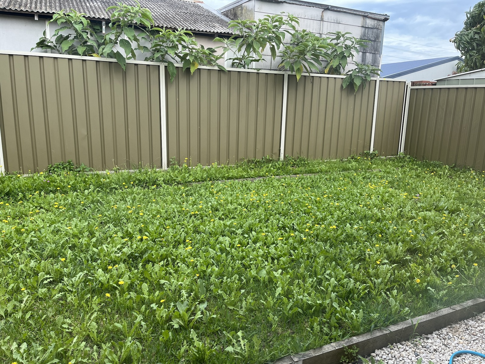

*The dandelions were taking over, and I was perfectly happy to let them. The bees, bugs, and lizards were welcome to share the place.*
{: .media-caption }

Looks better than any buffalo grass I've ever seen. Function over form I say. When they are at full growth, they provide pollen for the bees (native and European), harbour lots of little bug jumpers, which in turn feed the lizards that roam the grass. A little sad when a [common blackbird (Turdus merula)](https://en.wikipedia.org/wiki/Common_blackbird) snaps up a few, but as long as I can keep the bugs plentiful the lizards should thrive.

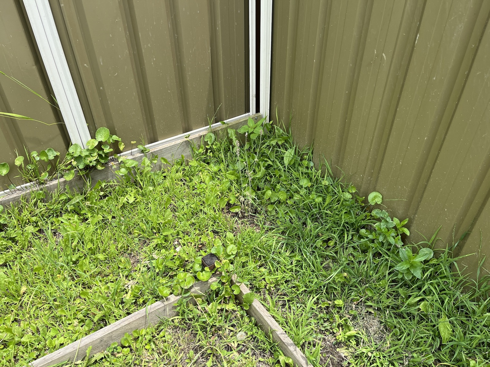

*My first lavender didn't survive the gardening experiment. Meanwhile, the weeds around the fence were doing spectacularly well. Typical.*
{: .media-caption }

Not everything has been rosy though. My first plant casualty, lavender. I had high hopes for it, but since I don't really know what I am doing it kind of died. Farewell lavender.

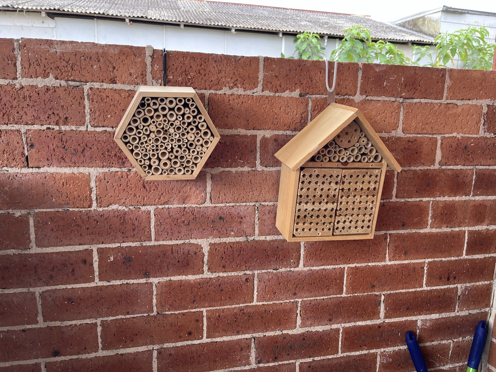

*Two little hotels for our native bees and wasps. Tiny guests were turning up, although they weren't especially interested in posing for photos.*
{: .media-caption }

My native bee hotels have been doing well, attracting a few different species of [native masked bee](https://inaturalist.ala.org.au/taxa/127812-Hylaeus) (genus Hylaeus), as well as [native wasps](https://inaturalist.ala.org.au/taxa/368724-Pison) that might be genus Pison. Both are ridiculously tiny and mostly seem interested in getting on with their own business.

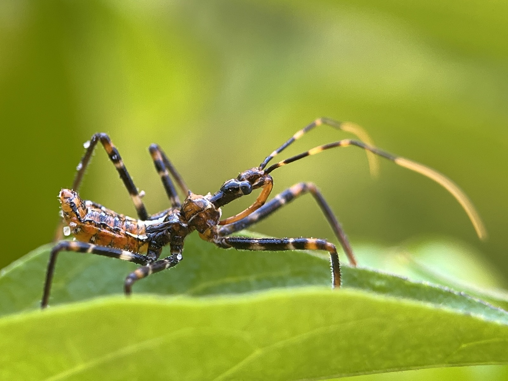

*An assassin bug nymph, which I identified as Pristhesancus plagipennis. Very impressive, provided you're not the next honeybee on its menu.*
{: .media-caption }

Then you've got the other bugs, like the pictured assassin bug nymph, [Pristhesancus plagipennis](https://en.wikipedia.org/wiki/Pristhesancus_plagipennis). It's ready to drink the brains of the next honeybee that lands nearby.

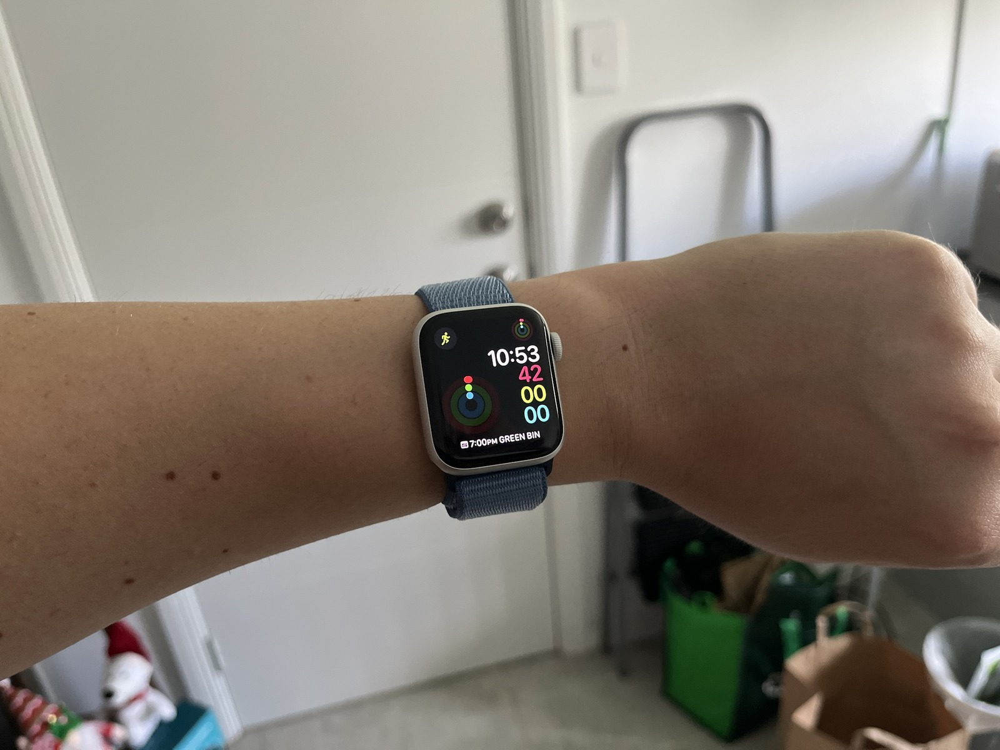

*Back on the Apple Watch train with a 40 mm SE 2. Turns out I really didn't miss the bigger watch at all.*
{: .media-caption }

And now I'm back on the Apple Watch train with my shiny new Apple Watch SE 2. This time around I've picked out the smaller of the two and went with the 40 mm. And I have to say, I do not miss the bulk of the 44 mm. The Apple Watch is a great motivator to stay on track with new year health goals.

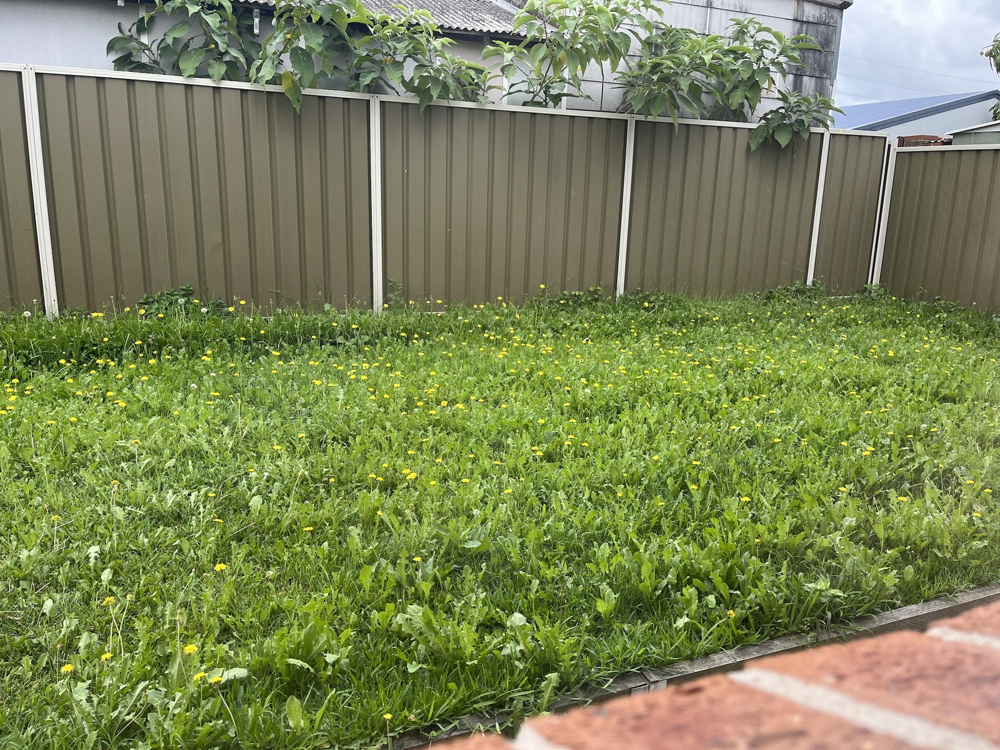

*Wait, that was supposed to be another watch photo. Nope, more dandelions! You can probably tell what I was spending my time looking at.*
{: .media-caption }

Wait that's not the image I was looking for... that's more dandelions!

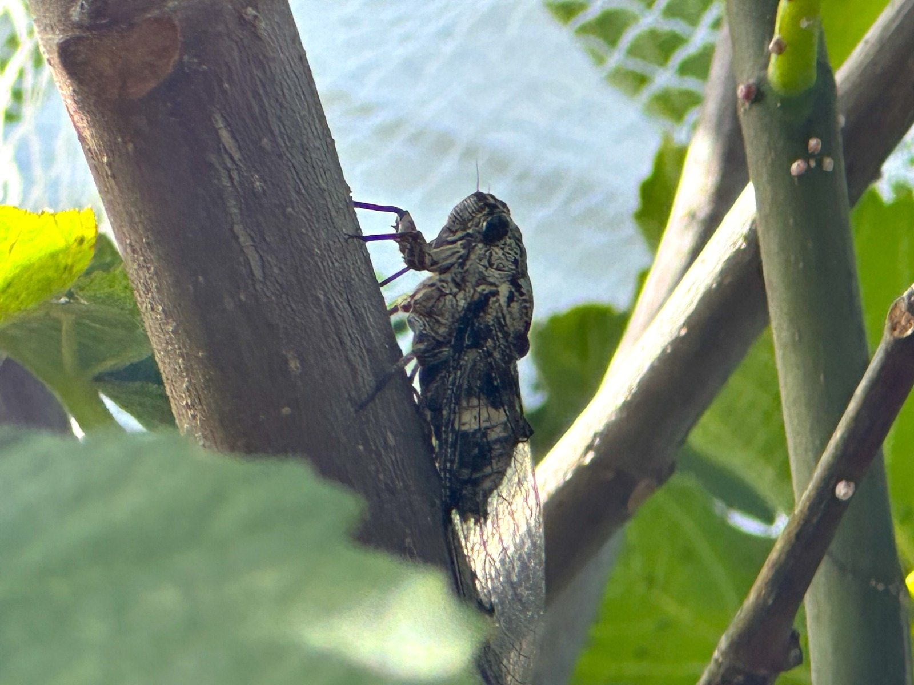

*Another floury baker in the tree. The chorus had gone quiet, but I wasn't about to blame the bats without evidence.*
{: .media-caption }

Whoops, that's another floury baker cicada. The several in this tree have gone quiet. I wondered whether the local bats had eaten them, but silence alone couldn't confirm what happened.

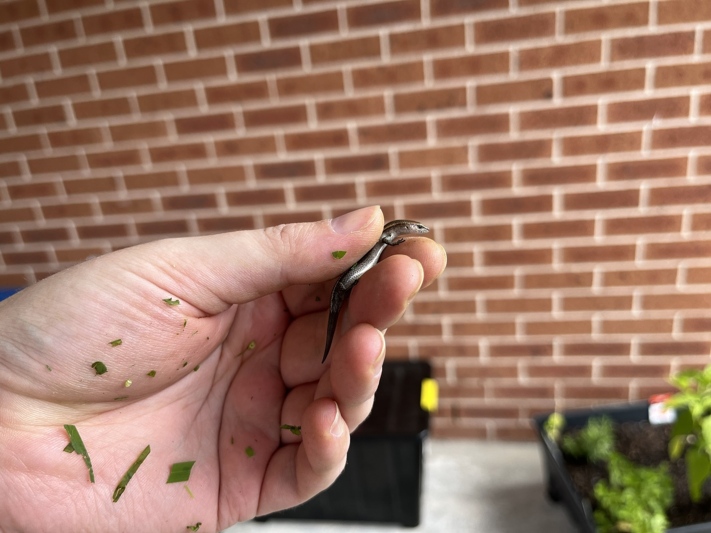

*This is Stumpie, one of the little skinks I try to keep clear of the lawn mower. A temporary lizard hotel is much better than another mishap.*
{: .media-caption }

And that's Stumpie. Tail growth is coming along well. If I find him running about while I'm mowing the lawn I'll move him into a lizard hotel plastic tub until I'm done.

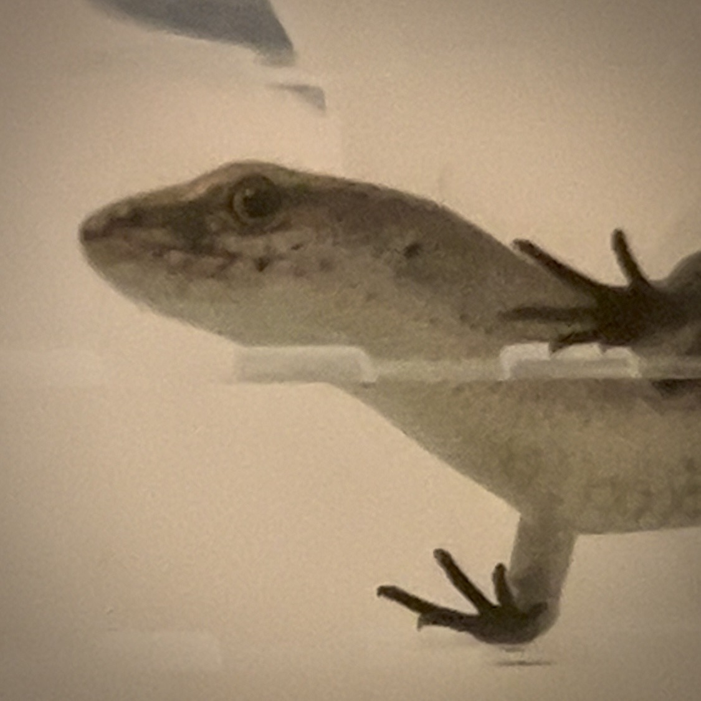

*Stumpie wasn't quite as impressed with the temporary accommodation. That look says plenty.*
{: .media-caption }

Don't look at me like that Stumpie. We don't want any repeats of how you got the name Stumpie after all!

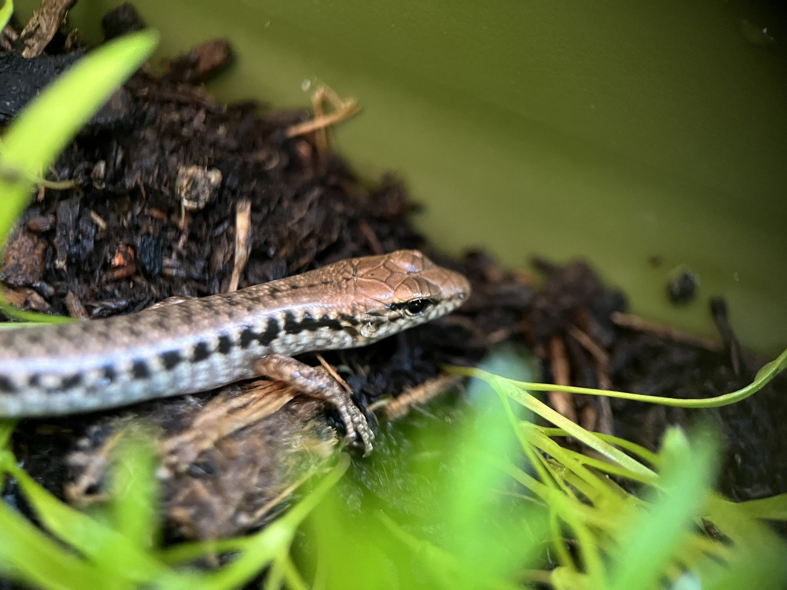

*This bar-sided skink had a very close call with a redback spider. I was glad I noticed before things ended badly.*
{: .media-caption }

Then we've got this little guy still rocking about, a [bar-sided skink (Concinnia tenuis)](https://inaturalist.ala.org.au/taxa/538970-Concinnia-tenuis). He'd been trapped by a [redback spider (Latrodectus hasselti)](https://en.wikipedia.org/wiki/Redback_spider). Luckily for the lizard, I noticed...

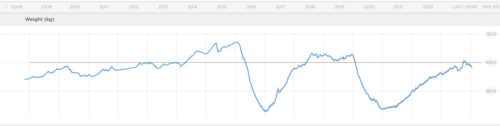

*There's my weight history, complete with some rather dramatic peaks and valleys. I was hoping the new year would bring another steady downward stretch.*
{: .media-caption }

And here's the data I wanted to show. Weight loss is beginning again. You might notice a drop almost immediately after becoming unemployed, then a spike to >100 kg when I ran out of money thanks to Sydney's rental market being unaffordable for a single person - let alone an unemployed single person.

*Even in the middle of all these life changes, Steam was still tempting me with Sonic Adventure DX for A$2.74. Some things never change.*
{: .media-caption }

Sure, I could have killed myself easily enough but chose to do the paradigm shift thing. Is it enough of a shift? That's still an unknown at this point. At least for now, there are real life distractions everywhere which seems to leave very little time for uploading videos. Not such a bad thing I guess. That's not to say I haven't been recording new footage.

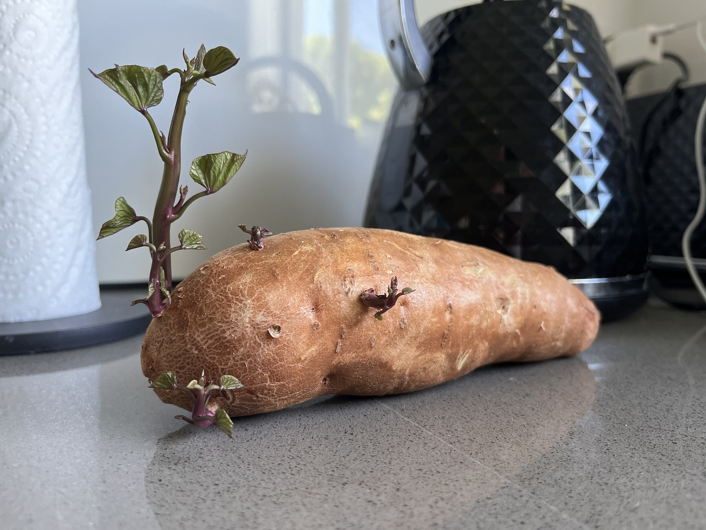

*Even the sweet potato on the kitchen bench was getting into gardening. I might have some competition!*
{: .media-caption }

Better go and check the garden is still there and get my 30 minutes of exercise in. Target weight is set at 75 kg this time around. Roughly 20 kg of weight loss to go, and while transitioning. Should be one heck of a ride. 🤷‍♀️

### Related Posts

- [Forced Veganism Rethink](/forced-veganism-rethink/)
- [The Garden, Lizards and Bees](/the-garden-lizards-and-bees/)
