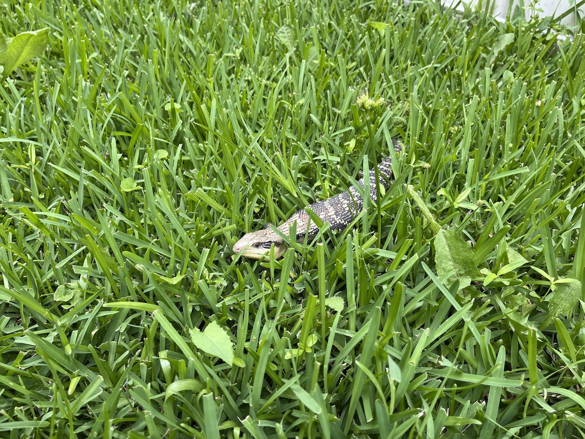
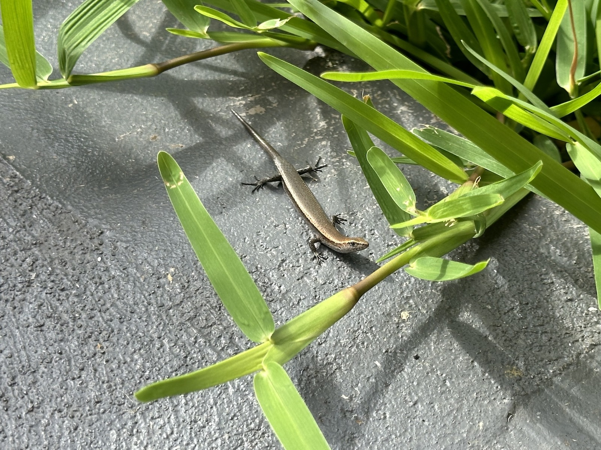
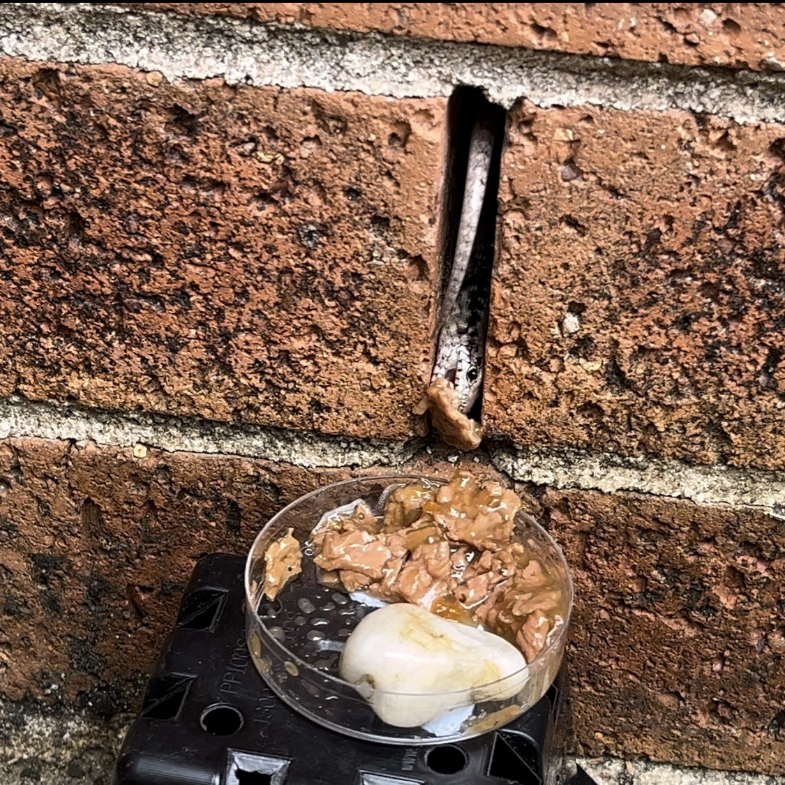
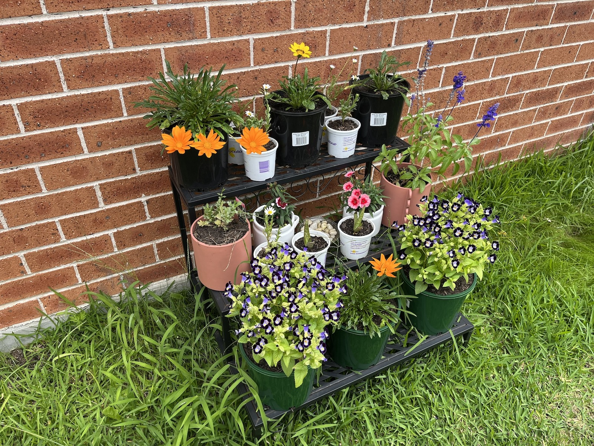
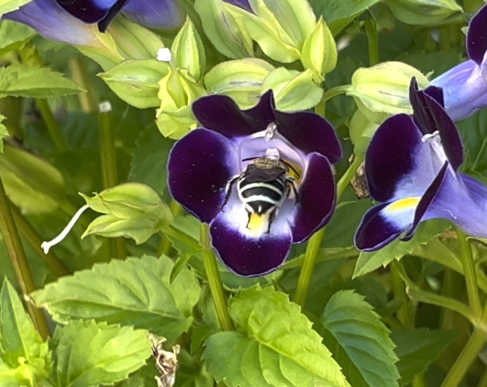

We had a giant blue tongue turn up randomly on the lawn. No doubt here for the snails and slugs I keep finding at night. I picked up a tray of beef dog food with minimal grain content and he hasn't shown up since! 😭

Stumpie continues to appear intermittently. He's doing quite well, but I've seen a lot of newly made Stumpie-class lizards. Whether it is infighting between lizard factions, attacks from birds, or the lawn mower I wish them a speedy recovery!

But what to do with the dog food? Well, since Bluey hasn't shown up, I thought maybe the bar-sided skinks would like a taste. And yes, they really do. The one I had captured earlier must have been a baby because this one living inside the walls is huge!

That said, feeding wild skinks dog food probably wasn't one of my brighter ideas. NSW wildlife advice generally discourages feeding native animals because it can change their behaviour, encourage dependency and cause health problems. Better to make the garden attractive enough for them to find their own dinner. Plenty of bugs around here anyway!

In other nature related news, I've got blue banded bees! They are the most goofy looking bees I've ever seen.

There's at least two that frequent the purple flowers here. I love them. Especially in slow motion! I did capture some video so they'll end up on Super Nature World at some point. Stay tuned! ✅

### Sources

- [NSW Government - Living with native animals](https://www.environment.nsw.gov.au/topics/animals-and-plants/native-animals/living-with-native-animals)

### Related Posts

- [New Year, New Something That Rhymes with Year](/new-year-new-something-that-rhymes-with-year/)
