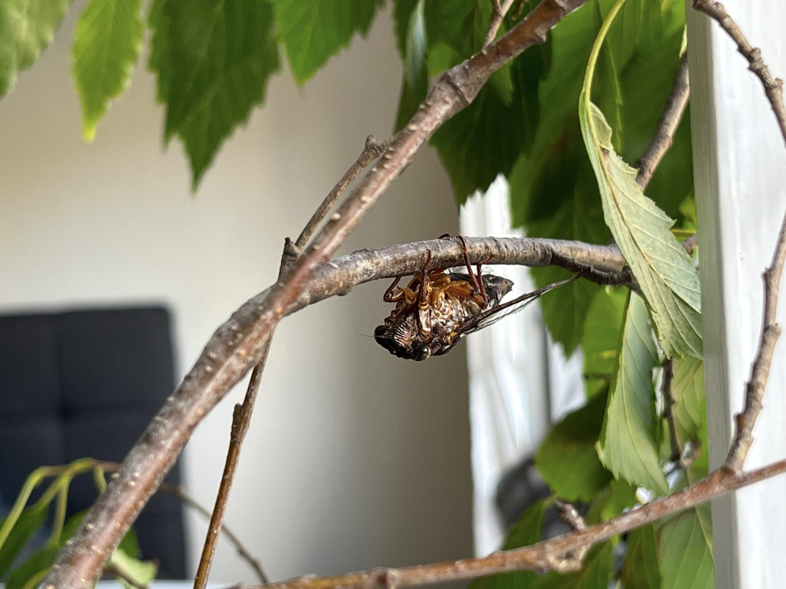

Flicky! Ohhh that little cicada was such a survivor. Resting and laying eggs almost every day for ten days while in captivity. Sadly she succumbed to time on 8th March 2023.

When I was a kid, I called cicadas "Croaky" because I thought they sounded like they were croaking. Well, I was a kid, cut me some slack! Flicky was a female Floury Baker (*Aleeta curvicosta*), so Flicky seemed a much more appropriate name. Her wings were badly damaged and flying wasn't an option, but that didn't stop her laying eggs. I wasn't expecting that!

I ended up reading quite a bit about keeping branches alive, cicadas feeding on xylem sap, and what happens to their eggs once they hatch. I knew the species already, but there's still a great deal I don't know about what goes on once the singing stops and the season ends.

**Flicky's Ten Days**

The ten original daily video diaries are collected below. Open a day to read the complete entry and watch its video.

01. Meeting Flicky — 27 February 2023



Flicky! A female Floury Baker cicada (*Aleeta curvicosta*) with badly damaged wings. Flying wasn't going to happen, but I wanted to do what I could to keep her comfortable. I already knew the species before finding her. This was the beginning of ten rather memorable days with a little cicada.

Looking a little closer at her wings, whatever had attacked her had taken about half the hind wing on one side and half the forewing on the other, along with a little bit of the remaining forewing. She'd certainly been through something, and I found myself looking at her and asking, "What do we do with you? What do we do?"

I didn't really know the answer at that point. But with flying out of the question, I wanted to see what I could do for the little one.

02. A Little More Time with Flicky — 28 February 2023



Another day with Flicky. Her damaged wings ruled out flying, but there's still a great deal I don't know about what goes on once the singing stops and the season ends. I spent time reading about how best to care for her.

Normally, if I found a cicada, I'd have a look and release it again. Flicky was a different story. With those wings, I couldn't simply put her back outside and expect her to fly away, so even the basics of keeping her comfortable needed a bit more thought.

I knew she was a Floury Baker, but knowing what species you've found and knowing how to care for one are two rather different things. The question was how to provide something resembling her normal environment when she couldn't move between trees herself.

There was certainly plenty to learn, and I'd barely scratched the surface!

03. Looking After Flicky — 1 March 2023



I knew cicadas feed on xylem sap. Working out how to provide suitable plant material to a cicada that couldn't fly was another matter. I ended up going down quite the rabbit hole reading about trees and how they move water.

Cicadas aren't chewing away at leaves. They're tapping into the fluid carried through the xylem, which is all well and good when you've got an entire living tree to work with. Flicky didn't have that luxury, and I couldn't exactly bring a tree into the house.

That raised another question. If I provided cut branches, how long would they remain suitable for feeding? Leaves might still look green, but that didn't necessarily tell me what was happening inside the wood.

What started as a question about looking after one little cicada had turned into a fair bit of reading about how trees work. I was going to need more than a passing understanding of xylem if I wanted to get this right.

04. The Tree Branch Question — 2 March 2023



Some of the reading I did while caring for Flicky concerned keeping cut branches alive. It's one thing to keep leaves green in a vase and another to know whether the branch is still suitable for a cicada to feed from. A rather fiddly problem to have.

The trouble was that a branch could look perfectly healthy while I had no real idea what was happening to the xylem inside it. Putting it in water might help prevent it from drying out, but whether that meant Flicky could continue feeding from it was another question entirely.

I was trying to understand how water travelled through the tree, what happened once a branch was cut and how long it might remain useful. I was also trying to work out whether some types of trees would be better suited to her than others.

I'd started out wanting to keep a little cicada comfortable, and now I was spending an extraordinary amount of time thinking about trees. Of course I'd already given Flicky branches to climb around and feed from. The question was whether those cut branches were still providing anything she could drink, even when the leaves looked perfectly healthy.

05. Branches and Leaves — 3 March 2023



Working out which branches were suitable for Flicky was another question entirely. I'd been working my way through leaf guides, elm, birch and anything else that might help, but none of it gave me enough to identify the tree with confidence. Not much point in pretending I knew what I was looking at when I was trying to find something she could feed from.

Flicky wasn't always making the job particularly easy either. At one point she seemed unwilling to turn around at the end of a branch, and I found myself asking, "Do you have to be so difficult?" Apparently getting a cicada to cooperate with my plans was going to be another challenge entirely.

06. Flicky and the Eggs — 4 March 2023



The most unexpected part of looking after Flicky was the eggs. Her wings were clearly too damaged for flight, yet she continued laying eggs during those ten days. Ohhh, Flicky. What a little survivor.

Of course, this raised an entirely new set of questions. Cicadas deposit their eggs into little cuts in tree branches using an ovipositor, and those branches eventually dry out once they're no longer attached to the tree. I was concerned that if the wood dried and warped too much, it could end up damaging or crushing the eggs inside.

Keeping the egg-bearing branches moist was going to be important, and plain water seemed a sensible place to start. That was a separate problem from finding suitable branches for Flicky to feed on.

Then there was the question of what happened if the eggs actually hatched. The tiny nymphs would need to reach soil and eventually find roots to feed from. I'd only intended to look after one injured cicada, and now I had the possibility of an entire next generation to think about.

I wasn't about to start cutting open branches to count eggs, either. Much better to give them a chance and see what happened.

07. The Next Generation — 5 March 2023



I hadn't set out to look after cicada eggs as well as an adult cicada, but there we were. I started looking into what happened after they were laid and how to give the nymphs a chance when the time came.

Today's job was getting Flicky onto another tree branch. I'd been experimenting with soaking branches in honey and water, hoping that the leaves and wood might remain suitable for her to feed from. The latest branch had been sitting in a very dilute honey mixture for about an hour and a half, and I'd split part of it down the middle to help it absorb the liquid.

My understanding of how plants move nutrients around was still a little questionable. I knew sugars were produced in the leaves through photosynthesis and transported through the phloem, while cicadas feed from the xylem. I wondered whether there might be some movement of nutrients between the two systems that would help Flicky, particularly with the honey mixture. That's what I was hoping, anyway. I wasn't exactly an expert on trees.

The honey was diluted to roughly one part in ten, which seemed rather more sensible than the one-in-five mixture I'd tried earlier. I was also replacing branches frequently, initially every day and then about every half-day. I felt a bit sorry for the tree supplying all these branches, but I was trying to find something that would keep Flicky feeding.

"It likes tree. I like tree."

That's about as good an explanation as I could offer.

Flicky was now spending time in a 50 litre tub with several branches available. The temperature was around 26 degrees, although it climbed to about 28 degrees later on, and I was trying to balance sunlight with not making the enclosure too hot. At one point she spent seven hours feeding, took a break for about an hour and a half, and then went straight back to it. I was rather impressed by that.

There was another little observation worth recording. After she'd been feeding for around ten minutes, I noticed clear fluid being expelled. That seemed encouraging, as it suggested she was taking in liquid from the branch. Whether the honey was actually helping was another question, but at least she appeared to be getting something.

I'd also started thinking more seriously about the eggs. The egg-bearing branches needed to remain moist, but I wasn't going to use honey water for those. Plain water seemed a better option while I worked out how to keep the wood from drying out before the nymphs hatched. From what I'd been reading, that could take around 70 days for a Floury Baker, which meant I potentially had a much longer project on my hands.

The other difficulty was working out whether Flicky had finished laying eggs. If she stopped looking for suitable branches and spent all her time feeding, that might be a sign she'd finished. Of course, the alternative was that she was simply having a rest. She wasn't particularly interested in explaining herself to me.

I'd also been looking at the honey itself. I ended up with some Australian Wild Nectar honey rather than Capilano, and discovered it was labelled as cold extracted. I knew I liked cold-extracted apple juice, but whether that made the slightest difference to a cicada was beyond me. I was hoping the mixture contained something useful without creating any more problems for her.

For now she seemed happy enough to keep feeding, although she occasionally stopped and left me wondering whether she was resting or wanted another branch. I could watch her for hours and still not be entirely sure what she was thinking.

Looking after a cicada is surprisingly involved, especially when you've also got a full-time job. And if those eggs hatch, this little experiment is only going to get more interesting!

08. Still Learning About Cicadas — 6 March 2023



There was an awful lot to read about the cicada life cycle, especially what happens after hatching. The little nymphs need to get to the soil and find roots. I hoped Flicky's eggs might eventually get that far.

We're now eight days into this unexpected adventure with Flicky the Floury Baker, and she's still spending time on the branches I've provided. One of those branches has already been used for egg laying, and I was rather interested in how she seemed to remember exactly where she'd been working. It had been exceptionally hot, around 38°C, and I'd even taken Flicky along to work rather than leave her in the heat without being able to check on her.

During the night I'd moved her onto another part of the arrangement, only to find that she made her way back towards the same section of branch. Perhaps she was recognising something about the wood, or perhaps it was simply the most suitable place available. She seemed particularly interested in a small section of twig where she'd already laid eggs, which made me wonder whether cicadas have some way of keeping track of where they've been.

I took a closer look at the little cuts left in the branch by the ovipositor. They're surprisingly noticeable once you know what you're looking for, although my camera wasn't particularly interested in focusing on them. It's amazing how much damage a small insect can make when she's depositing eggs into wood. I was also surprised at how small the nymphs appeared to be when I looked up photographs of newly hatched cicadas.

The branches Flicky had already laid eggs in were another matter. I'd removed those older branches from her enclosure and placed them in a small amount of plain water, hoping to prevent the wood from drying out and warping. If the wood changed shape too much, I was concerned it could end up crushing the eggs inside. Not exactly what I wanted after all this effort!

Flicky had separate branches in her enclosure for feeding. I'd been experimenting with a dilute honey-and-water mixture for those, although I couldn't tell whether she was actually getting anything useful from it. They were still cut branches rather than part of a living tree, so I was doing my best with what I had available.

Looking at the wood under a microscope, I could see what appeared to be the little passages in the xylem. It was fascinating to think that these were the structures Flicky was trying to draw fluid from, even though I still had plenty to learn about what was happening inside the branch.

I was also concerned about her damaged wings and what might have happened if I'd left her outside where I found her. She may have struggled to fly or move between trees, and there are certainly plenty of ants and other predators or scavengers around. I'd only seen her attempt to fly once during the week, which made me think keeping her somewhere safe had been the better option.

I was reminded of that after seeing ants attacking a Christmas beetle. I managed to free the poor thing and put it into some dirt, hoping it would recover. It wasn't exactly reassuring to think about what might have happened to Flicky if she'd ended up on the ground.

Another thing I'd started noticing was a change in the appearance of Flicky's compound eyes. The upper section of one eye looked lighter than I remembered, and there seemed to be a rather distinct dividing line. Some of the descriptions I'd read referred to Floury Bakers having brown eyes, although Flicky's looked more grey to me. I wondered whether age might have something to do with the change, but I really didn't know.

She also seemed to have something bothering her on the right-hand side from time to time. I'd watch her move her front and back legs as though something was irritating her, while the middle leg remained attached to the branch. Whether it was a tiny insect, an injury or something else entirely, I couldn't see anything obvious. Maybe it was just a little bug bugging the bug!

There was more experimenting with fresh branches throughout the day. Sometimes Flicky appeared interested in feeding, while at other times she would walk around and investigate the available twigs. At one point I'd started calling her Flappy McBuggo, which seemed like a perfectly reasonable name for a cicada with such unfortunate wings.

I even experimented with a fan and extra humidity to see whether the conditions could be improved. Unfortunately the humidifier had other ideas. A rubber seal had deteriorated and water ended up all over the floor, so that was another little problem to sort out!

The other challenge is what to do if the eggs develop and hatch successfully. Cicada nymphs need to reach soil and find suitable roots after hatching, which means I can't simply leave the branches in an ordinary container indefinitely. I've been reading about their lifecycle and trying to work out a practical way to provide the right conditions.

There are still a lot of things I don't know. I can't confirm how many eggs are in any particular slit, and I don't want to damage the branches just to find out. For now, I'd rather keep them as healthy as possible and see whether anything develops naturally.

By the end of the day Flicky was still moving about and showing interest in the branches. We're not exactly running a professional entomology laboratory here, but I'm doing my best to look after her and whatever eggs might be tucked away in the wood.

Eight days already. Who would have thought one little cicada could keep me this busy?

09. Still Laying Eggs! — 7 March 2023



Nine days in, and Flicky has spent almost every day laying eggs. In captivity! I only hoped to give her somewhere safe to rest, and now there are eggs to look after as well. Go Flicky! 🥰

It's been rather warm again, with temperatures expected to reach about 33 degrees today. Flicky has been staying on the branches I've provided, and I've even been able to leave the container open without her trying to wander off. That makes things a little easier, although I still spend an extraordinary amount of time checking that everything is all right.

I've been offering a very dilute honey-and-water mixture as a temporary source of nourishment, although I'm still trying to work out how suitable it actually is. Ideally Flicky would be feeding naturally from the xylem of a living tree. A cut branch in a container isn't quite the same thing, but I'm doing what I can with the resources available.

One thing I had to watch was the water containers themselves. I'd found Flicky sitting right above one of them, and I didn't particularly want her falling into a cup of honey water. I've been using bits of cardboard to cover the dangerous gaps, although she's managed to get past my little barriers before. Not the most elegant arrangement, but it does the job.

I brought Flicky along to work again to avoid the worst of the heat at home. Rather than carting the entire enclosure back and forth, I came up with a smaller transport arrangement using an empty box from a five-pack of rapid antigen tests. A little cicada bus!

That reminded me of another cicada bus we'd made many years earlier using a strawberry container. We'd collect cicadas from around the footpath near a building, where they were emerging from a little island of habitat surrounded by concrete. Not exactly an ideal place for a cicada, but they seemed remarkably well adapted to city life. Good memories.

Back home, Flicky hadn't done a great deal of feeding during the day, apart from a little around 7:30 pm while I was still at work. I refreshed some of the water and started thinking about replacing the older branches. Ideally I'd love to change them every half-day, but she sometimes seemed perfectly happy feeding from a branch that was already a few days old.

One of those older branches already contained egg-laying sites, so I wanted to keep it safe while giving Flicky somewhere fresher to feed. I was starting to wonder how much the internal structure of the wood changed once a branch had been cut from the tree. Taking cross-sections under a microscope at different ages might have been interesting, although I had quite enough to do without turning every branch into another experiment.

As the evening went on, Flicky spent quite a while moving between potential feeding spots. I noticed some twitching of the legs and abdomen, although I couldn't be certain what was causing it. Sometimes similar movements seemed to happen before egg laying, while at other times they might have been a response to something irritating or uncomfortable.

I also spent a surprising amount of time trying to convince her to feed from a fresh branch. She'd probe one spot, stop, turn around and try somewhere else. I kept encouraging her to find a decent place to drink, but apparently we had different ideas about what constituted a good branch.

"It's a tough decision being a cicada parent. What do you do?"

I didn't really want to disturb her while she was feeding, but I was also worried that the older branch was running out of whatever nutrients it had left. I tried moving her to the new one and waited to see whether she'd settle. Sometimes she'd go so still that I wondered whether she'd gone into a state of rest, only to start moving again when there was a little breeze.

I'd been calling her Flappy McBuggo, although Felicity Flick also crossed my mind. At this point she probably had more names than she needed. Whatever I called her, she still wasn't interested in following instructions!

Eventually Flicky began probing a branch in a way that looked rather like her previous egg-laying behaviour. The ovipositor appeared to be going into the wood, although I couldn't see any individual eggs and didn't want to cut the branch open to check. I'd read that there could be quite a few eggs in each slit and started wondering whether she'd already laid something approaching 200, but that was only a rough guess.

I was hoping Flicky would spend a little longer feeding first, because all this activity must take some energy. Still, it's rather difficult to explain your preferred schedule to a cicada! By the end of the session she appeared to finish at that spot and return to feeding, which was encouraging.

The next challenge is keeping the branches and any developing eggs in suitable conditions. I've been thinking about moisture, the way cut wood gradually dries and how the nymphs will eventually need access to soil if they hatch successfully. I've even been considering collecting a little soil with a trowel, although knowing my luck I'd probably find something buried that I really shouldn't.

For now, Flicky is still active, still investigating the branches and apparently determined to keep me busy. I can't confirm exactly how many eggs have been deposited, or even whether every apparent laying attempt was successful. But we're nine days into this unexpected little adventure, and I'm going to keep trying to give them the best chance I can.

10. Goodbye, Flicky — 8 March 2023



Flicky passed on 8th March 2023. Ohhh, little Flicky. Ten days isn't very long, but I grew so fond of her. She spent much of that time resting and laying eggs, and I'm glad I was able to keep her company.

The night before, she still seemed to have plenty of energy. I was getting ready to sleep when Flicky decided it was a wonderful time to start exploring the branches again. I couldn't tell whether she was looking for somewhere to feed, somewhere to rest or another suitable place to lay eggs, but she was certainly keeping me awake.

I'd been leaving the enclosure open overnight for a couple of nights, and she'd shown no real interest in leaving it. I kept wondering whether this would be the night she'd decide to go wandering. Instead she seemed determined to climb around the branches while I tried to get her settled.

I ended up helping her move from one branch to another, encouraging her to turn around and climb back towards the bottom. She was still remarkably active, although getting her to go where I wanted was another matter entirely. At one point she started walking backwards instead of turning around, which earned her a comparison with a crab.

There were still signs of possible egg-laying behaviour as the night went on. I thought I could make out another little cut in a branch, although I didn't want to turn the lights up and disturb her. It was around 12:30 am by the time I was watching her again, and I told myself I'd have another look later in the morning.

Sadly, that was to be our last night together.

By morning, Flicky had passed away. After all the feeding, climbing, egg laying and generally keeping me busy, she'd finally come to the end of her little life. I'd known that was going to happen sooner rather than later, but knowing something is coming doesn't make it particularly easy.

As the sun came up, I found myself looking at the beautiful blue sky and thinking about the time we'd spent together. I thanked her for that time and told her I'd do my best with her offspring. I couldn't promise perfection, but I'd certainly give those eggs a chance.

"One final sunrise."

Her young are in good hands. I'll do everything I can to give those eggs a chance to hatch and the tiny nymphs a chance to reach the soil. Goodbye, little Flicky. 🥲

Flicky lives on through her children. My next steps were doing the best I could to make sure her young hatched and could then be released back into the wild! 🥲

**Sources**

- [iNaturalist, *Aleeta curvicosta*](https://www.inaturalist.org/taxa/338899-Aleeta-curvicosta)
- [Cicada Mania, what cicadas eat](https://www.cicadamania.com/cicadas/what-do-cicadas-eat/)
- [Scientific American, how large trees move water](https://www.scientificamerican.com/article/how-do-large-trees-such-a/)
- [Leaf identification guide](https://allcreativedesigns.com.au/pages/leaf_characteristics.html)
- [Cicada Mania, raising cicadas](https://www.cicadamania.com/cicadas/is-it-possible-to-raise-cicadas/)
- [Ask Entomologists: Keeping Cicadas in Captivity](https://askentomologists.com/2015/04/23/how-would-one-go-about-raising-cicadas-in-captivity/)

**Related Posts**

- [Exuviae Variation Among Australian Cicadas](/exuviae-variation-among-australian-cicadas/)
- [Floury Baker Cicada Emerging](/floury-baker-cicada-emerging/)
