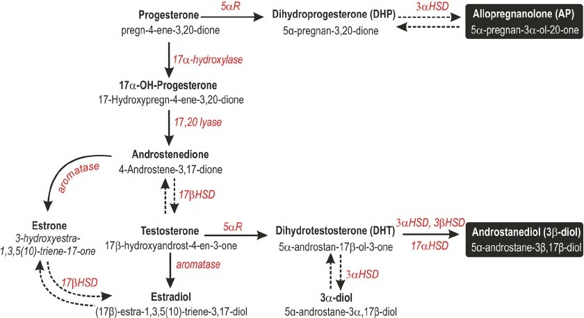
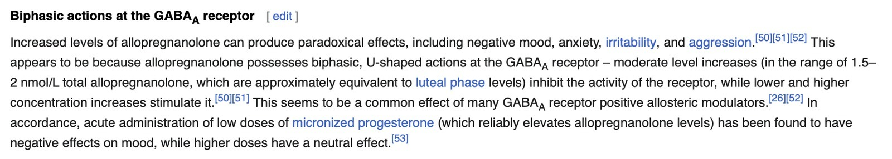
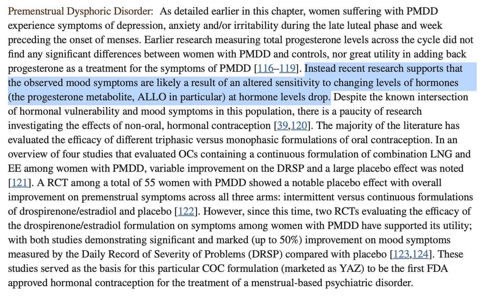
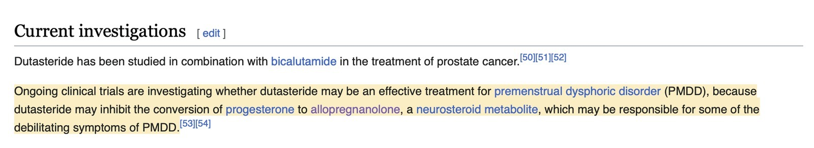
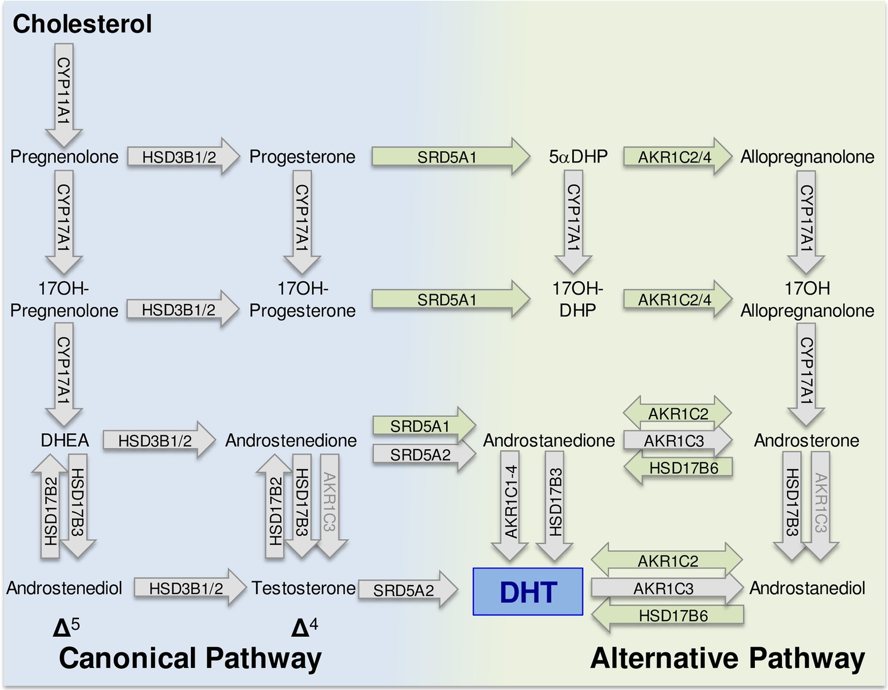

*Back to progesterone chemistry, because apparently I hadn't stared at enough enzyme diagrams yet. I wanted to understand how the different metabolites might fit together.*
{: .media-caption }

In the past week I have decreased my dose of progesterone to 100 mg twice daily (200 mg total). I have not had one incident of my brain feeling like it was on fire. Additionally, I am now taking my dose two hours away from any food. Because [pharmacokinetics](https://en.wikipedia.org/wiki/Pharmacokinetics_of_progesterone).

*One of the articles I was reading about allopregnanolone and GABA-A receptors. Interesting theories, but a highlighted webpage isn't proof of what caused my symptoms.*
{: .media-caption }

The Consumer Medicines Information (CMI) leaflet I was provided for my compounded progesterone was much less specific about food than the one for commercially available Prometrium.

[Exhibit one](/assets/uploads/progesterone-200mg-compounded-capsule-cmi.pdf), CMI for compounded progesterone. Delivered straight to my door from somewhere in Hinchinbrook, NSW.

> **Certain types of food may affect the way medicines work.**

[Exhibit two](/assets/uploads/prometrium-100-and-200-mg-published-by-mims-may-2022.pdf), CMI for commercially available progesterone (brand Prometrium).

> **Do not take Prometrium with food as this may affect the way Prometrium works.**

I remember reading both of these when starting progesterone and thinking, those are not the same. One was a general food warning; the other said not to take Prometrium with food. With most medications I'd taken, I assumed food would smooth things out. But a study of oral micronised progesterone found about twice the absorption with food. I couldn't put that exact figure on my compounded capsules, but so much for my assumption. Whoops?

*Another bit of reading about hormone fluctuations and mood, this time from the PMDD literature. It raised questions for me without providing a diagnosis.*
{: .media-caption }

Oral progesterone gets extensively metabolised on its first pass through the liver, producing neuroactive metabolites including allopregnanolone and pregnanolone. Add food to the mix and progesterone absorption can change again. What that meant for each metabolite in me, I couldn't tell. Great! Throw in changing levels and you're in for a treat.

*And yet another research rabbit hole: dutasteride and possible progesterone-metabolite effects. Very much a question for the endocrinologist, not a conclusion from this paragraph.*
{: .media-caption }

Probably worth noting that allopregnanolone acts on GABA-A receptors and can affect other neural signalling too. What happens when its levels drop? Could that be part of the brain fire? I hadn't measured neurosteroids or glutamate, so it was still a question. It **felt like excitotoxicity**, but I had no evidence of neuronal injury.

*And another progesterone pathway diagram to finish things off. By this point I had plenty of questions to take to my endocrinologist!*
{: .media-caption }

Realistically, I wanted to discuss another route of administration. Getting around some of the first-pass metabolism might change the metabolite profile, though it wouldn't dodge all the neurosteroids. I guess I'll have a word to my endocrinologist sometime in the near future. Stay tuned! 🙃

### Sources

- [Prometrium 100 mg and 200 mg: Consumer Medicine Information (MIMS, May 2022)](/assets/uploads/prometrium-100-and-200-mg-published-by-mims-may-2022.pdf)
- [Oral Micronised Progesterone Absorption (Food, Dose and Intramuscular Comparison)](https://pubmed.ncbi.nlm.nih.gov/8513955/)
- [Low-Dose Oral Progesterone Pharmacokinetics (Allopregnanolone and Pregnanolone)](https://pubmed.ncbi.nlm.nih.gov/16406399/)
- [Estradiol and Progesterone Metabolite Profiles (Oral vs Vaginal Administration)](https://pubmed.ncbi.nlm.nih.gov/8515718/)
- [Allopregnanolone, PMDD and GABA-A Receptor Sensitivity](https://pmc.ncbi.nlm.nih.gov/articles/PMC7231988/)

### Related Posts

- [Me, Myself and Progesterone](/me-myself-and-progesterone/)
- [Depression, Debt, Bees and Lizards](/depression-debt-bees-and-lizards/)
