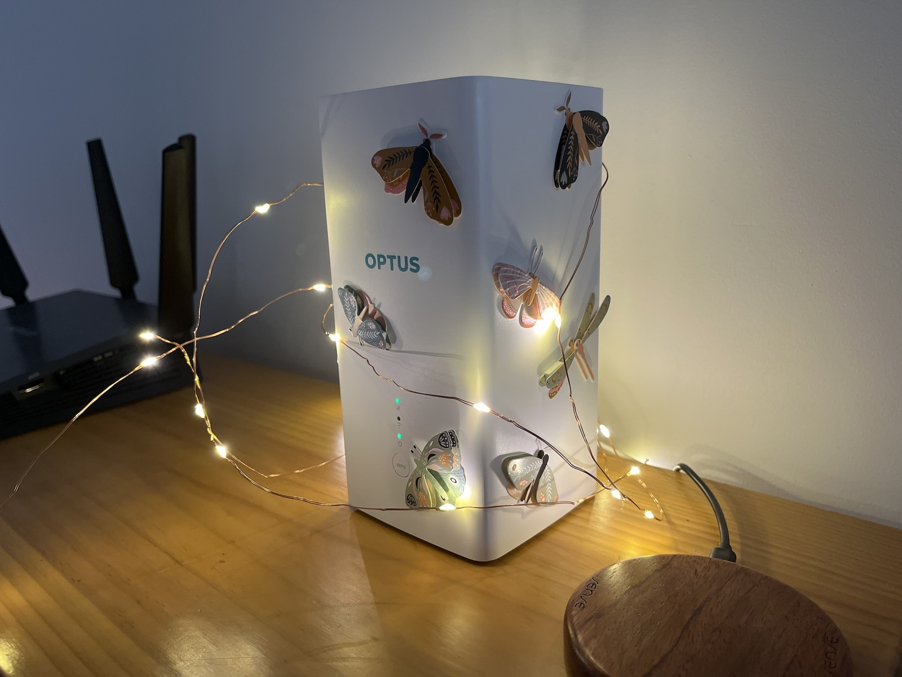

*A little bit of fairy-lit butterfly nonsense for the desk. Even the Optus modem deserved some cheerful decoration after that month.*
{: .media-caption }

Let me preface this by saying it has been a very long month. I have been experiencing bits of euphoria here and there - when they hit, it makes me grateful I didn't kill myself as planned. The CAPTCHA below was one of those moments. This post is just a quick life update with some pretty photos. I haven't forgotten about my most recent blood tests - I'll get to them in a future post. For now, let's look at where I am at in life! 🦂

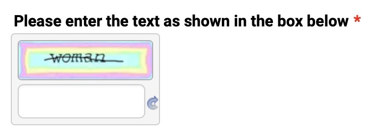

*The CAPTCHA said 'woman', and I couldn't have been happier about something so ridiculous. Sometimes the smallest things bring the biggest smile.*
{: .media-caption }

My transgender journey continues. I'd be lying if I said I was on top of this. There's just so much that I need to work on. I'm trying to prioritise what I consider to be the most important tasks. My name change is mostly complete now. I am loving my new name. **Phoenix**. The nicknames it can give are just amazing. Pho, Hoe, Enix, Nix, Nixie. It's the perfect name as far as I'm concerned.

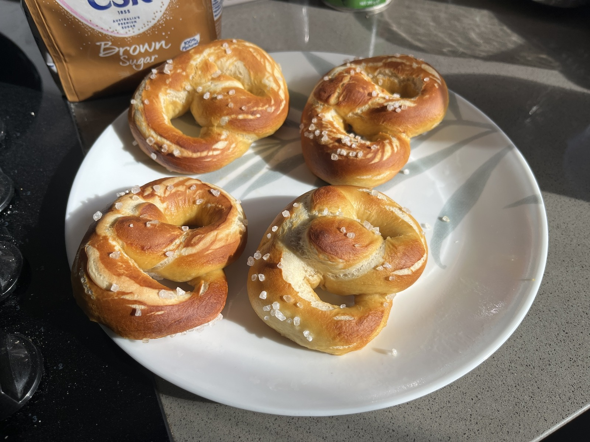

*Four homemade pretzels, all shiny and liberally salted. I'm starting to think these are becoming a bit of an obsession!*
{: .media-caption }

Gender marker changes, i.e. male to female, were proving a bit more difficult. In May 2024 NSW still required a sex affirmation procedure and two medical declarations to change a NSW birth certificate. **Even Queensland** had passed legislation moving away from that, although it wouldn't start until 24th June 2024. Yes, the one with all the crocodiles.

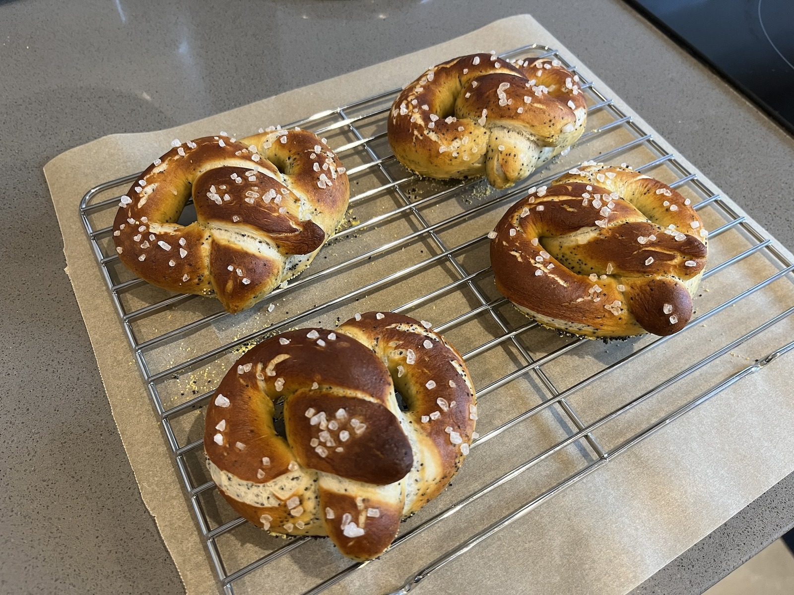

*And here's another batch of pretzels fresh onto the cooling rack. Slightly different shapes, same enthusiastic approach to the salt!*
{: .media-caption }

I am still in therapy, which is going well. Does anyone ever really leave therapy? Not really. It's providing me insight into subtle gender dysphoria signs I had never truly realised. Coupled with a little bit of pregabalin (Lyrica) I have made some affirming breakthroughs, cracking open some repressed memories.

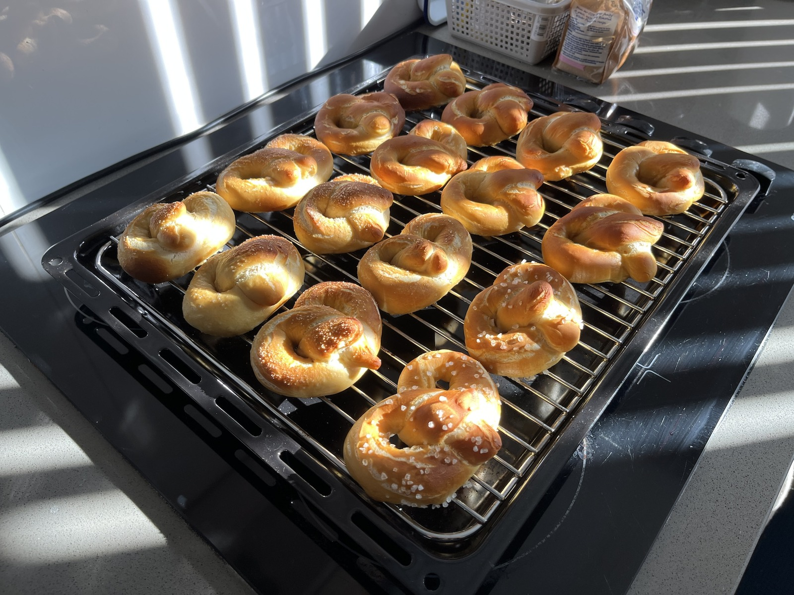

*Another whole tray of pretzels! Clearly the obsession had moved beyond making four at a time.*
{: .media-caption }

And I'm pretty sure that in hindsight, having a desire to take your girlfriend's birth control pills is not a very cisgender thought. If only I had known more about transgender people while growing up. Things would have been a bit different. I just thought I might have been gay for a bit. Well turns out that wasn't **quite** right. I mean I am **definitely** gay now, but as a transgender woman.

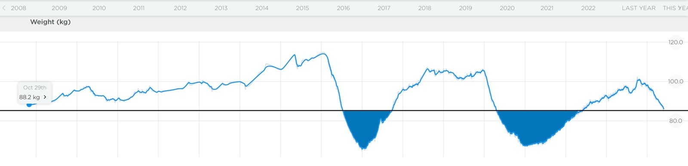

*My weight history going all the way back to 2008. Those blue patches are the stretches when I weighed less than at the time of this post.*
{: .media-caption }

Weight loss is continuing to march in the right direction. Meals have been cut back to two a day, one at 11 am and one at 5 pm. This seems to work well so far. Looking at the image above, the shaded areas are times when I was under the weight I am now. Some rough pixel maths says one year is 510 px.

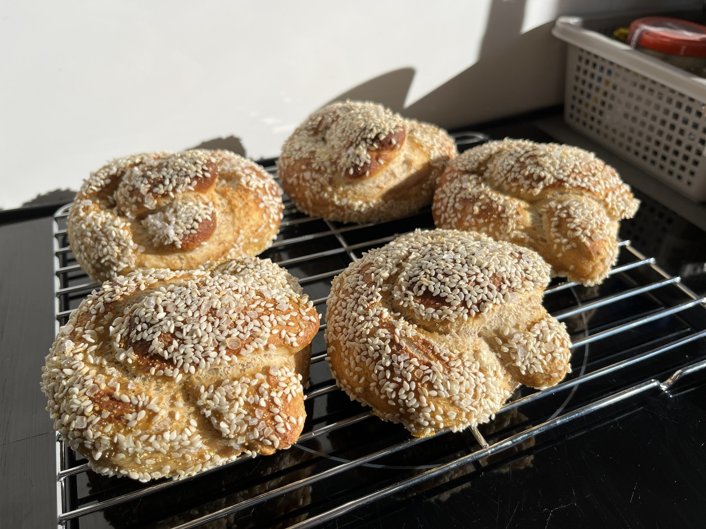

*The pretzel experiments continued, this time with a truly impressive amount of sesame seeds. I may have got carried away.*
{: .media-caption }

In the 2016-2017 range, I was at or below my current weight for around 14 months. Between 2020-2022 I was at or below my current weight for 25 months. That's around three years of being less weight than I am now since data collection started way back in 2008, pretty neat!

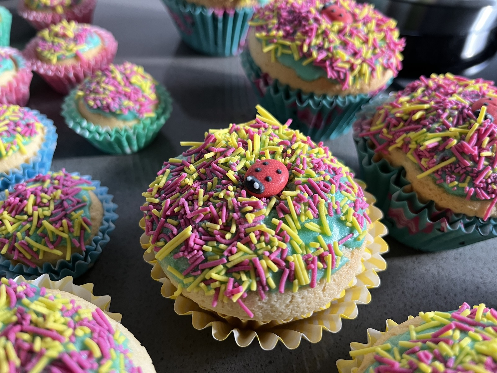

*Cupcakes with enough pink and yellow sprinkles to decorate the entire kitchen, plus a tiny ladybird on top. Subtle, as always!*
{: .media-caption }

Losing weight while transitioning might not be the best idea, the two just happened to begin at the same time. I guess one is a reason to live as my true self and the other makes the still alive me a healthier person. It's interesting to see how the rate of weight loss has slowed compared to previous periods. Not sure if this is estradiol messing with my metabolism or maybe just because I keep eating pretzels and cupcakes...

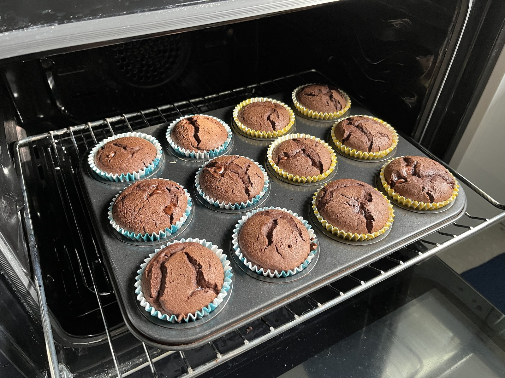

*Another batch of chocolate muffins fresh from the oven. Apparently cutting back on meals didn't mean cutting back on baking!*
{: .media-caption }

That's not to say that being healthier and baking bread and cake goods are incompatible. At the moment I'm almost reverse-engineering the pretzels into regular wholemeal bread. To think, I was just trying to make it an easier (or lazier) recipe. Don't worry once they are ready I'll be sure to add a new recipe post. Most of the recipes will be vegan. Eggs or dairy milk are no longer ideal. I'm back on the path to being as vegan as I can... bee. Haha!

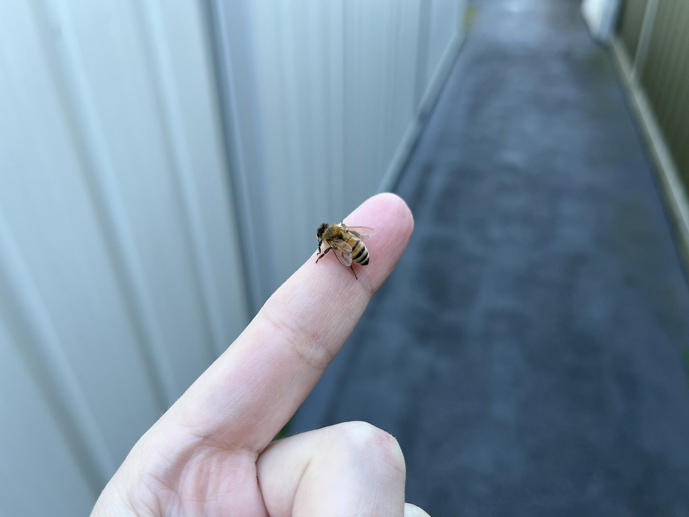

*One of the little honey bees resting on my finger. I was getting much more comfortable picking them up and giving them a chance to warm up.*
{: .media-caption }

A positive side effect of being vegan means I have to stop eating bees. This means instead of eating them, I can get better at handling them. Flow-on effects include helping me gain a new respect for the local paper wasps. It's almost winter here, so many of the seasonal paper-wasp colonies are winding down and surviving queens may be overwintering. The European honey bees on the other hand are still out and about. Individual bees stranded away from the hive can become cold and nearly motionless overnight. Sometimes popping one in the sun is enough for it to warm up and take flight again.

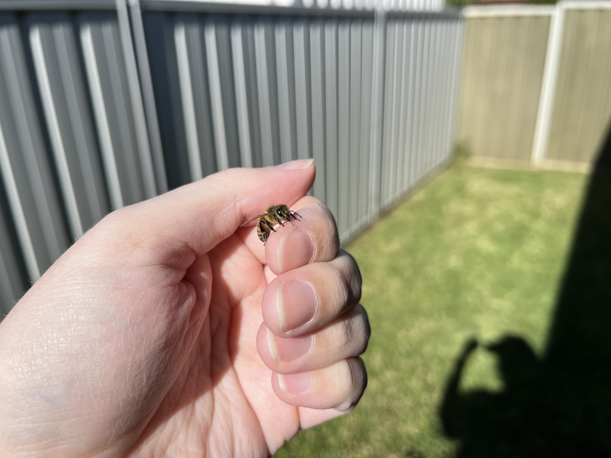

*Another honey bee on my hand, looking rather small against all that grass. I still couldn't tell why some of them were struggling.*
{: .media-caption }

Not all is well though, the most common failure pattern I have seen so far looks neurological: all the legs spasm, work normally for a while, then spasm again. Could it be pesticide poisoning? Those signs aren't specific enough for me to know just by looking at a bee. To prevent prolonged suffering, these little ones are mechanically destroyed. It hurts. **Every. Single. Time.**

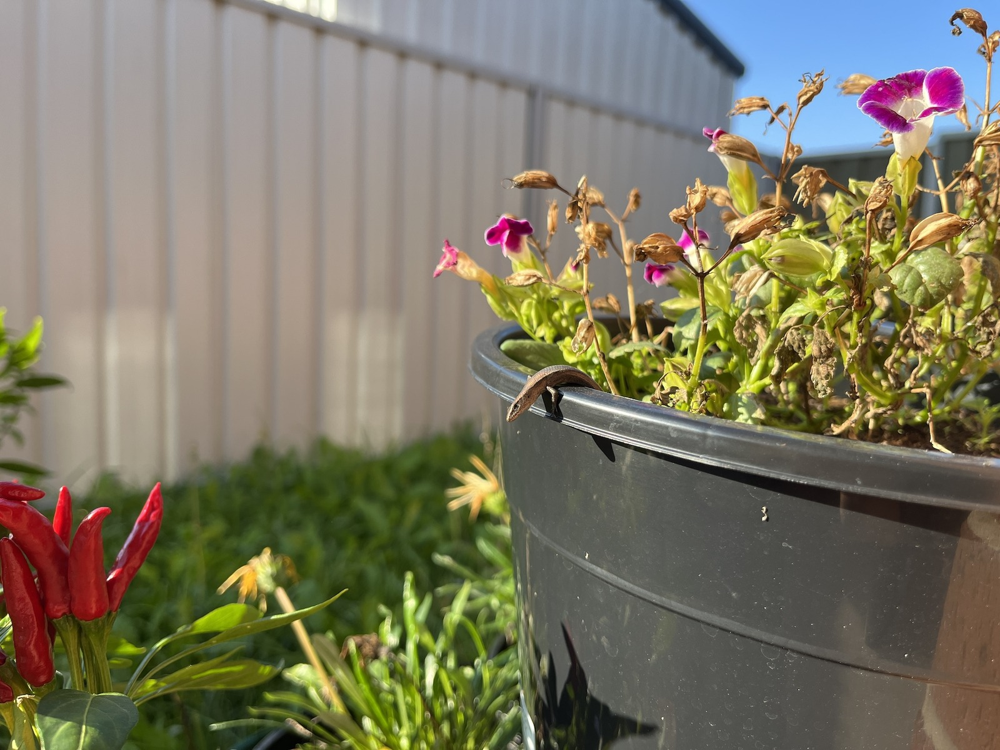

*A little skink keeping an eye on things from the edge of the flowerpot. They really do turn up everywhere in this garden!*
{: .media-caption }

Another one I found seemed to have problems with the two front pairs of legs. Poor thing couldn't clean itself. A little bit of digging led me to [slow bee paralysis virus (SBPV)](https://en.wikipedia.org/wiki/Slow_bee_paralysis_virus), which can cause front-leg paralysis and be transmitted by Varroa destructor. Was that what I was seeing? I couldn't tell just by looking.

And look at that vector, Varroa destructor. By then the national response had already moved from eradication to management: in September 2023 the National Management Group concluded eradication was no longer technically feasible. I still called that the government giving up. The February 2024 transition plan was about slowing its spread and helping the honey-bee industry manage it. Australian native bees aren't affected by the mite itself.

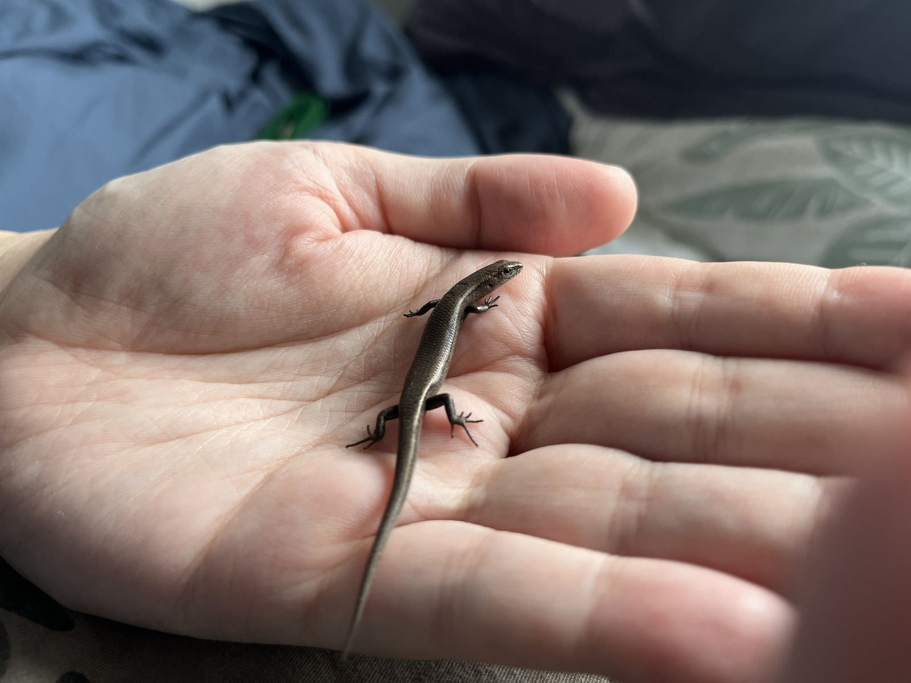

*A tiny skink having a brief visit to my hand. Not quite a university application, but probably more enjoyable!*
{: .media-caption }

On the employment and study front, I do not miss trading my time for pay that has very little benefit. The balance sheet is broken. Too many cons, too few (if any) pros. The benefit is just not there anymore. My life goals have shifted and I can leave any time I want.

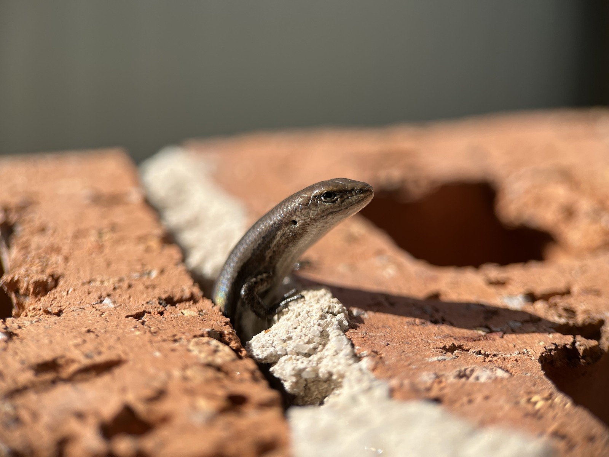

*And another little brick-dwelling skink! These holes look like a pretty good hideaway for such tiny creatures.*
{: .media-caption }

With that in mind, I guess I'll head back to university for the 18th time. I've literally picked a degree based on a dream I had. Quite a euphoric dream too, I saw my future self (in the third person) doing work in bushland. Regeneration? Documenting life as it existed during the Holocene (or Anthropocene) extinction event? Who knows. All I do know is that I'm just biding my time for now. What does the future hold? Who knows! What is a girl to do? 🤷‍♀️

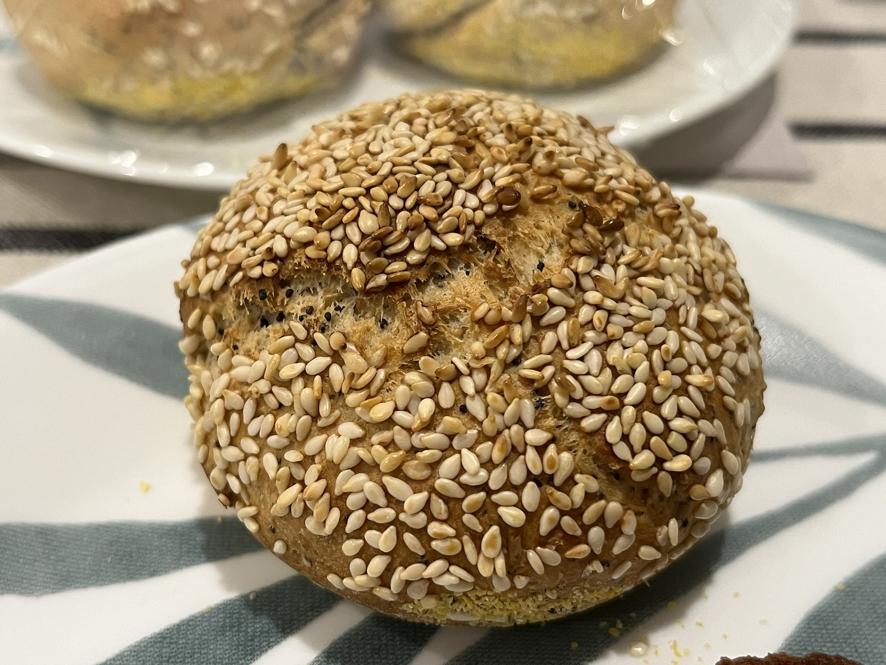

*One last baked creation for this post: a bread roll so covered in sesame seeds you can barely see the bread. I regret nothing!*
{: .media-caption }

**Footnote:** I picked up some fully hectic debt. And now I'm trying to kick pregabalin again. Incredible how quickly physiological dependence seemed to happen **for me**. Withdrawal symptoms after both short- and long-term pregabalin use are recognised, so this was another reminder that "prescribed" does not mean "effortless to stop". I can rest, errr-somewhat-uneasily-thanks-to-pregabalin-withdrawal-induced-insomnia, knowing that the psychiatrist who prescribed them **for sleep** is now retired. I think I'll be ready for mid-year intake at uni in... late July. I best do some exposure therapy at the uni before my first day there... bring it on! 🦎

**Update 2025:** NSW removed its medical-procedure requirement for changing a birth certificate from 1st July 2025. Australian national baseline testing in 2025 also found no evidence of slow bee paralysis virus in the samples tested.

### Sources

- [NSW Births, Deaths and Marriages Registration Act 1995 - historical version](https://legislation.nsw.gov.au/view/whole/pdf/inforce/2024-11-08/act-1995-062)
- [NSW Government - Change of sex](https://www.nsw.gov.au/family-and-relationships/name-changes-and-corrections/change-of-sex)
- [Queensland: Births, Deaths and Marriages Registration Act 2023 (Version 24 June 2024)](https://www.legislation.qld.gov.au/view/pdf/2024-06-24/act-2023-017)
- [NSW DPI - Varroa mite](https://www.dpi.nsw.gov.au/emergencies/biosecurity/current-situation/varroa-mite-emergency-response)
- [USDA APHIS - Slow Bee Paralysis Virus case definition](https://www.aphis.usda.gov/sites/default/files/slow-bee-paralysis-virus-case-definition.pdf)
- [National Varroa Mite Management Program - National Baseline Project](https://www.varroa.org.au/baseline)
- [TGA - Pregabalin and gabapentin](https://www.tga.gov.au/safety/safety-monitoring-and-information/safety-alerts/pregabalin-and-gabapentin)

### Related Posts

- [Depression, Debt, Bees and Lizards](/depression-debt-bees-and-lizards/)
