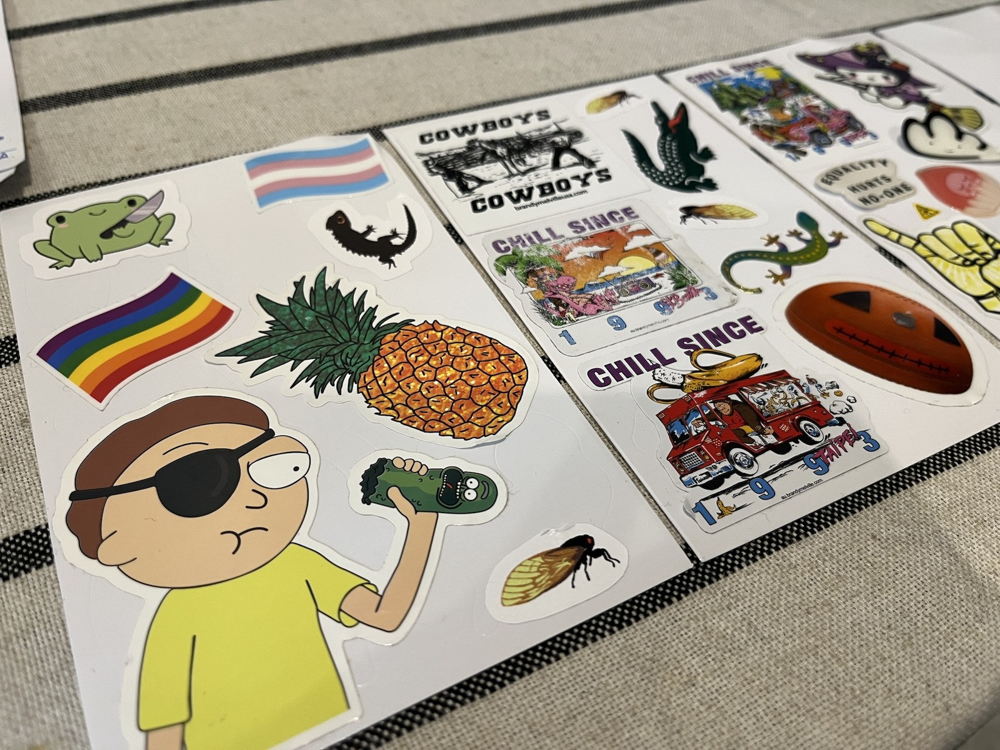

*A little collection of stickers to brighten the place up. Pride flags, cicadas, lizards, a pineapple, and plenty of other nonsense. Perfect!*
{: .media-caption }

Ahhhhh yes, now where was I? I've corrected my spiralling debt thanks to an early release of superannuation due to financial hardship. Taking away from future me isn't too bad - especially as future me shouldn't really exist. The fact that present day me exists is surprising to... me. For now I'm past that.

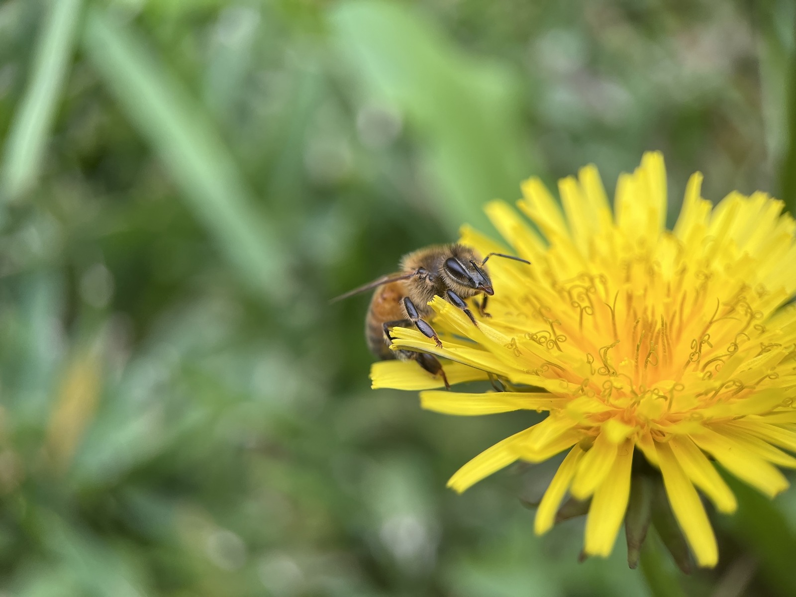

*At least the bees were still out doing bee things. This one was making excellent use of a bright yellow flower.*
{: .media-caption }

I've hit a bit of a problem with the ever-fast-approaching start of university. I can't handle groups of people. Groups of people I don't know anyway.

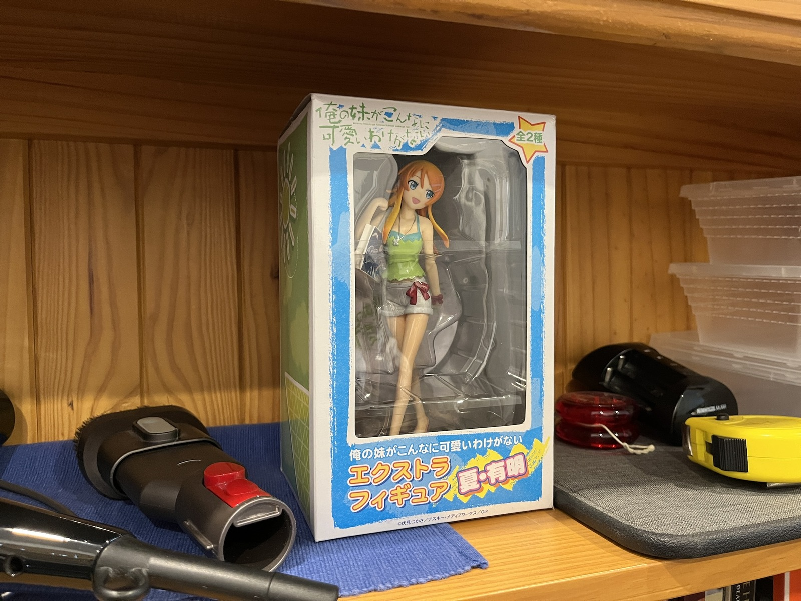

*A boxed figurine on the shelf, keeping me company while I try to make some sense of the great university adventure.*
{: .media-caption }

I have trialled visiting a gender therapy group repeatedly and either break down and fail to leave or get to the group, enter the building and... panic. I then escape the situation. [Fear extinction](https://en.wikipedia.org/wiki/Fear_conditioning) will be difficult to achieve - especially in such a short time before university starts.

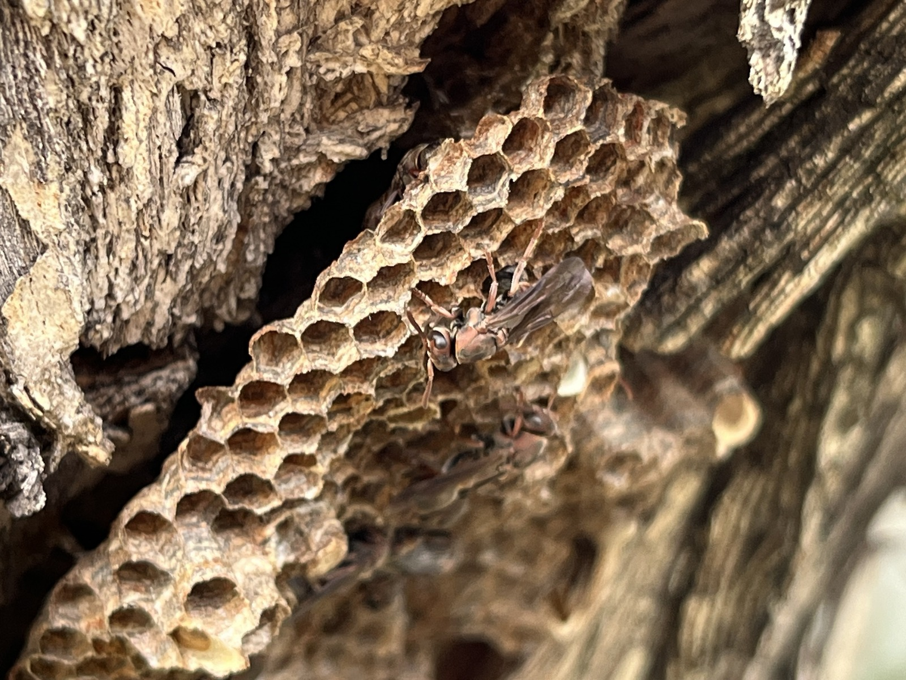

*A very close look at one of the local paper wasps on its nest. They're fascinating little things, even if I'd rather not get too close!*
{: .media-caption }

Doing nothing now will likely result in me deferring until 2025. In an effort to mitigate this I tried to restart antidepressants. I picked out the least side effect riddled one. In my case, that would be [duloxetine](https://en.wikipedia.org/wiki/Duloxetine) (Cymbalta), an [SNRI](https://en.wikipedia.org/wiki/Serotonin%E2%80%93norepinephrine_reuptake_inhibitor).

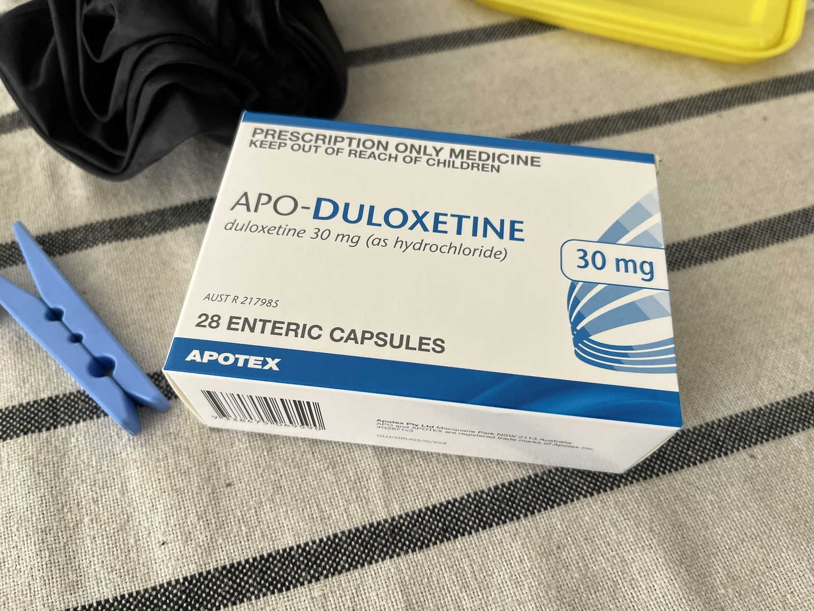

*A box of 30 mg duloxetine. I was hoping another antidepressant trial might make things easier, but the side effects had other ideas.*
{: .media-caption }

And no. I can't even. [Unrelenting bruxism 24/7](https://journals.sagepub.com/doi/10.1177/2320206821992534). At the lowest dose. [Every damn time](https://pmc.ncbi.nlm.nih.gov/articles/PMC6698238/). Bruxism is a known side effect of serotonergic antidepressants, but that still doesn't tell me why I've had such a rough time with them. Great. So where to from here?

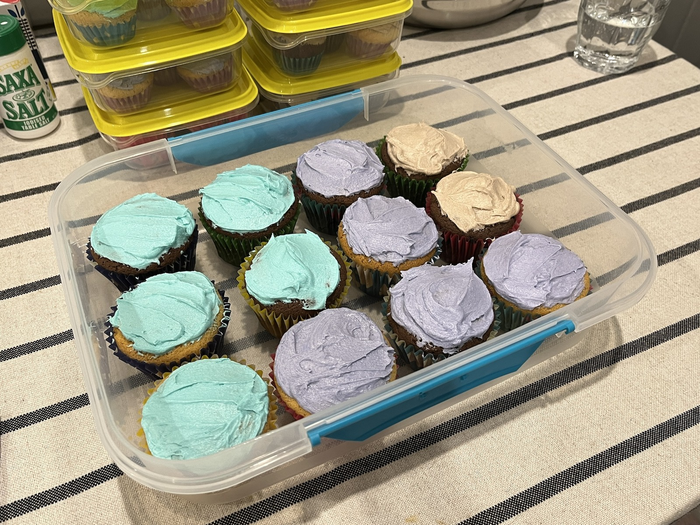

*Cupcake production continued despite everything else going on. Clearly the kitchen wasn't taking any time off!*
{: .media-caption }

My anxiety seems to fuel my depression and seems to be specific to interacting with groups of people. Of course there are the drugs that no one wants to prescribe because they are bad for you. Mainly drugs in the [barbiturate](https://en.wikipedia.org/wiki/Barbiturate) and [benzodiazepine](https://en.wikipedia.org/wiki/Benzodiazepine)\-classes. I would argue that killing myself is also bad for me. I would rather feel better some of the time than none of the time. They are not available to me, so...

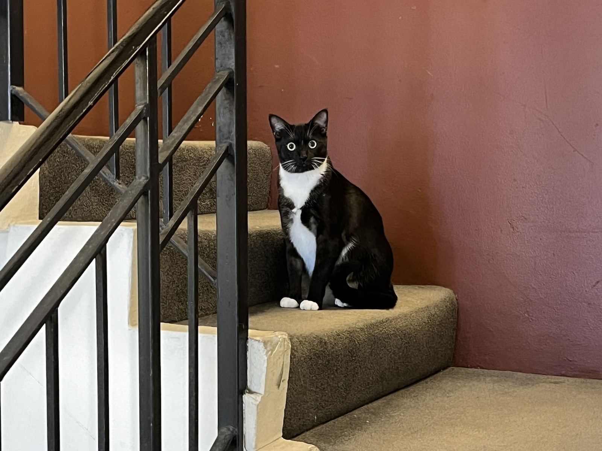

*A very serious-looking tuxedo cat on the stairs, apparently wondering what on earth I'm doing.*
{: .media-caption }

I'm trialling [bupropion](https://en.wikipedia.org/wiki/Bupropion) (Zyban, Wellbutrin), a norepinephrine-dopamine reuptake inhibitor (NDRI). Little direct effect on serotonin, and no bruxism for me. It might help my anxious depression, although pooled trials found a modest advantage for SSRIs when anxiety was high. For the first two weeks everything felt magical and stimulating. My little honeymoon period. I was waiting for [receptor down-regulation](https://en.wikipedia.org/wiki/Downregulation_and_upregulation), though I couldn't tell whether receptors explained any of that. Now I wait and see whether the benefit lasts.

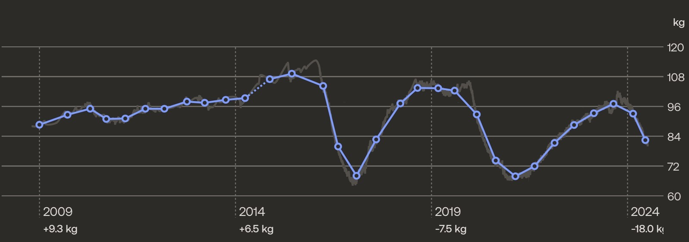

*The long-running weight chart, now showing another substantial drop towards 2024. A lot has happened since those earliest readings!*
{: .media-caption }

In other news I've scraped the top end of the so-called healthy [BMI](https://en.wikipedia.org/wiki/Body_mass_index) range. BMI isn't the absolute best measure of health, but going from 34.8 to 24.8 was a pretty substantial change in my weight. I was also thinking about cycling my weight to see whether GAHT changed where I regained fat. Would it help with redistribution? I didn't know whether that would work.

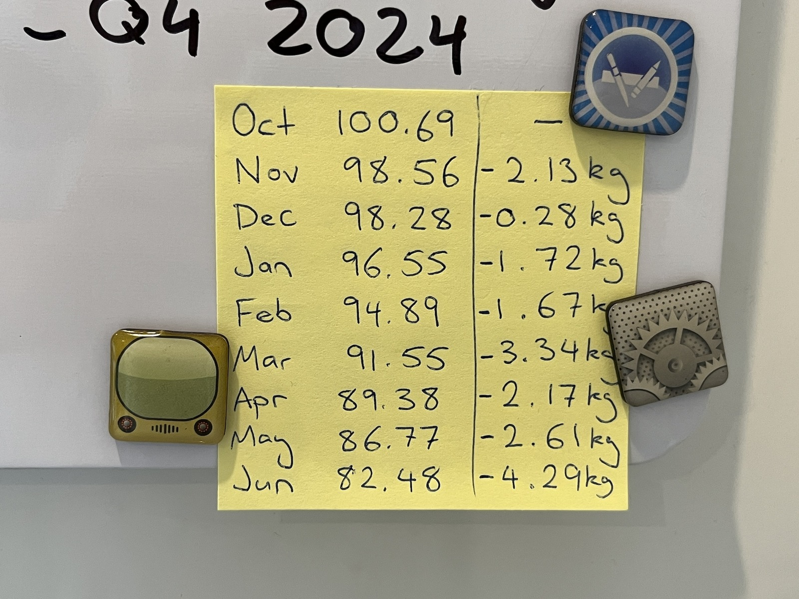

*My decidedly low-tech weight tracking: one yellow sticky note, a few magnets, and plenty of monthly scribbles. October to June was quite a journey!*
{: .media-caption }

What an excellent segue into the medication side of things for being a transgender woman. I've been monitoring a few things over the past month or so.

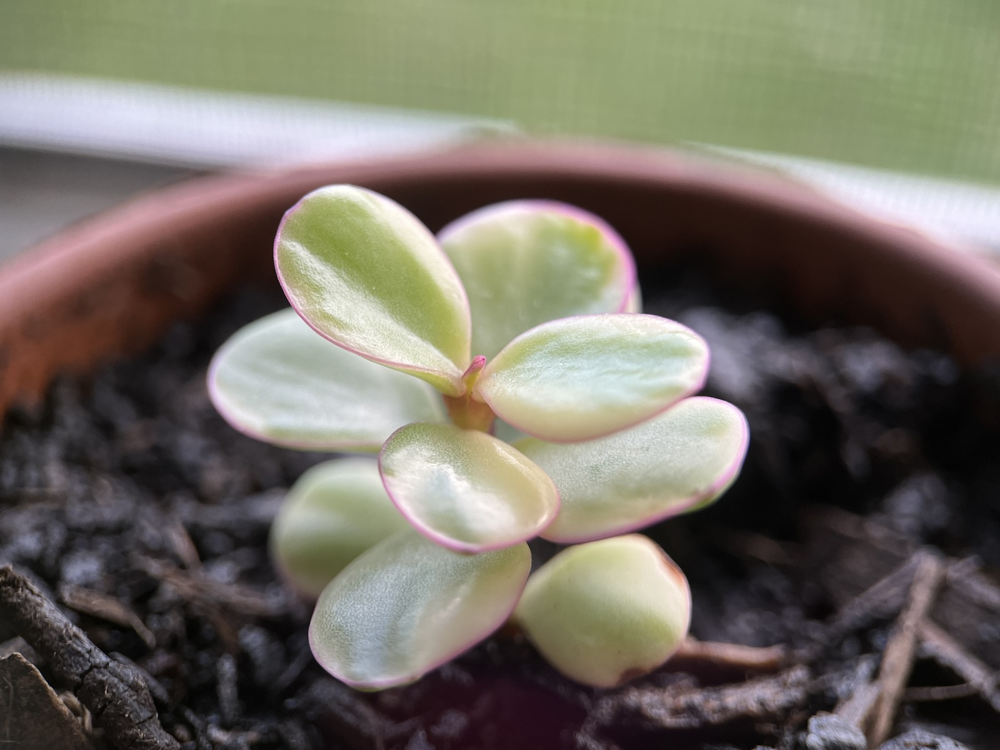

*A tiny new succulent with pink-edged leaves. At least the little plants weren't asking me to work out complicated hormone pathways!*
{: .media-caption }

[Progesterone](https://en.wikipedia.org/wiki/Progesterone_(medication)) is expensive and I am poor. So I had been comparing compounded progesterone with commercial Prometrium. At 400 mg/day split twice daily and measured in the trough, the compounded version gave me slightly higher numbers on one set of tests. Nice on paper, but that couldn't tell me whether the products were equivalent. Food, formulation and release characteristics can all change what gets absorbed and when.

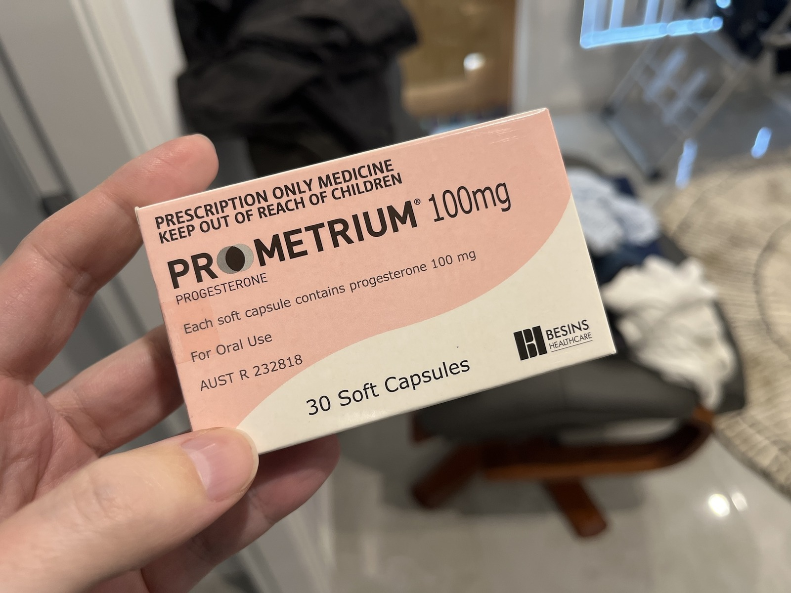

*The commercially available Prometrium 100 mg capsules, which I was comparing with compounded progesterone. My wallet certainly noticed the difference.*
{: .media-caption }

However, there was one unexpected effect I appreciated. When I took oil-based Prometrium 200 mg with food, I got a short-lived sedated, mildly euphoric feeling that reminded me of 4-5 mg of diazepam. The food part matters: it increases absorption, and the Prometrium leaflet says not to take it with food. I also noticed the effect after stopping finasteride. My best guess involved progesterone-derived neurosteroids such as [allopregnanolone](https://en.wikipedia.org/wiki/Allopregnanolone), though I hadn't measured those.

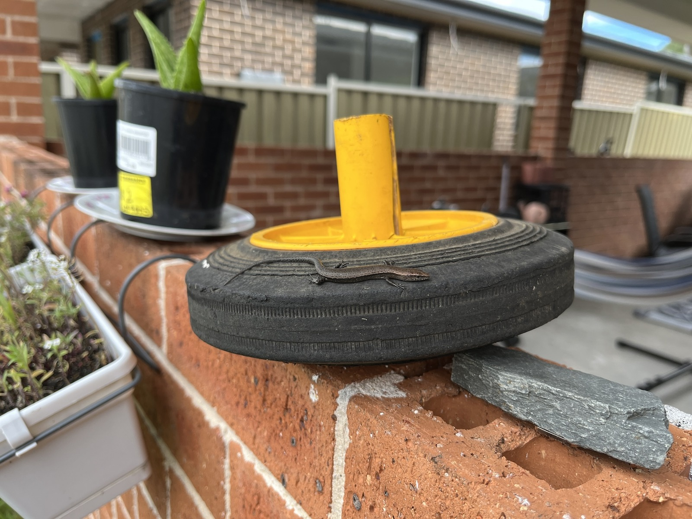

*Meanwhile, the garden skinks were busy making themselves at home. This one found a rather unusual perch on a little rubber wheel.*
{: .media-caption }

For a few hours each day, at a big hit to my wallet, I can leave my anxiety behind and actually get things done. It's a very desirable side effect for me. For now I am not taking any progesterone to retest my baseline - it should be very low but not quite zero.

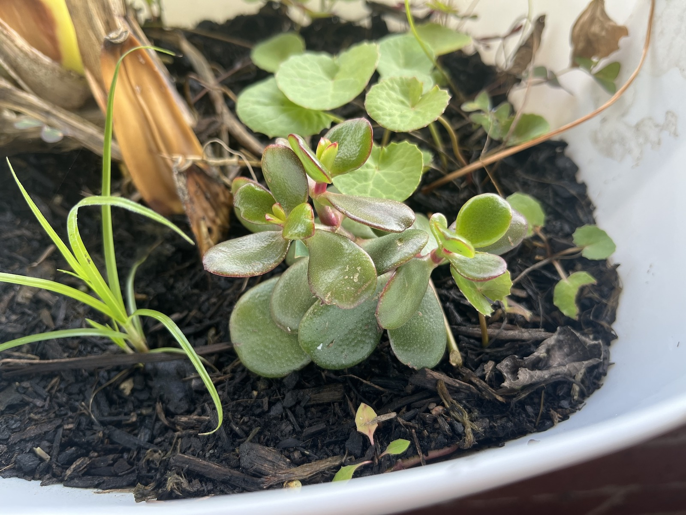

*More little succulent growth, this time surrounded by weeds and seedlings. Not much to look at yet, but I was keeping an eye on it.*
{: .media-caption }

One of the reasons for retesting my baseline was a pretty big confounding factor: I was now taking modified-release compounded progesterone. Comparing that with immediate-release Prometrium was getting messy. Over one week I increased the modified-release dose to 800 mg/day to see whether anything changed. Nothing. No positive mental effects, no negative ones either. That was a very high dose, and any further dose experiments needed to go through my prescriber. It still didn't tell me whether the formulations were equivalent.

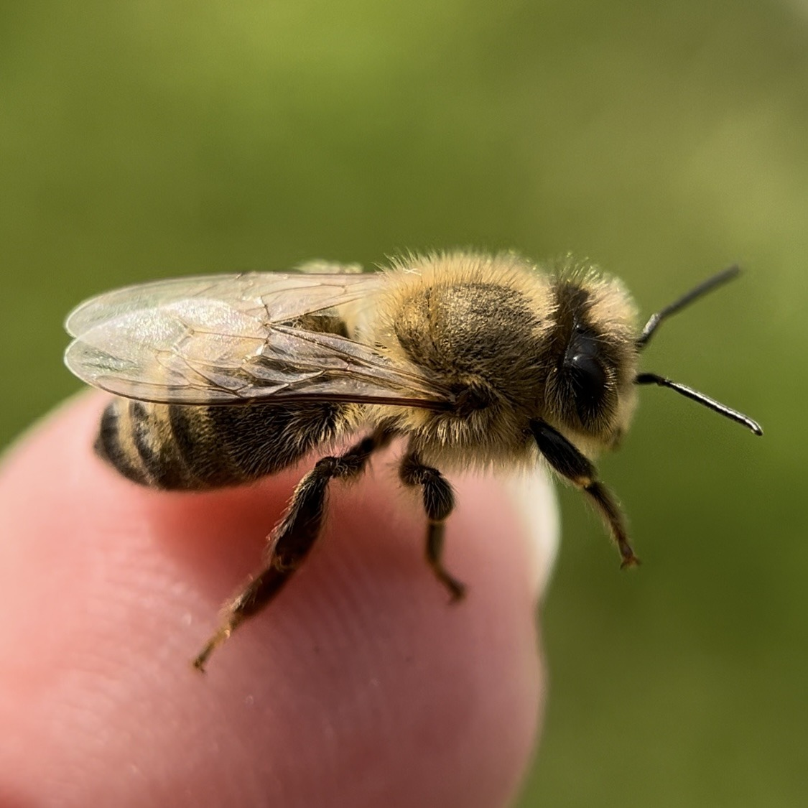

*A close-up of one of the honey bees I was looking after. Those tiny fuzzy faces are rather hard not to adore.*
{: .media-caption }

I'm also checking serum [DHT](https://en.wikipedia.org/wiki/Dihydrotestosterone). That can tell me about what's circulating, though it won't tell me exactly what's happening inside a hair follicle. I was mainly looking for shifts in steroid precursors on progesterone versus off progesterone. I'll do another post when I have additional data.

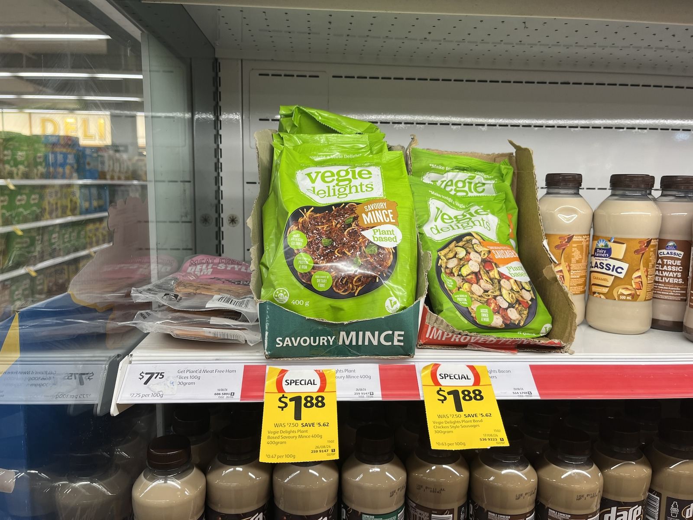

*A little supermarket bargain on plant-based food. The bright yellow special stickers were rather hard to ignore!*
{: .media-caption }

It was also neat to see what my [estradiol](https://en.wikipedia.org/wiki/Estradiol_(medication)) levels were soon after another set of pellets was implanted. I scored just over 1500 pmol/L at about one week, compared with roughly 700 pmol/L before the newest implants, and around 1200 pmol/L another three weeks later. I'd called anything above 400 pmol/L "gravy", but more isn't automatically better. The Australian guidance I was using targeted roughly 250 to 600 pmol/L, adjusted to clinical response, so those early post-implant levels were above that range.

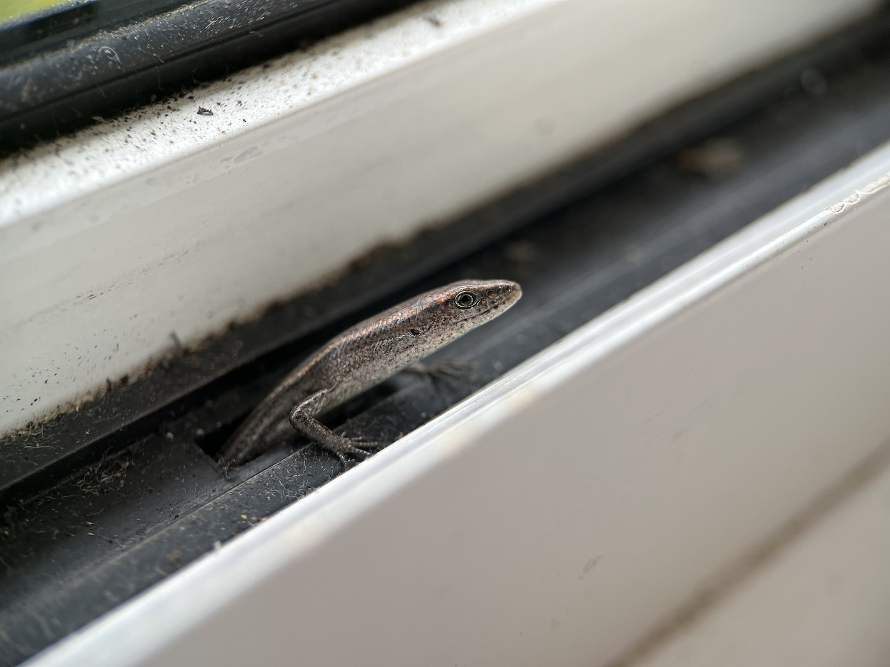

*A skink emerging from the window track, because apparently every gap is a potential lizard home. Such cute little opportunists.*
{: .media-caption }

See what the bupropion made me do? This post is massive. Oh well, until next time! 🥰

### Sources

- [Bupropion Versus SSRIs for Anxious Depression (Pooled Analysis of 10 Studies)](https://pubmed.ncbi.nlm.nih.gov/18605812/)
- [Prometrium 100 mg and 200 mg: Consumer Medicine Information (MIMS, May 2022)](/assets/uploads/prometrium-100-and-200-mg-published-by-mims-may-2022.pdf)
- [AusPATH: Hormonal Management of Transgender and Gender Diverse Adults (Position Statement)](https://auspath.org.au/wp-content/uploads/2023/01/mja250259-position-statement-adult-transgender-2022.pdf)
- [Standards of Care for Transgender and Gender Diverse Health (Version 8)](https://pmc.ncbi.nlm.nih.gov/articles/PMC9553112/)

### Related Posts

- [Mon Mothma Was a Deejay](/mon-mothma-was-a-deejay/)
- [Me, Myself and Progesterone](/me-myself-and-progesterone/)
- [Progesterone Consumer Medicines Information (CMI)](/progesterone-consumer-medicines-information-cmi/)
- [Third Time's a Charm; University Begins... Again](/third-times-a-charm-university-begins-again/)
