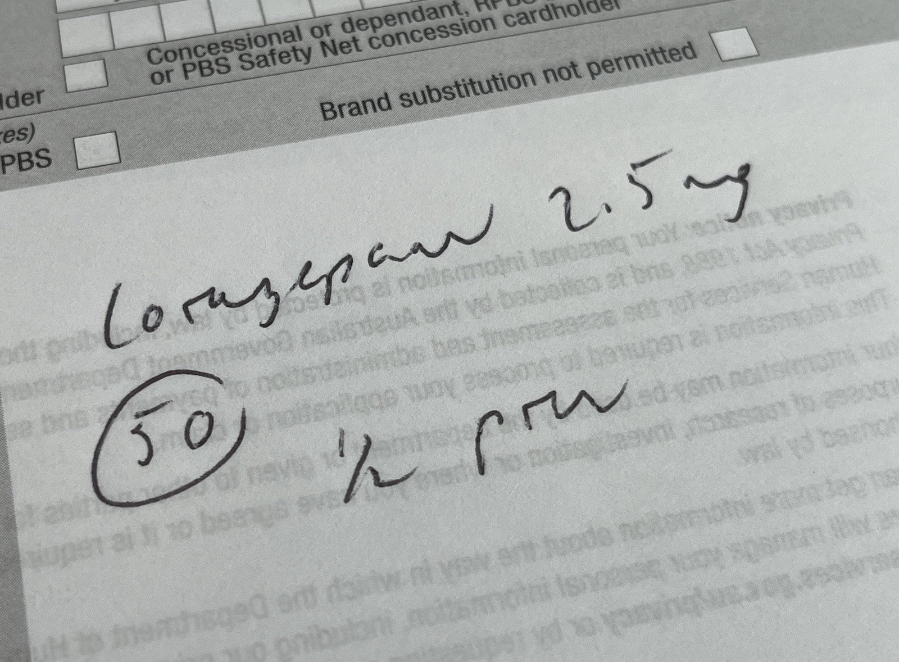
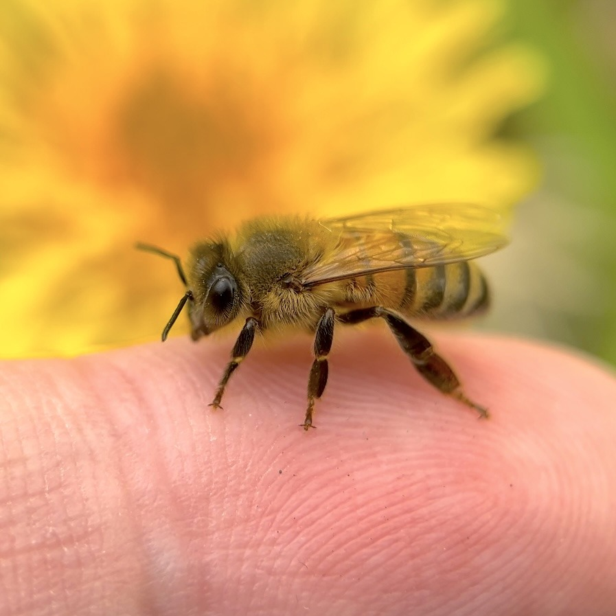
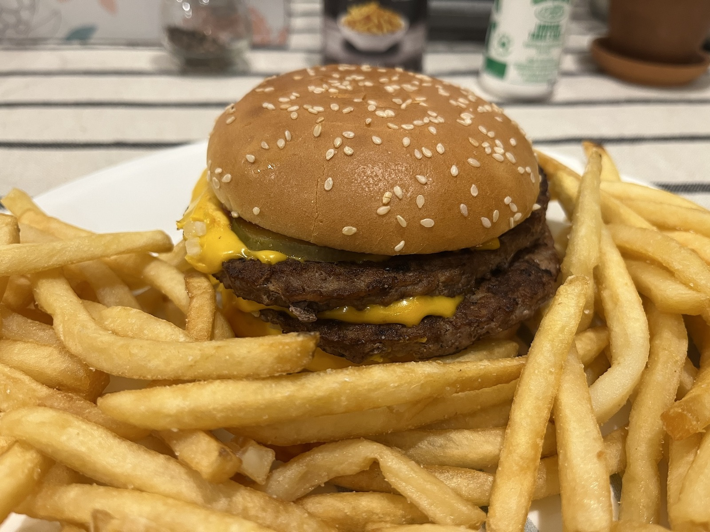
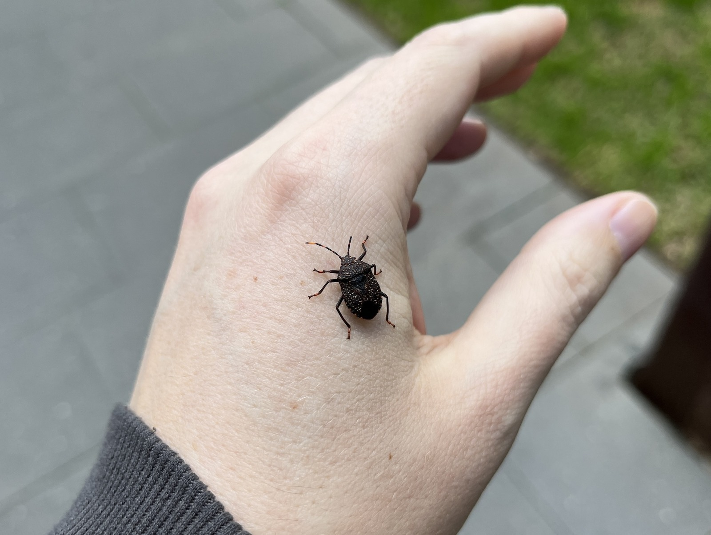
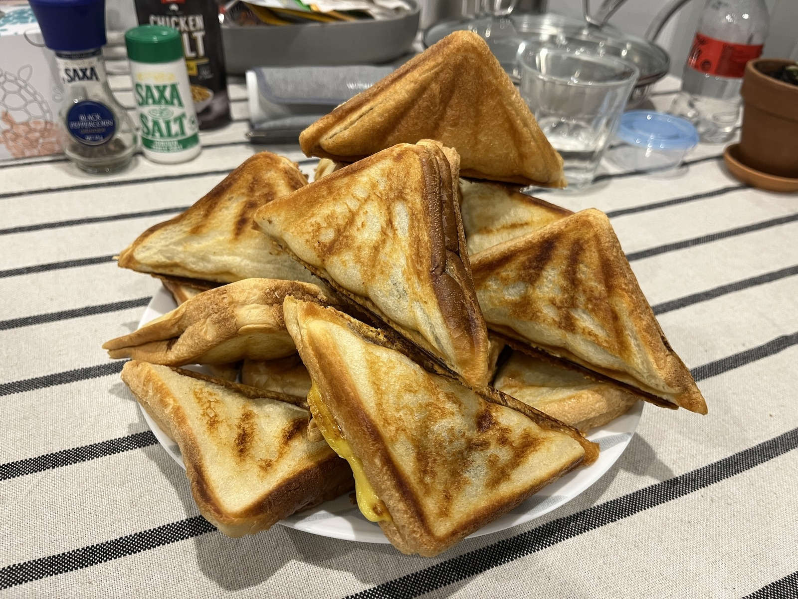
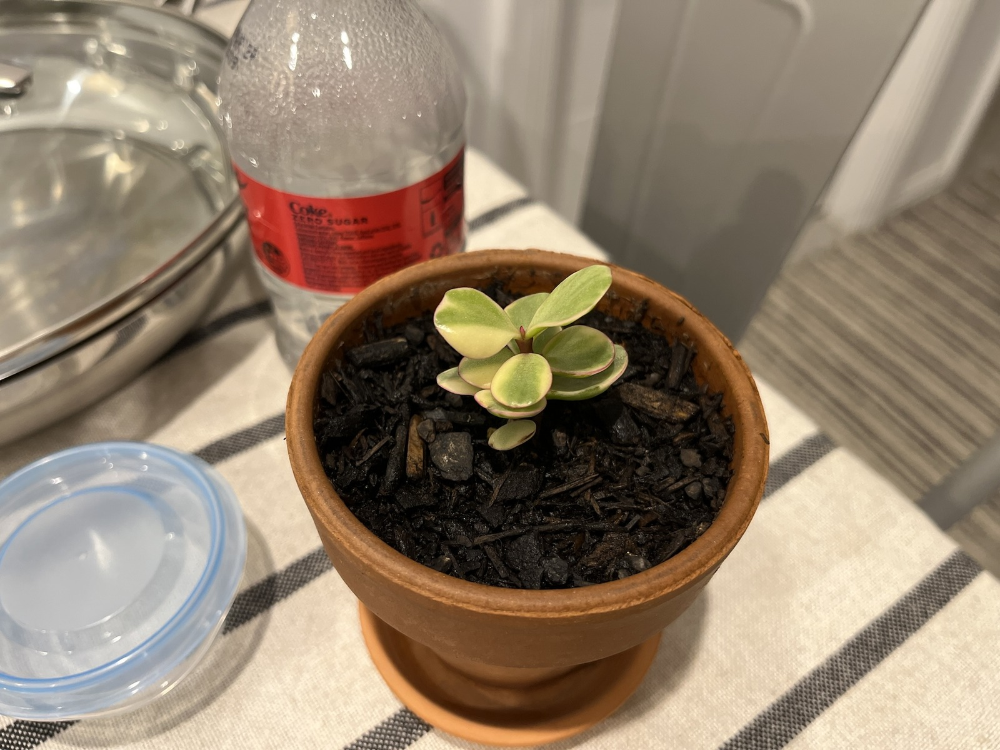
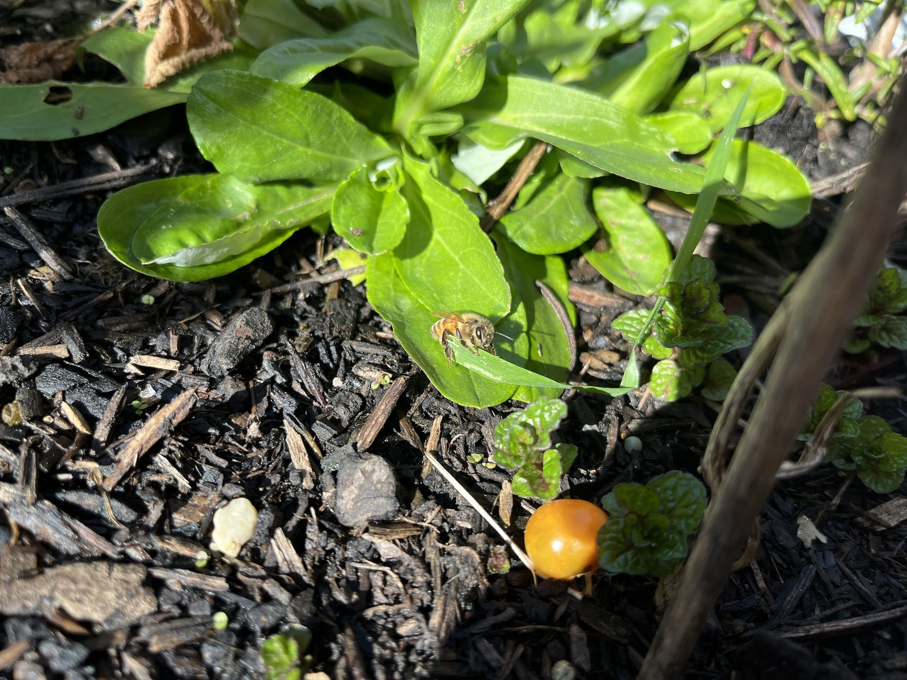

*Orientation week at UTS! The wind was doing marvellous things to my hair, and I was trying to convince myself that going back to university was a sensible idea.*
{: .media-caption }

Orientation week has started at university. The only thing I've seen so far were queues. Although, I did get to direct two people to the great hall. That wasn't terrifying. So why the hell can't I deal with groups?

*Some very hurried prescription handwriting for lorazepam. The medical part of getting myself to university was proving rather more complicated than I'd hoped.*
{: .media-caption }

Let's look at the medications I am on. Bupropion is gone now. It killed my emotional range. After being off it for a few days I can cry again. Which is great. It also caused me to get crazy hungry, I would just attack all the snacks - perhaps it was stress eating, perhaps it was a combination of the two.

*And of course, another little bee. At least they didn't seem to mind how much I was carrying around in my head that week.*
{: .media-caption }

We've got lorazepam 2.5 mg, a benzodiazepine, which I've been splitting in half and taking a few hours apart to have a greater effect over a longer period of time. And only taking as needed - very important. However, it just doesn't feel like it's enough. Today I added half a propranolol, 5 mg, as 10 mg was making me far too fatigued. A casual walk up and down stairs should not make a person sweat violently.

*A double cheeseburger and an enormous pile of chips. Apparently I was hungry enough to photograph my lunch as well as think about university.*
{: .media-caption }

Unfortunately, after today I can confidently say that this combination is not helping. And I hate to say this knowing what it puts me through every time, but I am going to bring pregabalin back into the fold.

*A tiny dark shield bug on my hand. There was always something interesting wandering around in the garden, at least.*
{: .media-caption }

I'll discuss this further with my psychiatrist later this week at length. I'm honestly having issues seeing any other solutions apart from the sweet release of death.

*Another little skink popping out of the bricks. They seem considerably better at handling the world than I was that week!*
{: .media-caption }

In hindsight, looking back at my past performance at university, I have only been successful if I have a support person with me. How can I make that happen? My capacity is limited when it comes to dealing with unknown people and even more so unknown groups.

*A rather impressive mountain of toasted sandwiches. When things got difficult, at least I could still make a ridiculous quantity of toasties.*
{: .media-caption }

So my plan was to discuss bringing pregabalin back, possibly alongside the lorazepam, and see whether I could function socially without turning my memory into soup. Both can cause sedation and cognitive problems, and pregabalin has dependence and withdrawal risks too. Something to go over with my psychiatrist. What I **hoped** pregabalin would do was reduce enough of the social anxiety for me to function.

*My little variegated succulent had made it into its own terracotta pot. Much less complicated than keeping my university plans together!*
{: .media-caption }

Way back in 2021 when I was attending UNSW while working... I was on something around 300 mg pregabalin per day. The one course I did, I scored a High Distinction (97). I remember almost nothing about it. Was pregabalin part of that? The timing made me suspicious. So yeah, memory might break. Ughhh!

*A little bee found a quiet spot on a blade of grass. Meanwhile, I was still wondering whether university and I were going to work out.*
{: .media-caption }

I suppose in an absolute worst case, I end up dropping the course and deferring until early 2025 and try again. Who knows maybe things will be more stable by then. A girl can dream about having a decent income via disability support pension (DSP) or maybe just escaping this living hell we call life. 🤷‍♀️

### Sources

- [TGA - Pregabalin and gabapentin](https://www.tga.gov.au/safety/safety-monitoring-and-information/safety-alerts/pregabalin-and-gabapentin)
- [Australian Commission on Safety and Quality in Health Care: Ativan Consumer Medicine Information](https://www.safetyandquality.gov.au/medicine-finder/ativan)

### Related Posts

- [Depression, Debt, Bees and Lizards](/depression-debt-bees-and-lizards/)
- [The People at University Are Amazing](/the-people-at-university-are-amazing/)
- [Thirty Days Has September](/thirty-days-has-september/)
