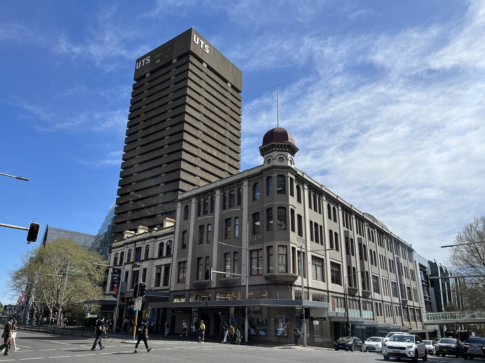

*The UTS campus was starting to become familiar. The huge tower and old buildings make quite a backdrop for another attempt at university life.*
{: .media-caption }

I've met some amazing people at university so far. Most of them are in the queer space. Scratch that, they are all in the queer space. These are young adults who are going through a lot but for the most part seem to be excelling at what they do. I envy that. There was a time when I was like that.

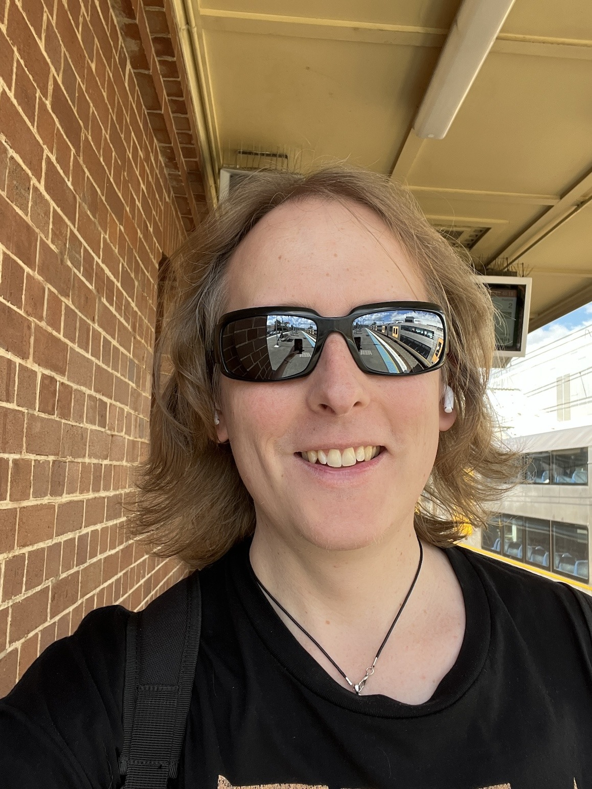

*Another selfie for the transition photo collection, this time on the station platform. At least travelling around was giving me plenty of opportunities to practise smiling at a camera.*
{: .media-caption }

My current medications, pregabalin and clonazepam, have been amazingly helpful on the social side of things. I have dealt with more people on a consistent basis than I have in the last 20 years of working in semi-retail. Worth noting that I've had to up the selfies so I can keep a track of changes under estrogen.

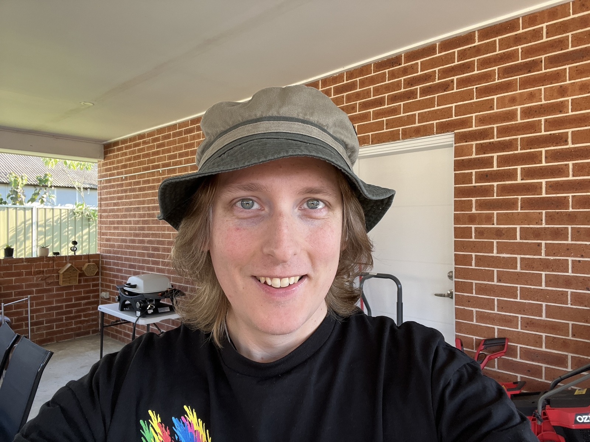

*A second selfie, this time with the hat on and considerably less wind. I was making an effort to keep a visual record of all these changes.*
{: .media-caption }

But there's always a catch, isn't there? There's this damn trade off between sociability and being able to think, but it's even worse because if I am in a social situation I can't think anyway. My brain just does a whole bunch of other things instead of the work at hand.

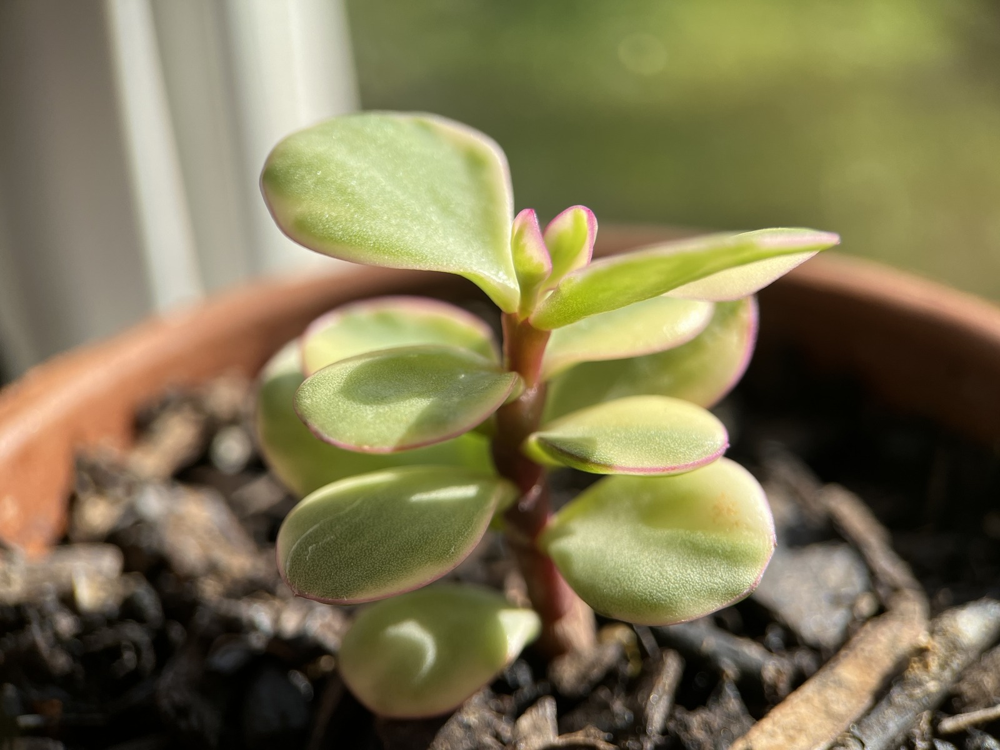

*The little succulent was growing nicely. Plants seem to have a far easier time keeping themselves organised than I do!*
{: .media-caption }

So pregabalin and/or clonazepam were helping enormously with the social side, even though I hadn't got the doses ideal yet. I'd been thinking of clonazepam as the short-term problem and pregabalin as something I could keep taking with no issue. Unfortunately, both can cause dependence and mess with memory and concentration. Pregabalin withdrawal can happen after short- or long-term use too, so changing things needed my prescriber's help. So what do I do? The way I see it there are four options.

1. Should I reduce the levels of pregabalin and cease clonazepam? This would likely result in me reverting and just abandoning study.
2. Should I carry on at full force and hope for the best even though my brain looks like Morgan's scrambled eggs? (Visualise the most heat denatured protein you have ever witnessed).
3. Should I perhaps drop the loading down to 0.25 full time, at the very least to maintain access to the queer collective - which I am finding amazingly beneficial to be a part of.
4. Or... drop all courses. Reapply for UTS after I get all my other stuff in order.

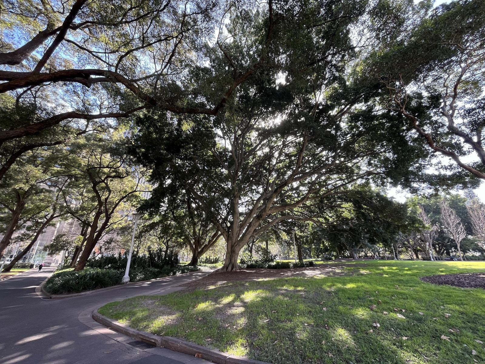

*A patch of green and some enormous trees near university. It's nice to have somewhere to escape the noise and crowds for a bit.*
{: .media-caption }

The good thing this round is that my Jobseeker Payment from the Australian Government (Centrelink) no longer relies on 0.75 units of full-time study. With that untethered I have some more flexibility.

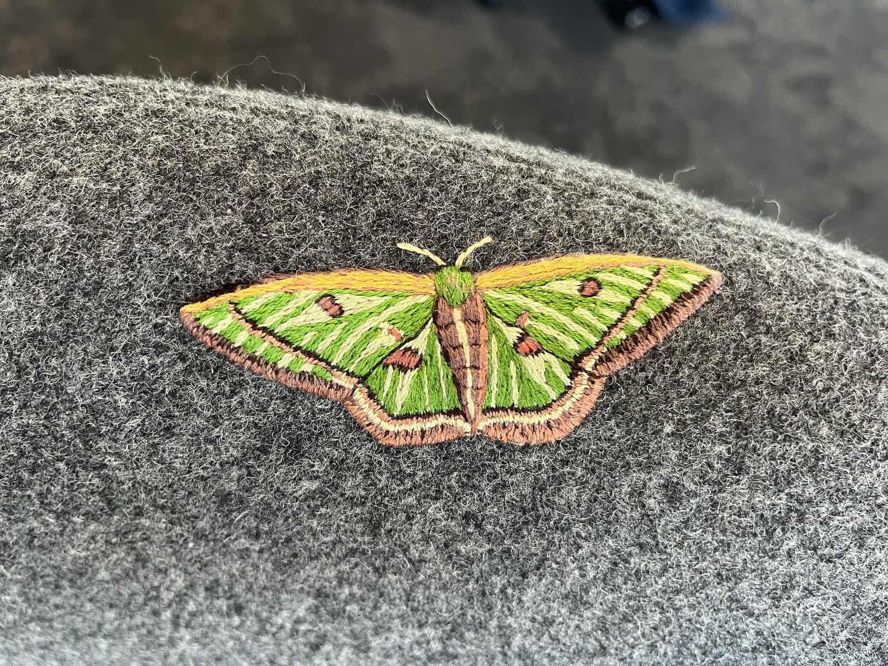

*A rather spectacular little moth patch. All the delightful green detail, and not a single actual moth required!*
{: .media-caption }

The only reason I can get these thoughts onto paper is because my thinking feels clearest before the morning dose. A few hours after it, I often feel more cognitively scrambled. Whatever the levels are doing, this trade-off is becoming hard to ignore.

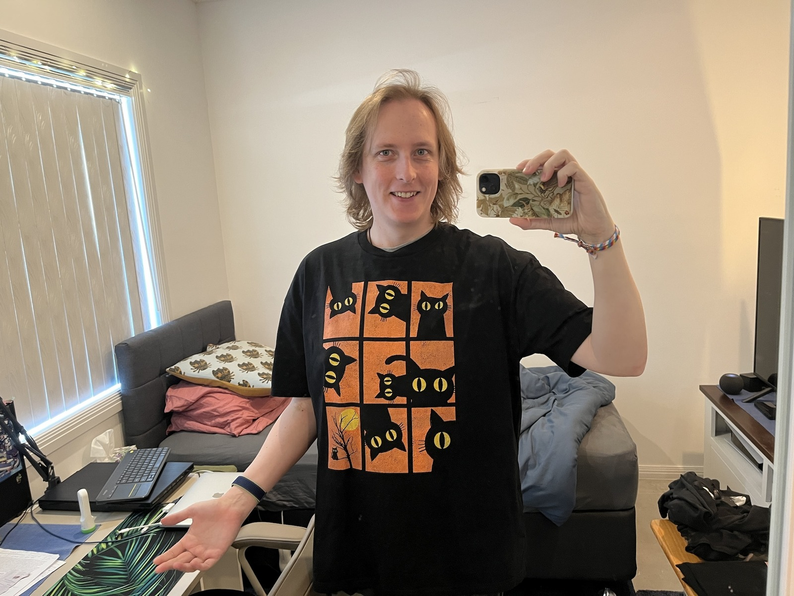

*Another one for the transition photo collection, this time wearing the cat shirt. I think the cats approve, even if they do look a little suspicious.*
{: .media-caption }

And then the question has to be asked do I even want to do my course? Should I go for a more generalised science like I wanted to some 20 years ago. I loved biomedical research right up until they started trying to shove careers down my throat and threatened my future work with needing to be competitive with grants to guarantee another year of work.

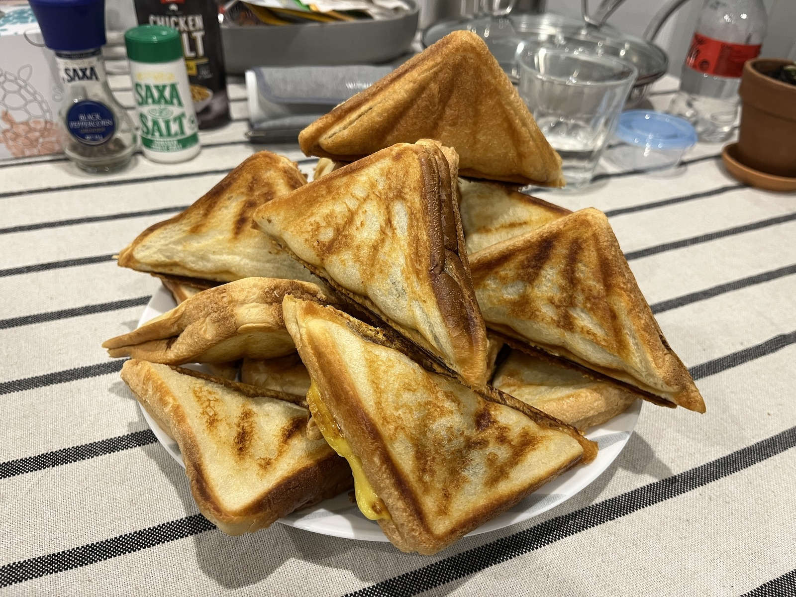

*Yep, the mountain of toasties makes another appearance. Apparently a perfectly reasonable amount of food to photograph twice!*
{: .media-caption }

That's just not me. I really think I need to fight the government a little bit harder on the Disability Support Pension. While being a JobSeeker with the Disability Employment Service is amazing... DSP would give me more flexibility to do what I want.

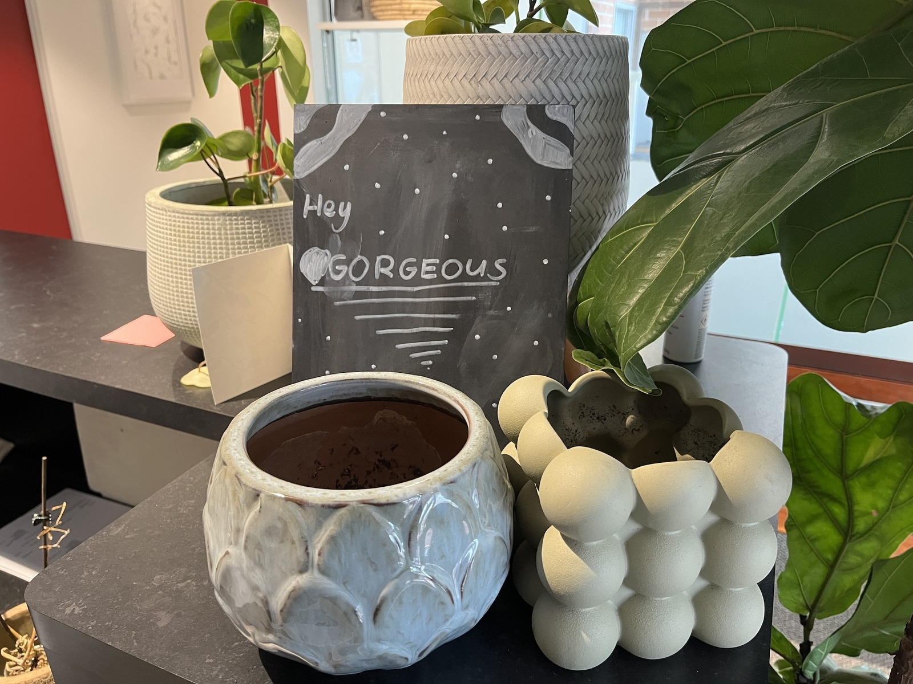

*A rather lovely 'Hey Gorgeous' sign nestled among the houseplants. That was a little boost I was happy to take!*
{: .media-caption }

After all, what is the point of living if you can't do what you want to do? I never asked to be here and I'm happy to leave. But the government refuses to give me a way out. This is not peak humanity so I can only do the best I can. For now that seems to be dropping a bunch of subjects, keeping one and focusing on getting the DSP.

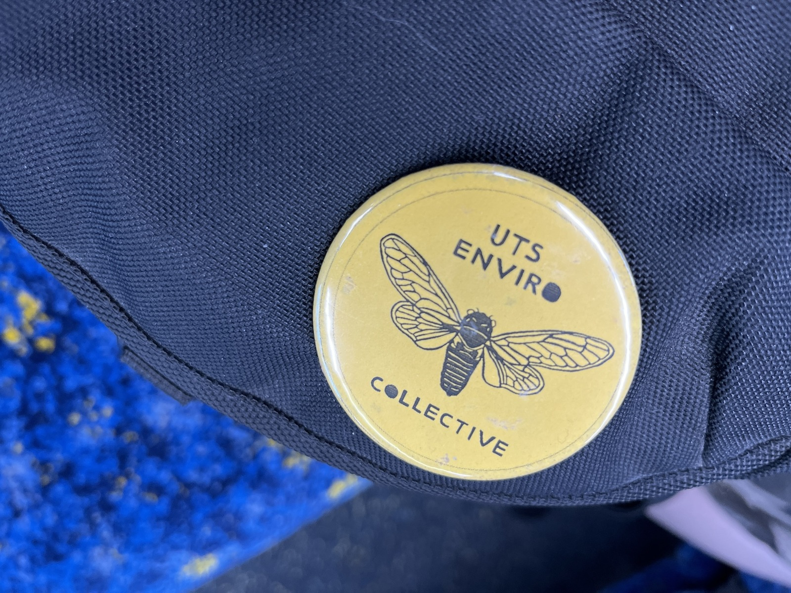

*A UTS Enviro Collective cicada badge. Well, you know I'm not going to walk past a cicada-themed badge without getting excited!*
{: .media-caption }

My next psychiatrist appointment should have a breakthrough or two with specialised therapy, but more on that in a later post. I just hope it works because I need to deal with this childhood trauma (read: sexual assault of a minor). It's been hanging over my head for the past 30 years and it nearly drove me to kill myself. Sunnier days ahead perhaps.

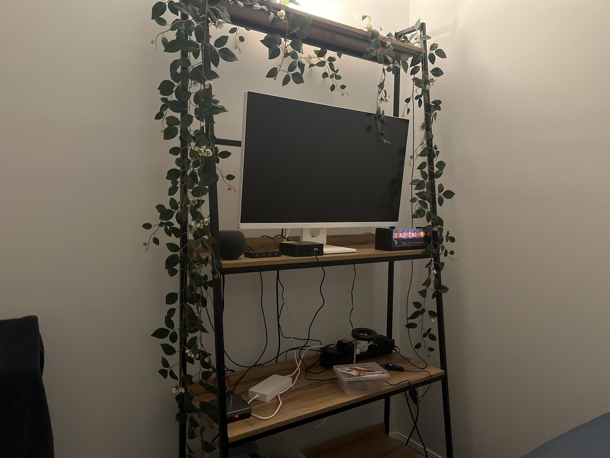

*The downsized study television and its very leafy new home. At least the entertainment setup was taking up less space now!*
{: .media-caption }

In other news, I've downsized my study TV (and sold my PlayStation 5 to fund it), the wasp comb nest I've been watching has **three** overwintered native wasps, and I've started to stress eat. That, alongside pregabalin and everything else changing at once, has coincided with roughly a 5% weight increase.

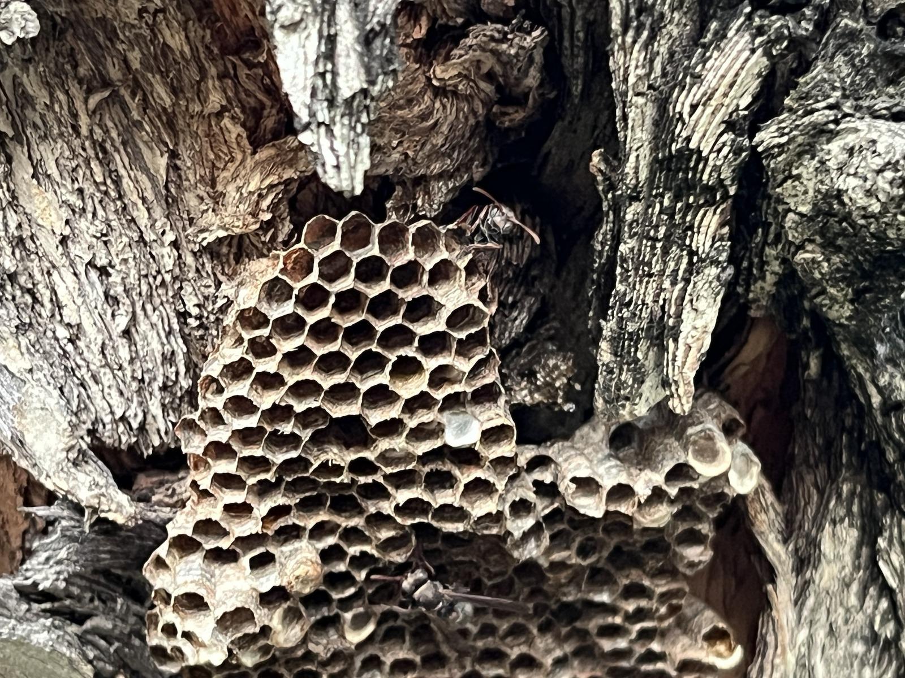

*The paper-wasp nest I'd been watching all winter. It's rather impressive how much structure those little insects build into a hollow in the tree.*
{: .media-caption }

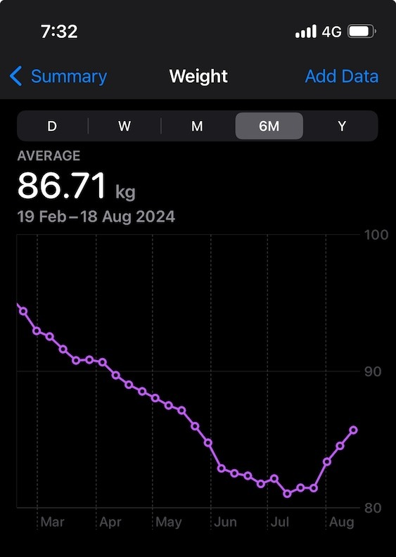

*The weight chart had turned upward again by August. Between stress, the treatment changes, and the snacks, I certainly had a few things going on!*
{: .media-caption }

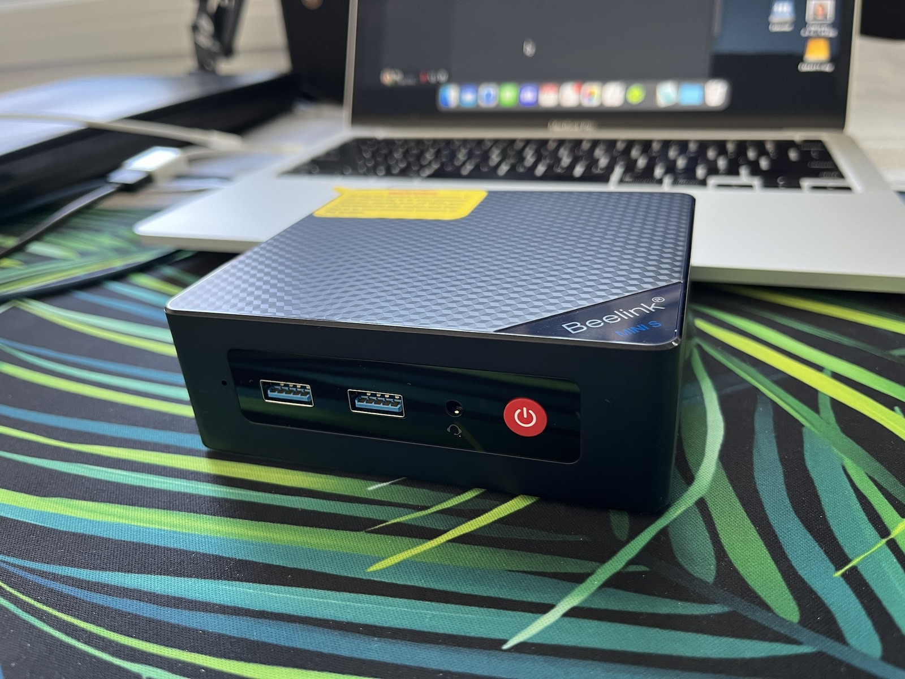

*The little Beelink NUC, ready for its Ubuntu adventures. I'm quite enjoying the idea of relying on Apple a little less for everything.*
{: .media-caption }

I'm also trying to detangle some of my life from the Apple ecosystem (I'm looking at you Siri) with a Beelink NUC running Ubuntu - so far so good.

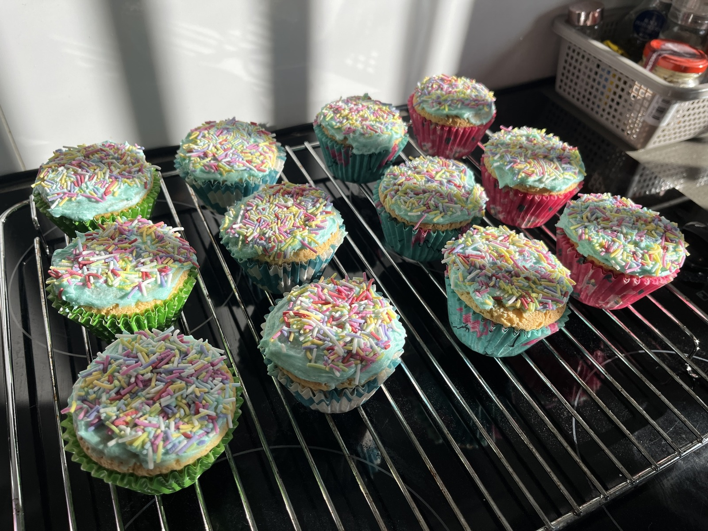

*More cupcakes, now with enough sprinkles to make a serious mess of the kitchen. Worth it, obviously!*
{: .media-caption }

We held a successful BBQ party with an appearance from SuperNick (Nick), I was very glad he could make it. Sadly Lilly had a viral infection but that's OK!

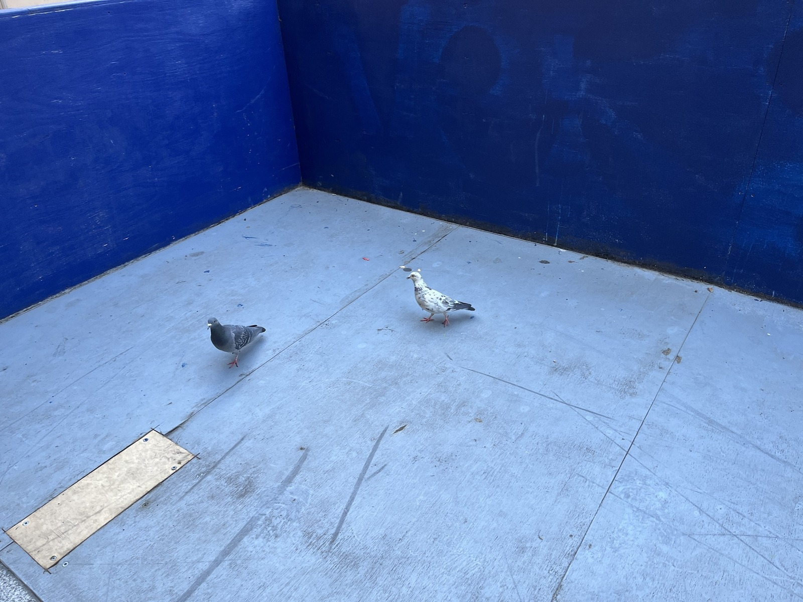

*Two pigeons hanging out in a very blue corner. They certainly weren't letting the university semester ruin their day.*
{: .media-caption }

[Jon](https://damntechnology.blogspot.com/) made it as a regular which was great too!

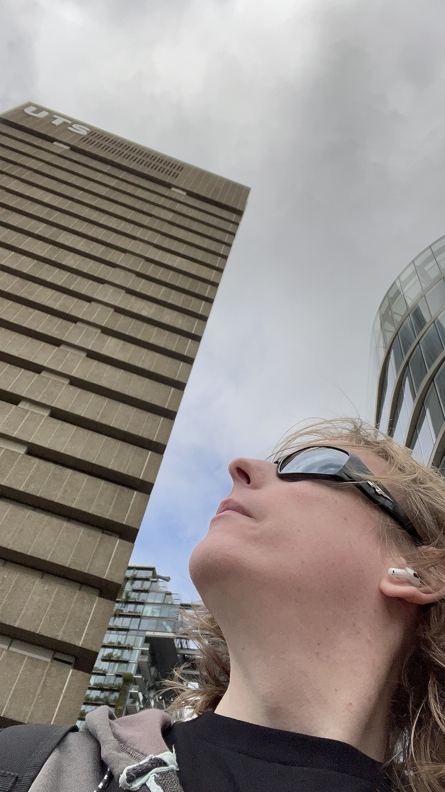

*Looking up at the UTS tower again. There was still a lot to figure out, but at least I was making my way through the semester.*
{: .media-caption }

I guess I technically started UTS for the spring period and am still finding bees on the path out front of a (cold) morning. Spring will be here soon and I can't wait. Hope for the best, plan for the worst. Too bad my planning is out the window thanks to pregabalin. Oh well, what's a girl to do! 🤷‍♀️

### Sources

- [TGA - Pregabalin and gabapentin safety alert](https://www.tga.gov.au/safety/safety-monitoring-and-information/safety-alerts/pregabalin-and-gabapentin)
- [Australian Commission on Safety and Quality in Health Care: Rivotril Consumer Medicine Information](https://www.safetyandquality.gov.au/medicine-finder/rivotril)

### Related Posts

- [Third Time's a Charm; University Begins... Again](/third-times-a-charm-university-begins-again/)
- [Thirty Days Has September](/thirty-days-has-september/)
