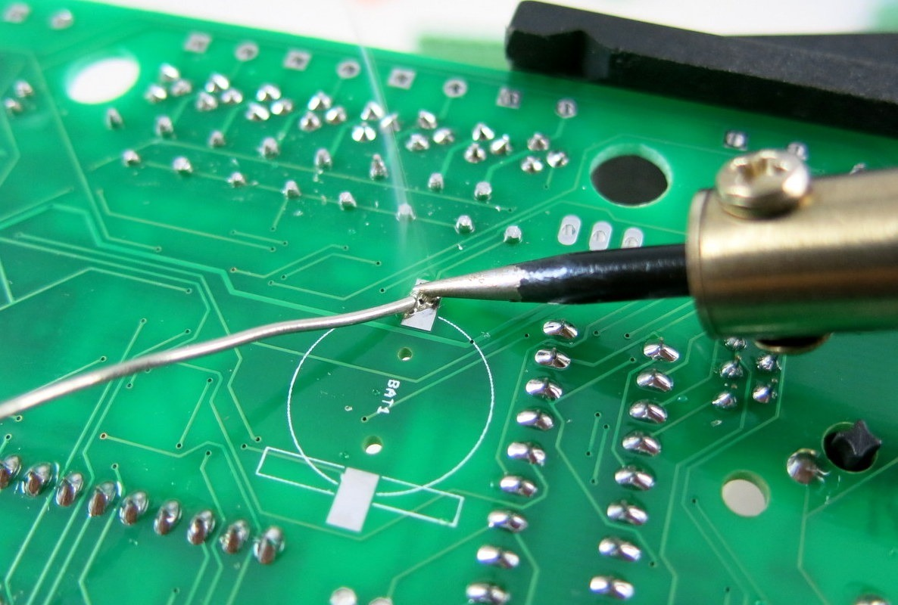
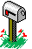

## The About Page

<figure class="about-running-cat">
  
</figure>

Ahhh yes, the About page. A staple of every gloriously overengineered homepage. I've been putting things on the internet since the 1990s, and apparently I still haven't learned when to stop. McRetro.net is part hardware workshop, part internet scrapbook and part evidence of my inability to leave old computers alone.

Click a section below to explore the wreckage!

🛠️ About Nix McRetro

{: width="600" }

*An artefact from a timeline that never existed.*
{: .media-caption }

Hello! I'm Nix, a transgender woman with a lifelong fascination for old computers, video games, and the stranger corners of the internet. Sega hardware has always been a particular weakness of mine, and I've spent far too much time taking things apart to see if I can make them work again. Sometimes I even succeed!

Away from the electronics, I love animals and wildlife, especially birds, cicadas, lizards, and all the little creatures most people walk straight past. I'm also a part-time [vegan](https://en.wikipedia.org/wiki/Veganism) and a full-time junk food enthusiast. :)

I've usually got more ideas than spare time, and there's always something else waiting to be tinkered with. I still believe in quality over quantity of life, even if the number of projects I've taken on might suggest otherwise!

🌐 My Internet History

*"Zap it here"*
{: .media-caption }

After a decade or so of moving homepages, I've decided this is where my internet home will be. I've had an online presence in one form or another since the mid-1990s. Born in the 80s and living for the 90s!

And what a time they were! Chatting on Mirabilis ICQ (Uh-oh!), blasting MP3s at 128 kbps in Winamp 2.x, playing Mega Drive games through Genecyst and KGen, and using GetRight to resume downloads when my mum picked up the telephone.

There was WS_FTP LE for uploading websites, Sausage Software's HotDog Professional for creating them, and far too many hours spent trying to make everything work. Wonderful stuff!

### The Homepages That Came Before

**[Sonic the Hedgehog Homepage](/homepages/sonic/)**  
August 1994 to June 1997

One of my earliest websites, dedicated to Sonic and friends. Some of its history survives through file timestamps, FTP logs and the Wayback Machine.

- 6 October 1996, approximately 11:51 am: `cap.jpg`, `caps.jpg`, `knuc.jpg`, `robutt.jpg` and `sal.jpg`.
- 27 October 1996, approximately 2:30 pm: `slogo.gif`, `slogo.jpg`, `srun.gif`, `swalk.gif`, `trun.gif`, `twalk.gif` and `siern.gif`.
- The Wayback Machine shows these images on 10 June 1997.
- The surviving `ws_ftp.log` records dates from `94.08.03 16:51` through `95.10.28 14:23`, but does not list the later Sonic logo and animation files.

**[Space / Planets Webpage](/homepages/space/)**  
November 1996 to June 1997

A little homepage about the planets. File timestamps from 9 November 1996, around 8:15 pm, include `mercury.gif`, `venus.gif`, `earth1.gif`, `mars.gif`, `jupiter.gif`, `saturn1.gif`, `uranus.gif`, `neptune.gif`, `pluto.gif` and `orbiter.gif`.

The Wayback Machine also shows these images on 10 June 1997.

**Emulation Realm 124**  
February to April 1999

Referenced by the parent website that housed it. Unfortunately, no images survive. It lives on in memory!

**The Glitch 9/9/99**  
Mid to late 1999

Another website known from surviving references on its parent site. No images survive from this one either.

**[RetroJunkie.net](https://web.archive.org/web/20120605011555/http://retrojunkie.net/)**  
February 2012 to December 2014

RetroJunkie.net hosted an array of information. Well, mainly YouTube videos! Much of that material eventually made its way into McRetro.net.

**[McRetro.net](/)**  
July 2015 to the present incarnation

The place you're visiting right now. We've got a blog, historical videos, repairs, projects and a collection of other things I probably should have thrown away years ago.

📬 Make Contact

{: width="37" height="56"}

Got a question, spotted something I've managed to get wrong, or have a story to share? Feel free to get in touch! I'm particularly interested in hearing from people who remember the same obscure bits of computing history, or might know something about the old hardware and websites I've been documenting.

You can find me on [Bluesky](https://bsky.app/profile/nixmcretro.bsky.social) or [Tumblr](https://tumblr.com/nixmcretro). Both are considerably easier than tracking down my old ICQ number, although I do miss that little "Uh-oh!" sound! :)

{: width="107" height="35"}

