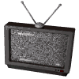

## Channels

<figure class="channels-tv-art">
  
</figure>

What started as a YouTube channel about retro computers back in 2012 somehow grew into videos about gaming, wildlife, parrots, and whatever else caught my attention. There was never really a grand plan. I just liked filming things!

These channels have become something of a video scrapbook, complete with questionable camera work, plenty of rambling, and the occasional useful bit of footage. I'm gradually bringing the old videos and their stories together here on McRetro.net. Have a look around! :)

🎸 Nix McRetro

This is where I tinker with old computers and whatever other retro hardware finds its way onto the workbench. Repairs, experiments, the occasional success, and a fair few things that don't go quite to plan. Time and money have always been a bit tight, so I work with what I've got, talk far too much, and rarely edit any of it out!

In 2026, I also started bringing videos from former channels, including Fish Tank World and Channel Chirp, into the mix.

YouTube Channel: [@NixMcRetro](https://www.youtube.com/@NixMcRetro) 
Homepage: [https://mcretro.net](https://mcretro.net)

👾 McRetro Gaming

McRetro Gaming started in June 2014, giving me somewhere to share all the games I was playing. From the trusty PlayStation 4 to retro gaming through the MiSTer FPGA, there's a bit of everything here.

No grand plan or strict schedule. I just play whatever catches my interest, sometimes badly, and see where things go! :)

YouTube Channel: [@McRetroGaming](https://www.youtube.com/@McRetroGaming) 
Homepage: [https://mcretro.net](https://mcretro.net)

🪲 Super Nature World

Super Nature World came along in 2022, because apparently I couldn't even go outside without finding something to film. Cicadas, lizards, little bugs, big bugs, and whatever other strange creatures happen to cross my path.

Who knows what you'll discover when you stop and look around? It's mostly nature, superfied!

YouTube Channel: [@SuperNatureWorld](https://www.youtube.com/@SuperNatureWorld) 
Homepage: [https://mcretro.net](https://mcretro.net)

🦜 Channel Chirp

Channel Chirp began just a couple of weeks after Pudge and Tillie came home. Along with Chip, they were three of the cheekiest green-cheeked conures you could ever meet. Plenty of noise, plenty of mischief, and never a dull moment!

They've all since left the nest, but their stories live on here. I'm gradually re-releasing their original videos on my Nix McRetro YouTube channel, while preserving their adventures in the McRetro Nest.

YouTube Playlist: [Channel Chirp](https://www.youtube.com/playlist?list=PLJAZP-TLMPj50jY6ytY53J3bQkgPIbeYP) 
Homepage: [https://mcretro.net/chirp/](/chirp/)

