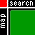


<section class="chirp-search-page" aria-labelledby="chirp-search-heading">
  <header class="chirp-search-heading">
    
    

      <h1 id="chirp-search-heading">Find-a-Squawk</h1>
      
Search released Channel Chirp adventures only.

    

  </header>
  

    <label class="visually-hidden" for="nest-search-input">Search the flock</label>
    

      ⌕
      <input id="nest-search-input" name="q" type="search" autocomplete="off" placeholder="Search the flock...">
      <button id="nest-search-clear" class="chirp-search-clear" type="button" hidden>Clear</button>
    

  

  
{{ chirp_posts.size }} adventures

  

    
    <article class="chirp-search-result" data-nest-post>
      <h2 class="chirp-search-result-title"><a href="{{ post.url | relative_url }}" data-nest-highlight>{{ post.title | escape }}</a></h2>
      
{{ post.share_description | default: post.excerpt | strip_html | normalize_whitespace | truncate: 220 | escape }}

      

        <time datetime="{{ post.date | date_to_xmlschema }}">
          {% assign d = post.date | date: '%-d' | plus: 0 %}
          
            
            
            
            
          
          {{ d }}{{ ordinal }} {{ post.date | date: '%B %Y' }}
        </time>
      

    </article>
    
  

  <button type="button" class="chirp-search-more" id="nest-search-more" hidden>Show more results</button>
  
No chirps matched that search. Try a different word!

</section>

