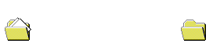

## Goodies

<figure class="goodies-floppy-art">
  

    
  

  <figcaption class="media-caption"><em>Don't copy that floppy!</em></figcaption>
</figure>

Welcome to the Goodies page! This is where I keep all sorts of bits and pieces that don't quite fit anywhere else. There's a mix of old favourites, restored pages and experiments I've tinkered with over the years.

✅ Ready to Visit

**🎹 [BleepGarden Music Maker 2000](/homepages/op-1/)** 
A browser-based music maker originally created for SuperNick. Make some noise with synthesizers, keyboards, rhythms and songs. Bleep, bloop, bleep!

**☎️ [Dial-Up Networking](/homepages/modem/)** 
Hear the old-school modem connection, then dial into either a randomly selected McRetro article or one of the restored historical homepages.

**🗄️ [File Server](https://files.mcretro.net/index.html)** 
A home for all sorts of historical computer files. I'll get it working soon, promise!

**🌐 [GeoCities Rebuild Project](/homepages/geocities/)** 
The story of my GeoCities archive rebuild, with original artwork, dial-up adventures, links to the worklogs, and a gateway to my private local archive.

**🐐 [GOATPAD 1337](/homepages/goatpad/)** 
A 64-pad browser soundboard and sequencer from 2024, with drums, effects, bass, GOAT SOUL, and melodies. A strange little musical time capsule!

**🎵 [Lunchbeat](/homepages/lunchbeat/)** 
An original 1-bit groovebox running in your web browser, with an electronics project behind it. Sometimes the simplest sounds are the most entertaining!

**📸 [Photo Gallery](https://photos.mcretro.net/index.html)** 
A deep dive into thousands of photos of retro computers, game consoles, modems, accessories, projects, and the occasional bit of nature. Browse the folders, search for obscure gadgets, and zoom in on all the tiny details. It turns out I photographed a lot of stuff!

**🎳 [The Cyber Lanes](/homepages/bowling/)** 
An old-school bowling league homepage with scores, averages and a leaderboard. Check out those lanes!

**🎮 [VRAMpage MD](/homepages/vrampage-md/)** 
Bend the bits of a Sega Mega Drive right in your browser! Load your own game ROM, experiment with video memory, work RAM and sound, and see how wonderfully strange things can get.

🗃️ Restored Historical Homepages

The original HTML and artwork from these restored sites have made it back onto McRetro.net. No modern makeover here; these are the old-style pages as they were, with just the paths fixed where necessary.

**🐟 [Fish Tank World](/homepages/fishtankworld/)** 
The original aquarium homepage, with fish biographies, tank readings, animated artwork, and a restored [photo gallery](/homepages/fishtankworld/gallery/). Splash!

**🐍 [Frank the Snake](/homepages/frank/)** 
Frank's own homepage, snake facts and an original [photo gallery](/homepages/frank/gallery.html). A big snake with a big heart!

**🐶 [Pepper the Dog Blog](/homepages/pepper/)** 
Hello, I am Pepper the Dog! The original sausage dog homepage, complete with photographs, adventures and entries dating from 2016 to 2018. Woof!

**🦔 [Sonic the Hedgehog Homepage](/homepages/sonic/)** 
One of my earliest websites, dedicated to the Sonic the Hedgehog Saturday morning cartoon. Character biographies, original images, MIDI files and even a downloadable theme song. The guestbook link is a historical placeholder, and modern browsers may block automatic music playback.

**🪐 [Space / Planets Webpage](/homepages/space/)** 
Travel back to 1996 with a page full of planets, animated graphics and some wonderfully brief astronomical descriptions.

**🌳 [Super Nature World](/homepages/nature/)** 
An old-fashioned nature homepage featuring a frog, a lizard and a few original placeholder pictures. Apparently not a place for fish or birds!

🔗 Cool Links

Below are some of the coolest links I've amassed over the years. Who knows, there might be something of use for you here!

**[ASSEMblergames.com](https://web.archive.org/web/20180202174959/https://assemblergames.com/)** 
Great place to learn about rare hardware, help others and get help with repairs.

**[Sega World Sydney](https://web.archive.org/web/20110721034955/http://gaming.chronomagister.com/fanums/sws/archived/segaworld/index.html)** 
Get Out of the House! A look back at what Sega World Sydney was all about before their demise.

**[Segata Sanshiro Music Video](https://web.archive.org/web/20180202174959/https://www.youtube.com/watch?v=hhZWB_KfBLs)** 
Chuck Norris doesn't stand a chance.

**[Ship to Shore Theme Music](https://www.youtube.com/watch?v=q6tZpuQPfko)** 
Don't even ask about this one, very catchy tune though...

**[The Cover Project](https://www.thecoverproject.net/)** 
Lots of covers for most consoles for DVD shaped cases.

**[XBOX Archive](https://web.archive.org/web/20160219035811/http://xboxarchive.co.uk/)** 
A wiki for true XBOX enthusiasts who wish to collect valuable information about the XBOX system from Microsoft.

**[Macintosh Garden](https://macintoshgarden.org/)** 
Great software archive for the classic Macs of all ages.

**[Pippi Longstocking Theme Song](https://www.youtube.com/watch?v=8ulG3-QJeAA)** 
A relic of a song I once heard while playing on a Commodore 64. Relevant right?

**[The Vintage Computing Files Archive](https://web.archive.org/web/20160219035811/http://themacarchive.net/)** 
The VCFA's mission was to ensure that hard-to-find files remained easy to find and accessible to everyone. (Archived copy.)

**[VOGONS Vintage Driver Library](https://www.vogonsdrivers.com/)** 
Drivers for old computer hardware.

**[Peter H. S. Madsen's Animated GIF Archive](https://web.archive.org/web/20180202174959/http://madsenworld.dk/anigif/frameset.htm)** 
What can I say, animated GIFs make me weak at the knees.

